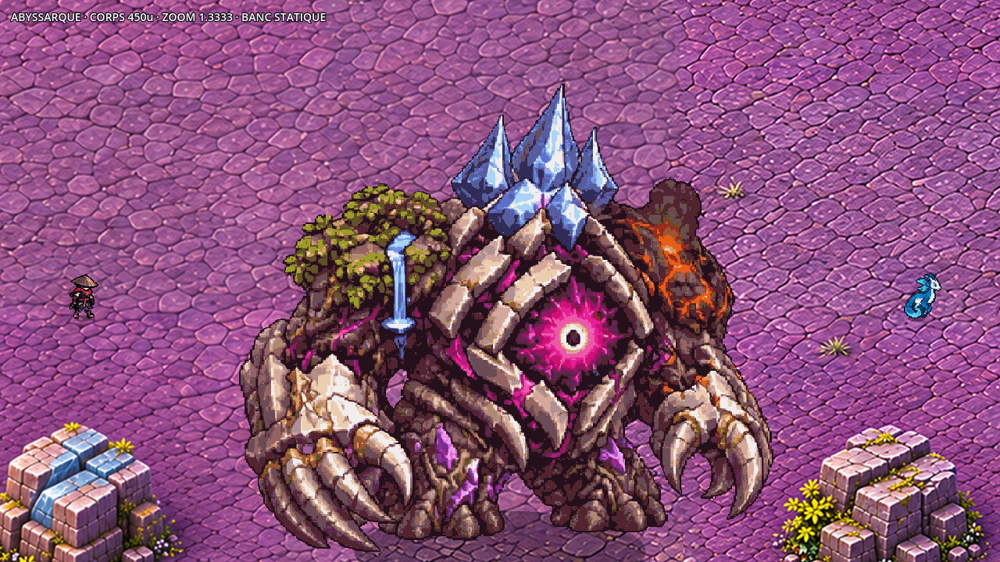
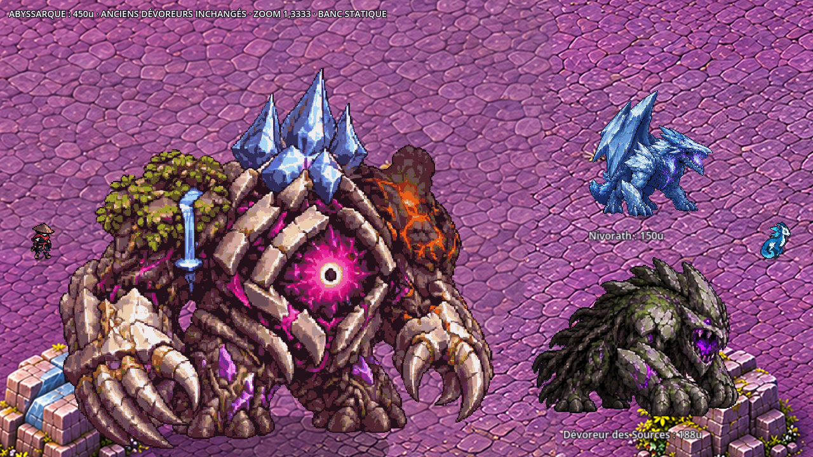
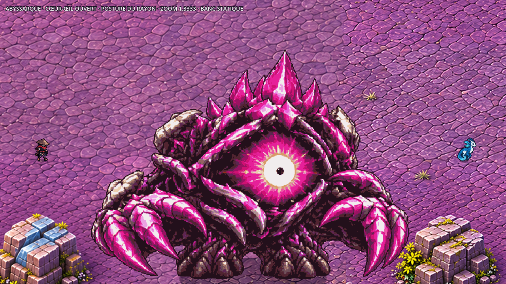
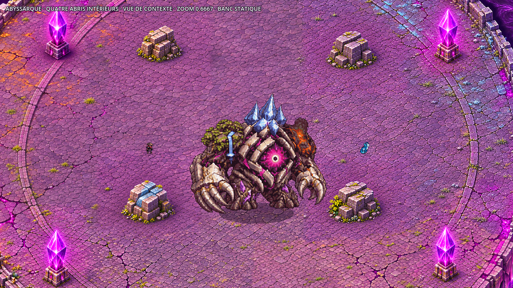

# Abyssarque — Dévoreur final de l’Œil de la Faille

Sept planches sources **A–G, six colonnes, 120 poses d’animation** : A–F en 6×3, G en 6×2.
Un colosse de Faille assemble les cinq mondes autour d’un cœur-œil magenta : pierre moussue et eau,
basalte et magma, racines et cristal, glace, calcaire pâle et dorures ternies de la Cité.
Deux bras à griffes, quatre appuis, trois pointes de couronne ; aucune tête humaine séparée.
La dernière forme expose le vide violet et le cristal magenta, avec quelques fragments pâles sur les arêtes.



## Taille et origine

**450 unités de haut** dans la première pose de référence, à `scale=0.5` ; aucune multiplication de rang
dans le banc. Les Dévoreurs existants mesurent, première pose `idle` et paramètres de données compris :

| Dévoreur | Hauteur visible | Rapport Abyssarque / référence |
| --- | ---: | ---: |
| Dévoreur des Sources | 188u | 2,39× |
| Pyrevorn | 148u | 3,04× |
| Glauquemire | 75,5u | 5,96× |
| Nivorath | 150u | 3× |
| Médiane des quatre | 149u | 3,02× |

Les quatre fiches utilisent `BossData.visual_scale` à sa valeur par défaut **1,0**.
Pour l’Abyssarque, Claude conservera également **`visual_scale=1.0`** : le gabarit est déjà dans les pixels.
Les poses qui fléchissent sont plus basses ; les couronnes et gestes de transformation varient naturellement.
Le Chasseur et Glimmerwing gardent leurs feuilles et échelles existantes ; repère de la bible, Chasseur environ 52u.



L’origine publiée au manifeste est le **centre du corps**. L’ancre de rangement des pieds est distincte,
pour que l’effondrement descende vers le bas sans recentrer ni regonfler chaque reste.
Les valeurs exactes de cellule et des deux ancres sont dans les jobs et le reçu de livraison.
Le cœur-œil est le repère du point faible ; ses mouvements de visée sont dessinés dans F.
Les coordonnées de ciblage, le rayon de collision, les télégraphes et les fenêtres de faiblesse restent à Claude.

## Planches et identifiants de phase

Le [job canonique](../../assets/concepts/incoming/boss.abyssarch/job.json) importe A et référence
les six recettes de phase dans `phase_jobs`. Il s’agit d’**un seul boss**, avec sept identifiants visuels :

| Source | Identifiant visuel | Rangées, haut → bas |
| --- | --- | --- |
| A, 6×3 | `boss.abyssarch` | `idle`, `move`, `attack` (griffes) |
| B, 6×3 | `boss.abyssarch.roots` | `roots_entry`, `roots_idle`, `roots_attack` |
| C, 6×3 | `boss.abyssarch.magma` | `magma_entry`, `magma_idle`, `magma_attack` |
| D, 6×3 | `boss.abyssarch.crystal` | `crystal_entry`, `crystal_idle`, `crystal_attack` |
| E, 6×3 | `boss.abyssarch.ice` | `ice_entry`, `ice_idle`, `ice_attack` |
| F, 6×3 | `boss.abyssarch.rift` | `final_entry`, `ray_sweep`, `summon` |
| G, 6×2 | `boss.abyssarch.death` | `collapse`, `eye_close` |

Les entrées B–F commencent par la pose A réutilisée au même gabarit monde ; G commence par la forme finale F.
Le reste des rangées garde les transformations, anticipations, frappes, visées et retours dessinés.
La première pose commune aide au raccord ; Claude pourra fondre les changements de visuel lors des phases.
Les six poses de G s’effondrent, puis les six suivantes contractent l’œil jusqu’à une couture fermée.

Pour l’intégration : changer le `visual_id`, jouer l’entrée une fois, puis le repos et l’attaque de la phase.
B–E ont des alias techniques `idle`/`move` vers leur repos, `attack` vers leur technique.
Seule A contient une marche dessinée ; ces alias ne prétendent pas fournir une marche supplémentaire par matière.
F réutilise la dernière pose de `final_entry` comme repos statique, sans nouvelle pose peinte ;
`move` réutilise ce repos et `attack` la posture de rayon.
**Mort complète : G `collapse` → `eye_close` → `hidden`.** Les poses transparentes de compatibilité A–F
ne remplacent pas G ; elles satisfont le format minimal du manifeste pendant le travail d’intégration.
Les fps proposés sont des valeurs de présentation à synchroniser avec les phases et les télégraphes.



**Le jeu dessine les rayons, projectiles, invocations, cratères, plaques, cercles d’alerte et zones au sol.**
Les planches montrent les gestes et de courts accents attachés au corps. Aucun sol ni ombre n’est peint dans les sprites.
L’animation du tourbillon de l’arène et la fin du jeu restent également à Claude.

## Sources et import

Génération avec l’outil imagegen intégré : composition des poses, puis **42 colonnes réellement redessinées**
pour apporter assez de finesse à cette taille. Les A servent de référence aux autres planches ; F sert aussi à G.
Les colonnes sont recalées sur les hauteurs relatives du guide, puis assemblées en sept sources finales.
Le recalage conserve la réduction des morts ; il ne remonte pas un cadavre à la hauteur d’un vivant.
Le découpage, le rangement, les réductions techniques et l’indexation PNG ne redessinent aucune créature.

Dans `assets/concepts/incoming/boss.abyssarch/` :

- `source/planche_A.png` à `planche_G.png` : sept sources finales assemblées ;
- `source/prompt_*.txt`, `provenance_*.json`, `detail_*.json` : prompts exacts, colonnes, recalages et réutilisations ;
- `source/normalization.json` et `SHA256.json` : paramètres d’import et empreintes ;
- `planche_*.webp`, `final_idle.webp`, `palette.png` : dérivés sans perte nécessaires à l’import ;
- `job.json`, `jobs/B.json` à `jobs/G.json` : recettes du boss et de ses formes.

Les essais et les colonnes intermédiaires restent hors Git ; les sept sources retenues sont dans le dépôt.
La palette comporte **32 couleurs communes A–G**, avec lumière haut-gauche et liseré violet bas-droite.
Alpha binaire et filtrage nearest. Les feuilles PNG indexées conservent exactement les pixels opaques et l’alpha.
Les icônes 64² réduisent le corps entier avec une marge de trois pixels.

Une feuille runtime par phase garde la densité de 0,5 tout en restant sous la limite de texture de 16384 pixels.
Un atlas unique de toutes les rangées serait trop haut. Pour limiter la mémoire, charger les formes selon les phases.
L’outil standard accepte deux options facultatives : `palette_source` et `runtime_anchor`.
Les jobs historiques gardent leur comportement ; la recette complète appelle l’outil standard pour chaque phase.
La reconstruction demande Pillow, NumPy et SciPy ; les contrôles de chargement utilisent Godot 4.3.

```powershell
python tools/art/import_abyssarch.py --preview-dir C:/chemin/hors-depot/apercus
python tools/art/check_abyssarch_sprites.py --out C:/chemin/hors-depot/audit.json
```

## Captures et portée de la vérification

Le [banc de capture](../../tools/art/preview_abyssarch.gd) charge les vraies tuiles finales de la carte 25,
vérifiées contre les fichiers Git de la livraison de l’Œil de la Faille. Position du boss depuis le haut-gauche :
`[2492,2272]`, soit `[-16,-236]` dans le repère monde centré du plan. Aucun abri déplacé.



Les captures au zoom réel utilisent **1280×720 et zoom 1,3333**. Seule la vue de contexte utilise 0,6667,
explicitement indiqué, pour montrer les quatre abris intérieurs. Chasseur et Écho sont placés sur le sol dégagé.
Comparaison avec Nivorath et le Dévoreur des Sources aux paramètres existants, sans agrandissement de présentation.

[Racines](../previews/abyssarque/abyssarch_racines_zoom_jeu.png) ·
[Magma](../previews/abyssarque/abyssarch_magma_zoom_jeu.png) ·
[Cristal](../previews/abyssarque/abyssarch_cristal_zoom_jeu.png) ·
[Glace](../previews/abyssarque/abyssarch_glace_zoom_jeu.png) ·
[Invocation](../previews/abyssarque/abyssarch_invocation_zoom_jeu.png) ·
[Effondrement](../previews/abyssarque/abyssarch_effondrement_zoom_jeu.png) ·
[Œil refermé](../previews/abyssarque/abyssarch_oeil_ferme_zoom_jeu.png) ·
[Mouvement](../previews/abyssarque/mouvement_zoom_jeu.gif).

Le banc accepte `--assets-root=` pour les témoins et `--map-root=` pour le dépôt contenant les tuiles finales
`assets/environments/rift_eye/map*.webp`. Il utilise une région inchangée de ces tuiles pour réduire sa mémoire.
Les captures et contrôles sont des **bancs statiques sans profil ni combat** ; ils ne valident pas encore
la navigation, les rayons contre les abris, les phases jouables ou la fin du jeu.

[Audit des sprites](../previews/abyssarque/audit_sprites.json) ·
[Reçu de livraison](../previews/abyssarque/controle_livraison.json).
Le reçu consigne les validations finales, les dimensions, les gabarits, les captures et les empreintes des tuiles.
Les sept nouvelles entrées préservent toutes les entrées préexistantes du manifeste.
**Aucun fichier de `src/`, `data/`, aucune carte ni collision modifiés.**
