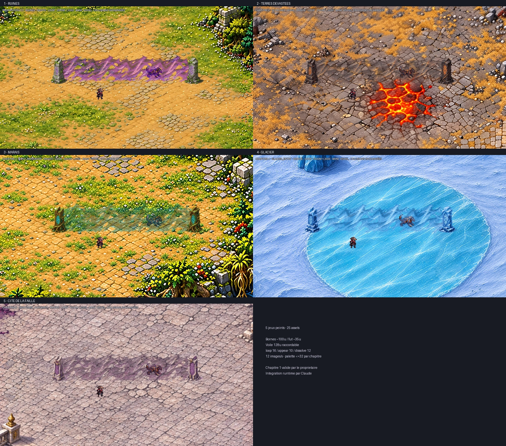
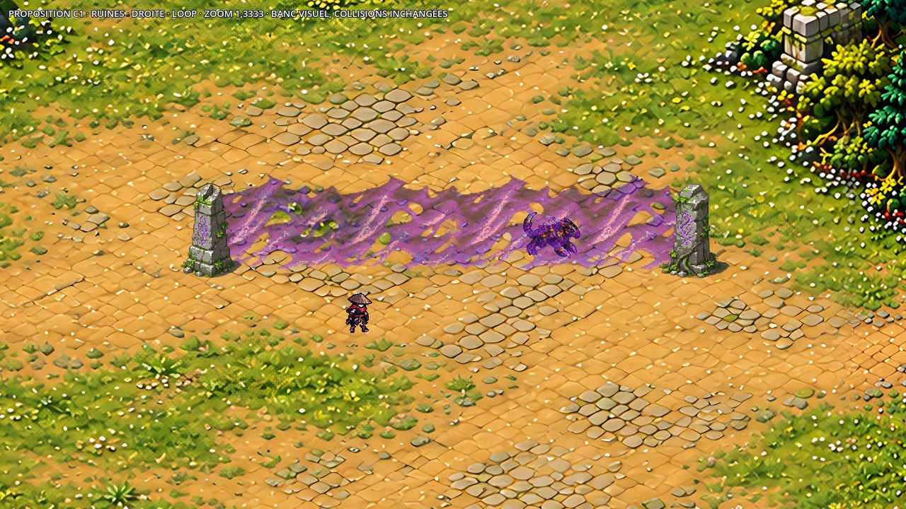

# Barrières peintes — cinq chapitres

**9 novembre 2026 — chapitre 1 validé explicitement par le propriétaire ; déclinaisons 2 à 5 livrées.**
Les cinq jeux contiennent chacun un voile face/biais/angle et deux bornes animées, soit **25 assets final**.
Le dessin validé du chapitre 1 est conservé pixel par pixel. Le shader et les barrières actuelles restent en jeu ;
Claude raccordera les sprites. Aucun changement de `src/`, `data/`, shaders, cartes ou collisions dans ce lot.



## Jeux et captures par chapitre

Chaque lien de capture conserve le zoom **1,3333** et la résolution **1280 × 720**, avec le Chasseur et Cendrelame
à leur échelle actuelle. Les GIF sont des aperçus réduits : apparition, deux boucles, dissolution, 54 poses chacun.

| Chapitre / préfixe du manifeste | Matière / carte témoin | Couleurs RGB communes | Captures et animation |
|---|---|---:|---|
| 1 — `object.barrier_1` | Pierre moussue, runes violettes / Ruines des Cascades | 26 | [Droite](../previews/barrieres-peintes-c1/droite_zoom_jeu.webp), [angle](../previews/barrieres-peintes-c1/angle_zoom_jeu.webp), [verticale](../previews/barrieres-peintes-c1/verticale_zoom_jeu.webp), [GIF](../previews/barrieres-peintes-c1/animation.gif) |
| 2 — `object.barrier_2` | Basalte, cendres et braises / Lisière calcinée | 32 | [Droite](../previews/barrieres-peintes-c2/droite_zoom_jeu.webp), [angle](../previews/barrieres-peintes-c2/angle_zoom_jeu.webp), [verticale](../previews/barrieres-peintes-c2/verticale_zoom_jeu.webp), [GIF](../previews/barrieres-peintes-c2/animation.gif) |
| 3 — `object.barrier_3` | Bois noyé, racines et eau sombre / Mangrove des racines | 31 | [Droite](../previews/barrieres-peintes-c3/droite_zoom_jeu.webp), [angle](../previews/barrieres-peintes-c3/angle_zoom_jeu.webp), [verticale](../previews/barrieres-peintes-c3/verticale_zoom_jeu.webp), [GIF](../previews/barrieres-peintes-c3/animation.gif) |
| 4 — `object.barrier_4` | Glace, givre et pierre gelée / Entrée du Glacier | 32 | [Droite](../previews/barrieres-peintes-c4/droite_zoom_jeu.webp), [angle](../previews/barrieres-peintes-c4/angle_zoom_jeu.webp), [verticale](../previews/barrieres-peintes-c4/verticale_zoom_jeu.webp), [GIF](../previews/barrieres-peintes-c4/animation.gif) |
| 5 — `object.barrier_5` | Acier pâle, ardoise, dorures et magenta / Faubourgs brisés | 32 | [Droite](../previews/barrieres-peintes-c5/droite_zoom_jeu.webp), [angle](../previews/barrieres-peintes-c5/angle_zoom_jeu.webp), [verticale](../previews/barrieres-peintes-c5/verticale_zoom_jeu.webp), [GIF](../previews/barrieres-peintes-c5/animation.gif) |

Les bornes éteintes et toutes les poses sont aussi visibles dans chaque dossier `barrieres-peintes-cN` :
`bornes_ouvertes_zoom_jeu.webp`, `planches_bornes.webp`, `planches_voile.webp`.
Les dix bornes mesurent **99,5 à 100,5 unités de haut**, avec un fût médian de **34,5 à 36,5 unités**.
Les dimensions nominales du voile restent 128 × 100 unités. Le sol demeure visible dans ses transparences.

Le banc respecte le `decor_scale` actuel de l’Entrée du Glacier (**0,9**) pour le décor et les positions ;
les personnages et modules gardent leurs dimensions en unités de jeu. Les autres cartes témoins sont à 1.
Les palettes des chapitres 2 à 5 sont prélevées dans les pixels de leurs cartes : basalte/braises, bois/eau,
ombres/glace et métal/or/corruption. Les accents restent dans leur famille de couleur pendant la quantification,
pour éviter de rabattre un filament de braise ou une veine magenta sur la pierre neutre.

[Audit des 25 assets](../previews/barrieres-peintes/audit.json) ·
[Chargement Godot, 20 captures et 5 GIF](../previews/barrieres-peintes/controle_livraison.json).
Les essais de circulation et de combat restent à faire après raccordement par Claude.

## Référence artistique validée : chapitre 1

Deux bornes de pierre grise moussue, runes violettes gravées, pieds et ombres peints. Le voile est une matière
trouée et translucide, tissée de filaments qui ondulent, se construisent puis se fragmentent.
Les quatre planches initiales ont été dessinées avec **imagegen intégré** ; les prompts exacts sont dans
`assets/concepts/incoming/object.barrier_1/source/PROMPT_*.txt`.

La palette est prélevée sur les pierres, mousses et cristaux de la carte des Ruines des Cascades :
**26 couleurs RGB effectivement utilisées**, sur un budget commun de 32, avec opacité graduée.
Les prélèvements, rectangles en pixels et empreintes sont dans `source/palette.json`.
Le voile garde environ 72 % de transmission moyenne sur sa cellule de référence ; ses trous sont transparents.
Cette moyenne inclut les marges, elle ne décrit pas l’opacité de chaque filament.



[Angle](../previews/barrieres-peintes-c1/angle_zoom_jeu.webp) ·
[Barrière verticale](../previews/barrieres-peintes-c1/verticale_zoom_jeu.webp) ·
[Bornes éteintes](../previews/barrieres-peintes-c1/bornes_ouvertes_zoom_jeu.webp) ·
[Apparition, deux boucles, dissolution](../previews/barrieres-peintes-c1/animation.gif) ·
[Toutes les poses du voile](../previews/barrieres-peintes-c1/planches_voile.webp) ·
[Toutes les poses des bornes](../previews/barrieres-peintes-c1/planches_bornes.webp).

Les captures Godot 1280 × 720 utilisent un **zoom 1,3333**, le véritable sol des Ruines à 2,25 px/unité et les
sprites actuels du Chasseur et de Cendrelame, à leur échelle du manifeste. Ce sont des compositions de validation
dans un banc isolé, sans modification ni simulation des barrières de la partie. Le GIF est réduit pour le dépôt ;
les captures fixes conservent leur résolution native.

## Modules livrés

Toutes les dimensions de cellule et les ancres ci-dessous sont en pixels d’art ; **scale = 0,5**.
Remplacer `barrier_1` par `barrier_N` pour le chapitre voulu : mêmes cellules, ancres et noms d’animation dans les cinq jeux.
L’ancre est le point de départ de la ligne au sol, sauf pour les bornes, centrées sur leur pied.

| Identifiant du manifeste | Cellule | Ancre | Parcours au sol, en unités |
|---|---|---|---|
| `object.barrier_1` | 256 × 256 | (0,224) | (0,0) → (128,0), face |
| `object.barrier_1.bias` | 112 × 512 | (16,224) | (0,0) → (0,128), biais |
| `object.barrier_1.corner` | 384 × 384 | (16,224) | (0,0) → (64,0) → (64,64), pli est→sud |
| `object.barrier_1.seal_a` | 160 × 256 | (80,232) | pied au centre |
| `object.barrier_1.seal_b` | 160 × 256 | (80,232) | pied au centre |

Les bornes font **100 unités de haut**, avec un fût médian de **34,5 unités de large** ; la végétation, le socle
et l’ombre débordent ce fût. Le voile fait nominalement 100 unités de haut, avec une crête déchirée et quelques
fragments bas. Le biais projette le sommet de 40 unités vers la droite pour qu’un mur vertical à l’écran conserve
une surface visible. Ce déport graphique ne déplace jamais la ligne bloquante.

Les variantes biais et angle sont des projections enregistrées des **mêmes pixels peints**, pas des dessins
indépendants : phase, matière, opacité et état restent identiques. Les bornes conservent un corps de pierre fixe ;
seuls les glyphes et la poussière peinte changent. Aucun nouvel émetteur de particules n’est requis.

## Animations et raccords

| Module | Animation | Poses | Images/s | Boucle |
|---|---|---:|---:|---|
| Face, biais et angle | `loop` | 16 | 12 | oui |
| Face, biais et angle | `appear` | 10 | 12 | non |
| Face, biais et angle | `dissolve` | 12 | 12 | non |
| Borne A et B | `idle` | 6 | 12 | oui |
| Borne A et B | `open` | 6 | 12 | non, conserver la dernière pose |

Les lignes de feuille sont dans cet ordre ; le job décrit leurs indices et longueurs exactes. Toutes les poses
d’une animation sont différentes. La dernière pose `appear` et la première `dissolve` sont exactement la pose
`loop/0` ; la dernière `dissolve` est entièrement transparente. Les bornes restent présentes en `open`.

Les deux bords du voile face sont identiques pixel par pixel, pour chaque pose. Un recadrage retire les traits
de cellules de la source générée ; un raccord local prémultiplié joint leurs matières. Les projections réutilisent
ce raccord. Tous les modules d’une même chaîne doivent partager **la même horloge et le même indice de pose** :
ne pas introduire de déphasage aléatoire entre modules voisins. Utiliser un filtrage `nearest` et des origines
alignées sur la même grille de demi-unité. Ne pas tirer une région d’atlas au-delà de sa cellule.

## Pose par Claude sur les barrières existantes

1. Conserver les rectangles et les groupes existants de `RiftWallVisual`. Construire la ligne de sol depuis leurs
   coordonnées actuelles, sans épaissir les rectangles ni écrire dans `ObstacleField` ou `FlowField`.
2. Pour un rectangle, parcourir les coins dans l’ordre haut-gauche → haut-droite → bas-droite → bas-gauche.
   Dédupliquer les arêtes internes des rectangles connectés et les bornes des coins partagés.
3. Poser les segments horizontaux de gauche à droite avec `object.barrier_1`, tous les 128 unités ; poser les
   verticaux du haut vers le bas avec `.bias`. Le sens du parcours ne nécessite pas de retourner les pixels.
4. Couper le dernier module à sa longueur restante **le long de sa ligne de sol**, sans modifier son échelle ni sa
   hauteur. Pour le biais, recadrer le plan projeté selon son paramètre de longueur, pas par une coupe horizontale
   arbitraire de la cellule. L’ombre et les pieds des bornes restent à la coordonnée exacte du coin.
5. Le module `.corner` couvre les derniers 64 unités horizontaux puis les premiers 64 verticaux d’un tournant
   est→sud : retirer ces deux demi-longueurs des modules voisins, poser une borne sur son pli (64,0).
   Pour les autres coins, joindre les demi-modules face/biais sous leur borne commune. Ne jamais tourner une image
   de 90° ou retourner verticalement une borne : la lumière doit rester en haut à gauche. Ce lot fournit un pli
   est→sud dédié, pas quatre dessins de coins indépendants.
6. Trier les sprites par leur pied : sol et éclairage peint au pied, voile, puis bornes et acteurs suivant leur Y.
   La partie haute du voile biais ne doit pas servir d’origine de tri. Éviter toute seconde ombre automatique sur
   les bornes, puisque leur ombre est déjà peinte. Mélange alpha standard, sans rectangle opaque ni shader d’énergie.
7. Déclencher uniquement les états graphiques depuis les événements existants. Ne pas utiliser la durée du fichier
   pour recalculer une fermeture de zone, une vague ou un délai d’ArenaFinale. Les clips source à 12 images/s durent
   0,833 s (`appear`), 1,333 s (`loop`) et 1 s (`dissolve`). Le contrat A3 cite 0,5 s d’apparition et 1,2 s de
   dissolution : **ces nombres diffèrent des durées des nouveaux clips**. Garder l’horloge de règles existante et
   l’horloge de lecture visuelle séparées ; ne pas étendre une collision pour attendre une animation. Le raccord
   runtime et son comportement aux changements d’état rapides restent à valider par Claude et le propriétaire.

Ne pas appliquer `decor_scale` une seconde fois aux sprites : leurs dimensions sont en unités de jeu, comme
celles du Chasseur. Les positions viennent de la géométrie finale déjà mise à l’échelle par le jeu.

## Sources, import et contrôles

Chaque identifiant possède son `job.json` et sa planche normalisée `poses.webp`, sous le `.gdignore` commun.
Les quatre sources initiales et les deux sources de chaque déclinaison (atlas de 38 poses de voile, atlas de 24 poses
de bornes) viennent d’imagegen intégré. Les douze sources retenues, prompts exacts, palettes, repères et empreintes
sont conservés dans `assets/concepts/incoming/object.barrier_N/source/`. Les essais rejetés restent hors Git.

```bash
python3 tools/art/import_painted_barriers.py --assets-root /chemin/jeu --work /tmp/barrieres-c1
python3 tools/art/import_barrier_chapters.py --assets-root /chemin/jeu --work /tmp/barrieres-c2-c5
python3 tools/art/check_painted_barriers.py --out /tmp/barrieres/audit.json
godot --headless --import --path .
```

Les outils font le découpage, retirent le résidu de matte neutre (dont le fond quadrillé pâle de la source du voile
des marais), alignent les cellules, conservent les trous alpha, calibrent les bornes et appliquent les palettes
des décors, puis utilisent `import_sheet.py`. Les **25 entrées sont final**, protégées de la génération procédurale,
sans remplacer `vfx.barrier.energy`. Les anciens assets et toutes les autres entrées restent inchangés.
L’audit contrôle aussi que les images du chapitre 1 correspondent toujours au lot explicitement validé.

[Audit des sprites](../previews/barrieres-peintes-c1/audit.json) : cinq assets, palette commune, dimensions,
poses distinctes, coutures, points de raccord entre états et invariants de portée.
[Contrôle de chargement](../previews/barrieres-peintes-c1/controle_livraison.json) : import Godot et cinq assets
valides, quatre captures natives et 54 poses du GIF. Le banc est `tools/art/preview_painted_barriers.tscn`, avec
`--art-root=… --assets-root=… --out=…`, dans un projet isolé sans autoload ou sauvegarde.

**Validation reçue :** « Valider le chapitre 1 ». Les quatre déclinaisons sont livrées conformément à cette validation.
Le raccordement runtime, l’ordre de profondeur dans les vraies scènes et les changements rapides d’état restent
à vérifier par Claude et le propriétaire. Le banc accepte `--chapter=1|2|3|4|5` en plus des chemins ci-dessus.
