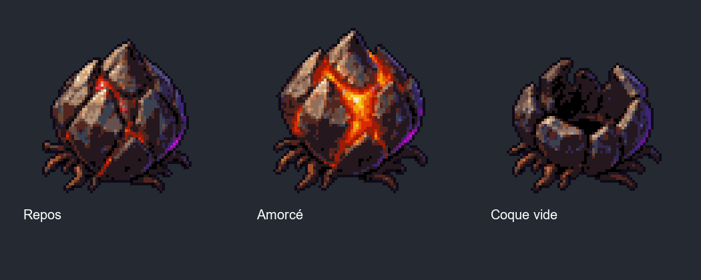

# Bulbe de braise — object.ember_pod

Planche peinte originale remplaçant le visuel provisoire de Claude. Génération intégrée, aucun
contenu tiers ; prompt exact, source et SHA256 dans `assets/concepts/incoming/object.ember_pod/source/`.
Statut `wip` jusqu'à validation de son apparence par le propriétaire. Aucune règle modifiée.

## Import et échelle

Pipeline commun `tools/art/import_sheet.py`, job dans incoming. Atlas 6 colonnes × 3 rangées,
cellules 256 × 256, ancre `[128,238]`, échelle `0.5`, hauteur cible au repos 56 pixels d'art,
soit environ 28 unités. Fond transparent, palette 32 couleurs, contour et racines conservés.
L'espace vide des cellules réserve la place aux gonflements et aux fragments proches du bulbe.

| Animation | Rangée | Poses | Cadence | Boucle |
|---|---|---|---|---|
| idle | 0 | 6 | 6 images/s | oui, 1 s |
| primed | 1 | 6 | 12 images/s | oui, 0,5 s |
| burst | 2 | 6 | 12 images/s | non, 0,5 s |

Repos : cœur rouge sombre ; amorçage : fentes élargies et orange vif ; éclatement : deux poses
compactes puis quatre poses de retombée, les dernières montrant une coque vidée. Pas de cercle,
halo de sol, grande gerbe ou aire de dégâts dessinés dans les images.

## Contrat de raccordement

Les noms `idle`, `primed`, `burst` correspondent au `PodDirector` déjà présent sur main.
L'alerte de 1,5 s et la repousse restent pilotées par le jeu : la boucle primed n'est pas une minuterie.
Les dégâts, télégraphes et gerbes restent dans le code existant, sans changement dans cette PR.

Après `burst`, conserver sa dernière pose, index 5, comme coque vide jusqu'à la repousse ; au retour
au repos, rejouer `idle`. Vérifier lors de l'intégration que la représentation ne retourne pas
automatiquement à idle après l'action : cela rendrait le bulbe rempli pendant son état vide.
Cette livraison ne modifie pas cette logique de représentation.

## Aperçus et contrôle

GIF [repos](../previews/ember-pod/idle.gif), [amorçage](../previews/ember-pod/primed.gif),
[éclatement](../previews/ember-pod/burst.gif), [coque vide](../previews/ember-pod/coque_vide.png).
Le script `tools/art/preview_ember_pod.py` contrôle les 18 poses, la transparence, les marges de cellule
et la taille au repos ; son rapport est dans `docs/previews/ember-pod/controle.json`.
Ces aperçus n'attestent pas l'équilibrage du combat. Les répertoires d'aperçus sont exclus de Godot.

Contrôles réalisés : `test_import.py` réussi ; import et chargement natifs dans Godot 4.3
des deux nouvelles textures dans un projet isolé, 18 poses et trois animations valides, aucune erreur.
Rapport `godot_control.json`. Le dépôt léger ne contient pas toutes les textures du jeu : aucune
validation globale ni partie simulée n’est revendiquée pour ce lot de composition.
