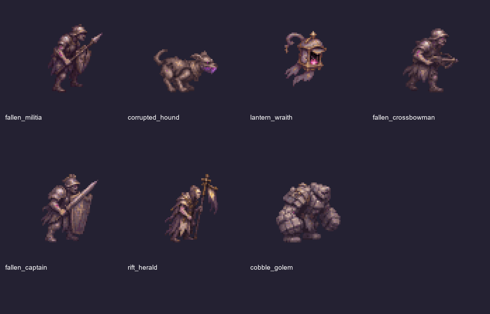
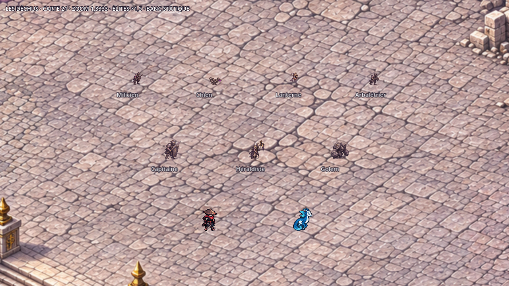

# Chapitre 5 — Les Déchus

Sept monstres de la Cité de la Faille, cartes 21 à 23. **Dix planches retenues, 144 poses peintes**,
sept feuilles de sprites, sept icônes et un `job.json` par monstre. Génération avec l’outil imagegen intégré.
Les images sources et les prompts exacts sont conservés dans le sous-dossier `source/` de chaque monstre.



## Identité et échelle

Gardes et habitants déformés : acier gris pâle, ardoise, dorures ternies, tabards et bannières déchirés.
Les chairs et le métal portent des veines violet sombre, avec des accents magenta concentrés sur les yeux,
la mâchoire de cristal, les charges et les techniques. Lumière haut-gauche, liseré violet bas-droite.
La lanterne est un objet possédé ; le chien reste quadrupède ; le golem est composé de pavés urbains.

Toutes les feuilles de jeu utilisent des **cellules 64 × 64, scale 0,5 et au plus 32 couleurs par monstre**.
La palette est commune aux planches A et B. L’alpha final est binaire ; le filtrage des sprites est nearest.
Les contours sélectifs du dessin sont conservés ; aucun contour noir uniforme n’est ajouté par l’import.

Le Chasseur et Glimmerwing conservent leurs feuilles, ancres et échelles existantes. Le repère de la bible
est un Chasseur d’environ 52 unités. Avec les paramètres demandés, les Déchus normaux sont plus petits :
hauteurs de référence de **16 à 24 unités**. Les élites utilisent le multiplicateur moteur existant **×1,5**.

| Monstre | Rang / sources | Hauteur de référence en pixels d’art | Hauteur monde affichée dans le banc |
| --- | --- | ---: | ---: |
| Milicien déchu | Normal, A 6×2 | 48 | 24u |
| Chien de garde corrompu | Normal, A 6×2 | 32 | 16u |
| Lanterne-spectre | Normal volant, A 6×2 | 40 | 20u |
| Arbalétrier déchu | Normal à technique, A 6×3 | 46 | 23u |
| Capitaine déchu | Élite, A 6×3 et B 6×2 | 48 | 36u |
| Héraldiste de la Faille | Élite, A 6×3 et B 6×2 | 49 | 36,75u, étendard compris |
| Golem de pavés | Élite, A 6×3 et B 6×2 | 43 | 32,25u |

Ces hauteurs sont celles de la pose de référence ; les morts, les flexions et le tunnel sont plus bas.
La lanterne utilise l’ancre `[32,58]`, `hover=8` pixels d’art et un petit mouvement vertical de boucle.
Son ombre est dessinée séparément au sol dans le banc, comme celle du moteur, jamais peinte dans sa feuille.
Les autres ancres sont `[32,54]`.

## Animations et recettes

| Identifiant et job | A, de haut en bas | B, de haut en bas |
| --- | --- | --- |
| [fallen_militia](../../assets/concepts/incoming/enemy.fallen_militia/job.json) | `move`, `attack` | — |
| [corrupted_hound](../../assets/concepts/incoming/enemy.corrupted_hound/job.json) | `move`, `attack` | — |
| [lantern_wraith](../../assets/concepts/incoming/enemy.lantern_wraith/job.json) | `move`, `attack` | — |
| [fallen_crossbowman](../../assets/concepts/incoming/enemy.fallen_crossbowman/job.json) | `move`, `attack`, `corrupted_bolt` | — |
| [fallen_captain](../../assets/concepts/incoming/enemy.fallen_captain/job.json) | `move`, `attack`, `death` | `shield_wall`, `rallying_cry` |
| [rift_herald](../../assets/concepts/incoming/enemy.rift_herald/job.json) | `move`, `attack`, `death` | `soul_link`, `corruption_seal` |
| [cobble_golem](../../assets/concepts/incoming/enemy.cobble_golem/job.json) | `move`, `attack`, `death` | `tunnel`, `slab_armor` |

Chaque rangée comporte six poses : anticipation, action et retour. Les déplacements bouclent ; les attaques,
techniques et morts ne bouclent pas. `idle` réutilise `move`. Pour les quatre normaux, la mort est une pose
runtime transparente destinée à l’effet commun de dispersion : aucune rangée de mort supplémentaire n’est peinte.
Leurs PNG de jeu peuvent donc avoir une ligne vide supplémentaire, distincte des planches sources commandées.

Les B ont été générées avec la A du même monstre en référence. Une seule correction de cadrage par B conserve
le gabarit du corps. La même échelle s’applique à toute la rangée : les cadavres et le tunnel ne sont pas regonflés.
Le chargement du carreau magenta, le bouclier levé, l’épée du cri, les fils d’âme, le coup d’étendard,
l’enfouissement et les dalles qui éclatent sont dessinés dans leurs poses. Les cercles d’alerte et zones au sol
appartiennent au jeu. Les fps des jobs sont des valeurs de présentation ; Claude synchronisera les charges et télégraphes.

## Originaux et import

Dans chaque `assets/concepts/incoming/enemy.<identifiant>/` :

- `source/planche_A.png`, éventuellement `planche_B.png` : originaux retenus, inchangés ;
- `source/PROMPT_A.txt`, éventuellement `PROMPT_B.txt` et `PROMPT_A_RETOUCHE.txt` : instructions exactes ;
- `source/provenance.json`, `normalization.json`, `SHA256.json` : traçabilité et paramètres ;
- `planche_A.webp`, éventuellement `planche_B.webp` : dérivés de découpage sans perte, alpha nettoyé et poses rangées ;
- `job.json` : recette de l’import standard.

Le découpage par composantes récupère les pointes d’armes qui dépassent une limite virtuelle de cellule
dans les originaux, puis range chaque pose entière. Il ne redessine ni le personnage ni les effets.
Les essais non retenus restent hors dépôt. Les empreintes des textes utilisent UTF-8 et les fins de ligne LF.

Reconstruction avec Pillow, NumPy et SciPy :

```powershell
python tools/art/import_fallen.py --preview-dir C:/chemin/hors-depot/apercus
python tools/art/check_fallen_sprites.py --out C:/chemin/hors-depot/audit.json
```

L’outil appelle `import_sheet.py` pour les sept jobs et met à jour leurs sept entrées du manifeste.
Toutes les entrées préexistantes sont conservées à l’identique. Les sorties sont sous
`assets/sprites/enemies/<identifiant>/` et `assets/ui/icons/enemies/`.

## Captures et vérifications



[Sur corruption](../previews/dechus/dechus_corruption_zoom_jeu.png) ·
[Attaques](../previews/dechus/dechus_attaques_zoom_jeu.png) ·
[Techniques 1](../previews/dechus/dechus_techniques_1_zoom_jeu.png) ·
[Techniques 2](../previews/dechus/dechus_techniques_2_zoom_jeu.png) ·
[Mouvement au zoom réel](../previews/dechus/mouvement_zoom_jeu.gif).

Les cinq captures statiques et six phases de mouvement viennent de Godot 4.3, en **1280×720 au zoom 1,3333**,
sur les trois vraies tuiles des Faubourgs brisés, avec le Chasseur et Glimmerwing. Elles sont produites par
[preview_fallen.gd](../../tools/art/preview_fallen.gd), sans profil joueur ni partie lancée.
Le banc applique les échelles du manifeste et le facteur élite ×1,5 de `BalanceConfig` ; il ne change pas le gameplay.

Contrôles réussis : **sept assets validés par `AssetValidator`, 144 poses auditées, zéro erreur**.
Alpha binaire, palettes de 32 couleurs au plus, marges d’au moins deux pixels, ancres de déplacement,
poses distinctes, affaissement des morts et du tunnel, empreintes des sources et préservation du manifeste vérifiés.
Import Godot des quatorze nouvelles textures, lint GDScript et compilation Python réussis.
[Audit des sprites](../previews/dechus/audit_sprites.json) · [Reçu de livraison](../previews/dechus/controle_livraison.json).

Les planches de contrôle `*_poses.png` montrent les rangées peintes à **2×** pour la revue des détails.
Elles ne représentent pas le zoom du jeu.

**Claude intègre les monstres, leurs comportements, projectiles et effets.** Aucun changement de `src/` ou `data/`.
Navigation, ciblage, dégâts et synchronisation des techniques restent à tester lors de cette intégration.
