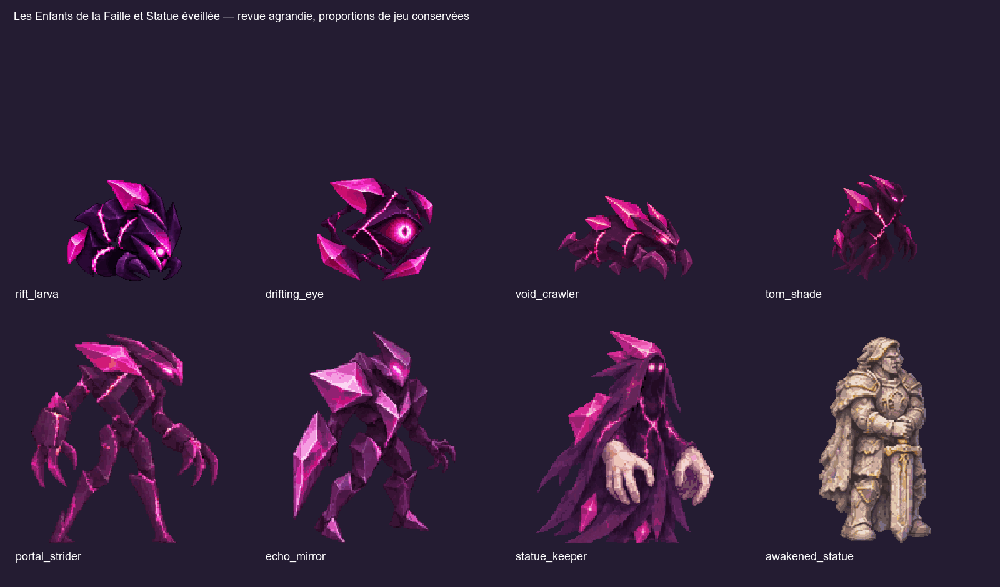
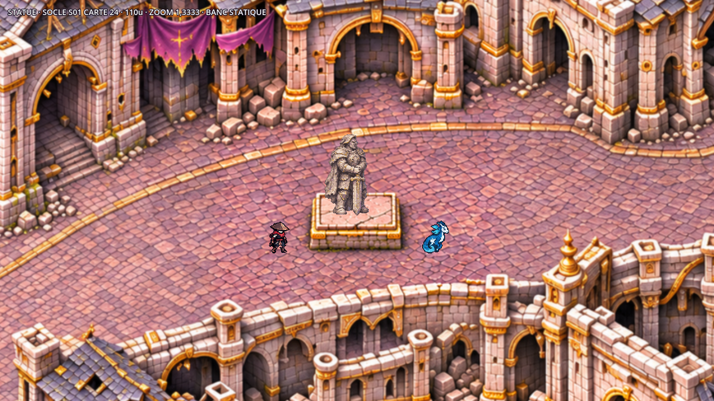
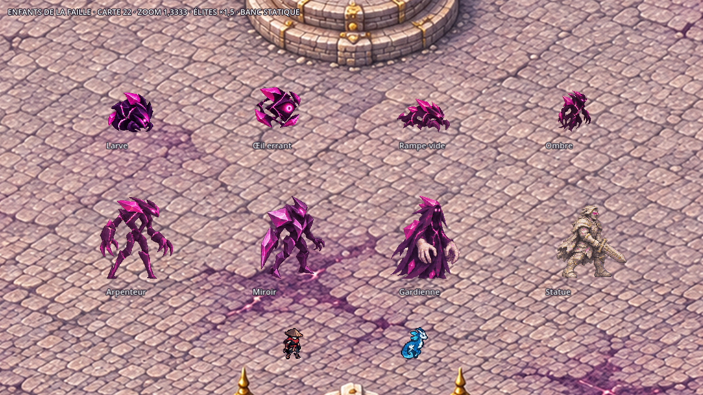

# Chapitre 5 — Les Enfants de la Faille et Statue éveillée

**Huit entités, onze planches sources, 162 poses peintes.** Matière de vide violet profond,
cristaux magenta anguleux, vides dans les silhouettes et coutures lumineuses ; yeux clairs.
La Gardienne garde ses grandes mains de pierre pâle. La Statue reprend le calcaire, l'ardoise
et les dorures ternies des socles du Panthéon ; aucun second socle n'est dessiné sous ses pieds.
Génération avec l'outil imagegen intégré ; sources retenues et prompts exacts conservés par monstre.



## Échelle

Les nouvelles silhouettes sont plus grandes et plus anguleuses que les Violets du chapitre 1.
**Scale 0,5 conservé ; cellules agrandies** pour accueillir ces gabarits : 192² pour les normaux,
256² pour les élites, 320² pour la Statue. Une cellule 64² à scale 0,5 limiterait le corps à 32u
et empêcherait notamment la Statue de 110u. Le Chasseur et Glimmerwing restent inchangés.
Les élites du banc utilisent le facteur moteur existant ×1,5, sans modification d'équilibrage.

| Entité | Hauteur de référence monde | Sources A / B |
| --- | ---: | --- |
| `rift_larva` | 56u | A 6×2 : déplacement, attaque |
| `drifting_eye` | 56u, hors flottement | A 6×2 : flottement, tir |
| `void_crawler` | 44u, corps large et bas | A 6×2 : déplacement, attaque |
| `torn_shade` | 56u | A 6×3 : déplacement, attaque, Pas de faille |
| `portal_strider` | 75u ; 112,5u avec facteur élite | A 6×3 ; B 6×2 |
| `echo_mirror` | 75u ; 112,5u avec facteur élite | A 6×3 ; B 6×2 |
| `statue_keeper` | 75u ; 112,5u avec facteur élite | A 6×3 ; B 6×2 |
| `awakened_statue` | 110u, sans facteur élite | A 6×3 |

Ces hauteurs sont les cibles médianes ; les poses de marche, de flexion et d'attaque varient naturellement.
Les mesures exactes de la première pose sont dans le [reçu](../previews/enfants-faille/controle_livraison.json).
L'Œil possède `hover=12` pixels d'art et une légère oscillation ; son ombre est dessinée séparément au sol.
Les autres sprites ne contiennent ni ombre peinte, ni cercle d'alerte, ni zone au sol.
Lumière haut-gauche, liseré violet bas-droite, alpha binaire, nearest, au plus 32 couleurs partagées entre A et B.

## Animations et intégration Claude

| Identifiant et job | Animations importées |
| --- | --- |
| [rift_larva](../../assets/concepts/incoming/enemy.rift_larva/job.json) | `move`, `attack` |
| [drifting_eye](../../assets/concepts/incoming/enemy.drifting_eye/job.json) | `move`, `attack` — projectile et ombre au jeu |
| [void_crawler](../../assets/concepts/incoming/enemy.void_crawler/job.json) | `move`, `attack` |
| [torn_shade](../../assets/concepts/incoming/enemy.torn_shade/job.json) | `move`, `attack`, `rift_step` |
| [portal_strider](../../assets/concepts/incoming/enemy.portal_strider/job.json) | A : `move`, `attack`, `death` ; B : `opening`, `portal_jump` |
| [echo_mirror](../../assets/concepts/incoming/enemy.echo_mirror/job.json) | A : `move`, `attack`, `death` ; B : `copy`, `reflection` |
| [statue_keeper](../../assets/concepts/incoming/enemy.statue_keeper/job.json) | A : `move`, `attack`, `death` ; B : `awaken_statues`, `stone_wave` |
| [awakened_statue](../../assets/concepts/incoming/enemy.awakened_statue/job.json) | `dormant` 1 pose, `awaken` 5 poses, `move` 6, `attack` 6 |

La Statue conserve sa source demandée **6×3** : rangée 1, une pose endormie puis cinq d'éveil ;
rangée 2 déplacement ; rangée 3 coup lourd. Quatre bandes dérivées permettent l'import des quatre états.
`idle` réutilise `dormant` pour elle, `move` pour les autres. Les normaux et la Statue disposent d'une
pose runtime de mort transparente pour un effet commun ; aucune mort supplémentaire n'a été inventée en source.
Les morts dessinées des élites s'affaissent ; les disparitions deviennent réellement petites.
Un facteur commun par planche B harmonise le cadrage avec sa A, sans regonfler les poses de disparition.
Les A servent de références visuelles aux B du même monstre.

Les ouvertures de l'Arpenteur sont verticales et attachées au corps. Le Miroir montre deux silhouettes
partiellement superposées ; Claude pourra les remplacer par deux entités si la mécanique l'exige.
Les mains de la Gardienne indiquent l'éveil et la frappe ; les ondes et les zones sont à dessiner par le jeu.
Les fps des jobs sont des valeurs de présentation à synchroniser avec les techniques dans le code.



Sur **S01 de la carte 24**, le centre de plan est `[1342,378.4]` en coordonnées monde depuis le haut-gauche.
Le dessus peint reçoit les pieds à `[1342,398.4]`, décalage visuel `[0,+20]` pour ce socle :
ce n'est pas un déplacement de collision. Vérifier les autres socles lors de la pose par Claude.
La Statue garde des pieds sans dalle supplémentaire, adaptés au socle vide existant.

## Livraison et vérification

Chaque dossier `assets/concepts/incoming/enemy.<id>/` contient un `job.json`, la source PNG originale,
les prompts et la provenance, les empreintes SHA-256 et les dérivés WebP sans perte nécessaires à l'import.
Le rangement technique utilise les composantes alpha, récupère les pointes qui dépassent une grille virtuelle,
et ne redessine aucune pose. Les essais écartés restent hors dépôt.

```powershell
python tools/art/import_riftborn.py --preview-dir C:/chemin/hors-depot/apercus
python tools/art/check_riftborn_sprites.py --out C:/chemin/hors-depot/audit.json
```



[Corruption](../previews/enfants-faille/enfants_corruption_zoom_jeu.png) ·
[Attaques](../previews/enfants-faille/enfants_attaques_zoom_jeu.png) ·
[Techniques 1](../previews/enfants-faille/enfants_techniques_1_zoom_jeu.png) ·
[Techniques 2](../previews/enfants-faille/enfants_techniques_2_zoom_jeu.png) ·
[Mouvement](../previews/enfants-faille/mouvement_zoom_jeu.gif).

Six captures PNG et six phases de mouvement Godot 4.3, **1280×720, zoom 1,3333**,
Chasseur et Glimmerwing aux échelles existantes. Le [banc](../../tools/art/preview_riftborn.gd)
charge les deux vraies tuiles de la carte 22 et le master final de la carte 24.
`--assets-root=` permet de lire les témoins et la carte 22 dans une autre copie ;
`--map24-source=` permet de fournir le master du Panthéon depuis sa branche de travail.
Ce sont des bancs statiques, sans profil ni combat ; l'intégration des comportements reste à Claude.

**Contrôles conformes : huit assets, 162 poses, zéro erreur.** Import Godot des seize textures,
validateur standard `AssetValidator`, marges de deux pixels, palettes, alpha, ancres, poses distinctes,
affaissement, disparition et empreintes des sources ; compilation Python et lint GDScript réussis.
[Audit](../previews/enfants-faille/audit_sprites.json) · [Reçu](../previews/enfants-faille/controle_livraison.json).
Les huit nouvelles entrées du manifeste préservent toutes les entrées antérieures.
Les icônes 64² montrent le corps entier, réduit au plus proche avec une marge de trois pixels.
Le script de vérification respecte désormais `IMPORT_TIMEOUT` ou `STEP_TIMEOUT` pour l'import Godot
et s'arrête si cet import échoue ; il ne poursuit plus les tests après une réimportation interrompue à cinq minutes.
**Aucun fichier de `src/`, `data/`, aucune map ou collision modifiés.**
