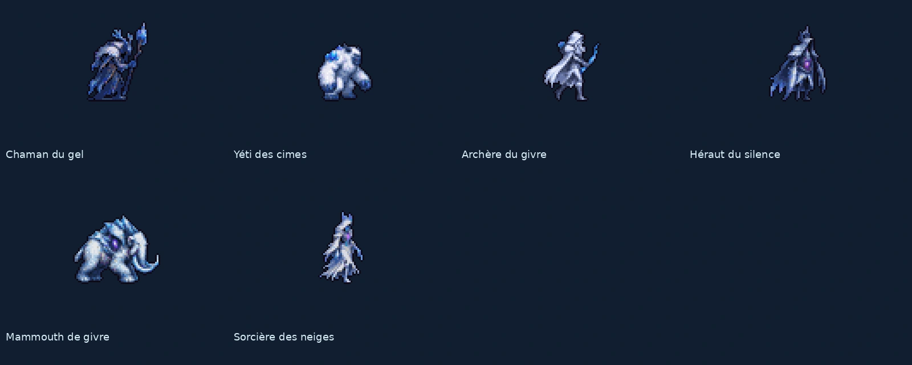

# Glacier silencieux — Élites

**Lot graphique livré le 3 novembre 2026.** Branche `codex/glacier-elites`, créée depuis `main` actualisé. 6 visuels, 216 poses dessinées. Sources retenues du 2 novembre réimportées au format demandé ; aucun changement de gameplay.



[Vue au zoom du jeu](../previews/glacier-elites/zoom_jeu.png) · [Catalogue et animations](../previews/glacier-elites/catalogue.json) · [Rapport](../previews/glacier-elites/qualite.json)

## Contenu

| Identifiant | Nom | Animations dessinées |
|---|---|---|
| `enemy.frost_shaman` | Chaman du gel | `move`, `attack`, `death`, `ice_prison`, `frost_mist`, `snuff` |
| `enemy.peak_yeti` | Yéti des cimes | `move`, `attack`, `death`, `avalanche`, `pounce`, `rage` |
| `enemy.rime_archer` | Archère du givre | `move`, `attack`, `death`, `chilling_arrow`, `hail_volley`, `fade` |
| `enemy.silence_herald` | Héraut du silence | `move`, `attack`, `death`, `hush`, `spell_echo`, `absorb` |
| `enemy.frost_mammoth` | Mammouth de givre | `move`, `attack`, `death`, `charge`, `ice_crack`, `armor_break` |
| `enemy.snow_witch` | Sorcière des neiges | `move`, `attack`, `death`, `blizzard_call`, `snow_clones`, `blink` |

## Correction de palette

Les trois planches de l’Archère du givre ont reçu une correction de palette par le générateur : peau et petits détails chauds remplacés par du bleu-gris et de la porcelaine froide. Poses et mise en page conservées. Les trois prompts exacts et la chaîne d’empreintes avant/après sont dans `source/palette_correction.json` ; les images précédentes restent hors Git.

## Recettes et contrôles

Cellules **64 × 64**, échelle **0,5**, ancre (32,54). Les volants utilisent (32,58), retrait de 8 pixels. Les normaux ont déplacement et attaque ; le Loup ajoute `slide`, le Brise-banquise `dive`. Les élites ont A déplacement/attaque/mort, B deux techniques, C le troisième geste ; la seconde rangée de C reste transparente sans animation inventée.

La lumière et les matières suivent les sources froides : glace, neige, blancs et bleus, liseré violet de Faille ; aucune couleur orange détectée dans les palettes livrées. Les recettes `assets/concepts/incoming/<id>/job.json` passent par `tools/art/import_sheet.py`. Prompts, sources retenues, empreintes et facteurs de cadrage sont conservés dans `source/`. Un facteur commun ajuste le cadrage de chaque créature ; une mort affaissée ne regonfle pas. `size_delivery.json` détaille les valeurs. Les sources de départ ne sont pas redessinées pour changer seulement la taille de cellule.

Le contour est inclus dans le budget de 32 couleurs : correction ciblée de l’importeur, accompagnée d’une régression. Les anciennes images déjà intégrées ne sont pas régénérées. Les sorties ont un alpha binaire, 32 couleurs opaques au plus, aucune pose vide parmi les animations dessinées et aucun pixel sur les bords de cellule. Les noms d’animations correspondent exactement aux entrées prévues du manifeste ; les cadences et boucles restent identiques.

La mort des élites est dessinée sur six poses ; `idle` est un alias de `move`. Les rangées de techniques sont séparées, sans cercles d’alerte ni masque de terrain.

Godot **4.3** : import, contrôle assets et banc de 36 captures 1280 × 720 au zoom du jeu, avec Chasseur témoin. **433 assets valides, 9 prévus, zéro erreur**. Ce banc est graphique : aucun combat, navigation ou synchronisation de mécanique n’est revendiqué. Les GIF font moins de 3 Mo.

Rejouer le banc après import :

```bash
godot --headless --import --path .
godot --path . --resolution 1280x720 res://tools/art/preview_glacier_sprites.tscn -- --catalog=res://docs/previews/glacier-elites/catalogue.json --out=/tmp/rift-glacier-elites --steps=36
```

## Limites et suite

- **Livré** : sprites du lot, icônes, recettes, sources retenues, planches, captures et contrôle assets sans erreur.
- **Non fait** : essais de campagne par le propriétaire et raccordement temporel des techniques par Claude.
- **Choix graphiques** : cadrage commun pour tenir dans les cellules, ancrage et palette limités sans modifier les mécaniques.
- **Protection** : `src/`, `data/` et tous les fichiers de la carte14 restent identiques à la base ; seules les entrées du lot changent dans le manifeste.

Dans cette branche indépendante, les entrées encore provisoires sont : `enemy.frost_crawler`, `enemy.blizzard_wolf`, `enemy.snow_wraith`, `enemy.ice_golem`, `enemy.hush_shard`, `enemy.ice_knight`, `enemy.frozen_sentry`, `enemy.icebreaker`, `boss.nivorath`. Les autres lots se fusionnent par leurs propres PR. Le statut `final` protège les dessins d’une génération procédurale ; la validation artistique en partie revient au propriétaire.

Poids des fichiers ajoutés ou modifiés : voir [poids.json](../previews/glacier-elites/poids.json), sources et aperçus compris. Essais et captures intermédiaires hors Git.
