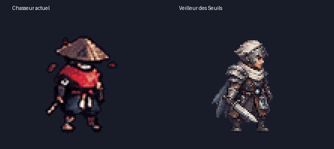
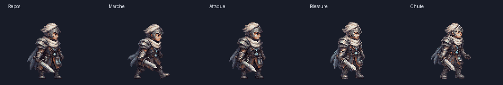

# Proposition de joueur : le Veilleur des Seuils

Création demandée par le propriétaire après les fusions des cartes 3 et 4 (PR #177 et #178).
Le propriétaire a demandé son remplacement en jeu : **le Veilleur devient le joueur par défaut**.
Seul `player_visual.visual_id` change dans `data/balance/balance_config.tres` ; statistiques et règles inchangées.
Le sprite historique `player.hunter` reste disponible.



## Personnage et facture

Guerrier voyageur : demi-casque ouvert, cheveux cendrés, épaulières d'acier asymétriques, écharpe ivoire,
cape courte bleu ardoise, cuir brun usé, petite lanterne et amulette cyan. Une épée droite permet de garder
les attaques existantes. La palette reprend l'acier et l'ardoise du décor ; les tissus clairs détachent le
personnage des sols sombres et ses accents cyan le distinguent des monstres magenta.

Les deux sources sont peintes par imagegen, avec le Chasseur et la Cour en références pour A, puis **A en
référence de B**. Éclairage haut-gauche, ombres violet-bleu et contour teinté. Aucun déplacement, membre ou
pose n'est fabriqué par déformation procédurale. L'import recadre, réduit en nearest, aligne les appuis et
quantifie les deux planches avec une palette commune de **48 couleurs**, comme le joueur réel actuellement livré.

## Format et animations

Identifiant : `player.threshold_warden`, statut `final` après le choix du propriétaire.
Cellules **112 × 80**, ancre **(56, 74)**, scale **0,65** et corps debout d'environ **62 pixels**.
La cellule est plus large que les 96 × 80 du Chasseur pour contenir l'extension de la lame ; **cela n'agrandit
pas le corps ou la physique**. En 3D, le pixel reste à 0,02405 m ; corps visible d'environ 1,5 m.
La référence historique 64 px de la bible ne décrit plus le joueur réel ; son contrat courant est repris ici.

| Animation | Poses | Cadence | Boucle |
| --- | --- | --- | --- |
| idle | 6 | 7 i/s | oui |
| move | 6 | 10 i/s | oui |
| attack | 7 | 18 i/s | non |
| hurt | 7 | 16 i/s | non |
| death | 6 | 8 i/s | non |

**32 poses peintes**. La Ruée utilise l'alias `dash → attack`, comme le joueur actuel : aucune animation
spécifique de Ruée n'est annoncée dans ce premier essai. Aucun nouveau sort, effet ou rayon n'est ajouté.
L'ombre au sol est mesurée dans le manifeste, dessinée par le moteur et absente des sources.



## Jouer et comparer

Le lancement normal du jeu utilise maintenant le Veilleur. La scène `tools/art/warden_trial.tscn` (F6) reste
disponible pour comparer les deux visuels. Elle utilise la vraie partie et
ne remplace que le nœud visuel du joueur, avec ses données de sprite et son ombre. Les déplacements,
collisions, cadence des actions, règles, HUD et sorts restent ceux du jeu. Aucun fichier `src/` ne change.
La partie normale et le retour au menu conservent le Veilleur.

```text
godot --path . res://tools/art/warden_trial.tscn -- --chapter=1
godot --path . res://tools/art/warden_trial.tscn -- --chapter=4
```

`--warden=0` conserve le Chasseur dans cette même scène. Pour une comparaison figée à la vue de jeu de 20 m :

```text
godot --path . --resolution 1600x900 res://tools/art/warden_trial.tscn -- --chapter=1 --seed=42 --warden-capture --reference-out=<dossier>
```

Les captures natives sur la Cour végétale et l'Avant-poste enneigé utilisent les mêmes cadrages, positions
et monstres avant/après ; les sprites ne passent pas dans la palette du décor. Les captures ne sont pas des montages.
Les éventuelles comparaisons côte à côte sont explicitement composées depuis ces captures.

## Sources et vérifications

- Sources retenues, planche conditionnée, jobs et prompts exacts :
  `assets/concepts/incoming/player.threshold_warden/`.
- Feuille en jeu : `assets/sprites/players/threshold_warden/threshold_warden_sheet.png`.
- Icône : `assets/ui/icons/players/threshold_warden.png`.
- Conditionnement reproductible : `python tools/art/condition_warden.py` (Pillow et NumPy).
- Vérification : `python tools/art/check_warden.py` ; 32 cellules non vides, marges sans rognage, alpha
  strict 0/255, 48 couleurs, entrée originale du Chasseur identique.
- Validation native `AssetValidator` : OK dans les deux captures ; essai de la scène jouable avec le bot.
- Lint ciblé GDScript et `git diff --check` conformes. Import Godot des deux images effectué avant captures.

Rapports, captures au zoom de jeu et GIF : `docs/previews/joueur_veilleur/`.
Les messages de ressources OpenGL non libérées à la fermeture existent aussi dans les références du jeu.
Activation demandée explicitement par le propriétaire. La sélection du visuel est réversible en remettant
`player.hunter` dans le champ de configuration, sans modifier les mécaniques.
