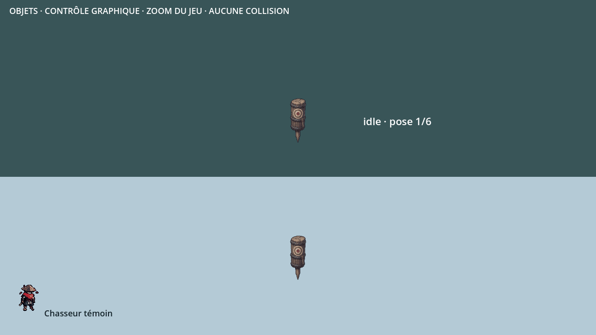

# Mannequin de la salle d’entraînement

`object.training_dummy` remplace son entrée `planned` par un tronc de bois cerclé de fer, planté sur un piquet, avec une cible peinte. Livraison graphique du 3 novembre 2026 ; aucune modification de la salle, du compteur de dégâts ou du gameplay.

[Planche des douze poses](../previews/mannequin-entrainement/planche.webp) · [Repos au zoom du jeu](../previews/mannequin-entrainement/idle_720p.png) · [Impact](../previews/mannequin-entrainement/hit_720p.png)

## Contrat graphique

| Animation | Poses | Cadence | Boucle | Durée |
|---|---:|---:|---|---:|
| `idle` |6|6 images/s|oui|1 s|
| `hit` |6|18 images/s|non|0,333 s|

Cellule **256 × 256**, ancre au pied **(128,238)**, échelle **0,5**. Hauteur de référence140 pixels d’art, soit environ70 unités du monde. La corde bouge légèrement au repos ; le tronc bascule puis revient à sa position après l’impact. Le piquet reste ancré : bas des douze silhouettes en y239, contour compris. Le pied de référence reste y238.

La feuille contient `idle` en rangée0 et `hit` en rangée1. Claude peut déclencher `hit` à la réception d’un coup et revenir à `idle` après sa fin ; ce raccord n’est pas ajouté ici. Aucune animation d’attaque ou de mort supplémentaire.

## Sources et contrôles

Recette `assets/concepts/incoming/object.training_dummy/job.json`, source retenue `source/sheet.png`, prompt et empreintes conservés. Import par `tools/art/import_sheet.py`, palette commune32 couleurs et contour ; lumière haut-gauche et liseré violet discret bas-droite. Les douze poses sont dessinées et distinctes ; aucune ne touche les bords de cellule.

Import Godot4.3 et `tools/run_tests.sh assets` réussis : **447 entrées,446 valides,un placeholder hors lot (`object.crystal_mirror`),zéro erreur**. Dix-huit captures natives1280 × 720, avec Chasseur témoin et zoom du jeu1,3333 ; GIF de moins3Mo. [Rapport](../previews/mannequin-entrainement/controle_geometrique.json).

`src/`, `data/`, les cartes14/15 et les autres entrées du manifeste restent identiques à main. Les rochers-abris sont livrés sur leur branche indépendante. Le banc est graphique ; les réactions aux vrais dégâts et les essais dans la salle restent à vérifier par Claude et le propriétaire.
