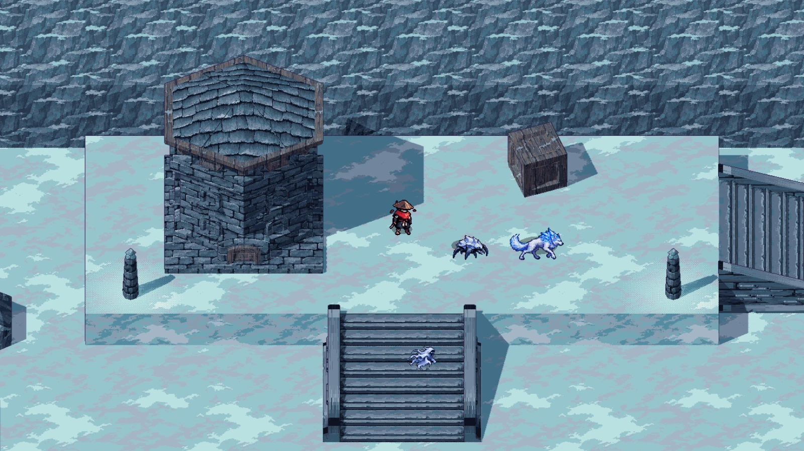

# Avant-poste des Glaces — matière et décors anciens

Premier lot à valider sur `codex/matiere-avant-poste-glaces`, depuis `origin/main` actualisé.
Le propriétaire a demandé de **remplacer aussi les objets trop futuristes** de la carte 4.
L'avant-poste devient un ensemble de maisons et de réserves anciennes pris dans la banquise.



## Direction et remplacements

La référence reste la Cour validée : pixel art peint détaillé, matière lisible et sprites inchangés.
La pierre bleutée, l'ardoise givrée et le bois brun désaturé remplacent les blancs, jaunes et bleus industriels.
La neige tassée et la glace du sol restent calmes pour laisser lire le Chasseur et les monstres du glacier.
Les escaliers reprennent le maillage et la texture de la Cour, avec une teinte froide.

| Ancien objet | Nouveau visuel |
| --- | --- |
| Modules d'habitation, garages, dépôts | Maisons de pierre et de bois, toitures d'ardoise |
| Tunnel fermé par sa collision historique | Réserve de bois fermée, sans fausse ouverture praticable |
| Atterrisseur et aire surélevée | Petite tour sur un socle de pierre |
| Camions et remorque | Réserves et caisses longues |
| Panneaux solaires | Piles de bois basses |
| Éoliennes | Mâts à bannières, sans pale ni moteur |
| Foreuse | Tour de guet sur le plateau |
| Caisses de fret et conteneurs | Caisses de bois ; huit petites caisses par pile haute |
| Balises | Bornes de pierre à cristal discret ; lumières existantes conservées |
| Équipements techniques sur les toits | Masqués, remplacés par les toitures des maisons |

Les pièces de remplacement proviennent du pack **KayKit Medieval Town, CC0**, déjà présent dans
`draft3d/medieval/`. Les rochers et falaises gardent leur géométrie, repeinte en pierre gelée.
Les sources Space Base restent chargées comme gabarits physiques historiques ; leurs visuels techniques
sont masqués. Elles ne constituent plus la direction artistique affichée.

## Construction et réversibilité

`draft3d/matter/outpost/dressing.gd` ajoute uniquement les visuels. Les nouvelles maisons sont ajustées
aux boîtes bloquantes source. Un soubassement plein matérialise toute leur emprise, y compris sous les
débords de toiture ; les portes sont fermées. Les mâts conservent un pied de 35 cm de rayon ; les bannières
commencent au-dessus de la hauteur physique historique de 2,4 m. Aucun corps physique n'est ajouté.

La construction est déterministe et mutualise les meshes des exemplaires identiques en mémoire.
Les ajustements de proportions sont documentés ici : cette passe remplace les formes autorisées,
elle ne prétend donc pas conserver les triangles des anciens objets techniques.

- `--outpost-matter=0` restitue la base spatiale, son sol et sa palette d'origine.
- Ajouter `--outpost-palette` pour comparer l'ancienne base dans la nouvelle palette.
- Aucun changement de `src/`, de `data/`, de shader, de collisions, de dispositions ou de sprites.
- La description FR/EN du chapitre est actualisée ; les identifiants techniques historiques restent compatibles.

## Textures et palette

Sources finales et prompts : `assets/concepts/incoming/material.outpost/`.
`tools/art/condition_outpost.py` découpe les panneaux, réduit en nearest et quantifie sans tramage.
Il ne dessine pas la matière. Chaque tuile de module a 160 × 160 texels sur 4 m ; le sol a 320 × 320 sur 8 m.
Les UV sont des projections dans le repère des modules, à **40 texels/m**, proches des 41,6 pixels/m des sprites.
Les faces à géométrie inchangée gardent leurs sommets et leurs normales dans le monde.
Filtrage nearest, matériaux rugueux sans reflet spéculaire, sans mipmaps flous.
Chaque texture contient 6 à 12 couleurs ; la palette finale de rendu en contient 48, comme la Cour validée.
L'éclairage de la carte et les shaders restent ceux du jeu ; aucune ombre directionnelle n'est peinte sur le sol.

## Vérifications et captures

- Contrôle natif : **74 formes de collision identiques**, mêmes transformations et **865 polygones de navigation**.
- Sol, plateau et deux escaliers : positions des triangles dans le monde identiques avant/après.
- 50 volumes de remplacement vérifiés contre leurs boîtes physiques : erreur maximale inférieure à 0,005 m.
- 80 meshes techniques masqués ; 49 objets remplacés, plus le socle, les bornes et les mâts.
- Tests existants du rendu pixel : 8/8 ; localisation : 6/6. Lint ciblé conforme.

Rapport complet : `docs/previews/matiere_avant_poste/validation.json`.
Six cadrages avant/après à graine 42 dans la vraie partie : base, départ, dépôt, réserves, plateau et ensemble.
Les détails utilisent la vue de jeu de 20 m en 1600 × 900 ; l'ensemble est dézoomé à 76 m.
Le Chasseur et trois monstres réellement chargés du chapitre 4 sont figés aux mêmes positions.
La palette d'origine est conservée dans les captures avant : elles montrent donc aussi son remplacement.

Reproduire, depuis le projet, avec Godot 4.3 :

```text
godot --path . res://tools/art/check_outpost_matter.tscn -- --outpost-matter=0 --report=<rapport.json>
godot --path . --resolution 1600x900 res://tools/art/outpost_reference.tscn -- --chapter=4 --seed=42 --reference-region=plateau --reference-out=<dossier>
godot --path . res://tests/run_tests.tscn -- --filter=test_pixel_render
godot --path . res://tests/run_tests.tscn -- --filter=test_localization
```

L'import des images et des traductions est réalisé avec l'éditeur Godot avant ces contrôles.
Le rendu natif OpenGL est utilisé pour les captures et la preuve physique. Les avertissements de libération
de shaders et de ressources à la fermeture apparaissent aussi sur la référence originale et les tests existants.
La composition historique comporte des problèmes déjà recensés dans `docs/maps/CARTES_3D.md` : cette passe
préserve sa navigation, sans prétendre corriger ces problèmes de plan. Validation artistique et essai en jeu
par le propriétaire avant fusion.
