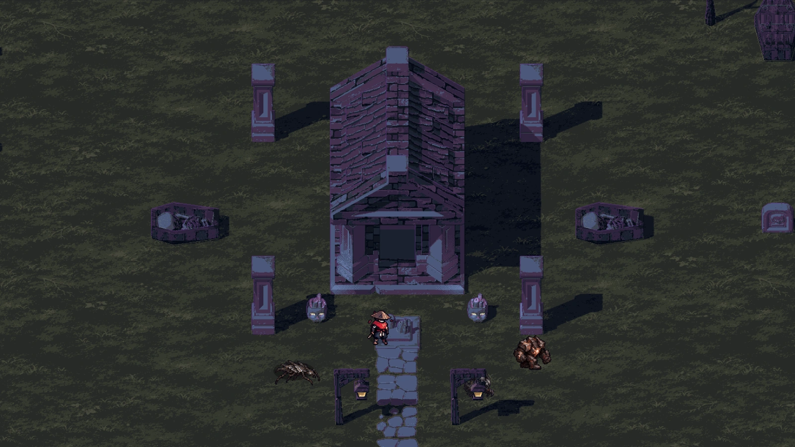

# Matière du Cimetière des Cendres — carte 2

Première passe à valider, branche `codex/matiere-cimetiere-cendres`. Elle reprend la finesse et la hiérarchie
de la [référence validée](REFERENCE_DECORS_3D.md), fusionnée dans main par la PR #169
(`96f28de64233287af6203b2058182a40546bdd0d`), en gardant l’identité nocturne de la carte 2.

## Résultat et périmètre



Le sol auparavant uni reçoit une terre cendreuse, de petites racines, une mousse basse et quelques feuilles sèches.
La pierre des tombes et des moulures reprend le panneau calme de la Cour ; la crypte reçoit des assises et
une couverture d’ardoise, les cercueils et bancs du bois patiné, les grilles du fer usé, les troncs de l’écorce.
Les conifères portent des groupes d’aiguilles sobres plutôt que des taches noires/brunes.
Les formes, gravures et ouvertures restent celles des meshes d’origine : aucun symbole n’est repeint par-dessus.

Le lot couvre **37 modèles Halloween, 41 meshes préparés, 271 instances de meshes peintes**.
Les deux escaliers du tertre reprennent exactement le mesh et l’atlas validés de la Cour. Les surfaces visibles
du sol et du tertre changent uniquement d’UV et de matière. Au total, 275 instances visuelles reçoivent une copie
peinte ou un nouveau maillage UV ; les corps physiques restent en place.

Les citrouilles décoratives gardent leur modèle et matière de base ; leur teinte passe par la palette nocturne.
Les triangles de flamme et de verre chaud des lanternes, ainsi que l’intérieur sombre de la crypte, conservent
leurs UV et leur matière. Lumières, sprites, règles, positions et colliders ne sont pas modifiés.
Pas de nouveaux objets de gameplay, d’herbe en volume ou de changement dans `src/` et `data/`.

## Activation et comparaison

Dans cette branche : `draft3d/main.tscn -- --chapter=2`, habillage actif par défaut.
**`--graveyard-matter=0`** restaure les pièces, le sol et la palette d’origine.
Ajouter **`--graveyard-palette`** garde les anciennes matières avec la nouvelle palette de 48 couleurs :
c’est le réglage employé pour comparer la seule matière sur les cinq cadrages livrés.
Les changements de palette ne sont donc pas confondus avec les changements de texture dans ces comparatifs.

Les régions de `tools/art/graveyard_reference.tscn` sont `crypt`, `graves`, `mound`, `wood`, `gate`.
Cette référence dérive de DraftRun : mêmes lumières nocturnes, caméra de jeu (vue 20 m), rendu pixel actif,
Chasseur et trois monstres du chapitre (`cinder_crawler`, `smoke_wisp`, `char_golem`). Seuls le combat et
les poses sont figés. Les acteurs sont placés sur la navigation existante. Aucun Écho n’est ajouté au prototype.
Les métadonnées avant/après sont comparées strictement : caméra, positions, acteurs, palette et densité identiques.

```text
godot --path . --resolution 1600x900 res://tools/art/graveyard_reference.tscn -- --chapter=2 --bot --passive --god --seed=241115 --pixel=1 --reference-region=crypt --reference-out=<sortie>
```

Pour l’avant : ajouter `--graveyard-matter=0 --graveyard-palette`. Les exports WebP et comparatifs dans
`docs/previews/matiere_cimetiere/` sont des captures réelles à 1600 × 900, sans retouche du rendu.
Les deux comparatifs verticaux conservent les pixels à leur taille d’origine, sans agrandissement.

## Sources, palette et densité

Sources retenues par l’outil **imagegen intégré**, avec job : `assets/concepts/incoming/material.graveyard/`.
Trois sources finales seulement : atlas 4 × 2 (`materials.png`), terre (`ground.png`), aiguilles (`needles.png`).
L’atlas garde son panneau initial de végétation comme partie de l’image source, mais le conditionnement utilise
la source dédiée d’aiguilles ; la pierre monolithique utilise le panneau 3 de la source validée de la Cour.
Les variantes rejetées restent hors Git. Les modèles KayKit et leurs licences CC0 ne sont pas modifiés.

Le sol mesure **640² texels pour 16 m**, phase UV mondiale commune entre le sol et le sommet du tertre.
Les gabarits de matière sont réduits à **160²** : six tons par gabarit, jusqu’à 48 couleurs communes aux atlas,
sans tramage. Les petits îlots de pierre prennent le centre calme du gabarit ; les corniches reçoivent un bloc
simple plutôt qu’une grille de joints. Les poutres étroites prennent une bande de bois sans multiplier les planches.
La maçonnerie, les ardoises et les aiguilles ont des périodes physiques de 4 m / 3 m / 3 m.

Les îlots coplanaires reliés sont emballés dans des atlas nearest, sans mipmaps, gouttières étendues de deux texels.
Largeur 1024, hauteur 64 à 2048 dans ce lot ; environ 9,27 millions de texels au total (~35,4 Mio RGBA sans mipmaps).
Allocation nominale **40 texels/m**, proche des 0,02404 m/pixel du rendu de jeu ; deux texels minimum pour les biseaux.
Le conditionnement peut réserver jusqu’à 4096 px de haut si nécessaire, avec contrôle explicite de débordement.

La palette de rendu propre au cimetière contient **48 couleurs** : ciels sombres, pierre froide, cendre/bois,
verts sobres, feuilles/ambre, violets et ivoire. Elle remplace la palette précédente de 32 couleurs dérivée des
aplats du pack. Source de vérité : `draft3d/matter/graveyard/palette.tres`. Les shaders de rendu ne changent pas.
Les modulations d’albédo sont dans `build_graveyard_meshes.gd` ; le sol utilise (0,90 ; 0,95 ; 0,65) pour garder
une terre lisible sous la lune bleue. Rugosité 1, spéculaire 0. L’ombre et les lueurs restent celles du moteur.

## Reproduction

Pillow et NumPy requis. Le premier outil lit seulement les pièces réellement présentes sur la carte, classe
leurs triangles par matière depuis la palette d’origine, garde positions/normales/UV source et exporte leurs faces.
Le second conditionne les sources et attribue les UV peints ; la finalisation relie les atlas aux copies de meshes.
Les UV0 d’origine restent en UV2. Ni les scènes de pièces ni leurs corps de collision ne sont réécrits.

```text
godot --path . res://tools/art/build_graveyard_meshes.tscn -- --graveyard-matter=0 --export=<faces.json>
python tools/art/condition_graveyard.py assets/concepts/incoming/material.graveyard/source/materials.png assets/concepts/incoming/material.graveyard/source/ground.png <faces.json> assets/concepts/incoming/material.graveyard/source/needles.png
godot --headless --editor --import --path .
godot --path . res://tools/art/build_graveyard_meshes.tscn -- --finalize
godot --path . res://tools/art/check_graveyard_matter.tscn -- --graveyard-matter=0 --report=<rapport.json>
```

Pour un réglage de teinte seul, `--finalize --retint` évite de réencoder les buffers de mesh.
Le projet complet importe normalement les PNG avant finalisation. Sur cette machine Windows, l’import ciblé
utilise le projet minimal aux mêmes chemins res:// décrit dans le guide de la Cour ; les captures et contrôles
ont ensuite tourné dans le projet complet (OpenGL Intel Iris Xe). Les caches restent hors du dépôt.

## Contrôles et limite connue

Contrôle natif conforme sur **16 848 triangles** : sommets, UV source et emprises identiques ; écart maximal
des normales de 0,000259 après deux encodages octaédriques, sous le seuil de 0,0003 (~0,017°).
Les deux volumes Ground/Mound gardent leurs positions de sommets et normales. Les 171 formes de collision,
les poses des modules et les 897 polygones de navigation sont identiques avant/après, empreintes SHA-256 comprises.
42 textures contrôlées (32 couleurs au sol, ≤48 aux atlas, sans mipmaps), UV bornés et cinq paires de captures
aux métadonnées identiques. Lint des six scripts GDScript concernés conforme.

**Problème préexistant, non corrigé par ce lot :** le jeu émet déjà avant la passe
`Navigation map synchronization error… already-merged edge` sur cette carte. L’erreur reste présente après,
malgré une navigation générée identique : elle doit être examinée séparément, sans la présenter comme un défaut
créé ou résolu par les textures. Les imports Halloween signalent aussi des UID anciens, puis utilisent correctement
leurs chemins texte ; les captures natives signalent des ressources OpenGL non libérées à la fermeture, également
présentes sur le rendu d’origine. Aucune de ces limites n’est masquée dans les rapports.

## Prompts exacts

### Atlas de matières

```text
Use case: stylized-concept. Production texture template atlas for the SECOND map of Rift Hunters, a moonlit Ashen Graveyard. Match the deliberate detailed 16-bit pixel art craftsmanship and low-noise hierarchy of reference 1, an actual approved in-game courtyard. Reference 2 is the graveyard before painting: preserve the cemetery identity but replace its smooth flat toy-like materials. This is MATERIAL ALBEDO ONLY, no scene illustration, no characters, no physical modeled objects.
OUTPUT: one square atlas EXACTLY FOUR COLUMNS x TWO ROWS, eight equal square panels edge to edge, no labels, no text, no gutters, no perspective. Each panel is a flat seamless material field or registered texture template as specified, later reduced to native160 square texels per4 metres. Crisp intentional pixel clusters, rich but restrained edge wear. Flat neutral lighting; no cast shadows or highlights pretending there is a sun. Actual engine provides moon and lantern lighting. No photoreal noise, blur, dithering, scribbled cracks, camouflage moss, sharp white sparkles or busy detail everywhere.
Top row left to right:
1) Cemetery CRYPT MASONRY: cold charcoal / blue-slate stone courses, nine restrained horizontal courses, irregular broad blocks, subtle thin mortar, quiet stone centers, chipped edges. Slight pale dry lichen near bottom, little damp dark moss only at foot; no lush green carpet. Main colors #39434c #4b5562 #606a77 #737d89.
2) MONOLITH / GRAVESTONE SURFACE: ONE unbroken cold stone field, not multiple blocks, no writing, no drawn skulls, no symbols. Large quiet centre, tiny restrained wear at four outer edges and corners, faint mineral structure. Dry pale lichen and dark damp stain only near very bottom. Existing mesh contains carving; do not paint another silhouette.
3) WEATHERED DARK WOOD: four broad vertical boards, muted grey-brown #303039 #41404a #55505a #6a6063, sparse grain with purposeful short pixel clusters at edges, split seams, calm board centres. Damp at bottom, no yellow oak, no nails.
4) OLD IRON: very dark blue-charcoal #202733 #313b49 #485260, restrained scratch wear mostly at edges, tiny brown oxidation #584641 #6d5545. No bright chrome or shiny sparkle, no rivet grid.
Bottom row left to right:
5) CRYPT ROOF SLATE: overlapping small roof slates in offset rows, narrow chips, cold dark grey-violet #32303f #484555 #5d5867 #756b7d. Roof tiles calm, no bright orange roof. Pattern repeatable, no perspective.
6) DEAD TREE BARK: vertical broad irregular bark furrows, muted ash-brown #292931 #3c343b #51434a #69555b, broken ends and light lichen only sparingly. No green leaves or tree silhouette.
7) AUTUMN FOLIAGE SURFACE: deliberate connected clusters of desaturated dark rusty-olive leaves, sparse ochre tips #464533 #62583c #786242 #90734f, shadow patches #303b34. Large readable masses, not leaf confetti or green neon; this texture wraps the existing low-poly pine canopy.
8) OLD BONE / WAX SURFACE: muted aged grey-ivory #7d797a #97938b #b0ad9b, quiet broad centre, faint dry pits close to borders, no drawn skull or bones. No pure white.
Each panel stays within its exact assigned quarter-width and half-height. Rich detail comes from small chips and purposeful clusters, not uniform stippling. Keep materials restrained so existing detailed player and enemy sprites remain foreground. Colors share a muted palette, values intended for dark fantasy. No baked magenta glow; the game draws magical light.
```

### Sol cendreux

```text
Use case: stylized-concept. Create one production seamless TOP-DOWN GROUND ALBEDO texture for the Ashen Graveyard map in a detailed pixel-art dark fantasy 2.5D game. Reference1 is the approved courtyard for deliberate painted pixel clusters and quiet backgrounds; reference2 is the cemetery at night where this texture replaces a featureless smooth green ground. Keep cemetery identity rather than lush green forest.
Only flat orthographic ground, edge to edge square, no scene, no objects, no buildings, no characters, no frame or text. No paving or big stones: the actual map already has 3D stepping-stone paths and graves. No painted grave pits, raised terrain, circles or gameplay objects.
Native design target 640x640 texels across 16x16 metres; detailed crisp 16-bit pixel art, no anti-aliasing blur, no photographic grit, no stippling or dithering. Palette 24-32 restrained colors coherent with cold grey-blue worn stone and muted weathered brown wood. Neutral unlit albedo; engine supplies blue moonlight, orange lanterns and violet candle light. Do not bake directional illumination, shadows or lights.
Composition: 75% broad quiet connected masses of packed ashy grey-brown earth #303033 #39383a #494347 #554e4f, subtle irregular dry patches; 20% low sparse dark olive / grey-sage moss and short dying grass #293b33 #3d4b3c #505c47, clustered towards gentle transitions rather than evenly scattered; 5% small asymmetrically spaced groups of dry leaves, each group about 4-8 leaves in muted ochre-brown #69573f #7e674a #8c7351, low saturation and not brighter than stone. Sparse thin roots at a few earthy margins, tiny pebbles near only a few transitions. At least half the tile should be QUIET negative space with little micro detail. No clear central motif or repeated rows. Low contrast so detailed red-caped Hunter and bronze/ember monsters remain readable in front of it.
Keep grass low, mostly earth exposed rather than a thick wavy carpet. No bright lime, magenta corruption, skulls, flowers, pumpkins, obvious cracks, orange confetti or huge leaves. No uniform camouflage mottling; hierarchy and connected material masses.
SEAMLESS on all four edges, same values and motif scale on opposite edges, no dark rim, no gaps when repeated. Output only the square tile.
```

### Aiguilles des conifères

```text
Use case: stylized-concept. A single flat production albedo texture for the foliage surface of stylized 3D conifer trees in the moonlit Ashen Graveyard of a detailed pixel-art game. The attached in-game image shows the problem: current trees look like black/brown camouflage cones. Replace that random mottling with deliberate calm needle-frond shapes. Do not draw a tree or cone; output ONLY a square edge-to-edge seamless foliage MATERIAL TEXTURE.
Detailed crisp 16-bit pixel-art craft at native160x160 texel design, no anti-aliasing, blur, photographic noise, stippling or dithering. Broad overlapping needle sprays arranged in loose shallow downward arcs, like 4-5 irregular horizontal tiers of drooping conifer branch tips. Needles are grouped into tapered short clusters rather than hundreds of isolated lines. Main masses quiet and connected, texture detail concentrated at the lower edge of each branch tier. No large maple leaves, no camouflage islands, no separate brown and black patches, no thick black outline, no highlights sprinkled everywhere.
Palette tightly related restrained dark grey-sage / olive: #344238 #42513d #526248 #627153 #75805d, with only a tiny amount of desaturated dry ochre #81704f on some outer needle tips. This is a tired autumn conifer, not bright green summer forest. The darkest color must remain near the middle tones, no deep black holes between sprays; the actual 3D engine supplies shadows and moon/lantern light. Neutral albedo without baked shadows, highlights, glow or directional lighting. Same deliberate painterly pixel clusters as a detailed character sprite, but background contrast subordinate to characters. Low medium contrast, branch tiering readable from a distance.
The pattern must repeat seamlessly across all four edges without a dark or bright rim. No text, watermark, labels, border, objects, sky or perspective.
```
