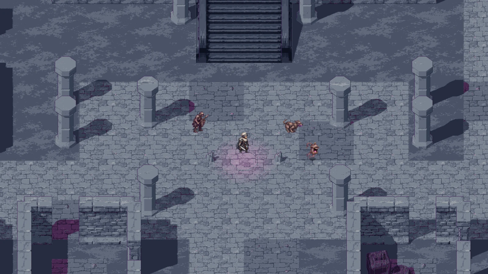

# Matière de la Cité Effondrée — carte 5

Passe sur `codex/matiere-cite-effondree`, depuis main actualisé le 17 novembre 2026.
La Cité conserve son damier, son forum, ses maisons ouvertes, ses entrepôts, son temple et son acropole.
La [Cour validée](REFERENCE_DECORS_3D.md) reste la référence de finesse, adaptée à une cité nocturne.



## Direction

Pierre pâle et joints usés pour les murs, pierre travaillée plus calme pour les piliers et moulures,
petit pavage irrégulier, bois sombre, fer mat et bronze terni. Le sol entre les rues est une poussière
de pierre grise avec de faibles traces mauves ; les lueurs violettes existantes marquent la Faille.
Les anciennes cases de terre des rues reçoivent le même pavage légèrement assombri : elles ne découpent
plus de grands carrés de couleur dans le sol. Les escaliers reprennent le mesh UV et l'atlas de la Cour.

La matière est peinte par imagegen. Deux sources finales sont conservées : gabarits des matières et sol
calme, dans `assets/concepts/incoming/material.city/source/`. Les prompts exacts sont dans `prompts.json`.
Le panneau de tissu de la source composite n'est pas exploité : aucune nouvelle bannière n'est ajoutée.

Les sprites, le Veilleur, les lumières et le soleil de la carte restent inchangés. Aucun nouveau corps,
décor, obstacle, effet, collision ou chemin. Aucun changement dans `src/`, `data/` ou les shaders.

## Méthode et densité

`draft3d/matter/city/dressing.gd` copie les meshes en mémoire en conservant les positions et normales
locales ; seuls les UV et les matériaux changent. Les UV0 source restent en UV2 pour la vérification.
Les triangles sont regroupés par famille de matériau. Flammes et petits éléments végétaux conservent
leur matériau source. Les ressources KayKit et les meshes physiques ne sont pas réécrits.

Les UV projetés dans le monde raccordent les modules, y compris les pans tournés, les sols et les étages.
Les textures sont partagées ; un cache de meshes utilise une phase commune de 24 m, multiple de toutes
les périodes de matière. La densité nominale est **40 texels/m** sur les surfaces orthogonales ; les petits
biseaux restent dans leur géométrie source et utilisent une matière calme. Nearest, sans mipmaps,
matériaux rugueux, sans reflet spéculaire ni ombre directionnelle peinte.

| Matière | Texture | Période |
| --- | --- | --- |
| Maçonnerie | 96² | 2,4 m |
| Pierre travaillée, fer, bronze | 160² | 4 m |
| Bois | 64² | 1,6 m |
| Pavage et pavage usé | 120², texture commune | 3 m |
| Poussière de pierre | 320² | 8 m |

Sept textures et huit matériaux, sans atlas dupliqué par objet. Chaque texture a 12 couleurs, le sol 16.
La palette de rendu propre à la cité contient **48 couleurs**, comme les autres passes validées :
pierre claire, ardoise, gris neutres, bois, bronze et accents de Faille. Les rampes grises évitent de
transformer les petites variations du sol en taches bleues et roses. Le seul changement de rendu en code
est la sélection de cette palette pour le chapitre 5, pas une modification des shaders.

Le test de mousse de la Cour s'applique désormais au seul chapitre 1 : la cité ne réutilise plus sa palette
verte. Les autres vérifications du rendu pixel restent inchangées.

## Vérifications

Rapport natif : `docs/previews/matiere_cite_effondree/validation.json`.

- **438 meshes**, **28 modèles de scènes** et **143 349 triangles** contrôlés avant/après.
- Sommets et UV source identiques ; écart maximal d'encodage des normales : 0,000248.
- Les boîtes de rendu ont un écart maximal de 0,0000101 m : petite marge ajoutée par Godot lors de la
  conversion BoxMesh → ArrayMesh. Les triangles sont vérifiés séparément, sans relâcher leur égalité.
- **180 formes de collision**, poses des modules et **1 185 polygones de navigation** identiques,
  avec empreintes SHA-256.
- Aucun nœud de décor ni corps ajouté par l'habillage ; terrain et escaliers couverts par le contrôle.
- Tests existants du rendu pixel : 8/8 ; lint ciblé et `git diff --check` conformes.

Sept cadrages de la vraie partie avant/après : forum, porte, maisons, entrepôts, temple, acropole et ensemble.
Six détails à la vue de jeu de 20 m, ensemble dézoomé à 76 m, sortie 1600 × 900. Veilleur et trois monstres
du chapitre (milicien déchu, chien corrompu, lanterne-spectre) aux mêmes positions ; combat et poses figés.
La comparaison inclut le remplacement de la palette d'origine de 32 couleurs par la palette de 48 couleurs.

Import des images effectué dans un projet minimal aux mêmes chemins res://, puis contrôles et captures
dans le projet complet en OpenGL natif. Aucun changement des imports KayKit n'est poussé. Les messages
de secours UID vers chemin texte et les avertissements de ressources à la fermeture existent aussi sur
la capture originale ; ils sont distincts de l'habillage et ne signalent pas une texture manquante.

## Essayer, comparer, reproduire

Habillage actif par défaut sur la carte 5 dans cette branche : `draft3d/main.tscn -- --chapter=5`.
`--city-matter=0` restaure toutes les matières et la palette d'origine. Ajouter `--city-palette` pour garder
les anciens matériaux avec la nouvelle palette.

```text
python tools/art/condition_city.py
godot --headless --editor --import --path .
godot --path . res://tools/art/check_city_matter.tscn -- --city-matter=0 --report=<rapport.json>
godot --path . --resolution 1600x900 res://tools/art/city_reference.tscn -- --chapter=5 --seed=42 --reference-region=all --reference-out=<dossier>
godot --path . res://tests/run_tests.tscn -- --filter=test_pixel_render
```

Le conditionnement nécessite Pillow. Il découpe, réduit en nearest et quantifie les sources, sans dessiner
de matière. Les variantes de teinte sont dans les matériaux ; les palettes sont des ressources éditables.
Validation artistique par le propriétaire avant fusion de la PR brouillon.
