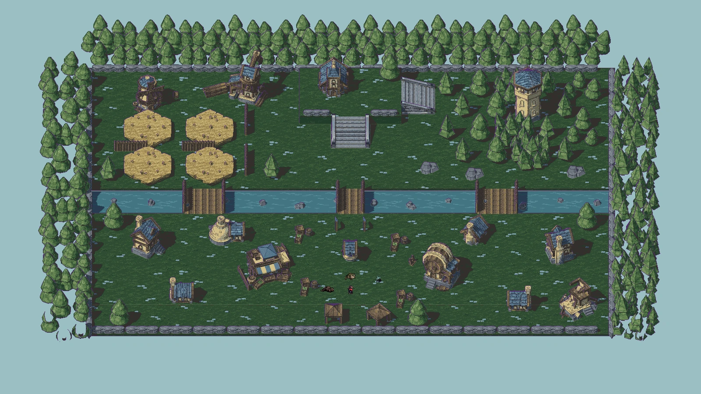

# Matière du Hameau du Gué — carte 3

Première passe à valider sur `codex/matiere-hameau-gue`, branche créée depuis main actualisé.
La [Cour validée](REFERENCE_DECORS_3D.md) reste la référence de finesse. La carte 2 et sa PR #175
restent séparées : aucun fichier de matière du cimetière ni fusion de cette PR n’est nécessaire ici.



## Choix artistiques

Le Hameau conserve son village en plein jour, sa rivière et ses toits bleus. Les aplats très vifs du pack
sont remplacés par des matières sobres : pierre froide et sol végétal de la Cour, enduits patinés,
bois vieilli, ardoises bleu-gris, toile, écorce et feuillages groupés. Les champs restent dorés ; l’eau
reste clairement distincte des surfaces praticables. Soleil, ambiance, géométrie et sprites ne changent pas.

Une seule nouvelle source peinte, produite par l’outil **imagegen intégré**, fournit huit gabarits : enduit,
bois, ardoises, toile bleue, écorce, feuillage, paille et eau. Les centres restent calmes et l’usure suit les bords.
La pierre utilise le panneau calme de la source Cour et les sols utilisent sa texture végétale existante.
L’herbe reste basse et peinte, sans superposition d’un tapis de petits brins 3D.

La passe couvre **33 modèles Medieval**, **35 variantes d’échelle**, **40 meshes préparés** et
**185 instances de meshes peintes**. Les trois ponts sont habillés de planches, les trois volumes de terrain
(deux rives et butte) partagent les UV mondiaux du sol ; le volume d’eau reçoit des rides peintes statiques.
Les deux escaliers de la butte reprennent le mesh et l’atlas validés de la Cour. Au total, 194 instances
visuelles changent de mesh UV/matière. Aucune pièce n’est déplacée, ajoutée au parcours ou supprimée.

## Échelle et UV

Les modules de ce pack sont des miniatures, agrandies en général ×5, avec des pièces ×4, ×4,5, ×6, ×7 et ×8.
Le nom d’une variante contient cette échelle (`_s500` pour ×5). L’export des coordonnées de texture prend
aussi en compte le transform local de chaque MeshInstance3D ; les sommets du mesh restent dans leur repère d’origine.
Les copies ne changent que les UV et matériaux, avec UV0 source conservés en UV2.

Densité nominale : **40 texels/m**, proche des 0,02404 m/pixel du rendu à la vue de jeu de 20 m.
Les îlots coplanaires reliés sont regroupés puis emballés avec une gouttière de deux texels.
Deux texels minimum pour les petits biseaux ; les petits îlots reçoivent un centre calme et les poutres fines
une bande de bois, pour éviter de répéter quatre planches sur une arête de quelques centimètres.

Les atlas font 1024 px de large, de 32 à 2048 px de haut dans ce lot (limite de l’outil 4096).
Ils totalisent environ 23,36 millions de texels, soit **89,1 Mio en RGBA** sans mipmaps.
Ce chiffre est une estimation des buffers de texture, pas une mesure de mémoire totale du jeu.
Les textures sont en nearest, sans mipmaps, rugosité 1 et spéculaire 0.

Le sol reprend les 640² texels /16 m de la Cour, avec une modulation un peu plus sombre sous le soleil plus fort
(0,65 ; 0,70 ; 0,75). Le pont utilise 48² texels /1,2 m : ses planches font ainsi environ 30 cm de large.
L’eau utilise 320² /8 m, avec des rides espacées ; elle reste statique comme le volume d’origine.
La maquette physique des trois passages, largeurs 7 m /4,5 m /7 m, est conservée.

Six tons sont réservés par gabarit ; chaque atlas est limité à 48 couleurs si ses familles dépassent ce budget.
La palette de rendu propre au village contient 48 couleurs (pierre, enduit, bois, verts, blés, eau et ardoises),
avec des valeurs plus sobres que les 32 couleurs d’origine. Les shaders de rendu restent intacts.
Le seul changement dans `pixel_render.gd` est le choix de cette palette pour le chapitre 3.

## Essayer et comparer

Dans la branche : `draft3d/main.tscn -- --chapter=3`, habillage actif par défaut.
**`--village-matter=0`** restaure l’ancienne matière et sa palette.
Ajouter **`--village-palette`** conserve l’ancienne matière avec les 48 couleurs de la nouvelle palette :
c’est le réglage des comparatifs pour isoler le travail de texture de l’effet de palette.

Les six régions de `tools/art/village_reference.tscn` sont `square`, `bridge`, `fields`, `church`, `grove`
et `overview`. Les cinq détails gardent la vue de jeu de 20 m ; la vue d’ensemble est dézoomée à 70 m.
La scène dérive de DraftRun, utilise son éclairage, son rendu pixel et ses sprites : Chasseur,
`mire_leech`, `rift_gnat`, `bloat_toad`. Combat et poses figés pour comparer, acteurs posés sur la navigation.
Les mêmes cadrages, positions, acteurs et palettes sont vérifiés avant/après. Le bosquet garde son occultation
naturelle par les feuillages ; le cadrage de comparaison place les acteurs dans la clairière avant.

```text
godot --path . --resolution 1600x900 res://tools/art/village_reference.tscn -- --chapter=3 --bot --passive --god --seed=241115 --pixel=1 --reference-region=square --reference-out=<sortie>
```

Pour l’avant, ajouter `--village-matter=0 --village-palette`. Les captures 1600 × 900 sont exportées en WebP,
sans retouche du rendu ; les comparatifs verticaux gardent la taille originale des pixels écran.
Livraison : `docs/previews/matiere_hameau/`, avec rapport et vue d’ensemble.

## Assets et reproduction

- Source retenue et job : `assets/concepts/incoming/material.village/`.
- Atlas, meshes, plans UV, manifeste de variantes, palette et matériaux : `draft3d/matter/village/`.
- Références réutilisées : `assets/concepts/incoming/material.painted_kit/source/templates.png`,
  `draft3d/matter/painted_kit/ground/terrain.png`, `draft3d/matter/cour/textures/iron.png`,
  `draft3d/matter/painted_kit/stairs_wide.res`.

Les textures de matériaux n’ajoutent pas d’objets Sprite3D au catalogue de sprites : aucune entrée nouvelle
au manifeste d’assets n’est nécessaire. Les scènes, binaires et licences CC0 KayKit ne sont pas réécrits.
Pas de changement dans `src/`, `data/`, les règles, les Échos, l’interface ou les minuteries.

Pillow et NumPy nécessaires. Les coordonnées exportées et caches d’import restent hors Git.

```text
godot --path . res://tools/art/build_village_meshes.tscn -- --village-matter=0 --export=<faces.json>
python tools/art/condition_village.py assets/concepts/incoming/material.village/source/materials.png <faces.json>
godot --headless --editor --import --path .
godot --path . res://tools/art/build_village_meshes.tscn -- --finalize
godot --path . res://tools/art/check_village_matter.tscn -- --village-matter=0 --report=<rapport.json>
```

Pour une calibration d’albédo seule : `--finalize --retint`, sans réencoder la géométrie.
Le helper partagé `condition_painted_kit.pack` reçoit deux paramètres facultatifs de taille d’atlas ; ses
valeurs par défaut et le fonctionnement du kit Cour restent inchangés. Cette extension est identique à celle
de la PR #175, pour que les deux lots puissent utiliser le même helper une fois intégrés.

Sur cette machine, le cache d’import Medieval manquait initialement : le pack original puis les nouveaux PNG
ont été importés dans un projet minimal aux mêmes chemins res:// et leurs caches transférés. Le projet complet
a ensuite servi à toutes les captures et contrôles. Aucune modification de métadonnée d’import du pack n’est poussée.

## Vérification

Contrôle natif conforme sur **29 571 triangles** : sommets, UV source et emprises conservés ; écart maximal des
normales 0,000258 après encodage, sous le seuil de 0,0003. Les sept surfaces terrain/ponts/eau gardent leurs
sommets et normales. Les **140 formes de collision**, les poses et les **760 polygones de navigation**
sont identiques avant/après, avec empreintes SHA-256. Les trois ponts sont explicitement comptés.

42 nouvelles textures/imports contrôlés, atlas ≤48 couleurs, UV bornés ; six paires de captures aux métadonnées
identiques. Lint des six scripts GDScript concernés conforme. Pas d’erreur de script, de chargement ou de
synchronisation de navigation sur ces captures finales. Des messages de ressources OpenGL non libérées sont
présents à la fermeture, comme sur le rendu d’origine et les captures de la Cour ; ils sont distincts de la passe.
La validation artistique reste celle du propriétaire avant fusion.

## Prompt exact de la source retenue

```text
Use case: stylized-concept. Production pixel-art ALBEDO TEXTURE TEMPLATE ATLAS for map3 of Rift Hunters, the Fordside Hamlet: sunny medieval village with slate-blue roofs, worn timber and pale plaster, fields, river, trees. Reference1 is the approved in-game courtyard: MATCH its restrained detailed 16-bit pixel-art craftsmanship, purposeful edge wear, quiet centres, and subordinate environment contrast. Reference2 is the current toy-like village: retain the medieval identity and blue roofing, but replace flat saturated lime/cyan/orange materials with natural muted painted materials. No rendered scene, no characters or objects.
Output one rectangular atlas EXACTLY FOUR COLUMNS BY TWO ROWS of EIGHT equally sized square material panels, edge to edge, NO border, labels, gutters or text. Every panel is flat orthographic albedo, no perspective or baked directional light/cast shadow. Main engine supplies sunlight. Crisp intentional pixel clusters at target native160x160 per panel, about 4m of surface, richly detailed but calm. No noise, dithering, blur, scribbled cracks, stippling, camouflage patches or shiny sparkles.
TOP ROW left to right:
1 PALE LIME PLASTER: muted warm grey-beige #77786d #8c8c7e #a3a391 #b9b8a2, quiet unbroken centre, restrained wear/dirt close to outer edges and a little damp near bottom. No bricks or grid; no white.
2 TIMBER BOARDS: four broad vertical boards of weathered oak #403a38 #554a43 #6d5c4c #85735e #a08a6d, calm centres, subtle sparse grain and split board seams, slightly worn edges. No orange/yellow fresh lumber, no nail grid.
3 BLUE SLATE ROOF: about eight staggered horizontal rows of small overlapping slate shingles in subdued blue-grey #2f4356 #40576c #536b7e #6c8191 #8898a1. Tiny restrained chips along shingle lower edges, quiet centres, no bright cyan, no arbitrary random holes. Repeatable in both axes, no perspective.
4 BLUE CLOTH: muted dusty indigo-blue #354b61 #4d657b #6a8092 #8798a4, subtle sparse pixel weave near edges and quiet central cloth. No folds casting painted shadows, no stripes (stripes already exist as geometry/color regions), no banners or object silhouettes.
BOTTOM ROW left to right:
5 TREE BARK: broad restrained vertical bark furrows in grey-brown #343634 #48443d #5e5647 #786d55, calm central masses, lichen sparse, not dense scratch noise, no tree silhouette.
6 BROADLEAF CANOPY SURFACE: grouped rounded leafy scallops in close-valued muted sage/olive greens #344a36 #476044 #5c7450 #71865d #8b9b70. Overlapping sprays whose details cluster near edges, large QUIET connected midtone areas. NO black gaps, NO random dark/light camouflage islands, NO neon lime, NO isolated leaf confetti. This wraps simple rounded 3D tree crowns; do not draw a full tree.
7 DRY WHEAT / STRAW: gentle upright golden-olive straw clusters #65553a #807046 #9b8855 #b3a06c, restrained detail near a few clustered stalk tips, large quiet field material, no grid, no ground or full wheat plants.
8 RIVER WATER: flat subdued blue-teal #244953 #35616c #487986 #628f98 #7ba1a6, broad calm connected colour masses, sparse small horizontal pixel ripple strokes and a few quiet wavelet clusters, seamless both axes. No white foam, no sparkling dots, no islands, no stones, no shoreline or perspective. It will wrap a flat existing river slab without changing geometry.
Shared palette discipline with cold worn stone and detailed dark-fantasy character sprites. Values mostly middle/dark, select lights only at material edges, don't texture every centre. No gradients, antialiasing, photographic grain or uniform all-over moss. Keep each exact panel in its own eighth.
```
