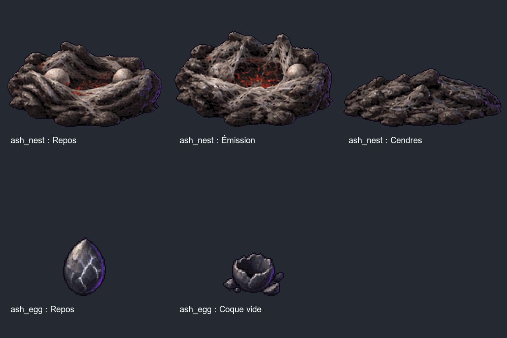

# Nid et œuf de cendre — carte 8

Deux planches peintes originales, générées sans ressource tierce. Prompts exacts, références de
matières, originaux et SHA256 dans leurs dossiers `assets/concepts/incoming/object.ash_*/source/`.
Le nid reste `wip` pour validation visuelle ; l'œuf est `final` conformément au brief et remplace
le prototype de Claude. Aucune donnée, attaque, cadence d'apparition ou règle modifiée.

## Atlas et paramètres

| Objet | Cellule | Ancre | Échelle | Taille contrôlée au repos |
|---|---|---|---|---|
| object.ash_nest | 256 × 256 | 128,238 | 0,5 | largeur environ 92 unités, contour compris |
| object.ash_egg | 128 × 128 | 64,118 | 0,5 | hauteur environ 23 unités, contour compris |

Les cibles avant contour sont 90 unités de large pour le nid et 22 de haut pour l'œuf.
Même pipeline `tools/art/import_sheet.py`, palette de 32 couleurs, fond transparent, contour
sélectif. Les résidus d'alpha inférieurs à 16 sont éliminés uniquement dans les bandes de travail ;
les originaux sont conservés. Aucun contour principal redessiné. Découpe à bornes arrondies puis
réespacement technique, pour ne pas rogner les planches aux dimensions non divisibles.

| Objet | Animation | Rangée | Poses | Cadence | Boucle |
|---|---|---|---|---|---|
| nid | idle | 0 | 6 | 6 images/s | oui |
| nid | spawn | 1 | 6 | 10 images/s | non |
| nid | death | 2 | 6 | 10 images/s | non |
| œuf | idle | 0 | 6 | 6 images/s | oui |
| œuf | hatch | 1 | 6 | 12 images/s | non |

## Contrat pour Claude

- Nid : jouer idle au repos, spawn lors de l'émission d'un Rampe-cendre, death à sa destruction.
  Spawn ne contient pas de créature peinte et ne déclenche aucune apparition par lui-même.
  La dernière pose de death, index 5, est un tas bas de cendre à conserver ou faire disparaître selon le moteur.
- Œuf : conserver idle pendant son compte à rebours ; jouer hatch pour l'éclosion. La dernière pose,
  index 5, est une coque vide, sans petit monstre peint. Le jeu garde la responsabilité de l'apparition
  de l'ennemi, de la destruction de l'œuf et de leurs collisions.
- Ne pas déduire dégâts, portées ou minuteries des cadences d'animation. Leurs noms de manifeste
  restent object.ash_nest et object.ash_egg ; aucun code src/ ou fichier data/ n'est modifié.
- Aucun cercle, grande gerbe, halo de sol ou télégraphe n'est inclus dans les atlas.

## Aperçus et contrôles

Cinq GIF et les deux derniers états sont dans `docs/previews/ash-nest-egg/`, exclu de l'import
Godot par `.gdignore`. `tools/art/preview_ash_objects.py` contrôle les 30 poses, marges et tailles.
Import et chargement ciblés de quatre textures dans Godot 4.3 : **30 poses, cinq animations,
aucune erreur**. Rapport `godot_control.json`. Pas de simulation de combat ni de suite globale
revendiquée : ce lot livre des visuels, le niveau jouable et ses mesures restent à Claude.
