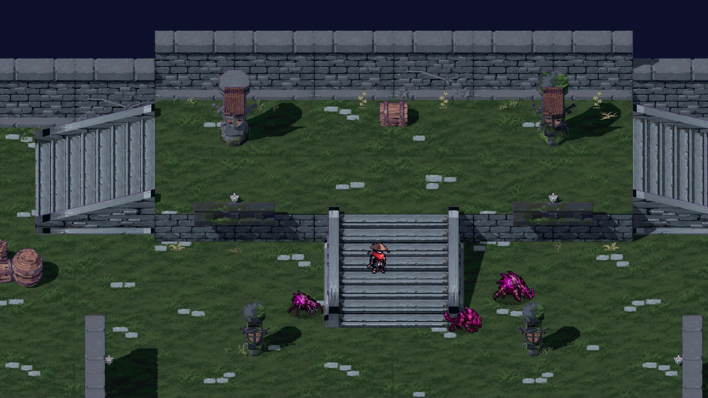

# Référence validée des décors 3D

Le propriétaire valide le **15 novembre 2026** la Cour après harmonisation du sol, des murs et des escaliers
(PR #169) et demande de garder ce style comme référence, puis de passer à la carte 2. Les détails secondaires
de la Cour ne bloquent pas cette suite et pourront être repris plus tard.

## Ce qui fait référence

- Pixel art peint détaillé, aux pixels francs, à la densité des sprites ; ni surfaces lisses unies,
  ni bruit réparti uniformément. Matières lisibles, centres calmes, accents sur les arêtes et transitions.
- Joints suivant les blocs, usure suivant les nez de marche ; dégâts conservant les ouvertures et cassures.
  Mousse liée aux pieds et zones humides, sans masquer toute la pierre.
- Sol en masses végétales connectées, petites dalles espacées, détails subordonnés aux personnages.
  Quelques touffes 3D larges et basses, sans doubler la texture par un tapis dense de petits brins.
- Rendu évalué dans la vraie partie, palette et éclairage actifs, avec les sprites existants inchangés.
  Couleurs et contrastes du décor laissent lire personnages, projectiles et télégraphes.
- Aucun changement de plan, de relief, de collision ou de navigation dans une passe de matière.

La référence technique est de 40 texels/m, nearest sans mipmaps, proche des 0,02404 m/pixel de la caméra.
Les textures du sol ont 32 couleurs ; les atlas de pierre et la palette de rendu de la Cour ont jusqu’à
48 couleurs. Cette richesse a été évaluée avec les sprites réellement utilisés, pas seulement les anciennes
spécifications génériques de cellules 64 px. Le shader de rendu et les sprites ne sont pas modifiés par ce lot.

## Activation et sources

Cet habillage est désormais **actif par défaut sur la carte 1**, aussi dans le fond du menu qui utilise la Cour.
`--painted-kit=0` restaure toutes les anciennes matières, l’herbe et la palette standard ; ajouter
`--painted-kit-palette` pour comparer ces anciennes matières avec les 48 couleurs de référence.
`--painted-kit-ground=0` restitue le seul ancien sol/herbe. L’ancienne option `--painted-kit` reste compatible.

- Guide et prompts pierre : [ESSAI_KIT_PIERRE_PEINTE.md](ESSAI_KIT_PIERRE_PEINTE.md).
- Guide et prompts sol : [SOL_VEGETAL_COUR.md](SOL_VEGETAL_COUR.md).
- Captures et preuves : `docs/previews/murs_escaliers_cour/`, `docs/previews/sol_vegetal_cour/`.
- Assets : `draft3d/matter/painted_kit/` ; sources finales et jobs dans
  `assets/concepts/incoming/material.painted_kit/` et `material.cour_ground/`.

## Déclinaison à la carte 2

La carte 2 de la v2 est le **Cimetière des Cendres** (`draft3d/level_graveyard.gd`, KayKit Halloween).
Reprendre la finesse, la hiérarchie de détail et l’intégration aux sprites de cette référence, en adaptant
les matières à son cimetière nocturne. Ne pas copier automatiquement le vert du sol de la Cour ou sa lumière.
Conserver le plan et les collisions existants ; livrer des captures dans l’éclairage de cette carte.
