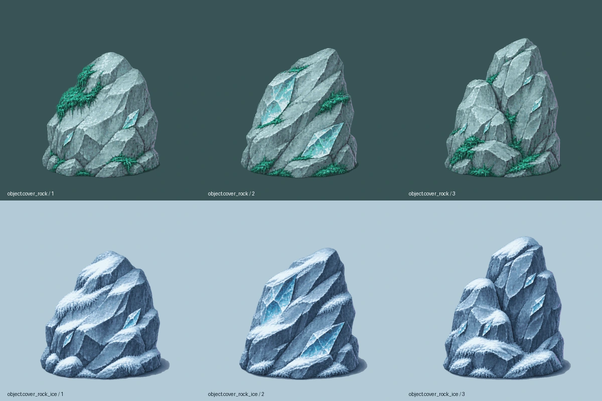

# Rochers-abris — marais et glacier

Livraison graphique du 3 novembre 2026 : `object.cover_rock` et `object.cover_rock_ice`, **trois variantes statiques chacun**. Pierre cyan, éclats de cristal-miroir et mousse émeraude pour le chapitre3 ; neige et glace pour le chapitre4. Éclairage haut-gauche, liseré violet discret bas-droite, texture fine adaptée aux décors peints.



[Contrôle Godot au zoom du jeu](../previews/rochers-abris/planche_720p.png) · [Mesures](../previews/rochers-abris/controle_geometrique.json)

## Contrat graphique pour Claude

- Cellule **384 × 384**, ancre au pied **(192,344)**, échelle **0,5**. Ce format contient les hauteurs demandées et leur ombre.
- Emprise de contact calibrée à **environ 116 unités** de large. Hauteur au-dessus du pied : **122 à 139 unités** selon la variante, dans la plage demandée de 120 à 160.
- Animations `variant_1`, `variant_2`, `variant_3` : une pose chacune, sans boucle. `idle` est un alias de `variant_1`. Elles sélectionnent une variante ; ne pas les faire défiler comme une animation.
- Les trois poses occupent les rangées0/1/2 de la feuille ; le manifeste fournit `row`, `cell`, `anchor` et `scale`. Placer le pied du sprite au point choisi par le jeu.
- **Ombre portée incluse**, avec alpha conservé. Ne pas ajouter une seconde ombre sous ces objets. La référence de contact est celle du rocher, pas le bas de l’ombre : les `frame_offsets` des recettes compensent ce décalage.
- Aucune scène de physique, collision, donnée d’arène ou position en niveau livrée. Le rayon d’obstacle d’environ58 unités, l’arrêt des tirs et les placements relèvent de Claude.

## Sources et reconstruction

Recettes : `assets/concepts/incoming/object.cover_rock/job.json` et `object.cover_rock_ice/job.json`. Une seule source retenue par objet sous `source/variants.png`, avec les prompts, les empreintes et `registration.json` : contacts relevés sur chaque source, échelle commune de base et décalages d’ancrage. Les étapes de génération sont tracées par leurs empreintes ; les essais restent hors Git.

L’import utilise le pipeline existant, sans modifier l’importeur :

```bash
python3 tools/art/import_sheet.py assets/concepts/incoming/object.cover_rock/job.json
python3 tools/art/import_sheet.py assets/concepts/incoming/object.cover_rock_ice/job.json
```

Les trois colonnes des sources deviennent trois rangées statiques. Palette commune limitée à32 couleurs RGB, contour peint conservé, alpha des ombres préservé. La correction des proportions a précédé le calibrage ; l’ombre des rochers des marais a été assombrie pour fonctionner aussi sur un sol sombre.

## Vérifications et limites

Import Godot4.3 et `tools/run_tests.sh assets` réussis : **449 entrées, 447 valides, 2 placeholders hors lot, zéro erreur**. Le banc de présentation utilise les vrais fichiers du manifeste et le zoom du jeu1,3333, avec le Chasseur témoin. Les six poses sont entières dans leurs cellules, sans bord touché ; palettes et hauteurs contrôlées.

`src/`, `data/`, les fichiers des cartes14/15 et toutes les autres entrées du manifeste restent identiques à main. Les bancs servent à la revue graphique ; aucune collision, navigation ou efficacité de protection en combat n’est revendiquée. Le propriétaire valide le rendu en partie et Claude raccorde les objets aux abris du jeu.
