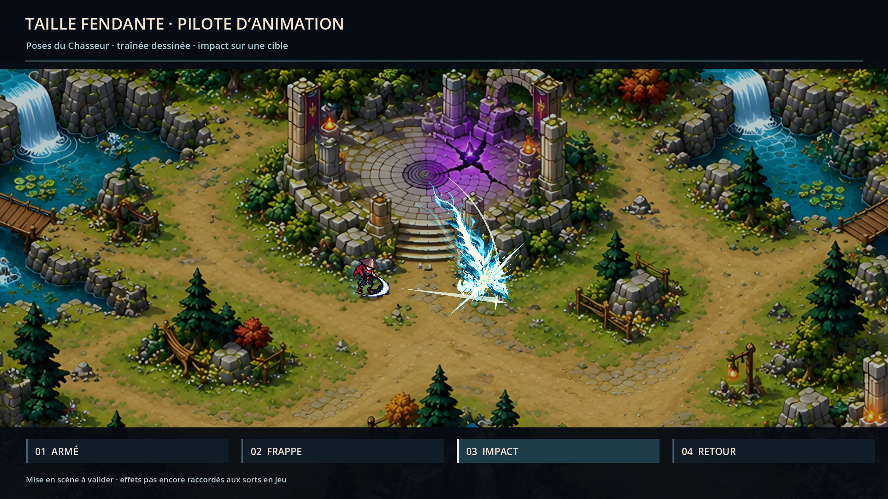

# Taille fendante — pilote de mouvement et d’impact

Suite C5 du 16 octobre 2026. Référence demandée par le propriétaire : le rythme, les
silhouettes de coupe et l’impact de Hades, avec les personnages, décors et couleurs
de Rift Hunters. Le pilote est une proposition à valider, pas une équivalence de finition
revendiquée avec le jeu de Supergiant.

## Ce qui change

La coupe emploie une vraie texture dessinée, déformée le long d’un arc animé,
avec un deuxième passage de rémanence. Le contour irrégulier, les coupures et les
filaments viennent du dessin ; le mouvement vient du maillage Godot.
La palette passe à l’ivoire/cyan allié plutôt qu’un anneau doré uniforme.

Deux images originales ont été créées avec le skill imagegen, outil intégré
`image_gen.imagegen` : `textures/blade-ribbon.png` et `textures/blade-impact.png`.
Les prompts complets et la provenance sont conservés dans `textures/generation.json`.
Les PNG conservent leur alpha original, sans détourage ou retouche externe.
Le shader `assets/vfx/hunter/cel_paint.gdshader` limite le rendu à huit teintes
et quatre niveaux d’alpha, avec dissipation en fragments, sans halo flou.

Le démonstrateur associe les sept poses d’attaque existantes du Chasseur à la coupe,
à une cible réelle du bestiaire (`enemy.husk`) et au décor existant de la Plaine fracturée.
Il ajoute des rémanences du personnage, une réaction visuelle de cible, une pause de
45 ms au contact et un très petit déplacement de caméra. Le ratio personnage/décor
vient des échelles du manifeste. La présentation est rendue en 1920 × 1080.

## Regarder le pilote

### En partie

[Vidéo native en partie](../previews/c5/live/taille-fendante-en-partie.mp4) : 2,5 secondes
en 1920 × 1080 à 30 images/s, sans montage ni piste audio capturée. Scène `scenes/run.tscn`
existante, vraies vagues, collisions, HUD, Écho et combat C1. Le bot et l’invulnérabilité
de capture sont ceux du protocole `tools/screenshot.gd`, avec `skip_profile` et données
utilisateur isolées. Aucune modification du code de jeu.

Le banc `tools/art/c5_live_preview.tscn` ajoute seulement un adaptateur de présentation :
il écoute les vrais événements `spell_cast` et `enemy_damaged`, remplace le secteur visuel
de travail et produit l’impact uniquement sur les coups confirmés de Taille fendante
(dans C1 : dégâts de sort du joueur + Fracture). Il ne déclenche pas lui-même les sorts,
ne crée pas d’ennemi et ne change ni dégâts, portée, cooldown ni déplacement.
Pour l’affichage du coup instantané, la pose de frappe commence à la frame 3.
L’impact est réduit de 104 à 72 unités, à 78 % d’opacité, avec deux occurrences maximum
par frappe. La coupe est affichée à 85 %. Pas de nouvelle pause ou secousse de simulation.

Capture déterministe : seed 31, premier contact de Taille après 25 s, obtenu à 28,47 s
avec sept ennemis vivants. Les 75 images sont encodées par `tools/art/encode_c5_live.py`
avec un exécutable FFmpeg fourni par `--ffmpeg` (H.264, CRF 16). L’encodeur utilisé ici
vient de `imageio-ffmpeg 0.6.0`, installé seulement dans le dossier de travail hors dépôt.
La vidéo sert à juger la lisibilité en situation ; l’adaptateur n’est pas raccordé au lancement normal du jeu.

### Étude du geste

Lancer `res://tools/art/c5_slash_pilot.tscn` pour une lecture continue.
Avec `-- --capture`, le démonstrateur exporte quatre captures et 60 images natives
dans `docs/previews/c5/pilot/`. Puis `python tools/art/encode_slash_pilot.py`
encode un WebP sans perte, de deux secondes à 30 images/s. L’outil d’encodage
n’effectue aucune retouche sur les captures. Les images intermédiaires restent locales.

Le bandeau de démonstration est traduit FR/EN dans `i18n/strings.csv`, clés `C5P_*`.

## Ressources raccordables

- `vfx.hunter.cleaving_slash` : scène d’arc existante, maintenant texturée.
  API inchangée : `play(direction, variant)` / `seek_visual(seconds)` / `duration()`.
- `vfx.hunter.cleaving_slash.ribbon` : texture de coupe de 2172 × 724.
- `vfx.hunter.cleaving_slash.impact` : scène autonome `blade_impact.tscn`, texture
  1254 × 1254, `play(direction)`, `duration() = 0.42`, `seek_visual(seconds)`.
  Taille nominale 104 unités du monde ; enveloppe visuelle conservatrice 144 × 144.
- `choreography.json` : chronogramme de poses et repères visuels pour C1/C2.

La lame conserve la portée nominale 150. Les franges de dessin dépassent légèrement
le contour de la zone, sans définir de collision. Tourbillon emploie aussi la texture
partagée ; Estoc et les sorts prismatiques attendent leur propre passe illustrée.

Les deux PNG sont référencés dans le manifeste ; le champ `textures` de l’arc les expose
également. Les affiches SVG du catalogue ne remplacent pas ces nouvelles textures en lecture.

## Raccordement par Claude — C1/C2

Le démonstrateur isolé **n’est pas une scène de combat** : aucun `Player`, `Enemy`,
`RunContext`, dégât, collision, état, déplacement physique ou sauvegarde.
Les sprites ne changent jamais d’apparence source ; seules les poses existantes sont rejouées.
Le recul de la cible est une mise en scène locale, pas un réglage de knockback.

Le repère de contact est à 0,19 s après le début du geste, soit 0,10 s après le début
de l’arc. Ce chronogramme sert à synchroniser la présentation. **Il ne doit pas retarder
les dégâts ni ajouter de latence de lancement sans décision côté gameplay.** Pour garder
le lancement instantané de C1, appeler `play_from(direction, &"base", 0.10)` : l’effet
commence à la phase de coupe puis poursuit sa lecture, sans imposer un délai au combat.
Le démonstrateur ne modifie pas ce comportement. C1 peut aussi synchroniser une anticipation
déjà disponible sans changer la fenêtre de contrôle du joueur.

L’impact autonome se lance seulement sur un contact confirmé par le combat, à la
position de ce contact. En cas de coup manqué, conserver uniquement la coupe.
Ne pas ajouter automatiquement une explosion en bout d’arc si aucune cible n’est touchée.
Les pauses et secousses restent optionnelles, limitées et réservées au raccordement C1.
Le pilote est muet : le raccordement du son, de la caméra et de la réaction de cible
en partie appartient à Claude ; aucun système sonore ou de caméra de jeu n’a été modifié.

## Validation attendue

Valider le poids du geste, la largeur et la lisibilité de la coupe et l’intensité de l’impact.
Après validation, décliner le langage graphique sur Estoc, Tourbillon, les sorts de Prisme
puis les autres familles, en conservant les signatures propres de chaque voie.

## Contrôles ciblés

Import Godot sans erreur après les deux textures et les sept textes FR/EN.
Validation des assets : 73 entrées, 72 valides, un placeholder préexistant, zéro erreur.
Le pilote produit ses quatre captures et ses 60 images sans erreur de rendu.
La capture en partie produit 75 images sur des contacts réels, avec HUD et autres effets actifs.
Le démontage du banc de partie a aussi été vérifié : services de contexte libérés avant fermeture,
sans diagnostic de ressources encore utilisées à la sortie.
Le shader, la scène d’impact et les variantes de coupe sont chargés par les aperçus natifs.
Aucun changement dans `src/` ; pas de relance de toute la suite pour ce lot visuel.
