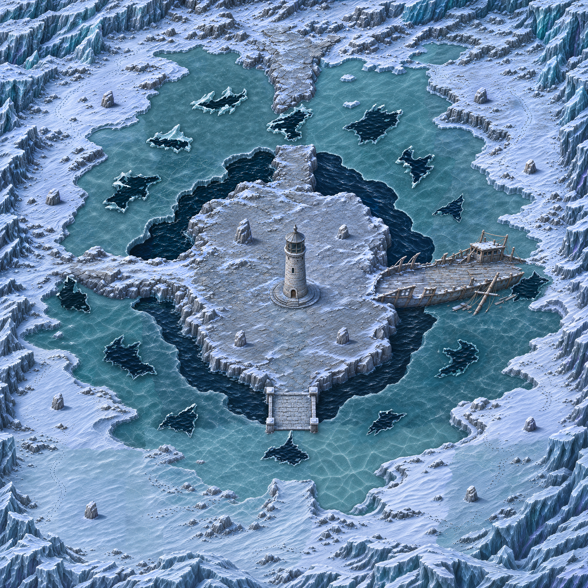
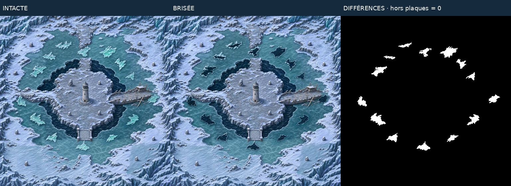

# Carte 19 — La Banquise du phare

**Détail graphique livré — 5 novembre 2026.** `lighthouse_floe`, chapitre 4, Glacier silencieux.
Défense d’autel ; B4 « Banquise qui se fend ». Le propriétaire a retenu la **première** composition
corrigée, longue épave à l’est et crête à l’ouest. Les deux ajustements autorisés sont appliqués :
plaques sous 600 unités et P05 à la sortie est de l’épave.

| Intacte entière | Brisée entière |
| --- | --- |
|  |  |

## Plan et échelle

Monde **5016 × 5016 unités** : île portant le phare éteint, fossé permanent d’eau noire,
anneau de banquise praticable, rivages enneigés et falaises. Le phare peint est l’autel.
Le [plan.json](../../assets/concepts/incoming/map.lighthouse_floe/plan.json) est approuvé et verrouillé.
Coordonnées en pourcentages depuis le coin haut-gauche du cadrage entier. Les polygones B4 suivent
les surfaces supérieures détaillées ; les lèvres et faces verticales décoratives restent communes.


| Repère | Position ou chemin |
| --- | --- |
| Départ | 21 % ; 80 %, place dégagée sud-ouest |
| Pied du phare | 50 % ; 50,7 %, socle cible 300 unités |
| Nord | Crête rocheuse ; plaque P01 |
| Est | Épave inclinée, bordages brisés, fer rouillé, mât couché ; P05 après la coque |
| Sud | Passerelle de pierre ; plaque P08 |
| Ouest | Crête rocheuse enneigée franchissant le fossé ; plaque P11 |
| Retour | Boucle de rivage ferme vers les autres accès |
| Abris | A01–A12, trois par quart : quatre sur l’île, huit sur les rivages |

**14 plaques irrégulières de 307 à 547 unités** de diamètre maximal entre sommets, sans octogones.
Turquoise translucide et fractures les distinguent de la glace stable. Aucun abri, y compris son
emprise maximale de 160 unités, ne recoupe les plaques. Les blocs ont été repris au gabarit cible140u.
Le phare conserve la forme et l’échelle acceptées : Chasseur environ52u, porte cible75–90,
marches12–16, petits pavés26 au plus. Les formes rocheuses naturelles ne sont pas des pavés.

**16 régions peintes** pour le décor commun, puis **14 ouvertures peintes localement** dans ces mêmes
régions. Master natif **3762 × 3762**, densité **0,75 pixel/unité** ; présentation **11286 × 11286**,
densité **2,25 pixels/unité**, en trois tuiles verticales. Calibration et correction locale des cases
douces sont documentées dans `source/detail_recipe.json`. Les intermédiaires restent hors dépôt.

## Qualité et superposition

| Contrôle | Intacte | Brisée |
| --- | ---: | ---: |
| Détails fins / 100 × 100 unités | 391,645 | 391,645 |
| Détails moyens | 96,173 | 95,787 |
| Secteurs conformes | 49/49 | 49/49 |
| Fidélité à la composition de l’état | 0,905 | 0,914 |
| Verdict | **Conforme** | **Conforme** |

Rapports : [intacte](../previews/lighthouse-floe/qualite_intacte.json),
[brisée](../previews/lighthouse-floe/qualite_brisee.json). Seuils inchangés de `check_map_quality.py`.
La référence brisée est la composition approuvée avec les seules ouvertures B4 projetées dans leurs
polygones ; tous les pixels de référence hors plaques sont inchangés (`source/broken_reference_recipe.json`).
Le diagnostic contre la composition intacte reste dans `qualite_brisee_reference_intacte.json` :
finesse conforme, corrélation0,842 sous le seuil, du fait du remplacement intentionnel de glace par l’eau noire.

**Zéro pixel modifié hors plaques après encodage**, aux résolutions native, jeu et aperçu.
Les deux aperçus entiers sont sans perte, au même cadrage. Preuve :
[superposition.json](../previews/lighthouse-floe/superposition.json).



L’image entière brisée représente toutes les ressources d’ouverture, pas une demande d’ouvrir les14
plaques simultanément. Claude fixe le séquencement B4 avec des accès ouverts et un retour au phare.
Aucun essai de navigation ou de combat n’est revendiqué par ce banc graphique.

## Captures au zoom réel

Le banc [preview_lighthouse_floe.tscn](../../tools/art/preview_lighthouse_floe.tscn) utilise les feuilles
et ancres existantes, à1280 ×720 et au zoom `GameDB.balance.camera_zoom` (1,3333), sans lancer de partie
ni écrire de profil. Neige bleutée, glace verte, lumière haut-gauche et liseré violet bas-droite.

- [Chasseur et Écho au phare](../previews/lighthouse-floe/phare_zoom_jeu.webp)
- [Épave](../previews/lighthouse-floe/epave_zoom_jeu.webp), [crête ouest](../previews/lighthouse-floe/ouest_zoom_jeu.webp), [passerelle sud](../previews/lighthouse-floe/pierre_zoom_jeu.webp)
- [Sept Échos sur neige](../previews/lighthouse-floe/silence_neige.webp) et [sur banquise](../previews/lighthouse-floe/silence_banquise.webp)
- [Sortie est brisée, personnages sur le pont](../previews/lighthouse-floe/brisee_epave_brisee_zoom_jeu.webp)
- [Ruines au même zoom](../previews/lighthouse-floe/reference_ruines_zoom_jeu.webp), [comparaison officielle d’échelle](../previews/lighthouse-floe/comparaison_echelle.webp), [douze abris à1px/u](../previews/lighthouse-floe/abris_echelle.webp)

Éclat du silence, Chevalier de glace, Sentinelle gelée, Brise-banquise, Héraut du silence,
Mammouth de givre et Sorcière des neiges restent distincts sur les deux sols ; aucun sprite refait.
Import Godot headless, deux bancs de captures, assets et lint ciblé réussis :448 assets,446 valides,
deux placeholders préexistants (`object.training_dummy`, `object.crystal_mirror`), zéro erreur.
Reçu : [controle_detail.json](../previews/lighthouse-floe/controle_detail.json).

## Collisions et raccordement

**[Référence entière légère à peindre : JPEG1254 ×1254](../previews/lighthouse-floe/reference_collisions.jpg)**,
état intact sans annotation, 4 unités par pixel. Recette, dimensions, poids et SHA-256 dans
[`source/collision_reference.json`](../../assets/concepts/incoming/map.lighthouse_floe/source/collision_reference.json).
Retour attendu : **PNG1254 ×1254 au même cadrage**, sans redimensionnement, obstacles bloquants
en rouge translucide. **Laisser les plaques B4 praticables** : le jeu les fermera temporairement.
Aucun masque statique dessiné par Codex.

Fond intact : `assets/environments/lighthouse_floe/map.webp`, `map_1.webp`, `map_2.webp`.
Ouvertures indépendantes sans perte : `assets/environments/lighthouse_floe/broken/p01.webp` à `p14.webp`.
`source/paired_recipe.json` donne fichiers, SHA-256 et rectangles sur l’image entière en pixels/unités.
Poser chaque ouverture à `(x0,y0)/2,25`, échelle `1/2,25`. Les rectangles bornent les images ;
les polygones du plan font foi pour les fermetures du jeu.

Le dépôt garde le fond commun sans perte (`source/map_detailed.webp`) et les seules ouvertures
(`source/broken_delta.webp`). Les **deux images entières** sont reconstructibles sans service externe :

```bash
python tools/art/build_lighthouse_floe.py --export-states --work /tmp/lighthouse-floe-export
```

Résultat : `native_intact.webp` et `native_broken.webp`, même cadrage3762 ×3762. La commande vérifie les
empreintes et les pixels hors plaques, reconstruit les surimpressions et contrôle l’état brisé.
Elle utilise les tuiles finales présentes. `--present` est réservé à leur reconstruction avec le modèle
de correction locale documenté ; aucune relance nécessaire pour l’intégration.

Le propriétaire peint les collisions ; Claude intègre autel, B4, gardien et campagne.
**Aucun changement de `src/`, `data/`, du manifeste ni des cartes14 à18.**
