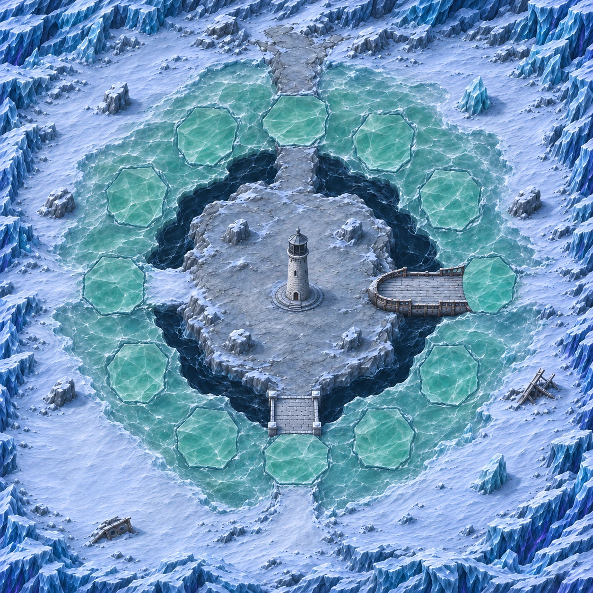
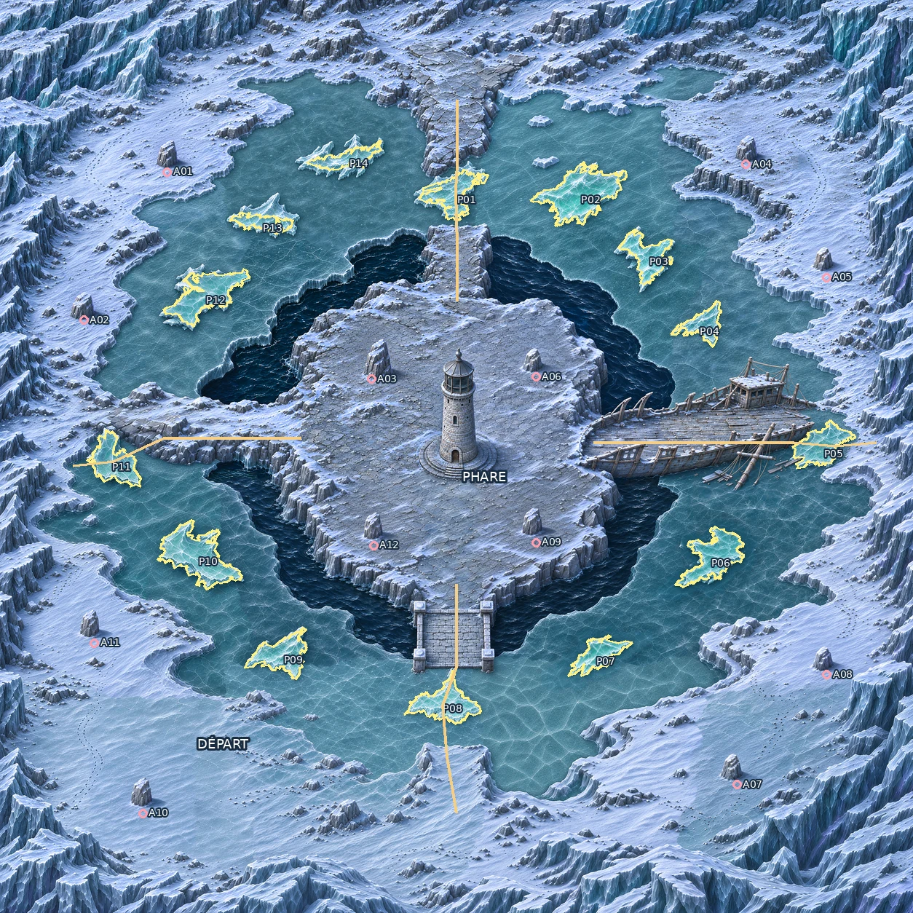

# Carte 19 — La Banquise du phare

**Composition à valider — 4 novembre 2026.** Identifiant proposé : `lighthouse_floe`.
Chapitre 4, Glacier silencieux ; défense d’autel, particularité B4 « Banquise qui se fend ».
Branche `codex/carte-19-banquise-phare`, depuis `origin/main` actualisé.

## Composition proposée

Monde carré de **5016 × 5016 unités**, image de composition de **1254 × 1254 pixels**.
Île rocheuse centrale, phare peint éteint, eau noire intérieure, anneau de banquise praticable,
puis rivage enneigé et falaises périphériques. Départ au sud-ouest sur une grande place dégagée.
Le phare est lui-même l’autel : aucun second autel ni enceinte de finale.

Les coordonnées ci-dessous partent du coin supérieur gauche, en pourcentages de l’image entière.
Le fichier [composition_review.json](../../assets/concepts/incoming/map.lighthouse_floe/source/composition_review.json)
contient les repères proposés, relevés sur les joints de la composition retenue.
Il reste **non figé** ; le `plan.json` définitif sera produit après validation du propriétaire.

| Repère | Position / trajet proposé |
| --- | --- |
| Départ | 21 % ; 80 %, rivage sud-ouest |
| Phare éteint | Pied vers 50 % ; 50,7 %, sur l’île stable |
| Accès nord | Crête rocheuse ; plaque P01 ; arrivée sur le nord de l’île |
| Accès est | Épave de brise-glace, coque visible et pont dégagé ; plaque P04 |
| Accès sud | Passerelle de pierre ; plaque P07 |
| Accès ouest | Bande de neige tassée ; plaque P10 |
| Détour | Boucle sur le rivage ferme, tracée en pointillés sur le plan |
| Abris | A01–A12 : trois par quart, huit sur les rivages et quatre sur l’île |

La cible du socle est d’environ **300 unités** ; la porte doit mesurer **75–90 unités**,
avec un Chasseur d’environ 52 unités. La tour reste grande et son sommet sans lumière.
La composition fixe les positions et les circulations ; les gabarits et petits motifs définitifs
seront repris dans les régions : marches 12–16 unités, pavés au plus 26, colonnes 30–45.
Les abris pleins seront ramenés à **110–160 unités** de largeur au sol, ombre portée incluse dans le dessin.
Les débris périphériques actuellement esquissés ne constituent pas encore ces gabarits définitifs.

## Plaques B4 et chemins de retour

**Douze plaques distinctes**, P01–P12 en sens horaire depuis le nord. Leurs polygones proposés
suivent les crêtes et fissures de la composition ; leurs emprises relevées font environ
**432–532 unités par axe**. Au moins une plaque se trouve sur chacun des quatre accès.
Les plaques intactes sont praticables. Aucun abri n’est placé dans leur emprise.
La mer verte et translucide se distingue du goulet d’eau noire permanent autour de l’île.

La boucle extérieure doit permettre de rejoindre un autre accès lorsqu’une plaque cède.
Proposition de séquencement pour Claude : conserver au moins deux accès au phare ouverts,
et ne pas ouvrir simultanément toutes les plaques d’un secteur. Les collisions du propriétaire,
la continuité effective des détours et le calendrier B4 seront validés lors de l’intégration.
Aucun test de navigation ou de combat n’est revendiqué par cette revue graphique.

L’image future « banquise brisée » montrera les douze emprises ouvertes comme **ressource graphique
à afficher plaque par plaque**. Elle ne décrit pas un état de jeu autorisant l’ouverture des douze plaques à la fois.

## Deux états et détail à venir

Après validation de cette composition : figer `plan.json`, découper avec `tools/art/map_regions.py`,
puis redessiner chaque région dans les **deux états, avec les mêmes limites et la même finesse**.
Les références sont les Ruines des Cascades et les règles de
[QUALITE_DES_CARTES.md](QUALITE_DES_CARTES.md). Aucun agrandissement de la composition ne sera livré comme détail.

L’état brisé partira de la source intacte commune : eau noire, morceaux flottants et bords cassés
seront peints localement puis réinsérés strictement dans les polygones des plaques.
Tout ce qui est hors plaques doit conserver **exactement les mêmes pixels**, y compris le phare,
les rivages, les abris, les quatre ouvrages et les ombres extérieures.
Même cadrage et même résolution pour les deux images. Le contrôle pixel à pixel sera effectué
**sur les fichiers effectivement livrés, après encodage**, avec superposition et rapport de différences.
Le choix d’encodage devra préserver cette identité hors plaques.

À ce stade, seul l’état intact de **composition** existe. Le second état, le détail par régions,
le rapport `check_map_quality.py` conforme pour chaque état et la preuve de superposition restent à produire
après validation. Aucun fichier du manifeste ou décor utilisable en jeu n’est ajouté.

## Lisibilité et captures de revue

Le banc [preview_lighthouse_floe.tscn](../../tools/art/preview_lighthouse_floe.tscn) affiche la composition
avec les feuilles existantes du jeu, leurs ancres et leurs échelles inchangées. Le zoom est lu dans
`GameDB.balance.camera_zoom`, à 1280 × 720 ; aucune partie ni écriture de profil n’est lancée.

- [Chasseur et Écho au pied du phare](../previews/lighthouse-floe/phare_zoom_jeu.png)
- [Épave traversable](../previews/lighthouse-floe/epave_zoom_jeu.png)
- [Passerelle de pierre](../previews/lighthouse-floe/pierre_zoom_jeu.png)
- [Bande de neige tassée](../previews/lighthouse-floe/neige_tassee_zoom_jeu.png)
- [Sept Échos du silence sur neige](../previews/lighthouse-floe/silence_neige.png)
- [Les mêmes sur banquise](../previews/lighthouse-floe/silence_banquise.png)
- [Référence des Ruines au même zoom](../previews/lighthouse-floe/reference_ruines_zoom_jeu.png)

Éclat du silence, Chevalier de glace, Sentinelle gelée, Brise-banquise, Héraut du silence,
Mammouth de givre et Sorcière des neiges : sprites déjà livrés au chapitre 4, aucun redessin.
Ces captures examinent leur contraste sur la composition agrandie au zoom réel ; la finesse du terrain
et l’échelle des motifs seront à vérifier à nouveau après les régions.
Les sept silhouettes restent distinctes sur le vert de la banquise et le bleu-gris de la neige.
Le Chasseur est posé au pied des marches du phare ; la porte corrigée garde une taille humaine.
L’orientation lumineuse reste haut-gauche, avec un liseré violet discret en bas à droite.
Glace de mer verte, neige bleutée, pierre grise et fer rouillé désaturé donnent l’identité propre du lieu.

Le reçu [controle_composition.json](../previews/lighthouse-floe/controle_composition.json) conserve
les commandes, résultats de chargement et empreintes de cette étape. La conformité graphique finale
est explicitement en attente du détail et de la validation.

## Collisions et raccordement

Après le détail des deux états, fournir une **référence entière légère de l’image intacte**, sans repères,
avec recette, dimensions et SHA-256 dans `source/collision_reference.json`, comme pour les cartes précédentes.
Le propriétaire peindra les collisions puis renverra un **PNG au même cadrage** ; aucun masque statique n’est
dessiné par Codex. Les plaques resteront praticables dans cette peinture : le jeu les fermera temporairement
lorsqu’elles cèdent. Les polygones B4 sont des repères pour ces changements d’état, pas un masque statique.

Claude intégrera collisions, autel, fermetures B4, gardien et campagne.
**Aucun changement de `src/`, `data/`, du manifeste ni des cartes 14 à 18.**

## Sources et étapes

Dossier `assets/concepts/incoming/map.lighthouse_floe/` ignoré par Godot :
`composition.png`, `job.json`, croquis technique de composition, prompts retenus,
`generation.json`, `composition_review.json` et empreintes `SHA256.json`.
Essais et images non retenues restent hors dépôt.

- Composition et repères : proposés, en attente du propriétaire.
- `plan.json` figé : après validation.
- Régions intactes et brisées, contrôle qualité conforme et superposition : à faire.
- Référence de peinture des collisions : après le détail.
- Masque et intégration en jeu : propriétaire et Claude.
