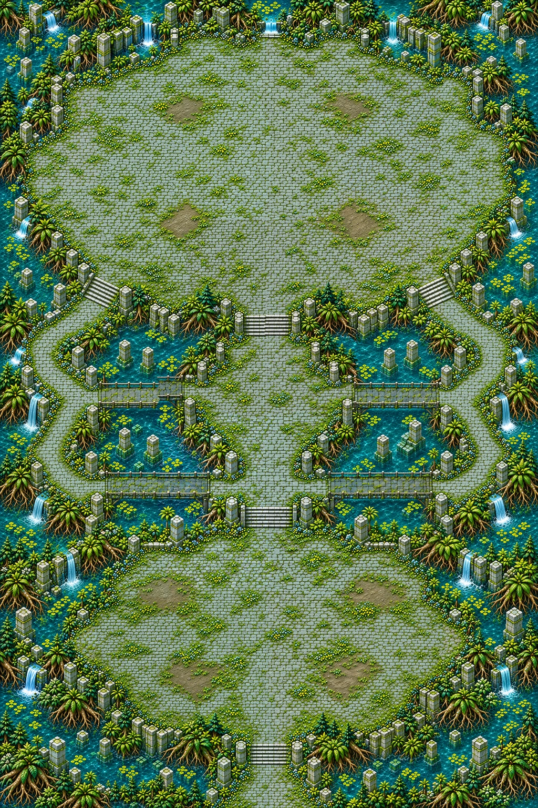

# Cœur des marais — détail de la carte 15

**Détail graphique livré le 3 novembre 2026.** La composition entière validée le 2 novembre et son plan restent figés : monde de **3344 × 5016 unités**, portrait 2:3. Douze régions ont été redessinées par vingt-quatre demi-régions, puis assemblées en un master continu. Deux tuiles de **3762 × 11286 pixels** livrent 2,25 pixels par unité.



[Composition figée](../previews/marsh-heart/composition.webp) · [Plan annoté](../previews/marsh-heart/plan_annote.webp) · [Vue entière dans Godot](../previews/marsh-heart/apercu_720p.png)

## Plan conservé

Chapitre 3 : eau turquoise profonde infranchissable, mousse émeraude, pierre cyan et vase gris-olive praticable. Décor et colonnes restent aux bordures ; les grandes surfaces de combat restent libres. Aucun miroir ou cristal interactif n’est peint dans le fond, ni cercle d’arène.

| Repère | Coordonnées approximatives, en % |
|---|---|
| Départ sud | 50,96 |
| Grande clairière vaseuse | 50,79 |
| Temple central | 50,55 |
| Terrasse de Glauquemire | 50,23 |
| Vase praticable | 28,74 ; 47,83 ; 68,82 |
| Chaussées hautes destinées à la marée | rectangles ouest (18,47,20,3), est (62,47,20,3) |
| Ponts bas restant secs | rectangles ouest (18,59,20,3), est (62,59,20,3) |

Les rectangles indiquent x, y, largeur et hauteur. Le sol central et les berges latérales conservent des alternatives sèches : ne jamais noyer tout le parcours. Le fond représente l’état de base ; l’eau montante sera une surcouche du jeu. Ces repères ne constituent ni masque ni collisions. Les objectifs de largeur des routes, de part praticable et de navigation seront contrôlés sur la peinture du propriétaire.

## Arène et validation du plan

L’emprise visuelle indicative de la terrasse est x12..88 %, y6..39 %, soit environ **2541 × 1655 unités**. Sa profondeur réellement praticable et ses coins libres restent à mesurer : **la compatibilité avec un rayon de 950 unités n’est pas certifiée**. Le propriétaire et Claude devront vérifier ce réglage du boss sur le masque. Le détail n’a pas agrandi ni recomposé la terrasse.

Trois accès restent visibles. Les quatre emplacements de miroirs proposés vers (38,19), (62,19), (38,28), (62,28) % restent du sol libre, à confirmer au raccordement. Vagues par zone, vase, marée et Dévoreur en trois phases relèvent de l’intégration.

Le 2 novembre, après présentation de la carte entière, le propriétaire a répondu : « Je valide la composition. » La demande précisait le contrôle ultérieur de la taille utile de l’arène sur les collisions. Cette validation fige la composition et le plan ; elle ne certifie ni navigation ni rayon de combat. Le 3 novembre, le propriétaire a demandé de démarrer la carte 15.

## Source retenue et reconstruction

Le **master natif assemblé** `source/map_detailed.webp` mesure 2508 × 3762 pixels, à 0,75 pixel par unité. Son encodage est sans perte ; la relecture RGB est identique pixel par pixel à l’assemblage. Les dessins apportent entre **1,13 et 1,26 vrais pixels générés par unité** avant réduction à cette densité native.

`source/regions_provenance.json` conserve les dimensions, cadrages et empreintes des vingt-quatre dessins et de leurs références. Le témoin du temple utilise le prompt initial puis une correction de matière ; les autres demi-régions utilisent `PROMPT_DETAIL_FIN.txt` et ce témoin comme référence de matière. La chaîne des prompts et les empreintes des entrées sont conservées. Les bandes et régions intermédiaires restent hors Git.

Les recouvrements internes font 128 unités ; le découpage entre régions suit `map_regions.py`. `map_seams.py` choisit un dessin dans chaque recouvrement par un chemin de faible différence, avec un fondu d’un pixel natif. Le plafond standard de calibration de netteté reste de 120 %. Aucun bruit procédural ni traitement neuronal n’est ajouté.

La présentation agrandit le master par 3 en Lanczos, puis encode les deux tuiles en WebP **qualité 98**, avec perte. Le rapport porte sur les tuiles décodées réellement livrées. `source/detail_recipe.json` donne la recette et leurs empreintes. Reconstruction avec numpy, Pillow et scipy :

```bash
python3 tools/art/finish_marsh_heart.py --work /tmp/rift-coeur-marais --quality 98
```

`package_marsh_heart.py` décrit la fabrication du master depuis les dessins conservés localement. Les outils et références de mesure du dépôt restent inchangés.

## Contrôles de livraison

| Contrôle sur les tuiles livrées | Résultat | Attendu |
|---|---:|---:|
| Densité | 2,250 | 2,183 à 2,317 |
| Part lisse médiane | 0,106 | ≤ 0,270 |
| Détails fins | 388,169 | 329,944 à 446,395 |
| Détails moyens | 101,967 | 90,940 à 123,036 |
| Secteurs conformes | 35/35, soit 100 % | ≥ 85 % |
| Fidélité au plan | 0,977 | ≥ 0,850 |

**Verdict : conforme.** [Rapport chiffré](../previews/marsh-heart/qualite.json) et [journal](../previews/marsh-heart/qualite.log).

La [planche d’échelle](../previews/marsh-heart/echelle.png) vient de `map_regions.py compare` : carte livrée, composition, Ruines, avec une réduction commune de 1710 à 1600 pixels pour le dépôt. La [comparaison des sols](../previews/marsh-heart/echelle_sol.webp) conserve exactement 1 pixel par unité et traverse aussi la jonction entre tuiles. Les captures de la terrasse, du temple, de la chaussée, du pont sec et de la clairière utilisent le même Chasseur, le même Écho et le même zoom réel que la capture des Ruines.

Le [diagnostic spectral relatif](../previews/marsh-heart/nettete_relative.webp) signale **26 cases sur 620, soit 4,2 %**, sous la limite de 5 % de l’outil. Il compare les cases aux matières les plus nettes de cette carte ; les 35 secteurs passent aussi les critères absolus de référence. Cette vue rouge et verte est un diagnostic de netteté, pas une peinture de collisions.

Import Godot **4.3**, sept captures **1280 × 720** et contrôle ciblé des assets : réussis, sans erreur de script ou de chargement. Assets : 442 entrées, 427 valides, 15 prévues pour le chapitre 4 dans un lot indépendant, zéro erreur. Lint du banc de capture et exécution des recettes réussis. [Contrôle de chargement et limites](../previews/marsh-heart/runtime_controle.json).

## Collisions et raccordement

Une image entière légère **1024 × 1536** a été remise au propriétaire pour peindre les collisions en rouge translucide, au cadrage exact de la composition validée. Le JPEG exact reste localement sous `collision/reference.jpg` ; recette et empreinte sont dans `source/collision_reference.json`. Retour attendu en PNG, au même cadrage et sans redimensionnement. Aucun masque n’a été peint automatiquement.

- **Livré** : détail des douze régions, master natif sans perte, deux tuiles, prompts/empreintes/recette, rapport conforme, vue entière et captures au zoom réel.
- **Non fait** : collisions peintes, mesure de l’arène utile, navigation, champ `field`, niveau jouable, entrée du manifeste runtime et mécaniques. `src/`, `data/` et le manifeste runtime sont identiques à `main`.
- **Choix faits sans validation** : redessin par demi-régions, matière et pavés plus fins dans leurs emprises figées, correction du grain du témoin, assemblage continu et encodage qualité 98.
- **Raccords Claude** : réutiliser les deux tuiles de `assets/environments/marsh_heart/` pour le monde 3344 × 5016 ; attendre la peinture du propriétaire, construire le champ et vérifier passages et arène. Placer vase, marée, vagues, miroirs et gardien séparément du fond. La marée ne doit toucher que les chaussées prévues.

**Détail graphique livré ; aucun essai de circulation ou de combat n’est revendiqué.** Le poids du lot figure dans [le rapport de poids](../previews/marsh-heart/poids.json).
