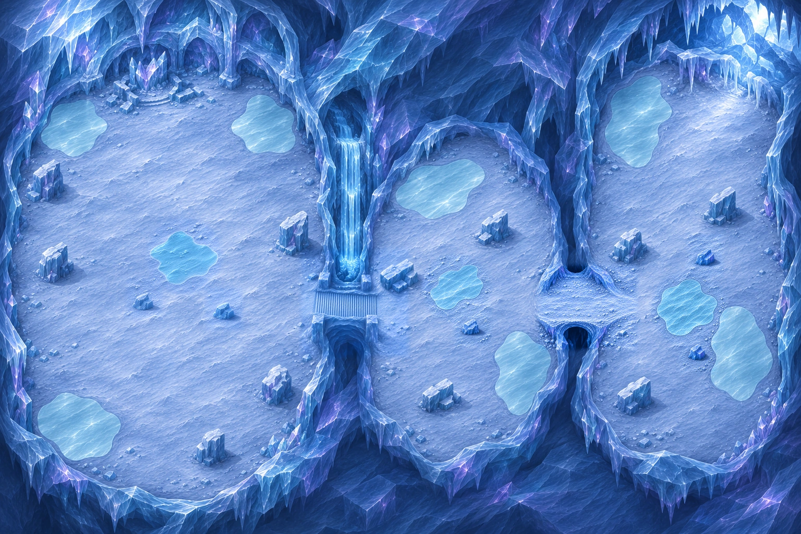

# Carte20 — Le Cœur du Silence

**Composition à valider par le propriétaire — 5 novembre2026.** Identifiant proposé : `silent_heart`.
Chapitre4, Glacier silencieux, fin de chapitre : deux zones de vagues puis Nivorath.
Branche `codex/carte-20-coeur-silence`, créée depuis `60d4297`, puis fusion de main `320ab58`.

## Parcours proposé

Monde **5016 ×3344 unités**, cadrage **3:2**, composition **1536 ×1024 pixels**.
Parcours **de droite à gauche**, à l’intérieur du glacier. Des murs de glace profonde, des voûtes
et des piliers naturels en bordure encadrent trois salles inégales ; la lumière froide filtre du plafond.
La seule crevasse ouverte sur le ciel éclaire la place de départ à l’est. Les limites restent fermées par
la glace : cette ouverture de plafond n’est pas une sortie de carte.

Coordonnées en pourcentages depuis le coin haut-gauche de l’image entière.
Les repères et emprises proposés sont dans
[`source/composition_review.json`](../../assets/concepts/incoming/map.silent_heart/source/composition_review.json).
Ils servent à cette revue, pas aux collisions. **Le `plan.json` verrouillé sera établi après validation.**

| Repère | Emplacement et rôle |
| --- | --- |
| Départ | 92 % ;24 %, grande place de la galerie est sous la crevasse |
| Z1, Galerie des stalactites | Salle longue à l’est, centre vers85 % ;53 %, deux plaques B1 et trois abris |
| Tunnel Z1 → Z2 | Vers73 % ;57 %, court passage de glace au sol apparent, cible267u de largeur |
| Z2, Salle des échos | Salle arrondie irrégulière centrale, vers60 % ;59 %, deux plaques périphériques et trois abris |
| Escalier Z2 → cathédrale | Vers44 % ;58 %, traverse d’est en ouest au pied de la cascade gelée, cible334u de largeur |
| Cathédrale gelée | Grande nef ovale allongée nord-sud à l’ouest, trois plaques périphériques et cinq abris |
| Cœur de combat ferme | Centre22,5 % ;55 %, ellipse de repérage1250 ×1400u, sans dessin d’ellipse sur le décor |
| Décor du fond | Cœur de cristal brisé vers18 % ;15 %, contre le fond de la nef |

La cathédrale est séparée de Z2 par l’escalier et ses murs latéraux. Chaque liaison est suffisamment
courte et nette pour une barrière de jeu. Aucun effet de barrière n’est peint. Les flèches et l’ellipse
sur le plan annoté sont des repères de revue, jamais des éléments du sol.

## Glace et abris

**Sept plaques de glace lisse B1**, I01–I07, environ **413 à586u** de diamètre maximal relevé sur leurs
contours : deux dans Z1, deux dans Z2 et trois dans la cathédrale. Elles sont cyan clair, affleurantes,
polies, toujours praticables et contournables par le sol ferme. Aucune ne recouvre le tunnel ou l’escalier.
Il ne s’agit pas de plaques de banquise B4 : aucune seconde image d’eau ouverte n’est demandée ici.

**Onze abris pleins**, A01–A11 : trois dans chaque zone et cinq dans la cathédrale, hors plaques.
Piliers brisés, glace tombée et rochers dressés, ombres portées et faces haut-gauche éclairées.
Le gabarit **110–160u**, cible140u, sera fixé dans le détail des régions, en conservant les emplacements
approuvés. Les grands piliers de voûte restent dans les murs et ne remplacent pas ces abris de combat.

Le centre de la cathédrale reste ferme et dégagé. Les deux zones ont chacune une large aire de manœuvre.
La continuité navigable et l’étanchéité des barrières seront contrôlées par Claude lors de l’intégration,
avec les collisions peintes du propriétaire ; aucun essai de déplacement ou de combat n’est revendiqué ici.

## Lisibilité et échelle

Palette bleu-gris du chapitre, neige légèrement bleutée, glace profonde translucide et reflets violets
dans les murs ; aucun orange. Lumière haut-gauche et liseré violet discret bas-droite.
Nivorath et les sept Échos du silence utilisent leurs feuilles existantes, ancres et échelles inchangées.
Ils sont ajoutés uniquement dans le banc de revue, jamais peints dans la carte.

- [Nivorath sur neige](../previews/silent-heart/nivorath_neige.webp) et [sur glace](../previews/silent-heart/nivorath_glace.webp)
- [Sept Échos sur neige](../previews/silent-heart/silence_neige.webp) et [sur glace](../previews/silent-heart/silence_glace.webp)
- [Chasseur et Écho sur l’escalier](../previews/silent-heart/escalier_zoom_jeu.webp)
- [Tunnel](../previews/silent-heart/tunnel_zoom_jeu.webp), [abri](../previews/silent-heart/abri_zoom_jeu.webp), [cristal du fond](../previews/silent-heart/cristal_zoom_jeu.webp)
- [Ruines au même zoom](../previews/silent-heart/reference_ruines_zoom_jeu.webp)

Captures1280 ×720 au zoom réel `GameDB.balance.camera_zoom` (1,3333). Les silhouettes des sprites restent
distinctes sur les deux matériaux. L’escalier a été repris localement pour orienter les marches selon
le trajet est-ouest, puis resserré vers la cible12–16u par marche. Les détails d’architecture seront
calibrés pendant les régions : pavé26u au plus, colonne construite30–45, porte75–90, Chasseur environ52.
Les piliers naturels de la cathédrale peuvent être plus larges.

Ces vues examinent la **composition agrandie**, dont le terrain reste provisoire au zoom réel.
Elles ne constituent pas un détail graphique final ni un rapport de qualité conforme.
Le banc [preview_silent_heart.tscn](../../tools/art/preview_silent_heart.tscn) ne lance pas de partie,
avec `Profile.read_only = true`. Import Godot, captures, assets (450 entrées,448 valides, deux placeholders préexistants, zéro erreur) et lint ciblé réussis sur main actualisé. Reçu : [controle_composition.json](../previews/silent-heart/controle_composition.json).

## Suite après validation

1. Figer `plan.json` : départ, zones, deux liaisons, centre et emprise de la nef, sept plaques, onze abris.
2. Valider un secteur témoin au zoom réel, puis peindre les **douze régions** prévues pour5016 ×3344u.
3. Assembler, vérifier les raccords et l’échelle face aux Ruines, obtenir le verdict **conforme** de
   `check_map_quality.py` avec les seuils de [QUALITE_DES_CARTES.md](QUALITE_DES_CARTES.md).
4. Fournir l’image entière légère de référence pour la peinture des collisions, recette et SHA-256 dans
   `source/collision_reference.json` ; retour PNG au même cadrage. Aucun masque peint par Codex.

La référence de peinture sera produite après le détail, pour conserver les obstacles définitifs.
Les plaques B1 resteront praticables. Le jeu gère le glissement, les cercles de silence, l’Écho des sorts,
Nivorath et ses trois phases, l’éclatement de banquise et la plongée : aucun de ces effets n’est peint.

**Aucun changement de `src/`, `data/`, du manifeste ni des cartes14 à19.**
Claude intégrera collisions, zones, B1, Nivorath et campagne. Seule la composition est soumise ici.
