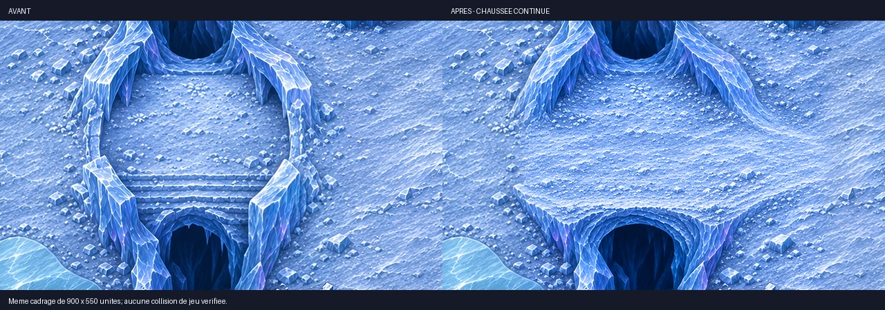

# Carte 20 — Le Cœur du Silence

**Retouche locale livrée — 7 novembre 2026.** `silent_heart`, chapitre 4, Glacier silencieux.
Le propriétaire demande de conserver la carte, de relier clairement la troisième salle par un chemin,
et d'ajouter quelques obstacles et plaques de glace vers le centre des îlots.

## Retouches retenues

Le monde reste de **5016 × 3344 unités**, cadrage **3:2**, parcours **de droite à gauche**.
Les trois salles, les parois, la cascade, le cristal brisé ouest et les deux liaisons gardent leur place.

- **Milieu → troisième salle, à l'ouest :** le tablier strié est remplacé par une chaussée de glace
  enneigée continue, raccordée aux deux sols sans marche murale ni vide aux extrémités.
  Axe vers **58,5 % de hauteur**, entre **38,9 et 49,5 % de largeur** ; largeur cible **290 unités**.
  Le gouffre reste nettement séparé sous l'ouvrage et la cascade au-dessus.
- **Trois plaques centrales ajoutées**, une par salle : ouest vers **23 % ; 48 %**,
  milieu **57 % ; 54 %**, est **86 % ; 58 %**. Cyan, affleurantes, praticables et contournables.
  Le plan donne les contours de matière relevés sur le détail.
- **Cinq abris compacts ajoutés** : deux dans la salle ouest, un au milieu, deux à l'est,
  hors du chemin de liaison. Repères `a12` à `a16`, cible 110–160 unités.
- Total du dessin : **dix plaques B1 et seize abris**. Les sept plaques et onze abris précédents sont conservés.

L'ancienne exigence d'un centre final uniquement en neige ferme et entièrement dégagé est révisée
par cette nouvelle demande : le centre reçoit une plaque et deux petits abris, avec du sol libre autour.
Le grand espace de combat et le sens du parcours sont conservés.

## Sources et conservation du détail

Les douze régions détaillées de la livraison du 5 novembre servent de base.
**Quatre retouches locales** ont été dessinées avec l'outil imagegen intégré : liaison et centres des trois salles.
Les zones utiles sont réinsérées avec des masques de retouche ; ce ne sont pas des masques de collision.

Seulement **8,43 %** des pixels de présentation se trouvent dans les emprises retouchées.
Les pixels hors de ces emprises sont vérifiés **identiques** aux tuiles précédentes.
L'encodage final sans perte préserve ce résultat ; aucune nouvelle passe globale de lissage.

- Source retenue : `assets/concepts/incoming/map.silent_heart/source/map_detailed.webp`, **3762 × 2508 px**.
- Composition au même cadrage : **1536 × 1024 px**, mise à jour uniquement sur les zones retouchées.
- Trois tuiles finales : `assets/environments/silent_heart/map.webp`, `map_1.webp`, `map_2.webp`,
  **3762 × 7524 px chacune**, densité **2,25 px/unité**, placement de gauche à droite sur 1672 unités par tuile.
- Plan courant : [plan.json](../../assets/concepts/incoming/map.silent_heart/plan.json).
- Prompts exacts, empreintes, dimensions, masques et conservation des pixels :
  [local_access_revision.json](../../assets/concepts/incoming/map.silent_heart/source/local_access_revision.json).
- Recette courante : `source/detail_recipe.json`. Historique des douze régions : `source/regions_provenance.json`.
  Empreintes textuelles normalisées en UTF-8/LF dans `source/SHA256.json`.
- Réinsertion reproductible : `tools/art/retouch_silent_heart.py --work <dossier externe>`,
  avec les quatre sorties retenues et les sources précédentes. Les intermédiaires restent hors dépôt.

## Échelle et contrôles

Huit nouvelles captures statiques à **1280 × 720, zoom 1,3333**, avec le Chasseur et le Spectre de neige
utilisé comme témoin d'Écho, aux images, ancres et échelles natives du manifeste.
Les personnages et effets du jeu sont inchangés.

- [Entrée depuis la salle centrale](../previews/silent-heart/chemin_entree_est.webp),
  [milieu de la chaussée](../previews/silent-heart/chemin_centre.webp),
  [sortie dans la salle ouest](../previews/silent-heart/chemin_sortie_ouest.webp).
- Centres [ouest](../previews/silent-heart/centre_ouest.webp),
  [milieu](../previews/silent-heart/centre_milieu.webp) et [est](../previews/silent-heart/centre_est.webp).
- [Nouveaux abris à la matière native, règle de 140 unités](../previews/silent-heart/abris_centraux_echelle.webp).
- [Comparaison aux Ruines à 1 px/unité](../previews/silent-heart/comparaison_echelle.webp).
- [Plan annoté](../previews/silent-heart/plan_annote.webp), réservé au repérage.

**Qualité conforme, seuils du dépôt inchangés :** densité 2,25 ; part lisse 0,122 ;
détails fins 382,376 ; moyens 98,877 ; **35 secteurs conformes sur 35** ; fidélité 0,965.
[Rapport qualité](../previews/silent-heart/qualite.json).
Import Godot 4.3 isolé et chargement des trois textures réussis ; lint du banc GDScript et compilation Python réussis.
Diagnostic relatif de netteté et reçu des captures :
[controle_detail.json](../previews/silent-heart/controle_detail.json).

Le diagnostic relatif adaptatif reste hors seuil sur la présentation existante : 68,1 % de cases signalées
avant, 62,1 % après. Avec la référence figée de la livraison précédente, il passe de 0 à 5 cases sur 620
(0,8 %). Ces résultats sont conservés explicitement ; ils sont distincts du verdict absolu conforme ci-dessus.

Les trois cadrages du chemin contrôlent sa continuité graphique, ses deux raccords et l'échelle.
**Aucun test de navigation ou de combat n'est revendiqué** : les collisions restent à peindre et à intégrer.
Le banc de contrôle est isolé, sans partie ni profil écrit.

## Nouvelle référence des collisions

**[Image entière à peindre : JPEG 1254 × 836](../previews/silent-heart/reference_collisions.jpg)**,
même cadrage, **1 px = 4 unités**. Elle remplace la référence antérieure refusée.
Recette et SHA-256 : `source/collision_reference.json`.

Retour attendu : **PNG 1254 × 836**, sans recadrage ni redimensionnement.
Peindre en rouge translucide les parois, les gouffres et les pieds des obstacles solides.
**Laisser libres la chaussée enneigée et ses deux raccords, l'autre liaison et les dix plaques B1.**
Les plaques de glace et les ombres ne sont pas des trous ni des obstacles.

Le propriétaire peint les collisions. Claude raccorde ensuite les zones, barrières, glissement B1,
Nivorath, Écho des sorts, cercles de silence, éclatement/plongée et campagne.
Vérifier en jeu le trajet de droite à gauche, l'entrée et la sortie de chaque liaison,
les virages et la retraite autour des nouveaux abris.

**Aucun changement de `src/`, `data/`, du manifeste, ni des autres cartes.**
