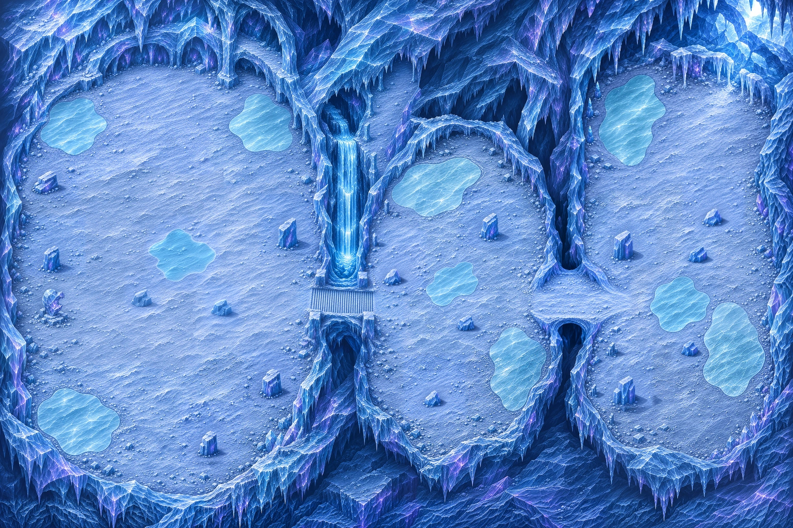
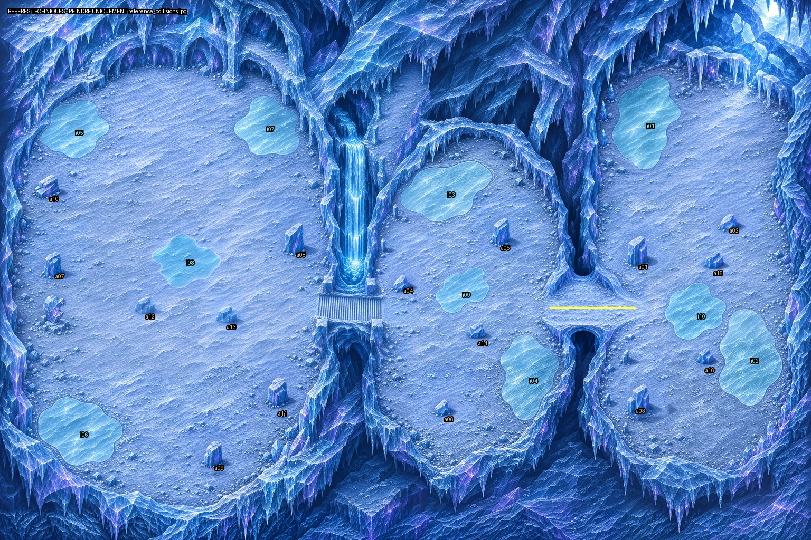
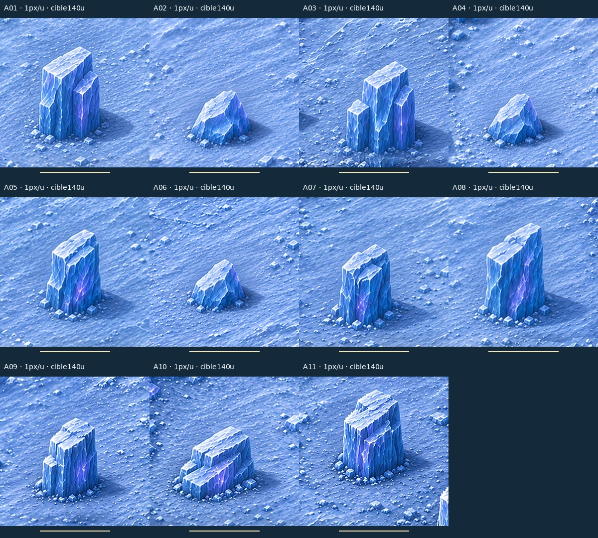

# Carte 20 — Le Cœur du Silence

**Détail graphique livré — 5 novembre 2026.** `silent_heart`, fin du chapitre 4, Glacier silencieux.
Composition validée par le propriétaire : trois salles d’est en ouest, arche puis escalier de cascade,
cathédrale à l’ouest, sept plaques périphériques. Les cinq corrections autorisées sont appliquées.



## Plan conservé et corrections

Monde **5016 × 3344 unités**, cadrage **3:2** et parcours **de droite à gauche**, à l’intérieur du glacier.
Le [plan.json](../../assets/concepts/incoming/map.silent_heart/plan.json) est approuvé et verrouillé.
Les repères sont en pourcentages depuis le coin haut-gauche de l’image entière ; ils ne constituent
pas des collisions. Les limites de matière B1 sont relevées sur le master détaillé, en conservant
les contours de composition et les positions approuvées pour comparaison.



| Repère | Emplacement et résultat |
| --- | --- |
| Départ | **92 % ; 24 %**, dans la salle est sous la crevasse lumineuse haut-droite ; aucun autre passage est ajouté |
| Z1, Galerie des stalactites | Salle allongée à l’est, stalactites aux murs, rangée de piliers fins sur son côté ouest, deux plaques B1 et trois abris |
| Arche est → milieu | Vers 73 % ; 57 %, sol apparent clair et continu, cible 267 unités de largeur |
| Z2, Salle des échos | Salle ronde irrégulière centrale, trois blocs de voûte tombés et deux plaques périphériques |
| Escalier de la cascade | Vers 44 % ; 58 %, marches d’est en ouest, cible 12–16 unités de profondeur, sol soutenu et clair |
| Cathédrale gelée | Grande nef ovale séparée à l’ouest, piliers naturels le long des côtés, cinq abris et trois plaques en bordure |
| Cœur de neige ferme | Centre 22,5 % ; 55 %, emprise libre cible **1250 × 1400 unités** ; l’ellipse du plan est un repère uniquement |
| Cristal brisé | **Fond OUEST, vers 7,5 % ; 58 %**, face à l’entrée ; ancien cristal du coin nord retiré |

Les ouvertures sombres sous les deux ouvrages se lisent comme des **gouffres infranchissables** : lèvres
cassées, parois verticales et vide profond. Les tabliers et leurs deux raccordements restent praticables.
Les masses de glacier ferment le bord de carte ; la fissure de plafond du départ n’est pas une sortie.
Les obstacles et sept plaques gardent les emplacements de la composition, sans nouveau trajet.

## Détail, glace et abris

Les **douze régions** sont redessinées, chacune sur un carré de 1574 unités avec marges.
Chaque sortie carrée de 1254 pixels fournit environ **0,797 pixel de vrai dessin par unité** ; les
parties utiles sont assemblées à **0,75 pixel/unité** par raccords de faible différence, puis calibrées.
Le master natif sans perte mesure **3762 × 2508 pixels**. La présentation est à **2,25 pixels/unité**,
soit **11286 × 7524 pixels**, en trois tuiles de 3762 × 7524. Les essais restent hors dépôt.

Les sept plaques B1 mesurent environ **416 à 604 unités** de diamètre relevé. Elles sont lisses, cyan, affleurantes, **toujours praticables et contournables**.
Aucune ne coupe un passage obligé. Elles ne deviennent pas des trous : aucun second état B4 peint.
Les onze abris ont été repris localement au gabarit cible de **140 unités**, dans la plage 110–160 :
trois dans la galerie, trois dans la salle des échos, cinq dans la cathédrale. Leurs pieds sont recalés
sur les blocs détaillés, sans déplacement dans les salles ; repères de composition conservés.
Le cristal ouest et l’escalier ont été protégés pendant cette correction locale. Les trois amas de dalles sont finalement des blocs compacts de125 unités, toutes leurs parties connexes incluses (`source/cover_final_corrections.json`).



**Verdict conforme : 35 secteurs sur 35**, détails fins386,238, moyens98,877, part lisse0,123, fidélité0,964. La finesse, la densité et la fidélité sont contrôlées avec les seuils inchangés du dépôt :
[rapport qualité](../previews/silent-heart/qualite.json),
[comparaison d’échelle avec les Ruines](../previews/silent-heart/comparaison_echelle.webp).
La présentation part du vrai détail peint ; la correction locale des cases douces est documentée
dans `source/detail_recipe.json` et `source/sharpness_repair.json`. Six retouches locales de parois extérieures ont ensuite rendu les sept secteurs de bordure conformes ; les pixels natifs intérieurs sont conservés (`source/border_corrections.json`).

## Captures au zoom du jeu

Le banc [preview_silent_heart.tscn](../../tools/art/preview_silent_heart.tscn) utilise les feuilles
existantes, leurs ancres et échelles inchangées, à 1280 × 720 et au zoom de `GameDB.balance`.
Chasseur environ 52 unités, marches 12–16, petits pavés 26 au plus, piliers fins 30–45 ; les grands
piliers naturels de la cathédrale restent aux murs. Palette bleu-gris, glace translucide et reflets
violets dans les parois, lumière haut-gauche et liseré violet bas-droite, sans orange.

- [Départ sous la crevasse](../previews/silent-heart/depart_zoom_jeu.webp)
- [Escalier avec Chasseur et Écho](../previews/silent-heart/escalier_zoom_jeu.webp)
- [Arche et gouffre](../previews/silent-heart/tunnel_zoom_jeu.webp), [cristal au fond ouest](../previews/silent-heart/cristal_zoom_jeu.webp), [abri](../previews/silent-heart/abri_zoom_jeu.webp)
- [Sept Échos du silence sur neige](../previews/silent-heart/silence_neige.webp) et [sur glace](../previews/silent-heart/silence_glace.webp)
- [Nivorath sur neige](../previews/silent-heart/nivorath_neige.webp) et [sur glace](../previews/silent-heart/nivorath_glace.webp)
- [Ruines au même zoom](../previews/silent-heart/reference_ruines_zoom_jeu.webp)

Nivorath et les Échos sont ajoutés uniquement dans ce banc, jamais peints dans la carte. Le profil est
en lecture seule ; aucune partie n’est lancée. Reçu des commandes, résultats et empreintes :
[controle_detail.json](../previews/silent-heart/controle_detail.json).
Aucun test de navigation, d’étanchéité des barrières ou de combat n’est revendiqué par ces captures.

## Collisions et raccordement

**[Image entière légère à peindre : JPEG 1254 × 836](../previews/silent-heart/reference_collisions.jpg)**,
sans annotation ni recadrage, 4 unités par pixel. Recette, dimensions, poids et SHA-256 dans
[`source/collision_reference.json`](../../assets/concepts/incoming/map.silent_heart/source/collision_reference.json).
Retour attendu : **PNG 1254 × 836 au même cadrage**, sans redimensionnement, obstacles bloquants
peints en rouge translucide. **Laisser les sept plaques B1 et les tabliers praticables** ; fermer les
gouffres sombres sous les ouvrages. Aucun masque statique dessiné par Codex.

Fichiers utilisables : `assets/environments/silent_heart/map.webp`, `map_1.webp`, `map_2.webp`,
à placer de gauche à droite sur 1672 unités chacune, échelle graphique `1/2,25`.
Source native retenue : `assets/concepts/incoming/map.silent_heart/source/map_detailed.webp`.
`source/regions_provenance.json`, `cover_corrections.json`, `detail_recipe.json` et `SHA256.json`
conservent les recettes et empreintes. Reconstruction depuis le master, avec le modèle de correction
locale documenté dans la recette :

```bash
python tools/art/build_silent_heart.py --present --model /chemin/realesr_general_x4v3_0.2.onnx --work /tmp/silent-heart-export
```

Le propriétaire peint les collisions. Claude intègre zones, barrières, glissement B1, Nivorath,
Écho des sorts, cercles de silence, éclatement et plongée de phase 3, puis campagne.
L’intégration et les essais en jeu restent à faire ; aucun de ces effets n’est peint dans le décor.
**Aucun changement de `src/`, `data/`, du manifeste ni des cartes 14 à 19.**
