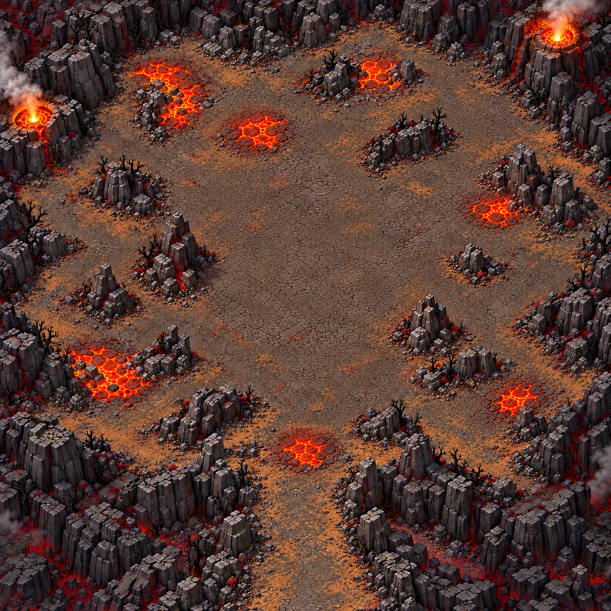
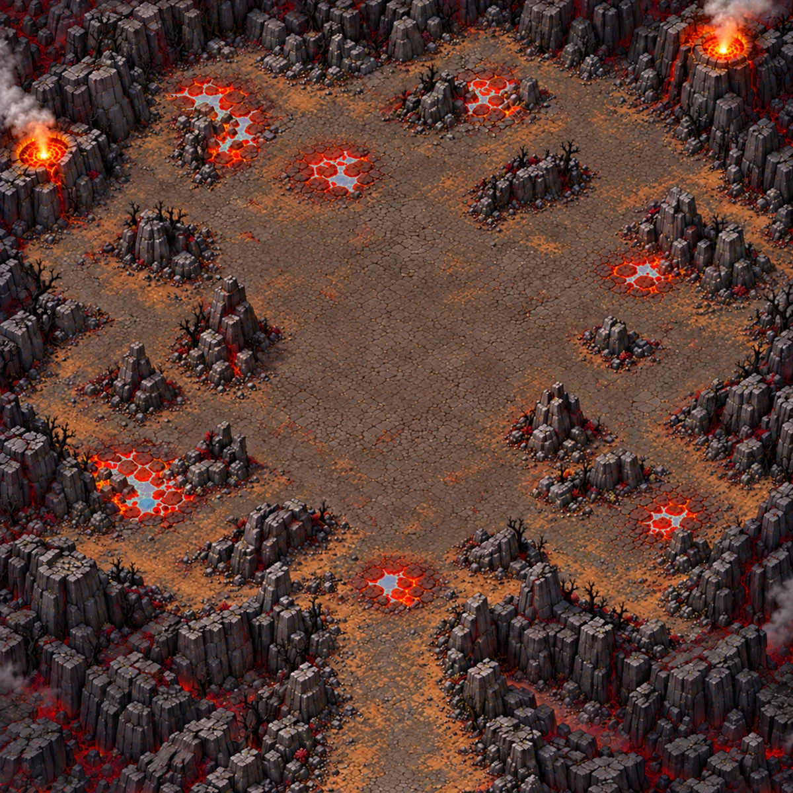
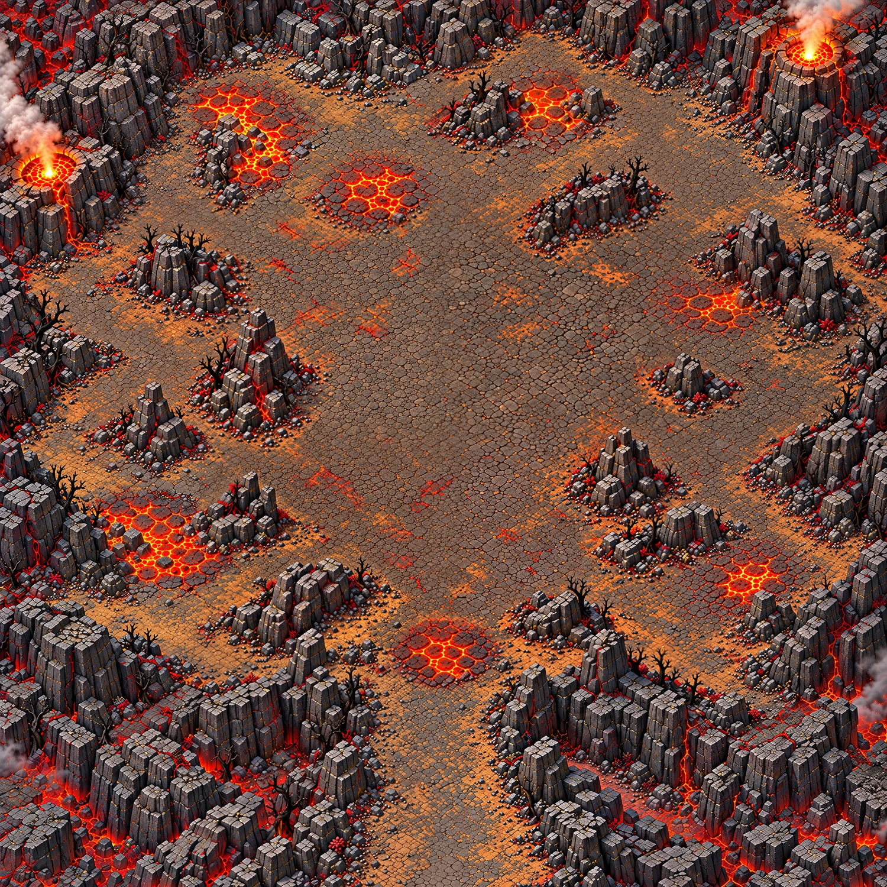

# Cœur du volcan — carte 10

Nouvelle map-arène pour la finale du chapitre 2, sans reprise de la spirale. Monde **5016 × 5016**, composition **1536 × 1536**. Une seule grande surface praticable, sans zones, barrières ou couloirs internes. Entrée sud (50,94), Pyrevorn au centre (50,50).

Le propriétaire a ensuite demandé d’avancer en continu sans pouvoir répondre : Codex choisit donc les compositions et poursuit sans attente. Il ne s’agit pas d’une validation visuelle explicite de chaque image par le propriétaire. Le plan ci-dessous est figé pour la passe de détail.

## Plan et circulation

Cratère irrégulier, roche sombre et cendre ; 16 formations de couverture repérées visuellement, réparties et décalées. Deux aiguilles flanquent le centre vers (31,44) et (69,56). Zone centrale visée : diamètre 1400 unités. Rampe sud sans danger. Deux évents actifs en périphérie, hors du sol de combat. Les fissures décoratives de la bordure sont rouge sombre.

Les dimensions des abris, les dégagements de 300 unités et la part praticable ≥55 % sont des **estimations visuelles**, à confirmer par la peinture des collisions ; aucune validation de navigation n’est revendiquée. Les petits cailloux restent de la texture traversable.

## Nappes brûlantes praticables

Masque `hazards.png` : **noir = rien, blanc = nappe praticable qui inflige des dégâts**. Huit nappes distinctes, sans nappe au centre ni sur la rampe. Les deux parties du groupe nord-ouest sont séparées. Le masque technique provient de la couleur orange dans des emprises contrôlées, avec suppression des petits reflets et remplissage de la croûte interne. Il ne décrit pas les collisions.

| Nappe | Centre X,Y % | Rectangle X1,Y1,X2,Y2 % | Diamètre maximal (u) |
|---|---|---|---:|
| H01 | [26.157, 12.728] | [21.549, 10.026, 29.427, 15.234] | 395.1 |
| H02 | [30.084, 16.819] | [27.279, 13.932, 32.422, 19.336] | 271.0 |
| H03 | [61.137, 12.117] | [58.724, 9.766, 64.453, 14.453] | 287.4 |
| H04 | [42.873, 21.861] | [38.997, 19.076, 45.703, 24.219] | 336.4 |
| H05 | [81.161, 34.483] | [78.776, 32.878, 83.724, 36.328] | 248.2 |
| H06 | [18.256, 61.817] | [13.607, 56.641, 23.438, 65.69] | 493.1 |
| H07 | [84.095, 65.54] | [81.12, 63.867, 86.719, 67.448] | 280.8 |
| H08 | [49.008, 73.628] | [46.354, 71.81, 51.107, 76.042] | 238.4 |

## Mesures et checklist

- [x] Composition carrée, carte entière, sans texte, personnages ou interface.
- [x] Une seule arène ouverte, agencement différent de la carte 9.
- [x] Centre et rampe sans nappe ; huit nappes de 200 à 500 unités sur le masque final.
- [x] Orange vif réservé aux nappes et aux deux évents périphériques.
- [x] Abris décalés, aucun duo symétrique ; larges détours visibles.
- [ ] Confirmation des largeurs, tailles d’abris et part praticable par collisions peintes.
- [x] Passe de détail et rapport CONFORME.
- [x] Planche d’échelle, masque final et contrôle de chargement.

## Livraison et poids

Seuls la composition retenue, les tuiles finales, le masque, les prompts et petits rapports sont livrés. Les recadrages et régions intermédiaires restent hors dépôt. Aperçus limités à 1600 pixels. Poids total ajouté à indiquer avant la PR ; au-delà de 150 Mo, publication à suspendre selon AGENTS.md. Aucun src/, data/ ou réglage de gameplay modifié.

L’ancien visuel carré de la carte 9 est renommé **Le Seuil du Cataclysme**, identifiant `cataclysm_threshold`, en conservant ses pixels ; `volcano_heart` est réservé à cette nouvelle carte 10.

## Livraison détaillée

Seize régions redessinées (4 × 4), assemblées selon le pipeline commun en trois tuiles **3762 × 11286** : carte totale **11286 × 11286**, soit **2,25 pixels par unité**. Les régions et essais restent hors dépôt ; leurs empreintes et dimensions sont conservées dans `source/regions_manifest.json`. Les seuils du contrôle n’ont pas été modifiés.

| Contrôle | Résultat |
|---|---:|
| Densité | 2,25 px/u |
| Part lisse | 0,233 |
| Détails fins | 334,482 |
| Détails moyens | 101,194 |
| Secteurs conformes | 100 % |
| Fidélité au plan | 0,950 |
| Verdict | **CONFORME** |

[Rapport complet](../previews/volcano-heart/qualite.json). [Planche d’échelle](../previews/volcano-heart/echelle.webp) issue de `map_regions.py compare`, réorganisée sur 1140 pixels de large sans redimensionner ses panneaux : **1 pixel = 1 unité**.

Le masque final `hazards.png` est en **11286 × 11286**, noir/blanc 1 bit, avec **huit composantes**. Il reprend les positions du masque figé de la composition par adaptation sans interpolation des valeurs ; ce n’est pas un masque de collisions. Les deux évents périphériques n’y figurent pas. [Contrôle du masque](../previews/volcano-heart/controle_masque.json).

Le contrôle ciblé dans Godot 4.3 a importé puis chargé les trois textures et le masque avec succès : [import](../previews/volcano-heart/godot-import.log), [chargement](../previews/volcano-heart/godot-chargement.log). Le [repère Chasseur/Mousseroc](../previews/volcano-heart/secteur_echelle.webp) est un **montage technique à l’échelle**, pas une capture de partie. Les collisions et la navigation ne sont pas encore validées en jeu.

À raccorder par Claude : entrée du manifeste, champ de collisions peint par le propriétaire, niveau, Pyrevorn, dégâts des nappes et projectiles volcaniques. Aucun fichier `src/` ou `data/` modifié.

Poids des nouveaux blobs uniques : **141,8 Mo**, renommages déjà présents dans main exclus. [Mesure détaillée](../previews/volcano-heart/poids.json).
