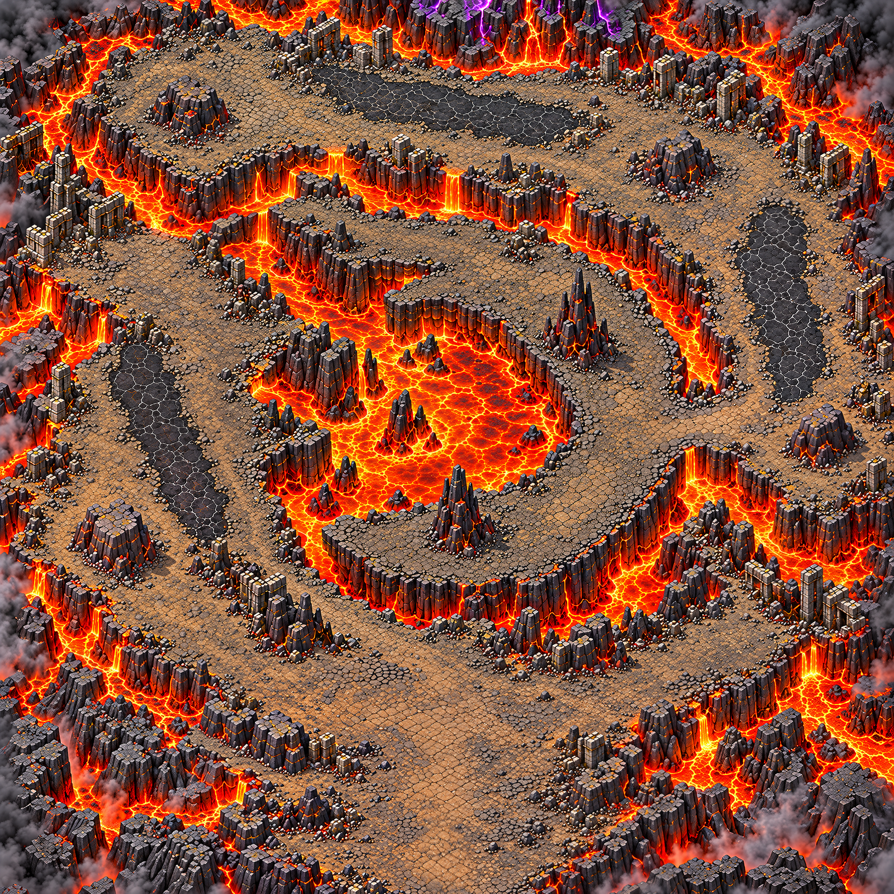

# Volcan carré — carte 9 sélectionnée

Le propriétaire a désigné la pièce jointe `c9.png` comme **carte 9**, après la carte 8 de la forteresse. L’identifiant graphique historique `map.volcano_heart` est conservé ; ce lot ne change aucune donnée de campagne. Le plan exact de cette pièce jointe fait foi sur les retouches antérieures.

Source conservée dans `source/composition_validee_c9.png`. Le fichier `composition.png` est uniquement sa remise au format de composition 1536 × 1536. Monde : **5016 × 5016 unités**.

Seize régions 4 × 4 redessinées puis assemblées avec recouvrements par le pipeline commun ; trois tuiles **3762 × 11286**, soit une carte **11286 × 11286** à **2,25 pixels par unité**. Ce n’est pas un agrandissement de la composition sans régions. Les silhouettes, passages et limites de lave restent fixés par la source.

## Contrôle

[Rapport global](../previews/volcano-heart-detail/qualite.json), [planche d’échelle](../previews/volcano-heart-detail/echelle.png), [chargement Godot](../previews/volcano-heart-detail/godot-chargement.log).

| Mesure | Valeur | Résultat |
|---|---:|---|
| densité (pixels par unité) | 2.25 | OK |
| part lisse (médiane) | 0.225 | OK |
| détails fins / 100×100 u (médiane) | 338.731 | OK |
| détails moyens / 100×100 u (médiane) | 100.036 | OK |
| secteurs conformes (part) | 0.918 | OK |
| fidélité au plan validé (corrélation) | 0.977 | OK |

Verdict global : **CONFORME**.

La carte de chaleur est le diagnostic **initial**, avant la retouche des matières ; elle ne prétend pas mesurer la dernière sortie. Les secteurs hors norme du contrôle final restent listés dans le rapport. Le verdict global ne garantit pas une netteté uniforme sur la fumée et tous les bords.

Les anciennes compositions et anciens masques de coulées sont des archives uniquement. Ils ne sont pas actifs dans le job, et ne doivent pas être réutilisés pour détourer la pièce jointe c9.png. Aucun masque de collision, champ de navigation, src/ ou donnée de gameplay n’est modifié. Carte graphique prête pour la suite de l’intégration, **pas encore jouable** ; circulation à valider après peinture par le propriétaire.

## Traçabilité

Prompts exacts `PROMPT_REGION.txt` et `PROMPT_RETOUCHE_MATIERES.txt` ; sorties initiales dans `essai_initial`, sorties retenues dans `regions`, correspondance dans `GENERATIONS.json`, empreintes dans `SHA256.json`. Images générées avec l’outil intégré, aucune ressource tierce. Import et chargement ciblé des trois textures par Godot 4.3 réussis ; aucun test de gameplay revendiqué.

qualite_initiale.json : densité (pixels par unité) = 2.25, part lisse (médiane) = 0.248, détails fins / 100×100 u (médiane) = 283.113, détails moyens / 100×100 u (médiane) = 94.242, secteurs conformes (part) = 0.837, fidélité au plan validé (corrélation) = 0.99.

qualite_seconde_passe.json : densité (pixels par unité) = 2.25, part lisse (médiane) = 0.225, détails fins / 100×100 u (médiane) = 324.44, détails moyens / 100×100 u (médiane) = 98.491, secteurs conformes (part) = 0.918, fidélité au plan validé (corrélation) = 0.979.

qualite.json : densité (pixels par unité) = 2.25, part lisse (médiane) = 0.225, détails fins / 100×100 u (médiane) = 338.731, détails moyens / 100×100 u (médiane) = 100.036, secteurs conformes (part) = 0.918, fidélité au plan validé (corrélation) = 0.977.

La finition locale concerne uniquement `r0_2`, `r1_2` et `r3_0`, avec `PROMPT_FINITION.txt`. Leurs versions précédentes sont dans `essai_seconde_passe`. Les trois étapes donnent 283,113 → 324,440 → 338,731 détails fins, avec des seuils de contrôle inchangés.
