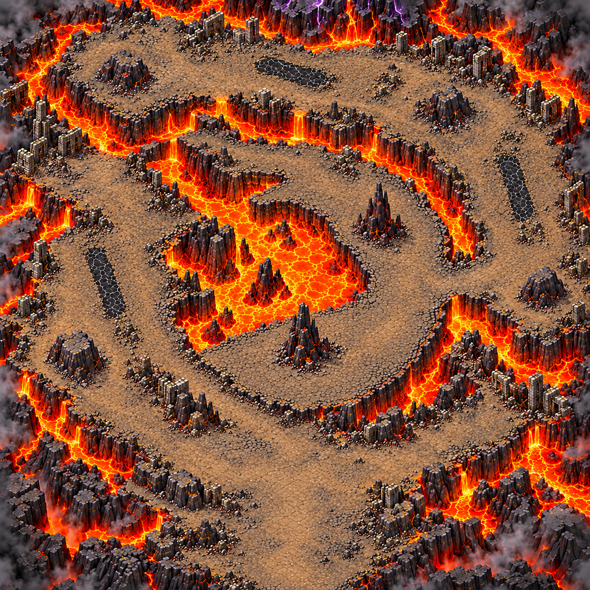
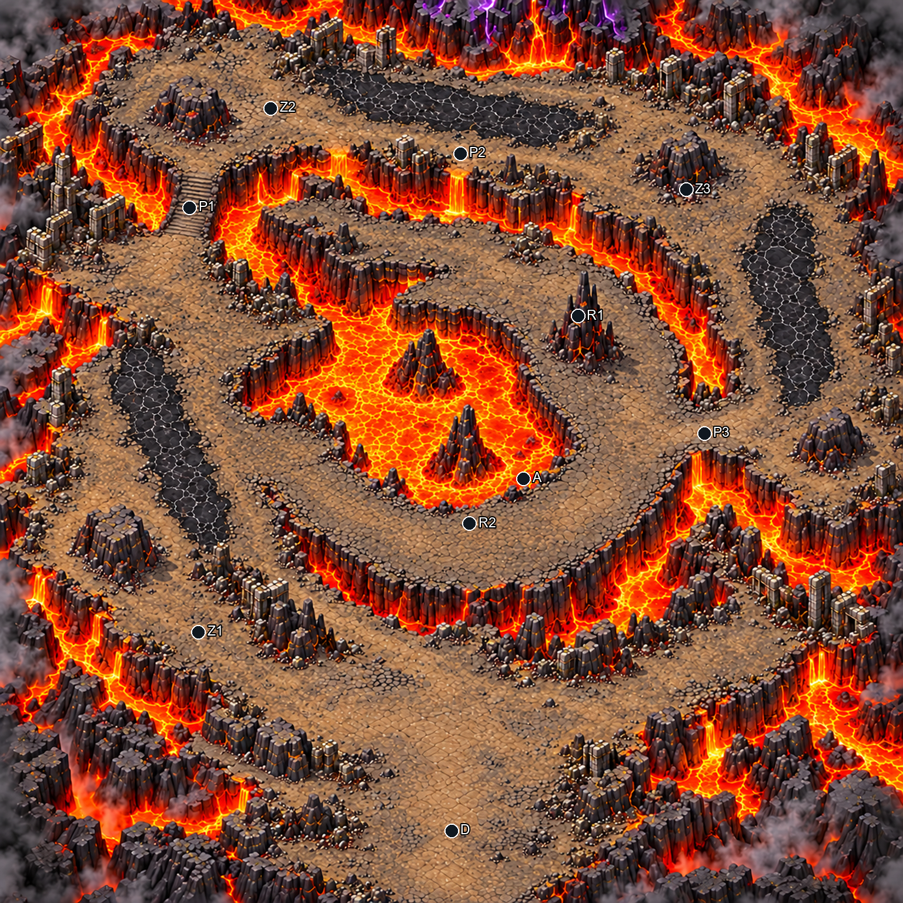
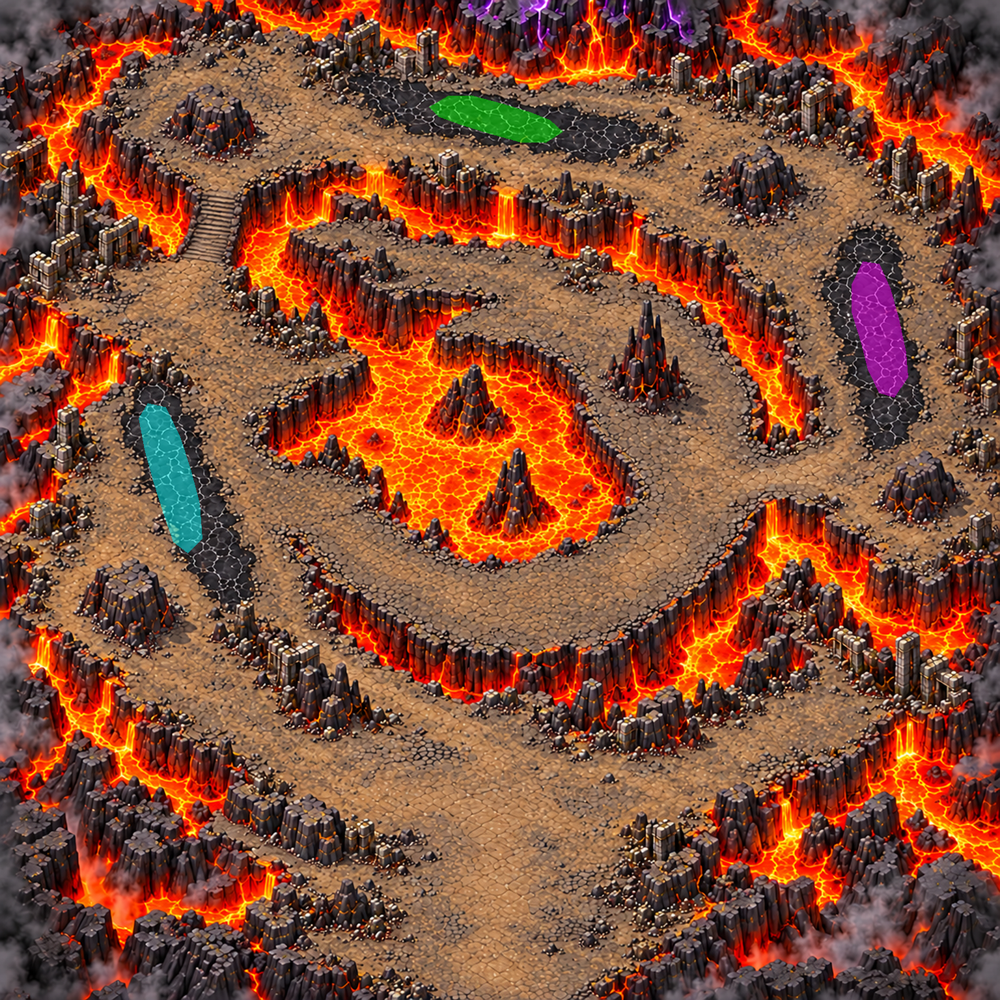
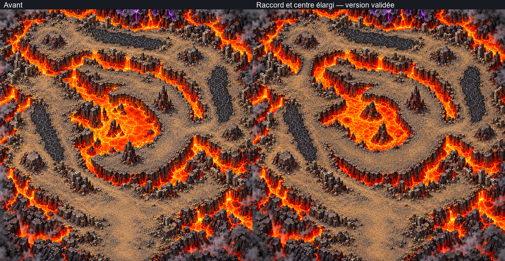

# Cœur du volcan — composition de la carte 10

Chapitre 2, « Les Terres dévastées ». Monde prévu : **5016 × 5016 unités**.
Composition **1536 × 1536**, issue d'une génération native 1254 × 1254 remise au format de
composition. **Ce fichier n'est pas une carte finale agrandie ni un niveau jouable.**
Version avec raccord nord-ouest et centre élargi validée le 24 octobre 2026 (« on garde celle la »).
Le plan est figé ; peinture des collisions et régions restent à réaliser.

## Identité et parcours

Finale volcanique : roche noire, cendre, lave orange, falaises à veines rougeoyantes,
fumée aux bords et quelques fissures violettes au sommet. Les Ruines des Cascades, la
Lisière calcinée et les Coulées de braise sont des références de matières, lumière et
caméra seulement. Leur plan n'est pas repris. Le départ sud contourne le volcan par
l'ouest, le nord puis l'est avant de rejoindre la caldeira par l'est.

La fin est un croissant de roche autour d'un lac de lave, ouvert vers l'ouest, séparé
du parcours extérieur par les falaises et la lave. Deux aiguilles décalées servent
d'abris. Ce n'est ni une place ronde ni une cour carrée. Les quatre blocs extérieurs
sont distincts de ces deux aiguilles.

Coordonnées observées approximatives, en pourcentage depuis le coin supérieur gauche.
Le brief complet et ses coordonnées initiales sont conservés dans `source/BRIEF_PROPRIETAIRE.md`.

| Repère | Brief X,Y % | Image proposée X,Y % | Observation |
|---|---|---|---|
| Départ D | 50,92 | 50,92 | Pied sud, sol dégagé |
| Zone 1 | 22,70 | 22,70 | Replat extérieur ouest |
| Zone 2 | 30,25 | 30,12 | La terrasse nord-ouest est plus au nord que demandé ; 30,25 tombe près de la lave |
| Zone 3 | 76,30 | 76,21 | Large replat extérieur nord-est ; descente sur le flanc est |
| Passage P1 | environ 18,49 au prompt | environ 21,23 | Rampe ancrée entre les plateaux ouest et nord-ouest, sans mur aux sorties |
| Passage P2 | environ 50,18 au prompt | environ 51,17 | Passage nord sur le replat |
| Passage P3 | environ 77,48 au prompt | environ 78,48 | Raccord unique du parcours extérieur au croissant |
| Caldeira A | 55,52 | environ 58,55 | Lac intérieur infranchissable et sol en croissant |
| Aiguille R1 | 52,35 au prompt | 64,38 | Aiguille nord-est de la caldeira |
| Aiguille R2 | 66,61 au prompt | 52,58 | Aiguille sud, décalée de R1 |
| Abris extérieurs | — | 13,60 ; 21,12 ; 76,18 ; 94,48 | Quatre gros blocs hors passages |

Ces écarts de repères sont **à valider** : aucune prétention de fidélité à un plan déjà
approuvé. La composition proposée deviendra le plan figé uniquement après accord.

## Lits de débordement provisoires

Trois bandes de croûte refroidie, noires à fissures grises, sont praticables. Les
enveloppes intérieures sont dessinées manuellement dans `flows.png` : fond noir,
une couleur pure par lit, sans anticrénelage. Ce masque ne décrit ni les collisions,
ni la lave liquide, ni tous les sols praticables. Des sols ordinaires restent sur
leurs côtés pour contourner un débordement ; les largeurs sûres seront confirmées
avec la peinture des collisions.

| Lit | Couleur pure | Centre X,Y % | Longueur du tracé, unités | Largeur moyenne, unités | Sens proposé |
|---|---|---|---|---|---|
| F01 ouest | #00FFFF | 17,03 ; 47,59 | 648,9 | 194,8 | Sud-sud-est |
| F02 nord | #00FF00 | 49,57 ; 11,87 | 563,5 | 156,1 | Est-sud-est |
| F03 est | #FF00FF | 87,90 ; 32,98 | 565,7 | 219,3 | Sud-sud-est |

Méthode : longueur de la polyligne centrale et largeur moyenne = aire du polygone /
longueur, converties depuis la source en unités du monde. **La largeur moyenne ne
garantit pas une largeur minimale**, notamment aux pointes arrondies. Polygones,
polylignes, méthode et chiffres sont fournis dans `flows.json`.

## Mesures et réserves

| Critère | Cible | Contrôle à ce stade |
|---|---|---|
| Format | 1:1 | 1536 × 1536, source carrée 1254 × 1254 |
| Route principale | ≥200 unités | Grands replats visibles, à mesurer sur les collisions |
| Passages | ≥120 unités | Cols/raccord est visibles ; gabarit exact à confirmer |
| Zones de combat | ≥750 unités | Grandes terrasses ouest, nord et est ; pas de masque de surface certifié |
| Caldeira | Croissant ≥500 de large, arc ≥1800 | Arc principal estimé >3000 unités ; croissant encore élargi sur la version validée ; largeur locale exacte à mesurer sur les collisions |
| Contournement des aiguilles | Assez d'espace pour boss/équipe | Retouche d'élargissement faite ; largeur minimale autour des obstacles **non certifiée**, à valider avant régions |
| Sol praticable | ≥50% | Non certifié sans peinture ; aucune statistique inventée |
| Abris | ≥120, espacement ≥350 | Quatre blocs extérieurs et deux aiguilles, visuellement séparés ; collisions à détourer |
| Lits | 150–250 de large ; 500–1000 de long | Longueurs et largeurs moyennes des trois masques dans les intervalles, hors pointes |
| Qualité finale | Régions + rapport conforme | Non applicable à la composition ; reste à faire après validation |

La version choisie conserve les lits de la référence initiale, ajoute une rampe au
nord-ouest reliant deux plateaux et élargit le croissant en prenant sur le lac.
Les masques restent des portions provisoires de ces bandes plus longues ; aucune
prétention de couvrir leur emprise complète. Le pont inutile au sud-ouest est rejeté.

## Checklist de composition

- [x] Format carré, sans texte, interface, personnages, bord ajouté ni télégraphes peints.
- [x] Parcours en spirale distinct des cartes 7, 8 et 9 ; caldeira en croissant.
- [x] Lave et falaises lisibles ; bords fermés ; pas d'objet flottant visible.
- [x] Trois lits refroidis et masque provisoire à quatre couleurs au total.
- [x] Deux aiguilles demandées et quatre abris extérieurs.
- [x] Version retenue par le propriétaire le 24 octobre, source et SHA256 conservés.
- [ ] Validation des largeurs minimales et du contournement des aiguilles.
- [ ] Surface praticable ≥50% confirmée sur la peinture.
- [ ] Collisions du propriétaire puis régions, comparaison d'échelle, qualité conforme et netteté finale.

## Livraison et contrat

Sources, références de style, prompts exacts et SHA256 :
`assets/concepts/incoming/map.volcano_heart/source/`. Le `job.json` reste `wip`,
`owner_approved=true`, `regions_started=false`. Aucun manifeste d'environnement final
ni `field` n'est créé : Claude intègrera le terrain après peinture des collisions.
La pluie de roches, les alertes au sol, dégâts, vagues et Pyrevorn sont entièrement
à coder côté Claude ; aucun impact, cercle ou boss n'est peint dans la composition.
Contrôle ciblé de chargement des deux PNG, structure/couleurs du masque et sources
joint dans `docs/previews/volcano-heart/controle_composition.json`.
