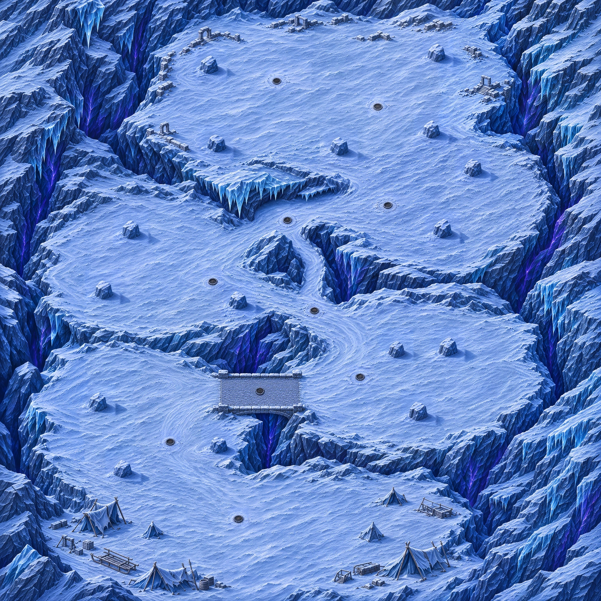

# Carte 17 — Le Col des braseros

Chapitre 4, Glacier silencieux ; identifiant proposé `brazier_pass`, monde **5016 × 5016 unités**.
La composition est validée par le propriétaire le 4 novembre 2026 (« c’est bon pour moi démarre la passe au détail »).
Le plan est figé : montée en serpentin depuis le camp au sud, quatre poches de failles à des altitudes différentes,
puis replat ouvert du sommet. Aucun plateau en enfilade gauche-droite ni plaque de glace praticable.

[Composition et détail côte à côte](../previews/brazier-pass/detail_ensemble.webp) ·
[Plan annoté](../previews/brazier-pass/plan_annote.webp) ·
[Repères complets en JSON](../../assets/concepts/incoming/map.brazier_pass/plan.json).

## Parcours et repères

Les coordonnées sont des pourcentages depuis le coin haut-gauche. Les repères sont destinés à Claude pour le
raccordement, sans données runtime ni collisions dans cette livraison.

| Repère | Centre x %, y % | Fonction |
|---|---|---|
| Départ | 40 ; 88 | Grande place dégagée du camp abandonné, tentes et matériel en périphérie |
| F1 | 30 ; 71,5 | Poche du bas gauche |
| F2 | 63 ; 64 | Poche du milieu droit, après le pont |
| F3 | 32,8 ; 44,7 | Poche du milieu gauche, accessible par deux côtés |
| F4 | 67 ; 31 | Poche du haut droit |
| Sommet | 54 ; 15 | Replat ouvert ; gardien après fermeture des quatre failles |

Chaque poche réserve une aire ouverte cible d’au moins 700 unités. Le sommet propose un cœur libre de
1000 unités et une emprise utile irrégulière détaillée dans `plan.json` ; ses ruines restent périphériques.
Il n’y a ni enceinte ni cercle de boss peint : le jeu dessine son cercle de combat.
Ces emprises restent à confirmer sur la peinture des collisions et la navigation lors de l’intégration.

La route principale vise 260 unités de large. Elle varie entre rampe de neige tassée, pont de pierre sur crevasse,
corniche et court passage sous un surplomb de glace dont le sol et les deux sorties restent visibles.
Le raccourci H5 → (53 ; 44) → H7 longe l’éperon par la droite, largeur cible 170 unités, axe d’environ 837 unités.
Il évite le détour de F3 sans dispenser de fermer cette faille. Aucune poche n’est un cul-de-sac sans retour visible.

## Foyers et abris

Dix foyers : dalle ronde noircie et plate, cendres, mince neige fondue, diamètre cible 90 unités.
**Aucun brasero ni feu n’est peint dans le fond.** Claude place le sprite existant `object.brazier` sur ces centres.
Les petits accents brun désaturé restent limités aux cendres ; le reste du décor est bleu-gris et violet froid.

| Foyer | Centre x %, y % | Rôle |
|---|---|---|
| H1 | 39,633 ; 86,204 | Départ |
| H2 | 28,309 ; 73,285 | F1 |
| H3 | 43,301 ; 64,992 | Relais du pont |
| H4 | 59,888 ; 62,520 | F2 |
| H5 | 52,392 ; 51,515 | Relais de la corniche et raccourci |
| H6 | 35,407 ; 46,651 | F3 |
| H7 | 47,847 ; 36,443 | Relais du surplomb |
| H8 | 64,593 ; 33,971 | F4 |
| H9 | 62,839 ; 17,624 | Sommet est |
| H10 | 46,093 ; 13,317 | Sommet ouest |

Les intervalles H1→H10 mesurent environ 862, 859, 841, 668, 886, 807, 849, 825 et 867 unités entre centres.
Ce sont des axes schématiques relevés sur l’image, pas des trajets mesurés sur une navigation.
La portée actuelle lue dans `ArenaData` est 220 unités : les zones chauffées ne se recouvrent pas ; les traversées
froides sont intentionnelles. Claude doit vérifier les temps de marche et le froid réel après intégration.

**Seize abris pleins**, trois dans chaque poche et quatre au sommet, empreinte cible 140 unités (plage 110–160),
avec faces éclairées haut-gauche et ombre bas-droite. Les pieds A1–A16 sont repérés dans le plan et la vue annotée.
Leurs matériaux sont ceux du schiste gelé et des congères compactes ; ils restent dans les aires de combat, écartés
des routes et des bords. Les types descriptifs du plan ne changent pas leur rôle d’obstacle plein.

[Les seize abris à la même échelle](../previews/brazier-pass/abris.webp) ·
[Les dix foyers vides](../previews/brazier-pass/foyers.webp).
Une correction locale après assemblage réduit les abris trop larges vers 140–150 unités et les foyers vers 90 unités,
sans déplacer leurs pieds/centres ; ses empreintes et rectangles figurent dans `source/scale_corrections.json`.
Le dallage intérieur du pont est redessiné en petits pavés de 15–23 unités ; ses bords, parapets et H3 sont des ancres
de recalage conservées (`source/bridge_paving_correction.json`).

## Détail, échelle et contrôles

Seize régions redessinées en trente-deux demi-régions avec recouvrements, chacune accompagnée d’un extrait des
Ruines à la même échelle. Un témoin de poste de garde a été vérifié au zoom réel avant de généraliser la méthode.
Le master retenu est sans perte,3762 × 3762 ; la présentation après redessin donne 11286 × 11286 pixels, en trois
tuiles 3762 × 11286 dans `assets/environments/brazier_pass/`. Une seule source native assemblée est conservée ;
les générations intermédiaires restent hors dépôt.

[Rapport de qualité](../previews/brazier-pass/qualite.json) ·
[Comparaison officielle à 1 pixel par unité](../previews/brazier-pass/echelle.webp) ·
[Recette et empreintes des tuiles](../../assets/concepts/incoming/map.brazier_pass/source/detail_recipe.json) ·
[Provenance des régions](../../assets/concepts/incoming/map.brazier_pass/source/regions_provenance.json).

Les captures statiques utilisent les vrais sprites et leurs échelles du manifeste, viewport 1280 × 720,
zoom `GameDB.balance.camera_zoom` (1,3333), sans écrire le profil ni charger une partie :

- [Pont et dallage](../previews/brazier-pass/pont_zoom_jeu.png),
  [poste de garde et porte](../previews/brazier-pass/poste_zoom_jeu.png),
  [poste ouest](../previews/brazier-pass/poste_ouest_zoom_jeu.png),
  [poste nord](../previews/brazier-pass/poste_nord_zoom_jeu.png),
  [Ruines au même zoom avec les mêmes acteurs](../previews/brazier-pass/reference_ruines_zoom_jeu.png).
- [Sept Givrés livrés sur la neige](../previews/brazier-pass/givres_zoom_jeu.png),
  [camp](../previews/brazier-pass/camp_zoom_jeu.png), [sommet](../previews/brazier-pass/sommet_zoom_jeu.png).
- [Corniche](../previews/brazier-pass/corniche_zoom_jeu.png),
  [raccourci](../previews/brazier-pass/raccourci_zoom_jeu.png),
  [surplomb](../previews/brazier-pass/surplomb_zoom_jeu.png).
- [Sprite brasero déjà livré posé sur H3](../previews/brazier-pass/brasero_lit_zoom_jeu.png) : aperçu séparé du fond.

Les repères de contrôle restent ceux de l’ART_BIBLE : Chasseur ≈ 52 unités, marches 12–16, pavés≤26,
piliers 30–45, cadres de porte 75–90. Les abris ne sont pas réduits en petits cailloux lors du redessin.

Contrôle final **conforme** : densité 2,25 pixels/unité, détails fins 376,968, moyens 102,353, part lisse 0,143,
48 secteurs conformes sur 49 (98 %), fidélité au plan 0,985. Import Godot headless, chargement des trois tuiles et des
sprites, treize captures, contrôle assets et lint réussis.
[Compte rendu des contrôles](../previews/brazier-pass/controle_detail.json).

La correction des cases douces laisse **zéro case résiduelle à la référence initiale figée**, après encodage. Le diagnostic relatif recalculé est conservé séparément, car la correction change sa référence. Le secteur hors norme du contrôle global est une bande de falaise au bord ouest (0 ; 2400), indiquée dans le rapport.

## Collisions et raccordement

[Image entière légère à peindre,1254 × 1254](../previews/brazier-pass/reference_collisions.jpg).
Elle provient du détail livré, réduit sans recadrage dans le cadrage exact de la composition validée.
La recette JPEG et son empreinte sont dans
[`source/collision_reference.json`](../../assets/concepts/incoming/map.brazier_pass/source/collision_reference.json).
Le JPEG identique se trouve localement dans `collision/reference.jpg` (copie de travail ignorée par Git).

Peindre en **rouge translucide** les falaises, crevasses, masses de ruines et **bases au sol** des seize abris.
Laisser libres la neige tassée, le pont, ses accès, la corniche, le raccourci, le passage sous le surplomb et les
dalles des foyers. Ne pas bloquer les ombres portées ni les sommets projetés des rochers.
Retour attendu : **PNG entier 1254 × 1254**, même cadrage et orientation, sans redimensionnement, rotation ni marge.
**Aucun masque n’est produit par Codex.**

Claude raccorde les collisions du propriétaire, le champ de navigation, quatre failles, dix braseros, le froid B7
(jauge loin d’un foyer allumé, ralentissement et dégâts à jauge pleine), le Chaman du gel qui les souffle,
le rallumage après 15 secondes, le gardien et la campagne. Tester les approches du pont, les deux accès de chaque
poche, le raccourci, le surplomb et l’emprise réelle du sommet avant de déclarer le niveau jouable.

Le lot reste hors manifeste runtime jusqu’à cette intégration. Aucun fichier de `src/`, `data/`, ni des cartes 14,
15 ou 16 n’est modifié. Les captures vérifient le rendu et le chargement ; aucun essai de circulation ou de combat
n’est revendiqué.
