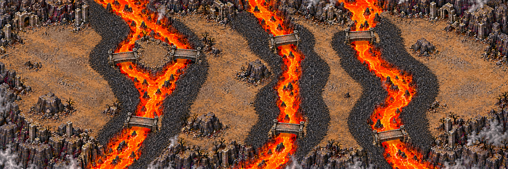
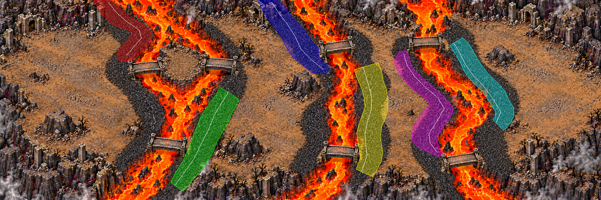

# Coulées de braise — composition de la carte 9

Chapitre 2, monde **5016 × 1672**, panorama **1536 × 512**. Cette PR livre une
**proposition à valider**, pas une texture finale ni un niveau jouable. Les régions,
la netteté au zoom du jeu et les collisions viendront après validation du plan.

## Parcours et repères à confirmer

Trois chenaux obliques, sept ponts de basalte, déplacement de droite à gauche.
Le chenal occidental se divise autour d'une île reliée aux deux rives. Le combat
final utilise l'étendue libre occidentale, sans arène construite ni cercle peint.
Les failles restent des objets du jeu : aucune n'est dessinée dans la composition.

Les coordonnées sont en pourcentage depuis le coin supérieur gauche. Le générateur
a déplacé certains repères : les positions ci-dessous proposent du sol libre dans
l'image livrée. Elles **ne remplacent pas silencieusement le brief** et doivent être
confirmées avant de figer le plan.

| Repère | Brief | Proposition sur l'image |
|---|---|---|
| Départ | 92,55 | 94,36 : replat oriental, éloigné du bloc-abri |
| Faille 1 | 74,35 | 83,32 : rive orientale sûre |
| Faille 2 | 55,70 | 63,66 : cuvette à l'est du chenal médian |
| Faille 3 | 36,30 | 30,31 : île, ruines retirées par retouche |
| Faille 4 | 18,65 | 18,50 : étendue près des ruines occidentales |
| Gardien | 8,40 | 8,40 : terrain naturel libre |

Ponts observés : chenal oriental vers (71,23) et (77,79), médian vers (56,23)
et (56,74), occidental vers (24,31), (36,31) et (28,73). Chaque chenal possède
donc plusieurs traversées permanentes ; le masque de débordement n'inclut aucun pont.
Quatre blocs-abris sont visibles vers (18,16), (42,73), (63,26), (88,62), loin
des tabliers. Leur échelle précise sera vérifiée à la passe de régions.

## Lits de débordement : masque provisoire

`assets/concepts/incoming/map.ember_flows/flows.png` est un masque RGB sans
anticrénelage : noir = aucun lit, une couleur pure par lit. Il couvre des portions
de croûte noire praticable ; ni la lave orange, ni les ponts, ni les collisions générales.
Les polygones, axes, couleurs, sens et mesures sont conservés dans `flows.json` et
dans le rapport de contrôle joint. Le tableau mesure les portions actives sélectionnées, pas les bandes entières de roche noire.

| Lit | Couleur RGB | Centre X,Y % | Longueur monde | Largeur moyenne monde | Sens |
|---|---|---|---|---|---|
| gauche_ouest_amont | #FF0000 | 20.8, 16.3 | 604 | 161 | sud puis sud-ouest |
| gauche_est | #00FF00 | 33.7, 71.1 | 900 | 189 | sud-ouest |
| centre_ouest_amont | #0000FF | 49.1, 19.4 | 716 | 186 | sud-est |
| centre_est | #FFFF00 | 61.7, 59.1 | 900 | 196 | sud puis sud-ouest |
| droite_ouest | #FF00FF | 70.5, 52.0 | 997 | 159 | sud-est puis sud-ouest puis sud-est |
| droite_est | #00FFFF | 80.6, 42.4 | 800 | 153 | sud-est puis sud-ouest |

**Réserve ouverte :** les six portions actives atteignent 500–1000 unités de long et 150–250 de large en moyenne. La largeur moyenne est l'aire divisée par la longueur de l'axe, pas une largeur minimale : certaines sections du lit cyan descendent vers 135 unités. Les pointes étroites des longues bandes ont été exclues du masque par des coupes perpendiculaires, sans changer l'image. Les bandes de croûte noire continuent donc au-delà des portions actives : les alertes du jeu devront rendre cette limite lisible. Les dimensions locales et les repères déplacés restent à valider avant régions. Quatre générations, prompts et mesures avant/après sont conservés.

## Sources et contrôles

Les sources brutes 2172 × 724, trois essais précédents, les quatre prompts exacts,
les références de style et leurs SHA256 sont dans `source/`. `composition.png`
est une réduction de format de la dernière source ; aucun agrandissement n'est
présenté comme une carte détaillée. Les références ne servent pas de plan.

Contrôle ciblé : lecture des PNG, dimensions, couleurs du masque, composantes,
polygones et absence de modification dans `src/`, `data/` ou les collisions.
Les ressources restent dans `incoming/` sous `.gdignore`, sans entrée de décor
jouable au manifeste tant que le propriétaire n'a pas validé et peint ses collisions.

- [x] Composition entière et provenance conservées.
- [x] Masque provisoire séparé du décor et des collisions.
- [x] Chenaux traversés par plusieurs ponts, espace final sans arène imposée.
- [ ] Validation des repères décalés et des dimensions des lits par le propriétaire.
- [ ] Régions, rapport de qualité conforme, chaleur de netteté et captures au zoom réel.
- [ ] Collisions peintes et intégration du mode par Claude.
