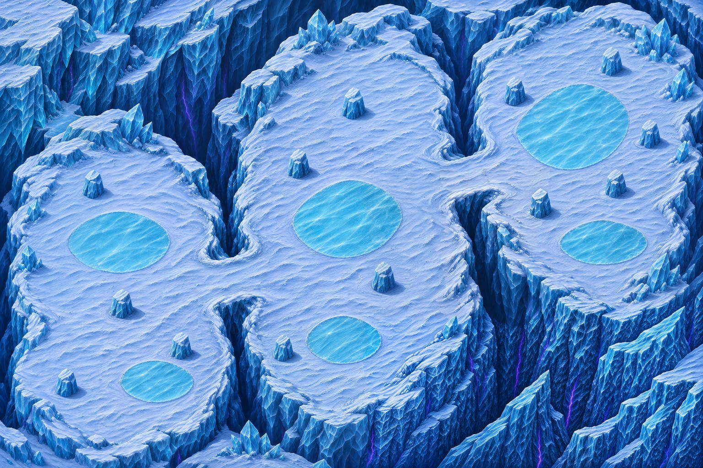

# Carte 16 — Entrée du Glacier

**Composition corrigée validée par le propriétaire** : « ok on garde cette version ». Trois plateaux et deux cols figés. **Détail graphique livré le 4 novembre 2026**, contrôle global conforme. Les collisions et le raccordement runtime restent au propriétaire et à Claude.



[Composition validée et détail, deux vues entières](../previews/glacier-entry/detail_ensemble.webp) · [Composition source figée](../previews/glacier-entry/composition.webp)

[Plan annoté entier](../previews/glacier-entry/plan_annote.webp) · [Référence légère à peindre](../previews/glacier-entry/reference_collisions.jpg)

## Parcours et finale

Chapitre 4, Glacier silencieux ; vagues par zone et B1, glace qui fait glisser. Monde **5016 × 3344 unités**, cadrage **3:2**. Ordre : **départ → Z1 → P1 → Z2 → P2 → Z3 / finale**. Pas d’arène séparée ; gardien et vagues restent à Claude.

| Repère | X ; Y en % depuis le coin haut-gauche | Rôle |
|---|---|---|
| Départ | 8 ; 87 | Neige libre au sud-ouest |
| Z1 — Bassin de neige | 15 ; 69 | Premier plateau, quatre abris |
| P1 | 33,5 ; 60 | Col entre Z1 et Z2 |
| Z2 — Plateau des glaces | 50 ; 62 | Deuxième plateau, quatre abris et marge de neige autour de la glace centrale |
| P2 | 67,5 ; 37 | Col entre Z2 et Z3 |
| Z3 — Terrasse du glacier | 83 ; 39 | Troisième plateau et finale, cinq abris |
| Centre indicatif de finale | 83 ; 34 | Glace et neige praticables |

L’emprise visuelle utile de la finale est le polygone irrégulier de `plan.json`, tracé en violet sur le plan annoté. Son rectangle englobant va de **X 73 à 94 %, Y 13 à 57 %**, soit environ **1053 × 1471 unités**. Les bases des cinq abris sont à retrancher du sol circulable. Cette enveloppe ne certifie ni un rayon libre ni la navigation : les mesures définitives se feront sur la peinture du propriétaire.

Le secteur **sud-est, approximativement X 70–100 %, Y 68–100 %**, est fermé par des faces de falaise et des crevasses bleu nuit. Aucun quatrième plateau, accès ou prolongement du parcours. Les deux cols validés restent dégagés. Les flèches du plan indiquent le parcours avec détour autour des abris ; ce ne sont pas des trajectoires calculées en jeu.

## Glace, neige et abris

Six plaques cyan clair **praticables au niveau de la neige** ; elles ne sont pas des bassins d’eau profonde. La plaque centrale G3 a été réduite pour dégager davantage de neige autour : emprise visuelle approximative de 16 × 17 % autour de 49,5 ; 46,8 %. Les autres plaques conservent leur disposition. Les contours de glisse restent à tracer lors de l’intégration.

**Treize abris : 4 sur Z1, 4 sur Z2, 5 sur Z3.** Blocs pleins à faces éclairées en haut à gauche, faces bleu sombre et ombre portée bas-droite. Leur base opaque mesure environ 42 à 48 pixels dans la composition, soit **137 à 157 unités**, hors ombre (relevé visuel, précision environ 2 px). Positions et largeurs relevées sur l’image retenue dans `plan.json`, plutôt que reprises aveuglément du prompt.

| Plateau | Abris | Pieds X ; Y en % |
|---|---|---|
| Z1 | A1, A2, A3, A4 | 13,35 ; 42,09 / 17,45 ; 67,77 / 25,98 ; 76,56 / 9,51 ; 84,67 |
| Z2 | A5, A6, A7, A8 | 50,39 ; 25,20 / 42,51 ; 37,99 / 54,56 ; 62,40 / 40,36 ; 77,15 |
| Z3 | A9, A10, A11, A12, A13 | 87,11 ; 16,11 / 73,24 ; 22,46 / 92,51 ; 31,45 / 87,57 ; 41,99 / 77,02 ; 46,48 |

Ces abris font partie du décor peint : **ne pas ajouter un deuxième objet-abri au même emplacement**. Le propriétaire peint leurs bases au sol ; Claude raccorde collisions et arrêt des tirs. Les grands aplats blancs sont cassés par une neige bleutée et des traces affleurantes, traversables, sans ajouter d’obstacles aux combats.

## Contrôle des sprites au zoom réel

[Capture sur neige](../previews/glacier-entry/lisibilite_neige.png) · [Capture sur glace](../previews/glacier-entry/lisibilite_glace.png) · [Avant/après neige](../previews/glacier-entry/comparaison_neige.webp) · [Avant/après glace](../previews/glacier-entry/comparaison_glace.webp)

Quatorze sprites du chapitre 4 de la PR #92, familles Givrés et Échos du silence, plus le Chasseur : **1280 × 720, zoom de caméra 1,3333**, échelle 0,5 et ancres du manifeste. Le banc appelle `EntityVisual` et charge les véritables feuilles ; aucun sprite n’est recoloré ou agrandi pour le contrôle. Les silhouettes et contours sombres restent distincts sur la neige bleutée et sur la glace. Recette, positions et empreinte de composition : `lisibilite.json`.

Les premières captures ci-dessus emploient la composition pour le contraste. Le contrôle final utilise les tuiles détaillées : [14 sprites sur neige](../previews/glacier-entry/detail_lisibilite_neige.png), [14 sprites sur glace](../previews/glacier-entry/detail_lisibilite_glace.png). Même caméra, mêmes poses, échelles et ancres ; aucune modification des feuilles. Banc statique hors partie : aucune simulation de navigation ou de combat revendiquée.

## Peinture des collisions

Le [JPEG entier à peindre](../previews/glacier-entry/reference_collisions.jpg) fait **1536 × 1024**, **398440 octets, soit 0,40 Mo**. Il correspond exactement à la composition corrigée validée. Recette d’encodage et SHA256 dans `source/collision_reference.json` ; copie locale ignorée par Git dans `collision/reference.jpg`.

Renvoyer un **PNG entier 1536 × 1024, même cadrage**, sans recadrage ni redimensionnement. Peindre en rouge translucide les zones bloquées : falaises, crevasses et **bases** des treize abris. Ne pas bloquer la neige, les cols ou les plaques de glace claire ; ne pas peindre l’ombre ou le sommet des blocs comme leur emprise au sol. **Aucun masque n’a été créé par Codex.** La référence de peinture reste figée pendant le détail.

## Livraison et raccordement

- Plan validé et figé : `assets/concepts/incoming/map.glacier_entry/plan.json`.
- Sources retenues, prompts, empreintes et suivi : `assets/concepts/incoming/map.glacier_entry/`.
- Douze régions redessinées en vingt-quatre demi-régions avec recouvrements, master natif sans perte de **3762 × 2508** à 0,75 px/unité.
- Trois tuiles WebP de **3762 × 7524**, présentation 11286 × 7524 à 2,25 px/unité : `assets/environments/glacier_entry/map.webp`, `map_1.webp`, `map_2.webp`. Le manifeste runtime reste à Claude.
- [Rapport qualité conforme](../previews/glacier-entry/qualite.json) et [comparaison d’échelle](../previews/glacier-entry/echelle.webp), extraits à 1 pixel par unité, sans réduction des objets. Aucune architecture ajoutée : l’abri et les faces de glace servent de témoins d’échelle.
- [Col 1 au zoom du jeu](../previews/glacier-entry/col_1_zoom_jeu.png), [col 2](../previews/glacier-entry/col_2_zoom_jeu.png), [abri](../previews/glacier-entry/abri_zoom_jeu.png), [finale](../previews/glacier-entry/finale_zoom_jeu.png) et [Ruines à caméra et acteurs identiques](../previews/glacier-entry/reference_ruines_zoom_jeu.png).
- Collisions du propriétaire ; navigation, glissade, barrières et niveau jouable à Claude.

`src/`, `data/`, le manifeste runtime et tous les fichiers des cartes 14 et 15 restent identiques à main. La passe au détail ne modifie ni la composition approuvée ni son image de peinture.

## Qualité du détail et reconstruction

Le contrôle standard du dépôt reste inchangé : densité 2,25 ; part lisse 0,178 ; détails fins 382,762 ; détails moyens 100,422 ; **35 secteurs sur 35 conformes**, fidélité au plan 0,986. Prompts, recadrages, résolutions générées et empreintes sont dans `source/regions_provenance.json`. Les quatre demi-régions du bas droit ont reçu une retouche de matière des falaises, sans déplacer leurs contours. Le master assemblé est la seule source de détail conservée ; les essais restent hors Git.

Calibrage natif par masque flou de rayon 1 pixel, plafonné à 120 %, puis présentation Lanczos ×3. La correction locale Real-ESRGAN x4v3 de la recette du dépôt traite 106 cases douces, repérées avant encodage : **0 case résiduelle contre la référence initiale figée, y compris après encodage**. La référence initiale sert au bilan avant/après ; le diagnostic relatif recalculé après correction est conservé séparément dans `detail_recipe.json` (404/620 cases sous sa nouvelle référence), sans le confondre avec ce bilan. Les mesures globales et les captures servent au contrôle final.

Reconstruction depuis le master retenu, avec le modèle ONNX x4v3 à débruitage 0,2 déjà utilisé par `tools/art/deblur_map.py` :

```bash
python3 tools/art/build_glacier_entry.py --rebuild --work /tmp/rift-glacier-detail \
  --model /chemin/vers/realesr_general_x4v3_0.2.onnx
godot --headless --import --path .
# Captures statiques, sans niveau ni modification de profil :
xvfb-run -a godot --path . --audio-driver Dummy --resolution 1280x720 \
  res://tools/art/preview_glacier_detail.tscn -- --out=/tmp/rift-glacier-captures
```

Le nom et l’empreinte du modèle sont enregistrés. Le script réapplique la même correction depuis le master ; aucune collision ou donnée de gameplay n’est reconstruite.

## En jeu (Claude, 4 novembre 2026)

- Collisions : peinture du propriétaire (`collision/painted.webp`), masque `collision.png` via
  `collision_mask.py overlay glacier_entry … --no-water` (la neige bleutée et la glace ne sont pas de l'eau), puis
  `build`. Les bases des treize abris sont bloquées.
- `data/arenas/glacier_entry.tres` : départ (-1800, 1240), zone 1 (-1756, 815), zone 2 (0, 401), barrières aux cols
  (col 1 : x ≈ -800, 240 unités ; col 2 : x ≈ 850, 200 unités), finale (1680, -520), rayons (470, 660), six plaques
  de glace. Gardien : Patriarche des cimes. Tests : `test_glacier_entry`.

