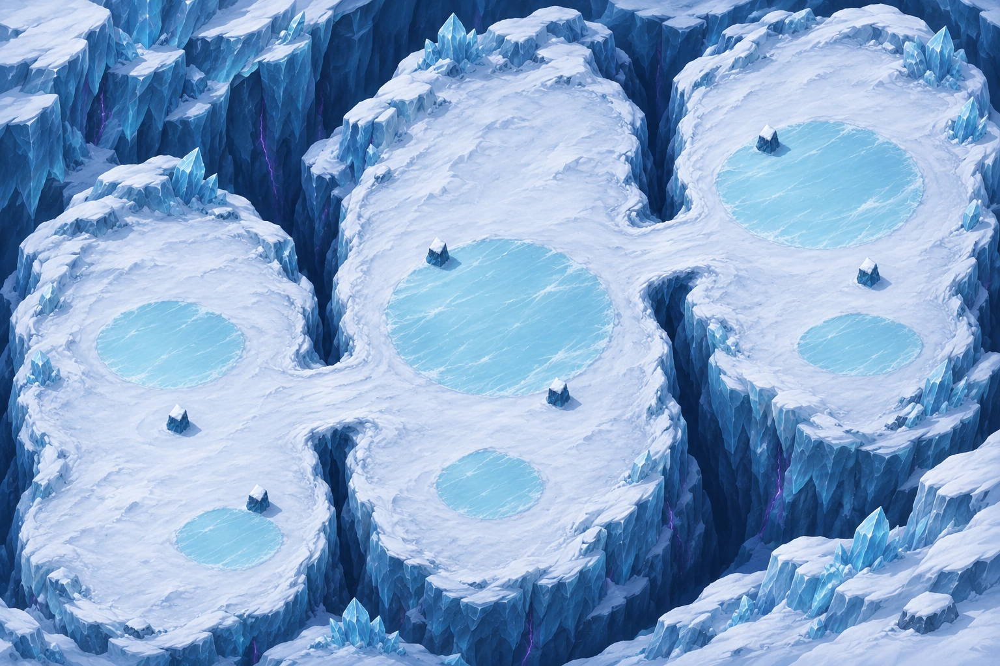

# Carte16 — Entrée du Glacier : proposition de composition

**Composition proposée le 3 novembre 2026, en attente de validation du propriétaire.** Aucun détail par régions, masque de collision ou niveau jouable n’est livré.

[Plan annoté entier](../previews/glacier-entry/plan_annote.webp) · [Deux vues entières](../previews/glacier-entry/apercu_ensemble.webp) · [Référence légère de collisions](../previews/glacier-entry/reference_collisions.jpg)

## Proposition de parcours

Chapitre4, Glacier silencieux : mode **vagues par zone**, mécanique **B1 glace praticable qui fait glisser**. Format proposé **3:2,5016 × 3344 unités**. Trois grandes terrasses ouvertes se suivent du sud-ouest au nord-est, reliées par deux courts passages enneigés. La dernière zone accueille la finale, sans arène séparée ni cercle peint. L’identité du gardien et les vagues restent à définir lors du raccordement.

Neige rugueuse et pierre glacée bleu froid, crevasses bleu nuit, plaques de glace lisse cyan pâle. Aucun orange, feu, brasero ou voile de blizzard. Les trois grandes terrasses sont le parcours proposé ; les petits replats extérieurs des falaises sont décoratifs. Le bord du parcours reste fermé par falaises et congères.

| Repère | Centre X,Y en % depuis le coin haut-gauche | Rôle |
|---|---|---|
| Départ |8,87|Neige libre dans la première zone|
| Z1 — Bassin de neige |15,69|Premiers combats et deux petites plaques de glace|
| P1 |33,5 ;60|Passage court entre Z1 et Z2, repère de barrière|
| Z2 — Plateau des glaces |50,62|Grande surface centrale, glace plus étendue et neige autour|
| P2 |67,5 ;37|Passage court entre Z2 et Z3, repère de barrière|
| Z3 — Terrasse du glacier |83,39|Grande zone finale de forme libre|
| Finale indicative |83,34|Sol de glace praticable libre, gardien à préciser|

Les passages visent environ200 à300 unités de largeur : leurs largeurs utiles et leur fermeture par des barrières seront contrôlées sur la peinture puis la navigation. Les polygones de `plan.json` décrivent le croquis de composition, sans constituer des zones de gameplay.

## Plaques de glace et abris

Les surfaces cyan clair sont **praticables**, au même niveau que la neige. Elles doivent faire glisser ; elles ne sont pas des trous ni de l’eau profonde. La neige propose des détours autour des plaques. Les masques ou données de glisse restent à Claude.

| Plaque | Centre X,Y % | Largeur,hauteur % approximatives |
|---|---|---|
| G1 |17,52|14,13|
| G2 |23,81|10,9|
| G3 |50,48|22,23|
| G4 |49,73|10,10|
| G5 |82,28|20,19|
| G6 |86,52|12,9|

Deux blocs-abris par zone, demandés au milieu des combats, restent largement espacés et hors des passages :

| Bloc | Centre X,Y % |
|---|---|
| A1 / A2 |18,65 /26,77|
| A3 / A4 |44,40 /56,61|
| A5 / A6 |77,23 /87,43|

Leur emprise visuelle vise environ116 unités de large, hauteur120 à150. Ils font partie de la proposition peinte ; leur tracé sera validé et peint par le propriétaire. **Ne pas cumuler un bloc peint avec un second objet-abri dynamique au même endroit.** L’intégration choisira une représentation cohérente, sans modifier silencieusement le plan validé.

Le croquis initial offrait55,5 % de sol avant les six blocs. Cette valeur appartient au croquis : la surface réellement praticable de l’image n’est pas certifiée et sera mesurée sur la peinture. Continuité des deux passages et distinction glace/crevasses inspectées visuellement ; aucun essai de circulation n’est revendiqué.

## Référence pour peindre les collisions

Le [JPEG léger entier](../previews/glacier-entry/reference_collisions.jpg) fait **1536 × 1024**, environ**0,43 Mo**, au cadrage exact de la composition. La copie locale `collision/reference.jpg` est ignorée par Git ; recette d’encodage et SHA256 sont dans `source/collision_reference.json`.

Après validation de cette composition, peindre les zones bloquées en rouge translucide et renvoyer un **PNG entier1536 × 1024**, sans recadrage ni redimensionnement. Falaises, crevasses et blocs-abris bloquent ; **les plaques de glace claire restent praticables**. Aucun masque n’a été peint automatiquement.

## État et suite

- **Livré pour validation** : composition entière, plan et repères en %, croquis source, prompt, empreintes, référence légère et contrôle de chargement Godot.
- **À valider** : format et parcours proposés, six plaques de glace, position des six abris et espace final.
- **Non fait** : détail graphique par régions, rapport de qualité finale, collisions, navigation, barrières, glissade et niveau jouable.
- **Suite après accord explicite du propriétaire** : figer la composition, recevoir sa peinture, puis préparer le détail à l’échelle des cartes de référence. Le statut `quality_conforme:false` du job signifie que cette composition n’est pas une livraison de détail final.

`src/`, `data/`, le manifeste runtime et tous les fichiers des cartes14/15 restent identiques à main. Le nom « Entrée du Glacier » et le format proposé restent soumis à validation. L’aperçu Godot est une image entière hors partie, pas une capture d’un niveau intégré.
