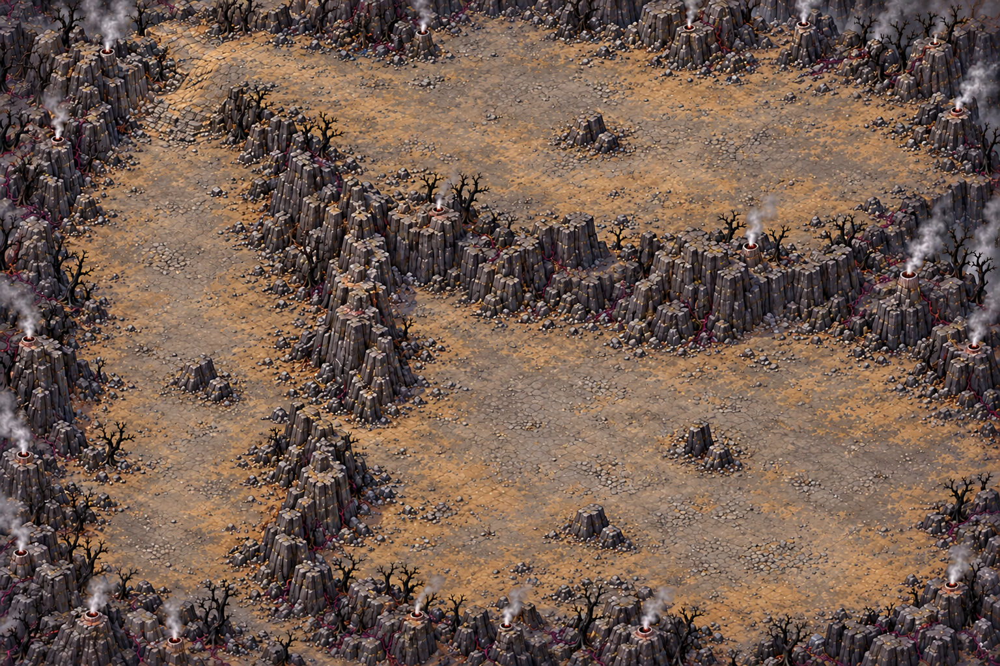
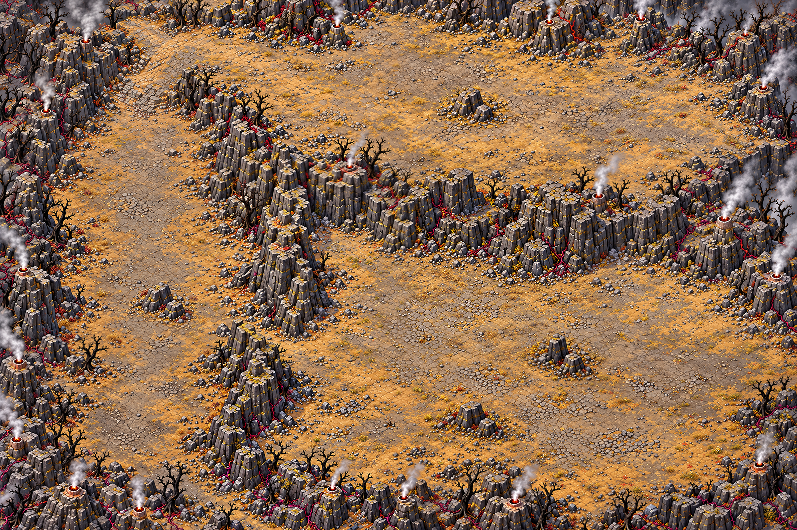

# Évents de cendre — carte 7, chapitre 2

Livraison de **composition**, monde 5016 × 3344 unités, image 1536 × 1024. Le propriétaire a
validé l'image en U puis demandé quelques obstacles : quatre groupes de basalte ont été ajoutés,
avec de larges espaces pour les contourner. Les Gorges de cendre sont abandonnées ; aucune de
leurs images ou de leur disposition n'est reprise.

## Parcours et variété

Départ en bas à droite, plaine basse vers la gauche, remontée par la vallée occidentale puis retour
vers l'est sur la corniche haute. Une arête centrale sépare les branches du U sans raccourci.
Pas de pont, arène séparée, place construite, pilier-abri ou bulbe peint dans le décor.
Le gardien utilisera le grand creux naturel de la dernière zone ; son cercle est dessiné par le jeu.

Les trois cartes jointes au générateur servent uniquement de référence de matières et de caméra.
La progression, les formes des zones, les passages et la fin de carte diffèrent de la Lisière calcinée,
conformément au § 1 bis de GENERER_UNE_CARTE.md. Fissures discrètes, roche et cendre grises/brunes,
fumée grise en bordure ; pas de lave en surface ni de dangers orange peints.

## Repères observés

Coordonnées en pourcentage depuis le coin supérieur gauche. Les positions de la brèche et de la
rampe ont dérivé dans la composition générée : **l'image approuvée fait référence**, pas une
reconstitution des coordonnées du brief. Les deux jeux de positions sont conservés au JSON.

| Repère | Position observée X,Y % | Position initialement demandée |
|---|---|---|
| Départ | 88,84 | 88,84 |
| Zone 1, plaine basse | 70,74 | 70,74 |
| P1, brèche de l'arête | environ 38,67 | 46,74 |
| Zone 2, vallée nord-sud | 22,62 | 22,62 |
| P2, rampe vers la corniche | environ 18,18 | 18,32 |
| Zone 3, creux de la corniche | 55,20 | 55,20 |
| O1, groupe de basalte | 70.5,67.5 | ajout du propriétaire |
| O2, groupe de basalte | 60,80 | ajout du propriétaire |
| O3, groupe de basalte | 21.5,57 | ajout du propriétaire |
| O4, groupe de basalte | 60,20 | ajout du propriétaire |

Les quatre groupes sont les seules exceptions ajoutées au centre des espaces libres. Ils ne forment
pas une barrière. Leurs collisions seront peintes par le propriétaire ; aucun masque n'est inventé.

## Douze propositions de bulbes

Ces positions sont des **propositions**, pas des objets déjà peints ou placés en jeu. Quatre par zone,
sur sol plat. Distances mesurées en unités du monde, en tenant compte du format 3:2, par rapport au
départ et aux passages observés **ainsi qu'aux passages du brief** : minimum **501,6 unités**, supérieur
aux 400 exigées. Les distances ne sont pas une mesure de chemin navigable ou de collisions.

| Bulbe | Zone | X,Y % |
|---|---|---|
| B01 | 1 | 59,64 |
| B02 | 1 | 77,63 |
| B03 | 1 | 68,85 |
| B04 | 1 | 82,72 |
| B05 | 2 | 17,49 |
| B06 | 2 | 27,62 |
| B07 | 2 | 14,75 |
| B08 | 2 | 16,84 |
| B09 | 3 | 42,17 |
| B10 | 3 | 55,29 |
| B11 | 3 | 72,18 |
| B12 | 3 | 87,24 |

[Plan annoté](../previews/ash-vents/plan_annote.png) ; positions précises, conversions et distances :
`assets/concepts/incoming/map.ash_vents/proposed_positions.json`.

## Mesures et limites de cette étape

| Critère | Contrôle de composition |
|---|---|
| Format | 3:2 exact, 1536 × 1024, monde 5016 × 3344 |
| Grandes clairières | trois étendues libres, largeur visuelle supérieure à 15 % (750 unités) |
| Brèche et rampe | environ 4–6 % de largeur libre ; estimation visuelle, à confirmer sur peinture |
| Circulation autour des rochers | ouverte visuellement ; à confirmer par les collisions du propriétaire |
| Départ | renfoncement libre ; aucun bulbe proposé à moins de 400 unités |
| Surface praticable ≥ 50 % | cible visuellement plausible, non certifiée avant détourage des collisions |
| Netteté, échelle et qualité finales | non revendiquées au stade de composition |

## Checklist et suite

- [x] Format, absence d'interface, de personnages et de texte dans la carte.
- [x] Trois espaces, U lisible et séparation centrale ; passages courts visibles.
- [x] Fin de carte sans arène ni abris imposés ; aucun bulbe peint.
- [x] Quatre groupes de rochers demandés, sans fermer les voies.
- [x] Sources générées, prompts exacts et SHA256 conservés dans `incoming/map.ash_vents/source/`.
- [x] Douze positions et distances contrôlées ; aucune modification de src/ ou data/.
- [ ] Collisions peintes et circulation confirmée par le propriétaire.
- [ ] Régions redessinées, assemblage et planche d'échelle.
- [ ] Rapport qualité CONFORME et contrôle de netteté après les régions.

Le décor livré n'est pas une texture finale de niveau. Claude intègre le niveau, ses collisions,
les bulbes, les Calcinés et le gardien. Le [sprite du bulbe](../art/BULBE_DE_BRAISE.md) est livré séparément.

## Passe de détail — livraison pour revue

Douze régions (4 × 3) redessinées avec `map_regions.py`, chaque sortie brute au-dessus
de 1254 pixels sur son grand côté, prompt exact et référence des Ruines joints.
Assemblage canonique avec recouvrements fondus et calibrage de netteté natif (20 à
120 % selon les régions). Trois tuiles **3762 × 7524** livrées dans
`assets/environments/ash_vents/`, soit **11286 × 7524** et 2,25 pixels par unité.
Le fichier de composition validé est inchangé. Aucune collision ou logique modifiée.

Le [rapport officiel](../previews/ash-vents-detail/qualite.json) est **CONFORME** :
part lisse 0,209 ; détails fins 330,620 ; détails moyens 98,877 ; secteurs conformes
94,3 % ; fidélité au plan 0,981. Les deux secteurs en bord droit (4800,0 et 4800,800)
restent hors norme, notamment près des fumées ; ils sont listés sans être masqués.

[Planche officielle d'échelle](../previews/ash-vents-detail/echelle.png) : carte
détaillée, composition, Ruines. [Comparaison avec personnages](../previews/ash-vents-detail/comparaison_personnages.png) :
montage technique à la même échelle, avec les sprites réels du Chasseur et de Mousseroc.
Ce n'est pas une capture de partie jouable. La capture GPU Godot a échoué sur
l'initialisation OpenGL de cette machine ; le chargement des textures est contrôlé séparément.

### Réserves de netteté locale et essai écarté

Le diagnostic relatif initial repère 136 cases plus douces sur 620 (21,9 %), malgré
le contrôle global conforme. Sa carte de chaleur historique est jointe sous
`diagnostic_initial_ash_vents_sharpness.png` et ne certifie pas l'absence de flou local.
Un essai du `deblur_map.py` existant a diminué les détails fins à 325,212 (sous le seuil)
et augmenté les alertes relatives. Il a été **écarté** : ses textures ne sont pas livrées.
Rapport et métadonnées de cet essai restent joints pour traçabilité. Les tuiles livrées
proviennent de l'assemblage canonique des régions, avec une seule retouche de palette
de r1_2 pour remplacer les herbes vertes accidentelles par des herbes sèches.

Cette livraison est prête pour revue visuelle, **pas qualifiée finale sans réserve**.
Le propriétaire juge la netteté locale ; les collisions peintes et le niveau jouable
restent à intégrer par Claude. Aucun champ de collisions ni entrée d'arène n'est inventé.
Le manifeste d'analyse des rapports ne constitue pas une entrée runtime du jeu.

Sources brutes, recadrages d'entrée, prompts, retouche et SHA256 :
`assets/concepts/incoming/map.ash_vents/source/regions_v1/`.
