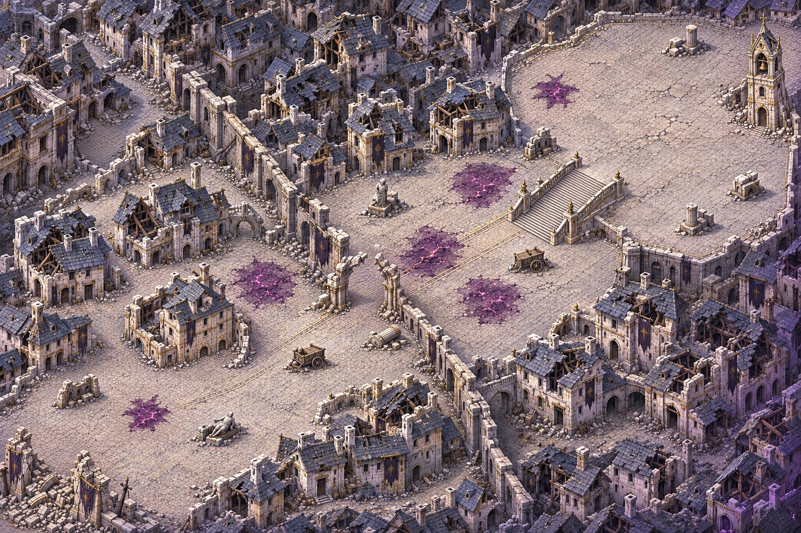

# Carte 21 — Les Faubourgs brisés

**Composition et identité à valider par le propriétaire — 5 novembre 2026.**
`shattered_outskirts`, première carte du chapitre 5, dernier chapitre : la Cité de la Faille.
Vagues par zone ; B9 « Sol corrompu ». Branche `codex/carte-21-faubourgs-brises`, depuis main actualisé.

## Identité proposée pour le chapitre 5

Une cité élégante de **pierre pâle et d’ardoise**, déchirée par l’ouverture de la Faille. Maisons
éventrées, petites ruelles et cours, grande avenue, remparts brisés, statues renversées et beffroi
fendu. Dorures ternies et bannières sombres déchirées conservent la trace de sa richesse.
La corruption forme des veines violet sombre à magenta dans les dalles ; elle reste limitée à cette
entrée de chapitre et pourra gagner les cartes suivantes. Aucune neige, lave ou végétation de marais.
Lumière haut-gauche et liseré violet bas-droite, même caméra et même échelle de personnages que le jeu.

Le propriétaire valide ici **l’identité de la cité et le plan**, avant de figer la composition pour
les régions. Cette étape ne livre pas encore le détail graphique final ni une carte jouable.

## Parcours et repères

Monde **5016 × 3344 unités**, cadrage **3:2**, composition **1536 × 1024 pixels**.
Parcours en diagonale du sud-ouest vers le nord-est, différent des cartes du Glacier silencieux.
Les repères proposés sont dans
[`source/composition_review.json`](../../assets/concepts/incoming/map.shattered_outskirts/source/composition_review.json),
en pourcentages de l’image entière depuis le coin haut-gauche. Ils ne sont pas des collisions.
**Le `plan.json` verrouillé sera établi après validation.**

| Repère | Proposition |
| --- | --- |
| Départ | **17 % ; 87 %**, sur les dalles saines de la place sud-ouest, devant la porte effondrée |
| Porte de ville | Vers 8 % ; 94 %, piliers brisés et gravats fermant le bord, sans sortie hors de l’image |
| Z1, Faubourgs | Rues et plusieurs cours reliées autour des maisons écroulées, possibilités de retour dans la zone |
| Z1 → Z2 | Arche de rempart à demi effondrée vers 46,5 % ; 57 %, seuil clair et praticable, cible 300 unités de large |
| Z2, Grande Avenue | Large voie dallée diagonale, façades latérales, statues et charrettes renversées |
| Z2 → finale | Escalier monumental fendu vers 71 % ; 39 %, large par son tablier, marches fines de 12–16 unités |
| Place du Beffroi | Au nord-est, centre utile proposé **81,5 % ; 25 %**, sol libre cible **1000 × 1000 unités** |
| Beffroi | À la bordure nord-est, pied vers 96,5 % ; 24 %, fendu, sommet entièrement visible dans la composition |

La finale est une **place ouverte**, sans enceinte d’arène ni cercle peint. Le jeu dessinera le cercle
du combat. L’ellipse et le trajet sur le plan annoté sont des repères de revue uniquement.
Les deux liaisons sont courtes et nettes pour recevoir les barrières du jeu. La porte effondrée
du départ reste du décor de bordure ; l’arche centrale conserve son chemin sous les deux piliers brisés.

## Sol corrompu et abris

**Six nappes B9**, deux dans les faubourgs, trois sur l’avenue, une en bordure de la place.
Leurs polygones sont relevés sur la peinture : diamètres maximaux **environ 314 à 490 unités**,
dans la cible 250–500. Les deux plus grandes propositions ont été réduites avant cette revue.
Dalles légèrement soulevées et fissurées, taches violettes sombres et fines veines magenta lumineuses,
contours irréguliers distincts des dalles saines. Ces nappes sont **toujours praticables**.

Certaines tentent le passage sur la route principale, avec un détour sur dalles saines ; aucune ne
couvre le seuil de l’arche ou l’escalier obligé. Le départ est hors corruption. Le jeu gérera le
renforcement progressif du Chasseur et des Corrompus qui y restent ; aucun effet animé ou cercle peint.

**Dix abris proposés** : trois en Z1, trois en Z2, quatre sur la place. Pans de mur, statues et
colonnes tombées, charrettes renversées. Ils sont hors des nappes et des passages, à l’intérieur des
aires de combat. Le gabarit final **110–160 unités**, cible 140, sera fixé dans les régions après
validation du plan ; les grands objets de composition restent provisoires à cette étape.

## Captures d’échelle et de lisibilité

Le banc [preview_shattered_outskirts.tscn](../../tools/art/preview_shattered_outskirts.tscn) ajoute
les **sprites existants** aux ancres et échelles du jeu, en lecture seule, sans lancer de partie.
Captures à **1280 × 720**, zoom réel `GameDB.balance.camera_zoom` :

- [Chasseur et Écho devant la façade témoin](../previews/shattered-outskirts/facade_zoom_jeu.webp)
- [Chasseur et Écho sur l’escalier](../previews/shattered-outskirts/escalier_zoom_jeu.webp)
- [Seuil de l’arche brisée](../previews/shattered-outskirts/arche_zoom_jeu.webp), [pied du beffroi](../previews/shattered-outskirts/beffroi_zoom_jeu.webp), [départ](../previews/shattered-outskirts/depart_zoom_jeu.webp)
- [Reflets et Échos du silence sur dalles](../previews/shattered-outskirts/lisibilite_dalles.webp)
- [Les mêmes sur le sol corrompu](../previews/shattered-outskirts/lisibilite_corruption.webp)

Éclat errant, Sentinelle de verre, Golem de quartz (chapitre 3), Éclat du silence, Chevalier de glace
et Héraut du silence (chapitre 4) : six témoins existants, sans nouveau sprite du chapitre 5.
Leur lisibilité est contrôlée sur les deux matériaux. Les grandes portes de la façade témoin ont
été réduites vers 75–90 unités ; le Chasseur mesure environ 52. Fenêtres et colonnes cible 30–45,
dalles 26 au plus, marches 12–16. Les seuils, fenêtres et petits pavés seront calibrés à nouveau
pendant le détail des régions, sans changer les emplacements approuvés.

Le terrain de composition est agrandi dans ces captures : **sa finesse reste provisoire**.
Aucun rapport `check_map_quality` conforme n’est revendiqué avant les douze régions détaillées.
Reçu des commandes et empreintes : [controle_composition.json](../previews/shattered-outskirts/controle_composition.json).
Aucun déplacement, combat, barrière ou niveau B9 n’est simulé par ce banc.

## Suite après validation

1. Figer `plan.json` : départ, zones, deux passages, place et emprise utile, beffroi, six polygones B9, dix abris.
2. Contrôler un secteur témoin au zoom réel, puis peindre **douze régions**, assembler et contrôler
   finesse et échelle selon [QUALITE_DES_CARTES.md](QUALITE_DES_CARTES.md), verdict conforme obligatoire.
3. Livrer la référence légère entière des collisions, avec recette et SHA-256 dans
   `source/collision_reference.json`. Retour du propriétaire en PNG au même cadrage, nappes B9 praticables.

Aucun masque statique produit à cette étape. Claude intégrera collisions, zones, B9, gardien et campagne.
**Aucun changement de `src/`, `data/`, du manifeste ni des cartes 14 à 20.**
