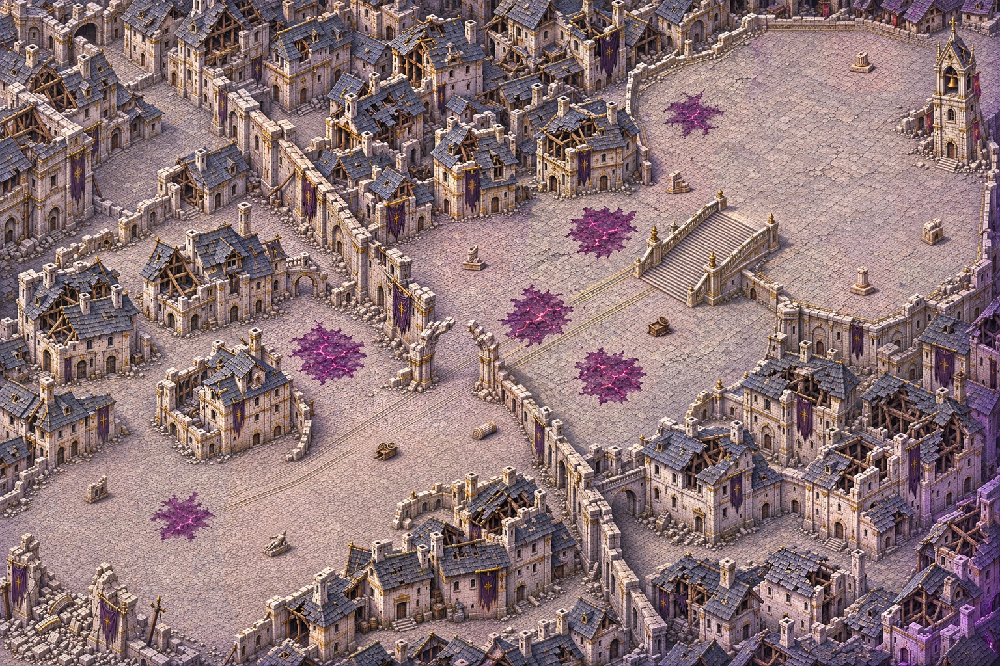
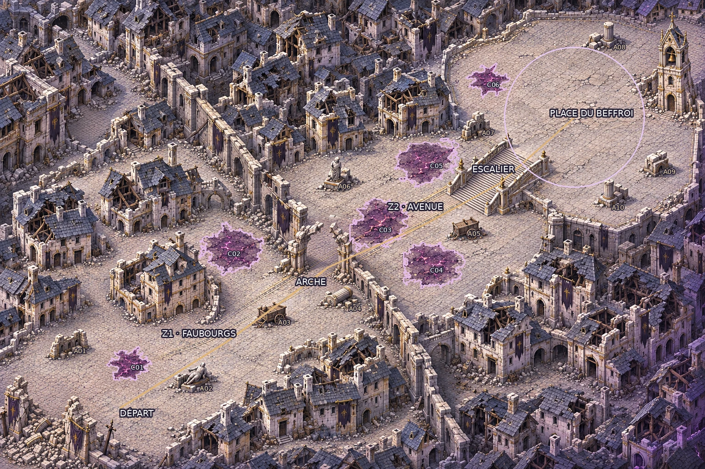

# Carte 21 — Les Faubourgs brisés

**Identité et composition validées par le propriétaire le 5 novembre 2026 ; détail graphique livré.**
`shattered_outskirts`, première carte du chapitre 5, dernier chapitre : la Cité de la Faille.
Vagues par zone ; B9 « Sol corrompu ». Branche `codex/carte-21-faubourgs-brises`, depuis main actualisé.



## Identité et plan conservés

Cité élégante de pierre pâle et d’ardoise, éventrée par la Faille : façades et charpentes rompues,
ruelles, cours reliées, grande avenue, remparts brisés, dorures ternies, bannières déchirées et beffroi
fendu. Six nappes violet sombre et magenta annoncent la corruption du dernier chapitre.
Aucune neige, lave ou végétation de marais ; lumière haut-gauche et liseré violet bas-droite.

Monde **5016 × 3344 unités**, format **3:2**, parcours diagonal sud-ouest → nord-est.
La [composition validée](../previews/shattered-outskirts/composition.webp) reste inchangée.
Le [plan figé](../../assets/concepts/incoming/map.shattered_outskirts/plan.json) contient départ,
polygones des zones, liaisons, emprise de la place, contours B9 et abris, en pourcentages depuis le coin haut-gauche.



| Repère | Emplacement et lecture |
| --- | --- |
| Départ | **17 % ; 87 %**, place sud-ouest sur dalles saines, devant la porte effondrée |
| Porte de ville | Vers 8 % ; 94 %, gravats et piliers brisés ferment le bord ; aucune sortie hors carte |
| Z1, Faubourgs | Cours et ruelles reliées autour des îlots de maisons effondrées ; trois abris |
| Z1 → Z2 | Arche à demi effondrée, **46,5 % ; 57 %**, seuil clair et continu entre les piliers, cible 300 unités de large |
| Z2, Grande Avenue | Voie dallée diagonale et dilatations de combat ; trois abris |
| Z2 → finale | Escalier monumental fendu, **71 % ; 39 %**, tablier libre, marches de 12–16 unités |
| Finale | Place du Beffroi ouverte ; noyau libre **1000 × 1000 unités**, centre utile **81,5 % ; 25,2 %** |
| Beffroi | Pied vers **96,5 % ; 24 %**, à la bordure de la place, sommet entier dans le cadrage |

La finale conserve une grande place ouverte : **aucune enceinte d’arène ni cercle de combat peint**.
L’ellipse et le trajet sur l’aperçu annoté sont des repères de revue ; le jeu dessine son cercle.
Le centre de contrôle du noyau libre a été affiné de **6,688 unités** vers le bas dans la même place,
sans déplacer le décor ; les silhouettes solides des quatre abris restent hors de ce noyau.
Les deux liaisons restent courtes et nettes pour les barrières du jeu.

## Six nappes B9 et dix abris

**Deux nappes dans les faubourgs, trois sur l’avenue, une sur la place.**
Le détail peint montre des dalles fissurées, teintées de violet sombre, traversées de veines magenta.
Les six surfaces restent **plates et praticables** ; aucun trou ni cristal bloquant n’y est ajouté.
Les bords de quatre nappes ont été resserrés localement après le redessin pour respecter la limite de 500 unités.

| Nappe | Diamètre maximal relevé sur le détail (unités) |
| --- | ---: |
| C01 | 344,09 |
| C02 | 413,34 |
| C03 | 421,61 |
| C04 | 385,37 |
| C05 | 382,02 |
| C06 | 337,11 |

Les emplacements validés sont conservés. `plan.json` garde les contours de composition et les contours
finaux de matériau ; ce sont des repères B9, **aucun masque statique de collisions**.
Le départ, l’arche, l’escalier et les abris sont hors des nappes ; un détour sur dalles saines reste visible.
Le jeu gérera le renforcement progressif du Chasseur et des Corrompus.

**Dix abris pleins** : trois en Z1, trois en Z2, quatre sur la place. Pans de mur, statues brisées ou
renversées, colonnes rompues et charrettes renversées, avec faces éclairées et ombres portées.
Les silhouettes solides ont été corrigées à **111,64–141,15 unités de large**, socles, roues et
brancards compris, hors ombre. Les repères de pied ont été affinés de moins de 90 unités dans les
mêmes emplacements de combat. [Planche des dix abris à 1 pixel par unité](../previews/shattered-outskirts/abris_echelle.webp)
et [relevés des silhouettes](../../assets/concepts/incoming/map.shattered_outskirts/source/cover_measurements.json).

## Source et reconstruction

**Douze régions réellement redessinées**, carrés de 1574 unités avec recouvrements du découpage standard
`map_regions.py`. Chaque sortie de 1254 pixels fournit **0,797 pixel généré par unité**.
Les marges extérieures de guide sont retirées ; les raccords suivent un chemin de faible différence,
avec fondu d’un pixel natif, pour conserver un seul dessin dans les recouvrements.

Le master retenu `source/map_detailed.webp` fait **3762 × 2508 pixels**, à 0,75 pixel par unité.
Il est sans perte, relecture RGB vérifiée pixel par pixel. Trois tuiles de **3762 × 7524 pixels**
forment l’image de jeu **11286 × 7524**, à 2,25 pixels par unité, sous
`assets/environments/shattered_outskirts/`. Les régions, essais et planches intermédiaires restent hors Git.

Le dessin urbain initial dépassait la bande de finesse des références. Un anticrénelage natif de
**0,6 pixel** calibre les contours avant la présentation Lanczos ×3 ; aucune texture procédurale n’est ajoutée.
Le diagnostic relatif a ensuite isolé les cases douces : correction locale Real-ESRGAN x4v3, débruitage 0,2,
sur 79 blocs. Aucune case ne reste sous la référence relative initiale après encodage.
Les tuiles finales sont en WebP qualité 98 ; les contrôles portent sur leurs pixels décodés.

Prompts, empreintes, cadrages et retouches : `source/regions_provenance.json`, `region_instructions.json`,
`cover_corrections.json`, `corrupted_material_corrections.json`, `detail_recipe.json` et `SHA256.json`.
Reconstruction depuis le master retenu, avec les dépendances Python du pipeline et le modèle ONNX indiqué dans la recette :

```bash
python3 tools/art/build_shattered_outskirts.py --present --work /tmp/rift-faubourgs \
  --model /chemin/realesr_general_x4v3_0.2.onnx
```

## Contrôles et captures

| Mesure sur les tuiles livrées | Résultat | Attendu |
| --- | ---: | ---: |
| Densité (pixels par unité) | 2,250 | 2,183–2,317 |
| Part lisse médiane | 0,162 | ≤ 0,270 |
| Détails fins par 100 × 100 unités | 355,725 | 329,944–446,395 |
| Détails moyens par 100 × 100 unités | 101,967 | 90,940–123,036 |
| Secteurs conformes | **35/35, 100 %** | ≥ 85 % |
| Fidélité à la composition validée | **0,953** | ≥ 0,850 |

**Verdict conforme**, seuils inchangés : [rapport](../previews/shattered-outskirts/qualite.json).
La [comparaison d’échelle](../previews/shattered-outskirts/comparaison_echelle.webp) est produite par
`map_regions.py compare`, puis disposée sans changer l’échelle des extraits : détail, composition et Ruines,
à **1 pixel par unité**. Le [diagnostic de netteté relative](../previews/shattered-outskirts/nettete_relative.webp)
sert à la revue de finesse, pas au détourage des collisions.

Le banc [preview_shattered_outskirts.tscn](../../tools/art/preview_shattered_outskirts.tscn) charge
les tuiles finales et les sprites existants à leurs échelles natives, avec le zoom réel du jeu,
à **1280 × 720**, sans profil écrit :

- [Chasseur et Écho devant une façade](../previews/shattered-outskirts/facade_zoom_jeu.webp)
- [Chasseur et Écho sur l’escalier](../previews/shattered-outskirts/escalier_zoom_jeu.webp)
- [Seuil de l’arche](../previews/shattered-outskirts/arche_zoom_jeu.webp), [beffroi](../previews/shattered-outskirts/beffroi_zoom_jeu.webp), [départ](../previews/shattered-outskirts/depart_zoom_jeu.webp)
- [Lisibilité sur dalles](../previews/shattered-outskirts/lisibilite_dalles.webp)
- [Lisibilité sur sol corrompu](../previews/shattered-outskirts/lisibilite_corruption.webp)

Témoins des chapitres 3 et 4 : Éclat errant, Sentinelle de verre, Golem de quartz, Éclat du silence,
Chevalier de glace et Héraut du silence, avec le Chasseur et un Écho. Aucun sprite du chapitre 5 créé.
Portes cible 75–90 unités, fenêtres et colonnes 30–45, pavés 26 au plus, marches 12–16 ;
le Chasseur d’environ 52 unités est le repère de la bible graphique.
Import Godot, huit captures, lint du banc et contrôle des assets réussis : **451 entrées, 449 valides,
2 placeholders préexistants, zéro erreur**. [Reçu des contrôles](../previews/shattered-outskirts/controle_detail.json).

## Référence des collisions et raccordement Claude

[**Image entière légère à peindre — JPEG 1254 × 836**](../previews/shattered-outskirts/reference_collisions.jpg),
**605 710 octets**, même cadrage que le plan validé, sans annotation, à **4 unités par pixel**.
Recette de réduction et SHA-256 : `source/collision_reference.json`.

Retour attendu en **PNG 1254 × 836**, sans recadrage ni redimensionnement, obstacles peints en rouge translucide.
Maisons, murs, beffroi et abris pleins sont bloquants ; les six nappes violettes B9, le seuil de l’arche,
le tablier de l’escalier et les places restent praticables. Le contour des collisions appartient au propriétaire.

Claude raccordera les trois tuiles au monde 5016 × 3344, le manifeste, la peinture du propriétaire,
la navigation, les zones, les barrières, B9, le gardien et la campagne.
Les monstres du chapitre 5 ne sont pas livrés ; les captures utilisent les sprites existants.
**Détail graphique livré ; collisions, niveau jouable, déplacements et combats non testés ici.**
Aucun changement de `src/`, `data/`, du manifeste ni des cartes 14 à 20.

Poids total des fichiers livrés par la PR, sources et aperçus compris : **65,07 Mo**.
