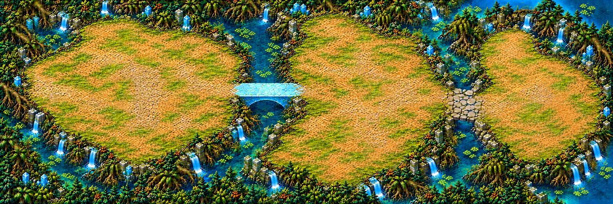

# Jardins de cristal — composition de la carte 13

Panorama **3:1**, monde prévu **5016 × 1672 unités**, composition **1536 × 512**. Chapitre 3 : jungle-marais, mousse émeraude, eaux turquoise infranchissables, cristal-miroir cyan pâle. Pas de lave, orange vif ou cendres.

## Parcours proposé

| Repère | Position X,Y % |
|---|---|
| Départ, place de pierre à la lisière gauche | 8,49 |
| Grande clairière du jardin | 24,48 |
| Arche de cristal tombé et tablier libre | 46,42 |
| Avenue de jardin très large | 62,48 |
| Chaussée de pierres plates | 75,53 |
| Terrasse finale épaisse en croissant, sans arène | 88,50 |

[Plan annoté](../previews/crystal-gardens/plan_annote.webp). Les repères sont indicatifs et ne définissent pas des zones de gameplay.

Les deux passages relient visuellement les sols libres. Leurs appuis sont ancrés aux berges ; aucun cristal ou pilier sur les tabliers. Le départ est fermé côté extérieur par racines et eau, avec une large ouverture vers la première clairière. La dernière terrasse regarde un lagon : aucun mur d’arène ni cercle peint.

## Contrôle du plan et limites

| Critère demandé | Constat au stade composition |
|---|---|
| Format petit | 3:1, 5016 × 1672 unités |
| Deux passages identifiables | Arche cyan puis pierres de gué ; continuité visuelle contrôlée |
| Routes ≥4 %, passages ≥2,5 % de largeur | Objectifs conservés ; mesures précises à relever sur le détourage, pas de certification de navigation |
| Clairières pour combattre et tourner | Grands plateaux libres, avenue centrale élargie lors de la dernière passe |
| ≥55 % de sol praticable | Objectif visuel recherché, non certifié sans peinture des collisions |
| Obstacles | Regroupés aux bordures, centres dégagés ; petits détails du sol à laisser traversables |
| Bords | Fermés par l’eau, les racines et les ruines ; aucun chemin ne doit sortir |

Deux retouches de composition avant validation : le premier pont de racines a été remplacé par l’arche de cristal du brief ; la bordure gauche a été fermée. Une passe d’espace a ensuite repoussé les bordures de végétation pour éviter une avenue trop étroite. Les essais non retenus restent hors dépôt.

## État et suite

- [x] Composition entière, prompts exacts et empreintes conservés.
- [x] Contrôle ciblé de chargement de l’image dans Godot ; aperçu technique 1280×720 joint.
- [x] Nouveau parcours horizontal, deux franchissements distincts, fin sans arène.
- [x] Composition corrigée validée par le propriétaire le 29 octobre 2026.
- [ ] Mesures du sol praticable et des largeurs lors de la peinture des collisions.
- [ ] Passe de détail par huit régions après validation, assemblage et rapport qualité conforme.
- [ ] Niveau jouable, collisions et mécaniques, raccordés ensuite par Claude.

**Ce n’est pas une carte finale ni un niveau jouable.** Aucun agrandissement livré comme détail final, aucun champ, masque de collision, `src/`, `data/` ou manifeste runtime modifié. Les références Ruines/Mangrove servent uniquement au style ; leur plan n’est pas repris. Le propriétaire a autorisé l’enchaînement des autres lots sans attendre une réponse ; la passe de régions attend la validation du plan.

Poids des nouveaux fichiers avant ces petites métadonnées : **4.7 Mo**, sous la limite de 150 Mo.

## Correction validée du premier franchissement

Le contournement au nord de l’arche est remplacé par un chenal infranchissable relié aux eaux des bords nord et sud. Le pont bas en cristal est orienté est-ouest et raccordé directement aux deux berges ; le tablier reste libre. Ce pont est l’unique franchissement entre les deux premières zones. Conserver cette topologie lors du détail ; surveiller la teinte ocre pour éviter un orange vif.
