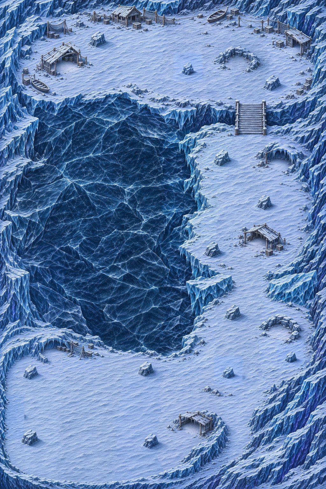

# Carte 18 — Le Lac gelé des tempêtes

**Composition validée le 4 novembre 2026 ; détail graphique livré, collisions à peindre.** Chapitre 4, Glacier silencieux ; identifiant
proposé `storm_lake`. Format vertical **3344 × 5016 unités** (2:3), image entière 1024 × 1536 pixels.
Le format suit la demande propre à cette carte.

[Composition et détail côte à côte](../previews/storm-lake/detail_ensemble.webp).

[Plan annoté entier](../previews/storm-lake/plan_annote.webp) ·
[Plan figé et repères](../../assets/concepts/incoming/map.storm_lake/plan.json).

## Plan validé

Le Chasseur part du campement de pêcheurs au **nord** et descend par la **rive est**. Le lac gelé bleu sombre est
**entièrement infranchissable**, avec des fractures profondes et des berges abruptes. La rive ouest est fermée par
la falaise ; aucun itinéraire ne contourne les passages de zones par ce côté.

| Étape | Centre x %, y % | Disposition validée |
|---|---|---|
| Départ | 44 ;12 | Place dégagée du camp abandonné ; cabanes, filets et barques en périphérie |
| Z1 | 48 ;13 | Large rive nord enneigée |
| P1 | 76,660 ;24,349 | Passerelle de bois courte sur crevasse ; largeur utile cible 260 unités |
| Z2 | 78 ;43 | Longue bande de neige entre lac et falaise, îlots de rochers espacés |
| P2 | 80,859 ;59,831 | Brèche courte entre deux masses de glace effondrées ; largeur cible 280 unités |
| Z3 | 79 ;72 | Grande anse au sud-est |
| P3 | 60,645 ;76,823 | Large entrée de l’arène depuis la berge sèche au sud du lac, environ 700 unités |
| Arène | 29 ;85 | Amphithéâtre de glace en croissant au sud-ouest, adossé à la falaise |

P1 et P2 sont les seules liaisons entre leurs zones, avec deux approches visibles et des masses latérales permettant
la pose d’une barrière. Le mode reste celui des [vagues par zone](../design/MODE_VAGUES_PAR_ZONE.md).
L’arène est un espace distinct, ouvert vers le nord-est et le lac par la berge sèche ; aucun cercle de boss n’est
peint. Son centre garde une cible de **1000 unités de sol libre**, avec les abris et refuges répartis autour.

Le trait du plan annoté indique un parcours proposé. Les largeurs et l’emprise utile doivent être confirmées sur
les collisions du propriétaire, puis par des essais de navigation lors de l’intégration.

## Sept refuges du vent B2

Chaque refuge garde un **sol praticable d’environ 200 unités de diamètre**, une entrée ouverte et des parois
protectrices. Les refuges sont des creux où l’on entre ; les blocs de combat sont des obstacles pleins.

| Repère | Centre x %, y % | Forme proposée |
|---|---|---|
| W1 | 19,727 ;13,737 | Cabane en ruine sur la rive nord |
| W2 | 73,438 ;13,346 | Rochers en demi-cercle sur la rive nord |
| W3 | 85,742 ;33,529 | Court surplomb de glace, sol visible sur la rive est |
| W4 | 80,664 ;49,935 | Ruine de cabane sur la rive est |
| W5 | 88,281 ;68,490 | Creux de rochers dans l’anse sud-est |
| W6 | 17,969 ;72,005 | Creux de glace dans la partie nord-ouest du croissant |
| W7 | 59,668 ;88,216 | Cabane basse sur le bras est du croissant |

Leur neige est plus calme, légèrement nacrée et plus chaude que le sol voisin, sans disque de couleur ni halo.
La carte est peinte par temps couvert neutre : **aucun voile de blizzard, flocon animé ou brouillard n’est inclus**.
Claude ajoute l’effet B2 de vision réduite et la révélation des ennemis près des refuges.

## Treize abris de combat et échelle

Trois blocs pleins dans chacune des zones Z1, Z2 et Z3, quatre dans l’arène ; A1–A13 sur le plan annoté.
Largeur au sol cible 140 unités, plage 110–160, ombre portée et face éclairée haut-gauche. Les pieds sont relevés
dans les repères de revue. Les rochers qui constituent les parois des refuges restent des éléments distincts.

Le camp de pêcheurs et les pontons donnent son identité au décor : bois grisé, lac très sombre, neige gris-bleu
en traînées et liserés violets bas-droite. Les gabarits finaux restent ceux de l’ART_BIBLE : Chasseur ≈ 52 unités,
marches 12–16, pavés≤26, colonnes 30–45, portes 75–90. Le redessin conserve le plan validé et les emprises des éléments.

## Captures du détail au zoom réel

Captures Godot 1280 × 720 au zoom réel 1,3333, avec les sprites existants et leurs échelles du manifeste :

- [Givrés sur la neige du camp](../previews/storm-lake/givres_neige.png) et
  [Givrés sur la berge](../previews/storm-lake/givres_berge.png), sept monstres et le Chasseur sur chaque vue.
- [Camp et architecture](../previews/storm-lake/camp_zoom_jeu.png),
  [passerelle](../previews/storm-lake/passerelle_zoom_jeu.png),
  [brèche](../previews/storm-lake/breche_zoom_jeu.png),
  [refuge](../previews/storm-lake/refuge_zoom_jeu.png),
  [arène](../previews/storm-lake/arene_zoom_jeu.png), avec le Chasseur et un Écho.
- [Ruines des Cascades au même zoom](../previews/storm-lake/reference_ruines_zoom_jeu.png), référence d’échelle.

Les silhouettes pâles restent lisibles sur la neige gris-bleu du camp et de la berge. Les captures utilisent les vrais sprites, leurs échelles du manifeste et la caméra du jeu. Le voile du blizzard sera ajouté par Claude.

## Détail et contrôles

Douze régions redessinées en vingt-quatre demi-régions, référence des Ruines jointe à chaque génération. Un témoin du camp avec Chasseur et Écho a fixé l’échelle avant le lot, et un second témoin a contrôlé la matière du lac sombre. Master natif sans perte 2508 × 3762, présentation 7524 × 11286 en deux tuiles 3762 × 11286 à 2,25 pixels par unité. Les essais et régions intermédiaires restent hors Git.

Contrôle **conforme** : détails fins 422,158, moyens 100,422, part lisse 0,108, **35/35 secteurs conformes**, fidélité au plan 0,992. La correction de netteté laisse zéro case résiduelle à la référence initiale figée après encodage ; le diagnostic relatif frais est conservé séparément dans la recette.

- [Rapport de qualité](../previews/storm-lake/qualite.json), [comparaison officielle d’échelle](../previews/storm-lake/echelle.webp), [compte rendu des contrôles](../previews/storm-lake/controle_detail.json).
- [Treize abris à 1 pixel par unité](../previews/storm-lake/abris.webp), [sept refuges et leur sol libre](../previews/storm-lake/refuges.webp).
- Recette, provenance et empreintes dans `assets/concepts/incoming/map.storm_lake/source/` ; reconstruction depuis le master retenu avec `tools/art/build_storm_lake.py --rebuild --work <dossier_hors_depot> --model <modele_x4v3_0.2.onnx>`.

Import Godot headless, chargement des deux tuiles et des acteurs, neuf captures finales, `tools/run_tests.sh assets`, gdlint et compilation Python réussis. Les deux placeholders du manifeste existant restent hors lot.

## Collisions et raccordement

[Image entière légère à peindre](../previews/storm-lake/reference_collisions.jpg), **1024 × 1536** au cadrage exact de la composition validée. Recette JPEG et empreinte dans [`source/collision_reference.json`](../../assets/concepts/incoming/map.storm_lake/source/collision_reference.json) ; copie de travail identique dans `collision/reference.jpg`, ignorée par Git.

Peindre en rouge translucide **tout le lac gelé**, les falaises et crevasses, les masses de glace des passages, les murs des cabanes et refuges et les **bases au sol** des treize abris. Laisser libres la neige des berges, le tablier entier de la passerelle et ses accès, la brèche, l’entrée du croissant et le sol ouvert des sept refuges. Les petits détails au sol restent traversables. Ne pas bloquer les ombres ni la projection du toit d’un refuge sur son sol praticable.

Retour attendu : **PNG entier 1024 × 1536**, sans recadrage, rotation, marge ou redimensionnement. Aucun masque n’a été produit par Codex. Claude raccorde la peinture, la navigation, les zones et barrières, le blizzard B2 et la révélation autour des refuges, le gardien et la campagne. Vérifier les passages et l’emprise libre de 1000 unités de l’arène sur les collisions peintes avant de déclarer le niveau jouable.

Aucun changement de `src/`, `data/`, du manifeste ni des cartes 14 à 17. Le décor reste hors runtime jusqu’à l’intégration par Claude ; aucun essai de circulation ni de combat n’est revendiqué.
