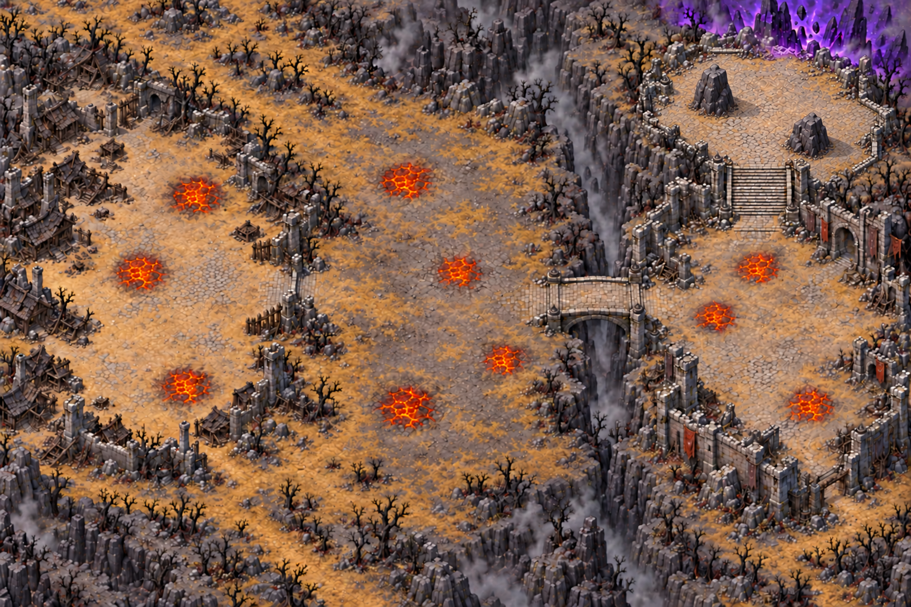

# Lisière calcinée — carte 6

Passe de détail demandée par le propriétaire le 21 octobre, sur la composition retouchée. Monde : **5016 × 3344 unités**, image **1536 × 1024**. Aucun niveau jouable ni collision produit.

## Identité du chapitre 2 : Les Terres dévastées

Carte 6 : steppe brûlée, village et fortin noircis, herbes grises et ocre, arbres calcinés, fissures fumantes. Palette gris cendre, ocre brûlé, brun charbon, violet discret. Orange incandescent exclusivement sur les plaques dangereuses. Lumière haut-gauche et rendu peint du chapitre 1. Cartes 7–9 : davantage de roche nue, cendres, fissures et fumée. Carte 10 : paysage volcanique, lave et roche noire. Cette progression visuelle est la référence pour les prochaines cartes du chapitre.

## Plan de composition

Coordonnées approximatives en pourcentage, origine en haut à gauche.

| Repère | X,Y % | Intention |
|---|---|---|
| Départ proposé | 13,56 | Place du village sans danger proche |
| Zone 1 | 20,50 | Village brûlé, grande place libre |
| Passage 1 | 31,48 | Porte de palissade courte |
| Zone 2 | 49,52 | Grande plaine de cendres |
| Passage 2 | 65,49 | Pont de pierre au-dessus de la gorge |
| Zone 3 | 80,58 | Cour du fortin |
| Accès arène | 83,31 | Large escalier |
| Arène | 84,18 | Grande cour en trapèze sous la faille violette |
| Rocher-abri 1 | 78.5,15.5 | Couverture, décalée vers le fond |
| Rocher-abri 2 | 88.5,23 | Couverture, décalée vers le premier plan |

L’arène ne présente plus de forme circulaire : cour en trapèze aux quatre côtés droits, deux gros rochers espacés et entrée libre. Le reste du plan et les dix plaques sont conservés. Les rochers sont uniquement dessinés : leur collision et leur capacité à bloquer les attaques restent à raccorder par le propriétaire et Claude. Circulation favorable visuellement, à confirmer sur les collisions peintes.

## Plaques de dégâts

Le masque hazards.png possède exactement les mêmes dimensions que composition.png : noir = hors plaque, magenta pur #FF00FF = plaque. Dix composantes distinctes ; aucune autre couleur. Les enveloppes suivent les fissures orange, incluent le charbon entre celles-ci et une marge de 2 pixels sur leur bord visible. Ce masque ne décrit jamais les collisions.

| Plaque | Centre X,Y % | Diamètre enveloppe, unités |
|---|---|---|
| H01 | 21.48, 32.23 | 231.9 |
| H02 | 14.97, 44.92 | 251.5 |
| H03 | 20.18, 63.48 | 209 |
| H04 | 44.27, 29.79 | 261.2 |
| H05 | 50.13, 44.92 | 215.5 |
| H06 | 44.27, 67.38 | 274.3 |
| H07 | 55.34, 59.57 | 163.3 |
| H08 | 83.01, 43.95 | 205.7 |
| H09 | 78.12, 52.25 | 205.7 |
| H10 | 88.54, 66.89 | 215.5 |

Distance minimale du départ proposé aux plaques : **311.3 unités**, supérieure aux 200 demandées. La plaque de la zone 1 a été éloignée de la palissade afin de dégager son approche. Les détours sûrs de chaque plaque restent à confirmer avec les collisions du propriétaire.

## Mesures et contrôle de composition

| Critère | Relevé |
|---|---|
| Format | 3:2, 1536 × 1024, monde 5016 × 3344 |
| Grandes zones | Trois clairières successives |
| Palissade | Environ 65–80 px de large, estimation visuelle |
| Pont | Environ 45–55 px, estimation visuelle ; minimum 2,5 % = 38,4 px |
| Escalier final | Environ 100–115 px de large |
| Arène | Environ 24 % de la largeur ; deux obstacles de couverture |
| Plaques | 10, diamètres enveloppes 163–274 unités |
| Sol praticable ≥55 % | Non certifié avant peinture des collisions |
| Netteté et échelle finales | Non revendiquées à cette étape de composition |

## Checklist

- [x] Carte entière, sans texte, interface ni personnages.
- [x] Trois grands espaces, pont et accès lisibles.
- [x] Identité cendre/ocre/charbon, orange réservé aux dix dangers.
- [x] Départ proposé dégagé, masque technique bicolore contrôlé.
- [x] Arène en trapèze, distincte de la carte 5, deux rochers-abris, entrée et couloirs dégagés visuellement.
- [ ] Validation du propriétaire : plan, circulation, détours sûrs et proportion praticable.
- [ ] Collisions peintes par le propriétaire.
- [ ] Après validation seulement : régions redessinées, assemblage, comparaison d’échelle, rapport qualité conforme et carte de netteté.

## Sources

Images originales, références, prompts exacts et SHA256 dans assets/concepts/incoming/map.scorched_verge/source/. Retouche finale : PROMPT_ARENE_ABRIS.txt. Génération par imagegen intégré. Contrôle ciblé dans docs/previews/scorched-verge/controle.json et aperçu des plaques dans plaques-annotees.png. Aucun changement de src/, data/ ni du manifeste runtime. Le script sharpness_map.py de Claude est désormais présent dans main ; il est conservé sans changement.

## Passe de détail du 21 octobre

Le propriétaire a demandé la mise au niveau des cartes validées. Découpage officiel : 12 régions (4 × 3), références d’échelle des Ruines jointes à chaque appel ; plan et dix plaques conservés. Les deux rochers-abris restent deux obstacles uniques, exception explicite à la subdivision des grosses masses de décor. Sources et prompts exacts dans source/regions_v1/. Contrôles qualité, échelle et netteté à joindre après assemblage. Les collisions et le gameplay restent hors de ce lot.

## Livraison détaillée — contrôle du 21 octobre

Trois tuiles de 3762 × 7524 pixels, soit 11286 × 7524 pixels et 2,25 pixels par unité. Contrôle officiel **CONFORME** : part lisse 0,213 ; détails fins 357,270 ; moyens 102,353 ; secteurs conformes 94,3 % ; fidélité au plan 0,978. Aucun seuil modifié. Renforcement de netteté natif plafonné à 120 % par le pipeline officiel, régions brutes conservées.

[Carte entière](../previews/scorched-verge/carte-detaillee.png), [comparaison à même zoom](../previews/scorched-verge/echelle.png), [rapport](../previews/scorched-verge/qualite.json), [carte de netteté](../previews/scorched-verge/nettete.png). La carte de netteté signale deux secteurs dans la gorge fumante : (2400,0) et (2400,3200). Le contrôle global est conforme mais le critère absolu « aucune case » n’est donc pas rempli. La fumée reste volontairement douce ; ces deux secteurs sont signalés, sans modification des seuils.

Import Godot final sans erreur après création du cache des polices et traductions. Images de décor seules : entrée du manifeste différée car le validateur exige un field de collisions ; aucun field inventé. Les collisions, zones, PV, dégâts au sol et gardien ne sont pas intégrés par ce lot.

## Correction locale après fusion de la PR #52

Traitement de netteté identique à celui des cartes validées de main : Real-ESRGAN general-x4v3, débruitage 0,2, uniquement dans les cases identifiées avant correction. Les dimensions, chemins et obstacles sont inchangés. Contrôle global après correction : **CONFORME**, lisse 0,234 ; fins 345,683 ; moyens 101,194 ; secteurs 94,3 % ; fidélité 0,978.

Le détecteur fin identifie initialement 104 cases sur 620. Après correction : **0 case résiduelle par rapport à cette référence initiale figée**, avec le même seuil 0,6. Le percentile recalculé après traitement monte et signale 434 cases (70 %) ; ce résultat relatif ne se compare pas directement à l’initial, comme l’explique QUALITE_DES_CARTES.md. Les deux résultats et les scores bruts sont conservés dans uniformite/. Aucun seuil modifié.

Les deux secteurs de gorge fumante restent hors de la bande de densité de détails du contrôle global, malgré une netteté locale restaurée : ce sont deux mesures différentes. Le rapport global demeure conforme. La correction est livrée dans une nouvelle branche depuis main, la PR #52 étant fusionnée.
