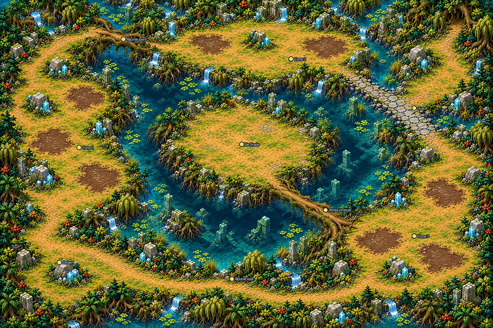
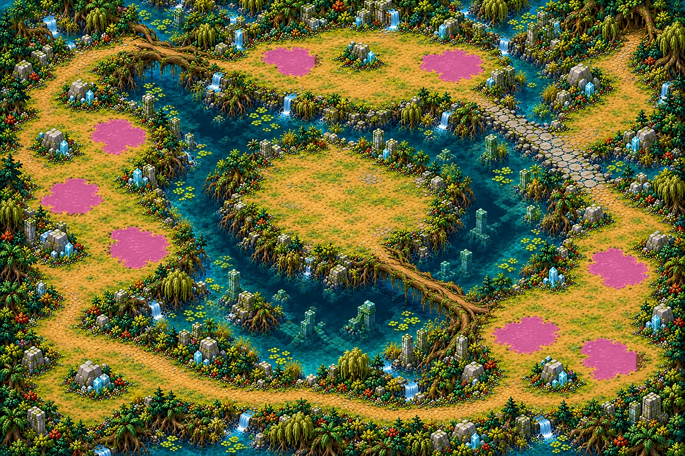

# Mangrove des racines — carte 11

Première carte des Marais engloutis. Monde **5016 × 3344**, composition **1536 × 1024**, parcours en boucle autour d’un lagon profond. L’île finale ne possède qu’un accès, par une longue racine-pont depuis la rive sud-est. Aucun mur ni cercle d’énergie peint.

Le propriétaire a demandé de continuer sans questions ni attente de validation ; composition choisie par Codex sous cette autorisation, pas validation visuelle explicite du propriétaire. Plan ensuite figé pour les douze régions détaillées.

## Repères réalisés (X,Y en %)

| Repère | Centre approximatif |
|---|---|
| Départ sûr sud-ouest | 12,80 |
| Zone 1, mangrove occidentale | 16,45 |
| Racine-pont nord-ouest | 25,12 |
| Zone 2, ruines de cristal-miroir au nord | 59,18 |
| Gué nord-est | 84,33 |
| Zone 3, tourbière orientale | 84,72 |
| Île finale dégagée | 49,44 |
| Longue racine, accès unique à l’île | 66,64 |
| Retour de la boucle par le sud | 47,85 |

Ces coordonnées décrivent l’image réalisée ; elles ne sont pas des placements de gameplay. Les repères du brief ont guidé le plan, avec un décalage visuel du pont nord-ouest et de l’île. À confirmer lors de la peinture des collisions.

## Vase praticable

Huit nappes, trois à l’ouest, deux au nord et trois à l’est. `mud.png` : **noir = rien, blanc = vase praticable qui ralentit**. Aucune nappe sur le départ, les ponts, le gué ou l’île. Masque technique aux dimensions finales **11286 × 7524**, noir/blanc 1 bit ; emprises de la composition adaptées sans interpolation des valeurs. Ce n’est pas un masque de collisions.

| Nappe | Rectangle X1,Y1,X2,Y2 % | Diamètre équivalent (u) | Extension maximale (u) |
|---|---|---:|---:|
| V01 | 38.22, 10.25, 45.90, 17.09 | 272.1 | 393.9 |
| V02 | 61.26, 10.64, 70.70, 18.26 | 307.2 | 474.6 |
| V03 | 13.09, 25.98, 21.35, 34.08 | 297.9 | 418.0 |
| V04 | 5.79, 38.87, 15.30, 46.78 | 321.4 | 477.7 |
| V05 | 16.15, 49.61, 24.87, 58.98 | 345.1 | 462.9 |
| V06 | 85.68, 54.20, 94.86, 63.57 | 330.3 | 460.6 |
| V07 | 71.81, 69.14, 81.77, 77.83 | 332.5 | 500.9 |
| V08 | 84.70, 74.02, 92.84, 83.50 | 335.5 | 444.4 |

Le diamètre équivalent mesure un disque de même surface ; l’extension maximale mesure les deux points les plus éloignés. Certaines extrémités dépassent légèrement la cible 450 unités (jusqu’à environ 501), sans fermer les détours secs ; chiffres conservés pour revue, sans les masquer. [Mesures détaillées](../previews/root-mangrove/mesures_vase.json).

## Mesures visuelles et circulation

| Critère | Relevé / statut |
|---|---|
| Format | 3:2, 5016 × 3344 unités |
| Grandes clairières | Trois berges ouvertes, centres libres |
| Routes | Généralement 200–350 unités de large, estimation visuelle |
| Racines-ponts et gué | Environ 120–200 unités, extrémités raccordées visuellement |
| Île finale | Largeur libre approximative 1100–1400 unités, à confirmer en jeu |
| Abris | Rochers et blocs de cristal répartis sur les berges ; tailles et espacements non certifiés sans collisions |
| Sol praticable ≥50 % | Objectif visuel, non mesuré sans peinture des collisions |

Les petits cailloux, brins d’herbe et éclats de surface ne doivent pas devenir des obstacles. Navigation et choix exacts de collisions restent au propriétaire et à Claude.

## Passe de détail et contrôles

Douze régions (4 × 3), redessinées avec une référence d’échelle des Ruines à chaque appel ; pas un agrandissement de composition. Assemblage commun avec recouvrements fondus, trois tuiles **3762 × 7524**, soit **11286 × 7524** et **2,25 px/u**. Régions intermédiaires et essais hors Git, empreintes dans `source/regions_manifest.json`.

| Contrôle officiel | Résultat |
|---|---:|
| densité (pixels par unité) | 2.25 |
| part lisse (médiane) | 0.157 |
| détails fins / 100×100 u (médiane) | 332.165 |
| détails moyens / 100×100 u (médiane) | 105.443 |
| secteurs conformes (part) | 1.0 |
| fidélité au plan validé (corrélation) | 0.995 |

Verdict **CONFORME**, sans changement des seuils. [Rapport](../previews/root-mangrove/qualite.json) · [Planche au même zoom](../previews/root-mangrove/echelle.webp) · [Carte entière](../previews/root-mangrove/carte_entiere.webp). La planche est réorganisée sans redimensionner ses panneaux : 1 pixel = 1 unité.

Import et chargement des tuiles et du masque contrôlés dans un projet Godot 4.3 isolé. Le [repère Chasseur/Mousseroc](../previews/root-mangrove/secteur_echelle.webp) est un montage technique à l’échelle, pas une capture de partie.

## Checklist et raccordement

- [x] Carte entière, sans texte, interface ni personnages dans l’image de jeu.
- [x] Identité mangrove émeraude, eau turquoise/profonde, cristal-miroir cyan ; aucun terrain volcanique.
- [x] Boucle visible et île à accès unique ; centres ouverts.
- [x] Huit nappes de vase, masque final et emprises documentées.
- [x] Douze régions détaillées, assemblage et rapport conforme ; comparaison d’échelle fournie.
- [x] Contrôle ciblé Godot de chargement.
- [ ] Validation manuelle de l’échelle, des détours, des abris et de la circulation par le propriétaire.
- [ ] Peinture des collisions, intégration du niveau, vagues, vase ralentissante et gardien par Claude.

Aucun `src/`, `data/` ou masque de collision existant modifié. Entrée du manifeste runtime différée : aucun champ `field` inventé. Sources retenues, prompts et SHA256 dans `assets/concepts/incoming/map.root_mangrove/` ; aperçu léger dans `docs/previews/root-mangrove/`.

Poids des nouveaux fichiers uniques : **109.1 Mo**, sous la limite 150 Mo. [Mesure](../previews/root-mangrove/poids.json).
