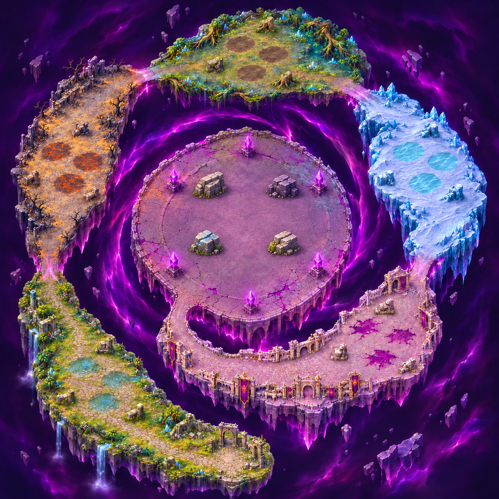

# Carte 25 — L’Œil de la Faille

Chapitre 5, dernière carte du jeu. Identifiant proposé : `rift_eye`.
**Composition approuvée le 7 novembre 2026**, image `c25.png` fournie par le propriétaire.
Monde : **5016 × 5016 unités**, format carré. Mode prévu : cinq zones de vagues, puis Dévoreur final.

Le parcours est une spirale horaire : départ sud, Val au sud-ouest, Terres dévastées à l’ouest,
Marais au nord, Glacier à l’est, Cité au sud-est et sur le retour intérieur, puis entrée unique
par le sud-ouest sur la plateforme de l’Œil. Les quatre soudures de chapitres et le dernier accès
restent praticables, sur un vide violet nettement séparé des fondations.

Le propriétaire demande ensuite explicitement les abris **à l’intérieur de l’arène**, pas sur ses côtés,
puis approuve l’image ainsi retouchée : « celle la c’est bon pour moi ».
Les quatre blocs occupent donc la surface de combat autour du point du boss.
**Le disque de 1400 unités n’est plus entièrement vide** ; cette exigence initiale est révisée par la
demande ultérieure d’abris intérieurs. Les six piliers-ancres restent sur le pourtour.
Le tourbillon est sous la plateforme, dans le vide ; aucun boss ni cercle de gameplay n’est peint.

Le [plan figé](../../assets/concepts/incoming/map.rift_eye/plan.json) donne le départ, les cinq polygones de zones,
quinze enveloppes initiales de matières, cinq passages, la plateforme, six ancres et dix-neuf abris
(trois par tronçon et quatre dans l’arène). Les pieds sont des repères graphiques approximatifs.
Les contours de matière seront affinés sur le détail sans déplacer les surfaces.

La passe de détail par seize régions est **en cours**. L’échelle des blocs, pavés, marches et piliers est
calibrée sur les Ruines et le Chasseur. Rapport qualité, captures avec sprites natifs et référence légère
des collisions à livrer après cette passe. La composition ne constitue pas une carte finale agrandie.

Sources retenues : `assets/concepts/incoming/map.rift_eye/`, notamment `composition.png`, `job.json`,
`plan.json`, `source/PROMPTS_COMPOSITION.txt` et `source/composition_provenance.json`.
L’outil imagegen intégré réalise les dessins ; essais et régions intermédiaires restent hors dépôt.

Le propriétaire peint les collisions. Claude intègre zones, barrières, briques des cinq chapitres,
Dévoreur final et fin du jeu. Aucun changement de `src/`, `data/`, du manifeste ou des cartes 14 à 24.
