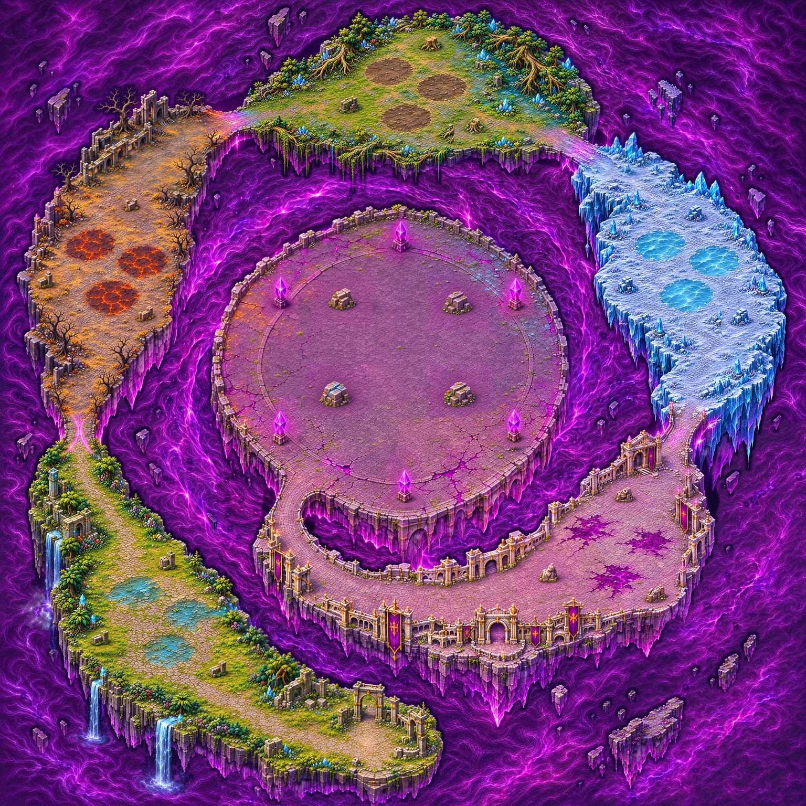

# Carte 25 — L’Œil de la Faille

Chapitre 5, dernière carte du jeu. Identifiant proposé : `rift_eye`.
Monde : **5016 × 5016 unités**. Cinq zones de vagues, puis Dévoreur final.
Composition `c25.png` approuvée par le propriétaire le 7 novembre 2026.



## Parcours et obstacles

Spirale horaire : sud → Val au sud-ouest → cendre à l’ouest → marais au nord → glacier à l’est →
cité au sud-est et sur le retour intérieur → entrée unique au sud-ouest de la plateforme.
Quatre passages soudent les chapitres ; le cinquième rejoint l’arène. Gabarit visé : 200 à 300 unités.
Le tourbillon est sous les fondations, dans le vide ; aucun boss ni effet de brique n’est peint.

Les **quatre abris sont à l’intérieur de l’arène**, autour du point du boss, conformément à la demande
explicite et à l’image approuvée. Le disque initial de 1400 unités entièrement vide est donc révisé :
il contient désormais ces abris. Le dégagement central visé pour le boss est de 600 unités de diamètre.
Les six piliers-ancres restent sur le pourtour. Gabarits à confronter au masque peint.

Le [plan](../../assets/concepts/incoming/map.rift_eye/plan.json) donne les pourcentages, les repères sur
l’image 1254 px et les positions monde centrées : `pixel × 4 − 2508`. Il contient le départ, cinq zones
avec cours visées à 600 unités minimum, cinq passages, quinze surfaces, dix-neuf abris (trois par tronçon
et quatre dans l’arène), six ancres, la plateforme et le point du boss.
Les polygones de zones sont des repères de gameplay, **pas des contours de collision**.

Les quinze surfaces ont leurs centres et enveloppes recalés sur le master détaillé : gués, sol brûlant,
vase, glace et corruption. Grandes dimensions relevées : 284 à 376 unités.
Ces enveloppes convexes sont des repères pour Claude, à ajuster pour les effets des briques.
[Plan des matières](../previews/rift-eye/plan_matieres.webp).

## Détail et échelle

Seize régions ont été réellement redessinées, puis assemblées par raccords de faible différence.
Vingt-cinq retouches locales recalibrent abris et ancres. Une seconde passe de seize régions ajoute
de vrais filaments au plasma ; les sols et objets protégés restent identiques.
La lumière de ce plasma est étalonnée séparément, sans déplacer les îles ni les chemins.

Master conservé : **3762 × 3762 px**, 0,75 px/unité, WebP sans perte.
Présentation : **11286 × 11286 px**, 2,25 px/unité, en trois tuiles **3762 × 11286 px**, WebP near-lossless80 (écart mesuré de1/255 au plus par canal).
Une correction locale des arêtes existantes homogénéise les cases douces après présentation ;
elle ne génère pas de texture. Prompts, recettes et empreintes : `assets/concepts/incoming/map.rift_eye/source/`.
Les essais et générations intermédiaires restent hors dépôt ; un seul master est retenu.

Le Chasseur conserve son échelle du manifeste (cellule haute de 80 unités × 0,65 = 52 unités).
Les abris visent 110 à 160 unités et les ancres 110 à 140 ; la collision doit suivre leur pied.
Planches avec règle de 140 unités :
[abris](../previews/rift-eye/echelle_abris.webp),
[ancres](../previews/rift-eye/echelle_ancres.webp),
[comparaison aux Ruines à 1 px/unité](../previews/rift-eye/echelle_ruines.webp).

## Captures et contrôles

Vingt-trois captures statiques Godot 4.3 en 1280 × 720, zoom 1,3333 : départ, cinq matières,
cinq surfaces de brique, cinq passages, centre, quatre abris intérieurs, gabarit du Dévoreur existant.
Cellules, ancres et échelles des sprites viennent du manifeste. Aucune partie ni profil joueur chargé.

[Centre](../previews/rift-eye/arene_centre.webp) · [Abri intérieur](../previews/rift-eye/a16_abri_interieur.webp) ·
[Val](../previews/rift-eye/val_brique.webp) · [Cendre](../previews/rift-eye/ash_brique.webp) ·
[Marais](../previews/rift-eye/marsh_brique.webp) · [Glacier](../previews/rift-eye/glacier_brique.webp) ·
[Cité](../previews/rift-eye/city_brique.webp).

**Les sprites propres au chapitre 5 manquent encore dans le dépôt.** `enemy.rift_breach` est un témoin
provisoire, mentionné sur les captures ; il ne valide pas les futurs sprites du chapitre 5.
Ce contrôle restera à compléter lors de leur intégration.
Autres témoins : Chasseur, Glimmerwing, Husk, Cinder Knight, Glass Sentinel et Ice Knight.

Rapport officiel sur les trois tuiles finales et la composition :
[qualite.json](../previews/rift-eye/qualite.json).
Diagnostic relatif distinct : [netteté.json](../previews/rift-eye/netteté.json),
[carte de contrôle](../previews/rift-eye/netteté.webp).
Le reçu `source/control_detail.json` rassemble empreintes, import et captures.

| Critère sur les tuiles finales | Résultat |
| --- | ---: |
| densité (pixels par unité) | 2,25 |
| part lisse (médiane) | 0,174 |
| détails fins / 100×100 u (médiane) | 392,804 |
| détails moyens / 100×100 u (médiane) | 93,47 |
| secteurs conformes (part) | 0,918 |
| fidélité au plan validé (corrélation) | 0,978 |
| Cases signalées par le diagnostic relatif | 42/949 (4.4%) |

## Carte à peindre

Fichier exact : **[reference_collisions.jpg](../previews/rift-eye/reference_collisions.jpg)**,
carte entière **1254 × 1254 px**, **1 px = 4 unités**, sans recadrage.
Empreinte et recette : `source/collision_reference.json`.
Retour : **PNG 1254 × 1254**, même cadrage, sans redimensionnement.

Peindre en rouge translucide le vide, les fondations infranchissables, les six piliers-ancres,
les abris et autres éléments solides. Suivre le pied au sol, sans prendre toute la projection verticale.
**Les quatre abris intérieurs de l’arène sont bloquants.**
Laisser praticables les cinq passages, gués, plaques brûlantes, vase, glace, corruption et le sol
de plateforme autour des abris. Les nappes magenta ne sont pas des trous.

Aucun masque de collision ni intégration jouable dans ce lot. Les captures ne testent ni navigation,
ni barrières, ni effets de terrain, ni combat final. Le propriétaire peint ; Claude intègre collisions,
zones, briques, Dévoreur final et fin du jeu.
`src/`, `data/`, le manifeste et les cartes 14 à 24 ne sont pas modifiés.

Réexport de la présentation depuis le master retenu, avec Pillow, NumPy et SciPy :

```powershell
$env:PYTHONPATH = 'tools/art'
python tools/art/build_rift_eye.py --present --cwebp C:/chemin/vers/cwebp.exe
```
