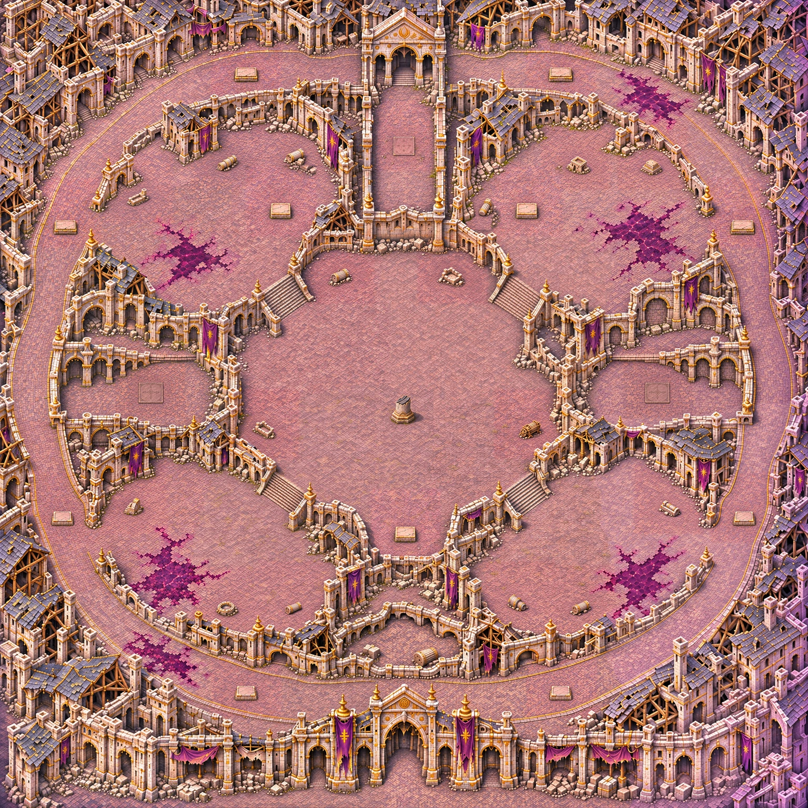
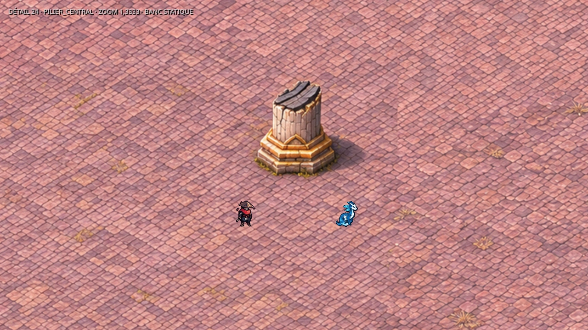
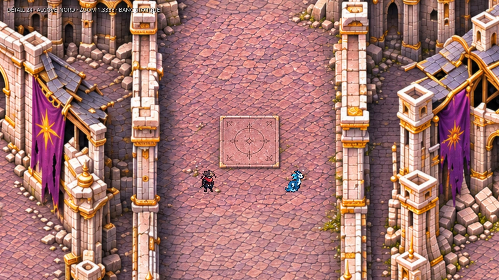

# Carte 24 — Le Panthéon brisé

Chapitre 5, Cité de la Faille. Identifiant proposé : `shattered_pantheon`.
Monde : **4400 × 4400 unités**, carré. Décor livré séparément de son intégration jouable.

## Composition validée

Le propriétaire conserve la composition et demande un petit pilier brisé au centre
(7 novembre 2026 : « ajoute un osbtacle en au centre de la map, genre un pilier »,
puis « sinon elle est bien comme ca »). La passe de détail conserve cette implantation.

- Une avenue en anneau, départ au sud devant la porte monumentale.
- Quatre quartiers avec leur cour dégagée, chacun entre l'avenue et la place.
  Les huit repères de passages sont dans le plan : un accès côté avenue et un côté place par quartier.
- Une place irrégulière en contrebas, atteinte en traversant les quartiers ; aucun raccourci radial direct.
- Onze socles de statues vides et bloquants ; aucun dans un passage.
- Trois autels runiques plats, vides et praticables, dans des galeries en cul-de-sac.
- Trois abris par quartier, quatre à la périphérie de la place et le pilier demandé au centre.

Le rectangle central de repérage fait environ 1003 × 1003 unités. **Il n'est plus entièrement vide** :
le pilier est l'exception explicite demandée par le propriétaire. Aucun cercle de gardien ni enceinte
d'arène n'est peint. Le combat doit pouvoir circuler autour du pied du pilier.



## Identité et échelle

Pierre pâle, ardoise mauve éventrée, bordures dorées vieillies et bannières violettes déchirées :
continuité des cartes 21 à 23, avec une silhouette propre au quartier des monuments.
Les nappes de corruption sombre et magenta sont du dallage praticable ; ce ne sont pas des trous.
Les cours restent lisibles et le centre sobre, pour recevoir les failles et le gardien dessinés par le jeu.

La matière est réellement redessinée par seize régions avec recouvrements, et non obtenue en agrandissant
la composition. Le master retenu fait 3300 × 3300 px (0,75 px/unité). Sa présentation fait 9900 × 9900 px
(2,25 px/unité), en trois tuiles verticales de 3300 × 9900 px, WebP sans perte.
Les raccords utilisent `map_seams`. Un anticrénelage natif de rayon 0,5 calibre les matières trop chargées
des générations pilotes ; les seuils de qualité n'ont pas été modifiés.

Une retouche locale réduit les abris et les socles, ajoute l'abri sud-ouest manquant et abaisse les autels.
Les bâtiments, passages et le pilier approuvés sont conservés. Les pixels hors des emprises de retouche
sont vérifiés identiques. Sources retenues, empreintes, paramètres et prompts :

- `assets/concepts/incoming/map.shattered_pantheon/composition.png` et `plan.json` ;
- `source/map_detailed.webp`, `regions_provenance.json`, `prop_repairs.json` et `detail_recipe.json` ;
- `source/PROMPTS_COMPOSITION.txt` ; les prompts des régions et retouches sont inclus dans les JSON de provenance.

Le banc de capture reprend les images, cadres, ancres et échelles du manifeste sans modifier les personnages :
Chasseur, Glimmerwing, puis six témoins des chapitres 3 et 4. Captures à 1280 × 720 et zoom 1,3333,
près d'un socle, des trois autels, du pilier, des accès, sur dalle et sur corruption.
Les planches de gabarits comportent une règle de 160 unités ; la comparaison aux Ruines reste à 1 px/unité.
Les dimensions du plan sont des cibles et repères graphiques : elles ne remplacent pas la vérification des
largeurs praticables après peinture des collisions.




## Plan et intégration par Claude

Le plan donne le départ, les quatre centres de failles, huit passages, le rectangle central,
les onze socles, trois autels et dix-sept abris dont le pilier. Les centres sont approximatifs,
relevés sur le dessin ; coordonnées en pourcentage depuis le coin haut-gauche et en unités de monde.
Le repère Godot est centré sur `(0, 0)`, soit `pourcentage × 44 − 2200` sur chaque axe.

Mode prévu : comme les cartes 1 et 17, ouverture de quatre failles, fermeture des quatre,
puis apparition du gardien. **Aucune faille interactive n'est peinte.**
Pour B8, le jeu pose et anime les statues sur les socles vides. Pour B10, il dessine les cages et allume
les runes des autels ; l'objectif est facultatif. Aucun personnage, statue, cage ou effet de jeu intégré
à l'image. Claude garde la responsabilité des collisions, objectifs, gardien et campagne.

Tuiles à raccorder après validation des collisions :

```text
res://assets/environments/shattered_pantheon/map.webp
res://assets/environments/shattered_pantheon/map_1.webp
res://assets/environments/shattered_pantheon/map_2.webp
arena_size : 4400
```

## Collisions à peindre par le propriétaire

Image exacte à peindre :
[`reference_collisions.jpg`](../previews/shattered-pantheon/reference_collisions.jpg),
**1100 × 1100 px**, carte entière, **1 px = 4 unités**. Empreinte du fichier et recette :
`source/collision_reference.json`. Revenir en **PNG 1100 × 1100**, sans recadrage ni redimensionnement.

Peindre en rouge translucide les bâtiments, murs, gros décombres solides, les onze socles de statues,
les abris et le pied du pilier. Les escaliers et ouvertures de circulation restent libres.
L'avenue, les huit passages, les quatre cours, les trois autels et la place autour des abris sont praticables.
Ne pas bloquer la corruption ni les ombres. Le contour des obstacles doit suivre leur pied au sol,
sans prendre toute leur projection verticale.

Les accès de 200 à 300 unités, les cours d'au moins 600 unités et les dégagements de 300 unités
devant les autels doivent être confrontés au masque peint avant intégration. Contrôler ensuite chaque
trajet avenue → cour → place et retour, les trois impasses, puis le combat près du pilier.

## Vérifications et limites

- `check_map_quality` exécuté sur les trois tuiles finales et la composition validée ;
  rapport : [`qualite.json`](../previews/shattered-pantheon/qualite.json).
- Diagnostic relatif de netteté séparé, avec les seuils officiels conservés.
- Chargement/import Godot 4.3 des trois tuiles et treize captures statiques.
- Lint du banc GDScript et compilation du script Python.

Le reçu final `source/control_detail.json` rassemble les résultats et les empreintes.

| Critère final | Résultat |
| --- | ---: |
| Densité | 2,25 px/unité |
| Part lisse médiane | 0,147 |
| Détails fins | 405,550 |
| Détails moyens | 109,885 |
| Secteurs conformes | 36/36 |
| Fidélité à la composition | 0,954 |
| Cases signalées par le diagnostic relatif | 15/729, soit 2,1 % (limite 5 %) |

Ce lot ne contient **aucun masque de collision ni intégration jouable**. Les captures vérifient l'apparence
et l'échelle des sprites ; elles ne valident ni navigation, ni objectifs, ni combat.
`src/`, `data/`, le manifeste et les cartes 14 à 23 ne sont pas modifiés.
Les essais et régions intermédiaires restent hors dépôt ; une seule source détaillée est retenue.

## Reproduction de la présentation

Avec Python, Pillow, NumPy et SciPy disponibles, depuis le dépôt :

```powershell
$env:PYTHONPATH = 'tools/art'
python tools/art/build_shattered_pantheon.py --present
```

L'assemblage des générations externes s'effectue avec `--generated <dossier>`,
les retouches retenues avec `--repairs <dossier>`, puis `--present`.
Ces intermédiaires ne sont pas requis pour réexporter le master versionné.
Le banc `tools/art/preview_shattered_pantheon.tscn` accepte `--detail` et `--out=<dossier>`.
