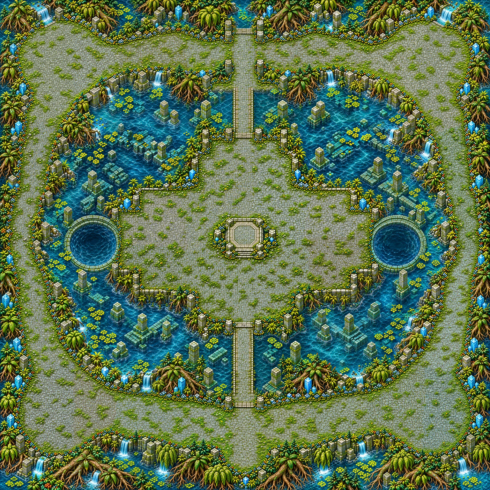

# Puits des reflets — détail de la carte 14

**Détail graphique livré le 3 novembre 2026.** Le plan carré validé le 29 octobre est conservé : monde de **5016 × 5016 unités**, composition de 1536 × 1536 pixels. Les seize régions ont reçu un redessin plus fin, par trente-deux demi-régions, puis un assemblage continu. Trois tuiles de **3762 × 11286 pixels** livrent 2,25 pixels par unité.



[Composition figée](../previews/reflection-wells/composition.webp) · [Plan annoté](../previews/reflection-wells/plan_annote.webp) · [Vue entière dans Godot](../previews/reflection-wells/apercu_720p.png)

## Plan conservé

La boucle périphérique reste continue autour de la place centrale en croix et de son socle d’autel vide. **Deux ponts seulement, nord et sud**, relient la place à la boucle. Les puits ronds est et ouest restent dans l’eau infranchissable, sans liaison latérale. Les quatre emplacements de portails restent vides pour les objets du jeu.

| Repère | X,Y % approximatifs |
|---|---|
| Départ sur la boucle sud | 50,87 |
| Portails NO / NE | 14,12 /87,12 |
| Portails SO / SE | 14,86 /87,86 |
| Pont nord | x47,5 ;y18,5 ;largeur4,5 ;hauteur10 |
| Pont sud | x47,5 ;y66 ;largeur4,5 ;hauteur17,5 |
| Socle d’autel vide | 50,48 |
| Puits ouest / est | 19,49 /81,49 |

Ces repères graphiques ne définissent aucune collision ou zone de gameplay. La part de sol praticable et les largeurs utiles seront mesurées sur la peinture du propriétaire.

## Source retenue et reconstruction

Le **master natif assemblé** `source/map_detailed.webp` fait 3762 × 3762 pixels, à 0,75 pixel par unité. Il est encodé sans perte et sa relecture RGB a été comparée pixel par pixel au résultat de l’assemblage. Les trente-deux dessins de demi-régions apportent entre 1,08 et 1,20 vrai pixel généré par unité. Leurs empreintes, dimensions, cadrages et références figurent dans `source/regions_provenance.json` ; le prompt retenu est `source/PROMPT_DETAIL_FIN.txt`. Les bandes et régions intermédiaires restent hors Git.

Le plan et l’échelle des pavés sont figés. Les recouvrements internes des régions font 128 unités ; ceux entre régions suivent le découpage standard de `map_regions.py`. Un chemin de faible différence choisit un seul dessin dans les recouvrements, avec un fondu d’un pixel natif : les joints ne se dédoublent plus. La calibration native conserve le plafond standard de 120 %. Aucun bruit procédural ni shader de détail n’est ajouté.

La présentation agrandit le master par 3 en Lanczos. Les tuiles sont encodées en WebP **qualité 98**, avec perte ; le contrôle final porte sur ces fichiers décodés. La source native reste sans perte. `source/detail_recipe.json` donne la présentation, l’encodage et les empreintes des tuiles.

Reconstruction depuis la source retenue, avec numpy, Pillow et scipy :

```bash
python3 tools/art/finish_reflection_wells.py --work /tmp/rift-puits --quality 98
```

`package_reflection_wells.py` décrit la fabrication du master depuis les trente-deux bandes de génération conservées localement. `map_seams.py` réalise les raccords ; les outils et seuils de qualité du dépôt restent inchangés.

## Contrôles de livraison

| Contrôle sur les tuiles livrées | Résultat | Attendu |
|---|---:|---:|
| Densité |2,250|2,183 à2,317|
| Part lisse médiane |0,049|≤0,270|
| Détails fins |425,248|329,944 à446,395|
| Détails moyens |109,692|90,940 à123,036|
| Secteurs conformes |49/49, soit 100 %|≥85 %|
| Fidélité au plan |0,957|≥0,850|

**Verdict : conforme.** [Rapport chiffré](../previews/reflection-wells/qualite.json) et [journal](../previews/reflection-wells/qualite.log).

La [planche d’échelle](../previews/reflection-wells/echelle.png) provient de `map_regions.py compare` : détail, composition et Ruines au même zoom, avec une réduction commune de 1710 à 1600 pixels pour le dépôt. La [comparaison des sols](../previews/reflection-wells/echelle_sol.webp) conserve exactement 1 pixel par unité. Les quatre vues `centre_zoom_jeu.png`, `pont_nord_zoom_jeu.png`, `boucle_sud_est_zoom_jeu.png` et `reference_ruines_zoom_jeu.png` utilisent le même Chasseur, le même Écho et le zoom réel du jeu.

Le [diagnostic spectral relatif](../previews/reflection-wells/nettete_relative.webp) signale encore 171 cases sur 961, soit 17,8 %, surtout dans les pavés comparés au feuillage plus riche de la même carte. Il est joint pour la revue visuelle ; les six critères absolus de référence passent, y compris les 49 secteurs. **Cette vue rouge et verte est un diagnostic de netteté, pas une peinture de collisions.** Les captures au zoom réel montrent les pavés et les raccords.

Import Godot 4.3 et cinq captures 1280 × 720 : réussis, sans erreur de script ou de chargement. Contrôle `assets` : 442 entrées, 427 valides, 15 prévues pour le chapitre 4 du lot de sprites indépendant, zéro erreur. Lint du banc et exécution réelle des recettes réussis. [Contrôle de chargement et limites](../previews/reflection-wells/runtime_controle.json).

## Collisions et raccordement

Le 2 novembre, une image entière légère **1536 × 1536** a été remise au propriétaire pour peindre les collisions en rouge translucide. Son cadrage est celui de la composition validée. Le JPEG exact est conservé localement sous `collision/reference.jpg` ; recette d’encodage et empreinte figurent dans `source/collision_reference.json`. Le retour est attendu en PNG, au même cadrage et sans redimensionnement. Aucun masque n’a été peint automatiquement.

- **Livré** : détail des seize régions, master natif sans perte, trois tuiles, prompt/empreintes/recette, rapport conforme, vues entières et captures au zoom réel.
- **Non fait** : collisions peintes et navigation, champ `field`, niveau jouable, entrée du manifeste runtime et raccord des mécaniques. Les règles de `data/` et `src/` restent identiques à `main`.
- **Choix faits sans validation** : redessin par demi-régions, matière plus fine, pavés plus petits dans leurs emprises figées, assemblage sans double texture et encodage des tuiles en qualité 98.
- **Raccords Claude** : réutiliser les trois tuiles de `assets/environments/reflection_wells/` pour le monde 5016 × 5016 ; attendre la peinture du propriétaire, construire le champ, vérifier les passages et placer les mécaniques. Les portails et l’objet d’autel restent des sprites séparés.

**Détail graphique livré ; aucun essai de circulation ou de combat n’est revendiqué.** Poids total des fichiers ajoutés ou modifiés par la PR : **123,21 Mo**, source et aperçus compris.

## En jeu (Claude, 3 novembre 2026)

- **Collisions** : peinture du propriétaire (`collision/painted.webp`) → `collision.png` → `field.png`, sans détection
  d'eau automatique (elle bloquait à tort un coin de la boucle sud-est) ; 40 % de sol praticable. Mini-carte,
  entrée `environment.reflection_wells` du manifeste.
- **Arène** `data/arenas/reflection_wells.tres` : défense d'autel (5 vagues de 50 s, sceau de 6 000 PV sur le socle
  central), famille des Reflets (Éclat errant, Miroir rampant, Sentinelle de verre, Golem de quartz ; élites
  Prêtresse-miroir, Colosse de cristal, Chasseresse des reflets). Six arrivées sur la boucle.
- **Miroirs-portails** (brique B6, `PortalDirector`) : quatre paires, chaque coin de la boucle relié à la place près
  de l'autel ; visuel `mirror_portal.tscn` de Codex (une teinte par paire, états actif, recharge, entrée et sortie).
  On passe en entrant dans le portail ; la paire se recharge 5 s. Les Corrompus passent aussi (1,5 par seconde et
  par portail au plus, 8 s entre deux passages d'un même Corrompu). La flèche de route vers l'autel propose un
  portail quand il raccourcit le trajet.
- **Gardienne : Dame des portails** (`PortalGuardian`, choisie par le propriétaire) : elle plonge dans un miroir et
  ressort par le portail qui s'illumine (le plus proche du Chasseur). Le Chasseur qui s'y tient quand elle ressort la
  piège : sonnée 5 s, dégâts doublés ; sinon, onde de prisme autour du portail. Sprite : celui de la Prêtresse-miroir.
- **Campagne** : quatrième carte du chapitre 3 ; elle donne Mousseroc. Objectifs : passer 8 portails, finir sous
  650 dégâts ; Cauchemar : piéger 2 fois la gardienne.
- **Équilibrage** (profil d'étape, 4 graines) : vagues 1,3 · 1,8, gardienne 1 · 2,4, autel frappé à 0,36 :
  3 victoires sur 4 (une défaite à 9 % de PV de la gardienne), 5 min 30 à 6 min 30.
