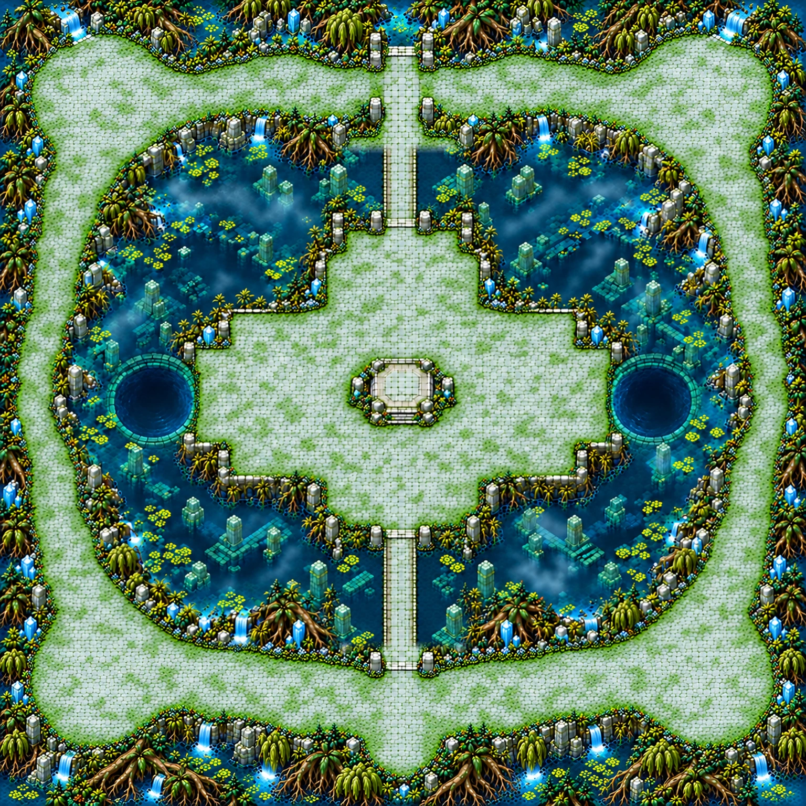

# Puits des reflets — composition de la carte 14

Composition carrée **1536 × 1536**, monde prévu **5016 × 5016 unités**. Chapitre 3 : temple englouti, pierre cyan pâle, mousse émeraude, racines et eau turquoise. Travail commencé après **13 h Europe/Paris le 28 octobre**, comme demandé.

## Plan proposé

Une boucle périphérique de dalles entoure la carte. La place centrale a une silhouette en croix et un socle d'autel vide. **Deux ponts seulement**, nord et sud, joignent cette place à la boucle. Les puits ronds est et ouest sont plongés dans l'eau sombre infranchissable ; aucune liaison latérale n'est proposée. Les quatre emplacements de portails restent vides : les objets seront placés par le jeu.

| Repère | X,Y % approximatifs |
|---|---|
| Départ sur la boucle sud | 50,87 |
| Emplacements de portails NO / NE | 14,12 / 87,12 |
| Emplacements de portails SO / SE | 14,86 / 87,86 |
| Pont nord | rectangle x47,5 ; y18,5 ; largeur4,5 ; hauteur10 |
| Pont sud | rectangle x47,5 ; y66 ; largeur4,5 ; hauteur17,5 |
| Socle d'autel vide | 50,48 |
| Puits ouest / est | 19,49 / 81,49 |

[Plan annoté](../previews/reflection-wells/plan_annote.webp). Les rectangles de ponts servent de repères graphiques ; ils ne définissent aucune collision ni zone de gameplay.

## Mesures et limites à cette étape

| Critère | Constat |
|---|---|
| Format | Grand carré 1:1, monde5016 × 5016 prévu |
| Boucle continue | Continuité visuelle inspectée, angles ouverts et départ sud relié |
| Accès au centre | Deux ponts visibles nord/sud ; aucun pont est/ouest |
| Ponts ≥2,5 % de largeur | Largeurs visuelles estimées ≈4,5 % ; à mesurer sur le futur masque |
| Boucle ≥4 % de largeur | Sols périphériques élargis ; mesure exacte au détourage |
| Sol praticable ≥55 % | Objectif de composition, **non certifié sans peinture** ; ne pas déduire une mesure fiable des seules couleurs de l'image |
| Place centrale | Croix élargie, sol libre autour du socle bas ; aucun cristal/objet sur le socle |
| Portails | Quatre empreintes de sol laissées vides, pas de portail peint |
| Bord extérieur | Racines et eau ferment la carte ; les chemins ne sont pas des sorties |

## Retouches et sources

La première composition avait une terre trop dorée et un cristal sur l'autel. La retouche a refroidi le sol, vidé le socle et rendu les deux puits ronds explicites. La passe d'espace a agrandi la place et les sols. Une réparation des ponts a amélioré leurs longueurs mais entamé la boucle aux approches : l'assemblage technique conserve donc la partie centrale/ponts de cette réparation, et les bandes nord et sud de la passe d'espace. Les recouvrements courts sont fondus ; **aucune peinture procédurale n'est ajoutée**. La carte n'est pas encore approuvée : il ne s'agit pas d'une modification d'un plan validé.

`source/assembly.json` décrit les bandes et les empreintes des entrées ; les prompts exacts sont joints. Une seule source retenue et sa composition de travail sont versionnées. Les variantes intermédiaires restent hors Git. Références de style : Jardins de cristal et Mangrove ; leurs plans ne sont pas repris.

## État et suite

- [x] Composition carrée entière, socle vide, deux puits, deux ponts et quatre emplacements.
- [x] Sols élargis, approches visuellement reliées et carte inspectée entière.
- [x] Sources/prompts/empreintes conservés.
- [ ] Validation du plan par le propriétaire puis peinture des collisions.
- [ ] Vérification chiffrée des surfaces et de la navigation.
- [ ] Seize régions de détail, assemblage à2,25 pixels/unité, rapport qualité conforme et planche d'échelle après validation.
- [ ] Intégration des portails, autel, ennemis et mécaniques par Claude.

**Composition seulement : aucun niveau jouable ni carte finale.** Aucune collision, `field`, donnée de gameplay, `src/` ou entrée du manifeste runtime ajoutée. L'agrandissement de travail à1536px n'est pas une passe de détail. Le rapport de qualité final n'est pas revendiqué à cette étape.

## Vérifications jointes

Chargement de la composition et rendu natif de la carte entière dans Godot : réussis, aperçu1280 × 720 joint. Import headless du projet complet et suites `tools/run_tests.sh assets` et `art` : verts. Assets :424 entrées,408 valides,16 placeholders,0 erreur ; ces résultats portent sur le **runtime de main inchangé**, la nouvelle carte restant hors runtime sous `.gdignore`. Le contrôle de qualité exécuté par la suite art concerne les cartes finales existantes : il ne certifie pas cette composition. Aucun seuil ou manifeste n’a été changé pour ce contrôle.
