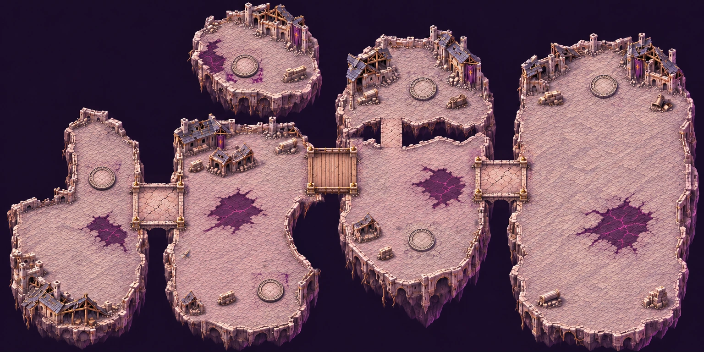

# Carte 23 — Les Quartiers suspendus

**Composition proposée au propriétaire — 6 novembre 2026. Détail graphique après validation du plan.**
`suspended_quarters`, chapitre5, Cité de la Faille. **Vagues par zone ; B6 Téléporteurs de faille.**
Branche `codex/carte-23-quartiers-suspendus`, depuis main actualisé (carte22 fusionnée, PR116).

## Identité et composition

La pierre pâle, l’ardoise, les dorures ternies et les bannières déchirées reprennent
les [Faubourgs brisés](FAUBOURGS_BRISES.md) et le [Sanctuaire des runes](SANCTUAIRE_DES_RUNES.md).
La corruption violet sombre et magenta se répand davantage sur les dalles et les fondations.
Les veines peintes au sol restent **praticables et décoratives** : aucune zone B9.
Aucune neige, lave ou végétation de marais. Lumière haut-gauche et liseré violet bas-droite.

Des quartiers entiers flottent au-dessus d’un vide violet très sombre : cours et places restent horizontales,
les falaises montrent dessous leurs racines de maçonnerie, caves rompues et fondations arrachées.
Le bord praticable est net ; le vide ne ressemble pas à un sol violet.
Le cadrage entier est **2:1, 5016 ×2508 unités**, composition **1536 ×768 pixels**.
Seules les bandes techniques extérieures au monde ont été retirées de la génération ; aucun îlot recadré.

Le parcours principal **ouest→est** utilise quatre îlots et trois ponts, sans téléporteur obligatoire.
Le cinquième îlot est un petit refuge au nord, sans pont ni liaison à pied.
Il n’y a ni diagonale de ville, ni trois rues parallèles, ni plan rayonnant.

Les polygones et repères proposés sont dans
[`source/composition_review.json`](../../assets/concepts/incoming/map.suspended_quarters/source/composition_review.json).
Les pourcentages partent du coin haut-gauche de la carte entière. **Pas de `plan.json` figé avant l’accord du propriétaire.**

## Cheminement et espaces libres

| Repère | Proposition |
| --- | --- |
| Départ | **10,96 % ; 73,76 %**, grande place de l’îlot ouest, devant les façades effondrées |
| P1 | Pont de pierre vers Z1, centre **22,59 % ; 58,14 %**, sol continu |
| Z1 | Cours des fondations, premier îlot central ; noyau ouvert **600 ×600u**, trois abris |
| P2 | Passerelle de bois vers Z2, centre **47,20 % ; 48,24 %**, sol continu |
| Z2 | Place des charpentes, second îlot central ; noyau ouvert **600 ×600u**, trois abris |
| P3 | Pont de pierre vers la finale, centre **71,09 % ; 50,91 %**, sol continu |
| Finale | Grand îlot est, place ouverte ; noyau libre **1000 ×1000u**, centre **86,32 % ; 58,61 %** |
| Refuge nord | Cinquième îlot, atteint uniquement par la paireC ; sol libre autour du socle et un abri |

Les trois tabliers sont courts, visibles et ancrés aux deux berges. Les fractures restent aux bords,
sans trou dans le passage. Largeur du dessus libre, hors parapets : **231,86u /231,86u /202,47u**.
Chaque segment transversal est donné dans le fichier de revue pour la future barrière du jeu.
Ces mesures sont graphiques ; aucune collision ni navigation en jeu n’est créée.

Le noyau de la finale est dégagé de bâtiments et d’abris. Pas de cercle de combat, de boss, de socle d’autel
ou de mur d’enceinte peint. Le carré clair sur le **plan annoté seulement** indique son emprise utile.

## Trois paires de socles vides

Les six socles sont bas, au sol, avec centre pavé et runes gravées sombres.
**Aucun vortex, effet d’énergie ou anneau lumineux peint.** Les couleurs et lignes de paire apparaissent
uniquement sur le plan de revue. Le jeu fournit les effets et le lien entre les jumeaux.

| Paire | Socle | Îlot | Centre (%) | Jumeau |
| --- | --- | --- | --- | --- |
| A | A1 | Départ ouest, recoin nord-est de la place | **14,53 ;50,55** | A2 |
| A | A2 | Z2, partie haute | **60,12 ;25,26** | A1 |
| B | B1 | Z1, recoin sud-est | **38,37 ;82,49** | B2 |
| B | B2 | Finale, partie haute | **85,81 ;24,93** | B1 |
| C | C1 | Z2, partie basse | **60,09 ;68,23** | C2 |
| C | C2 | Refuge nord | **34,71 ;18,56** | C1 |

Diamètres relevés sur la composition : **178,63 à199,20u**, cible180u, intervalle autorisé160–200u.
Trois socles ont été déplacés localement pour dégager leurs abords ; chaque emplacement propose
au moins120u de sol libre au-delà du socle, à confirmer au détail puis sur la peinture des collisions.
Les bases ne sont pas des obstacles. Le refuge ne possède aucun accès à pied, même discret.

**Point de raccordement pour Claude :** les paires entre îlots doivent respecter la progression des zones
ouvertes et ne pas court-circuiter les vagues ou leurs barrières. Cette proposition donne les jumeaux et
les emplacements ; aucun comportement de téléportation n’est codé ici.

## Abris, échelle et captures

**Onze abris proposés : 3 en Z1, 3 en Z2, 4 sur la finale et1 au refuge.**
Pans de mur, colonnes tombées, statue brisée, charrettes ou cloches tombées ; ombres portées et faces éclairées.
Leurs pieds sont relevés sur la composition. **Le gabarit final110–160u et les matières seront calibrés
dans les régions après validation**, en conservant ces emplacements et les noyaux ouverts.
Aucun abri sur les ponts ou sur les socles.

Échelle visée : Chasseur52u, marches12–16u, dalles au plus26u, colonnes30–45u,
portes ordinaires75–90u. Le sol et l’architecture de la composition restent provisoires :
**les grandes dalles des ponts seront remplacées par de petits pavés pendant la passe de détail.**

Le [banc de capture](../../tools/art/preview_suspended_quarters.tscn) emploie les sprites natifs,
la caméra réelle et un profil en lecture seule, sans partie ni sauvegarde :

- [Pont de pierre ouest](../previews/suspended-quarters/pont_1_zoom_jeu.webp), [passerelle de bois](../previews/suspended-quarters/pont_2_zoom_jeu.webp), [pont est](../previews/suspended-quarters/pont_3_zoom_jeu.webp)
- [Chasseur et Écho près du socle A1](../previews/suspended-quarters/socle_a1_zoom_jeu.webp), [socle C2 du refuge](../previews/suspended-quarters/socle_c2_zoom_jeu.webp)
- [Lisibilité sur dalles](../previews/suspended-quarters/lisibilite_dalles.webp), [corruption](../previews/suspended-quarters/lisibilite_corruption.webp), [près du vide](../previews/suspended-quarters/lisibilite_vide.webp)

Témoins : Éclat errant, Sentinelle de verre, Golem de quartz, Éclat du silence, Chevalier de glace,
Héraut du silence, avec le Chasseur et un Écho. Aucun sprite du chapitre5 créé.
Neuf captures1280 ×720 : composition agrandie pour la disposition et le contraste,
**pas une preuve de finesse finale ni une simulation de déplacements ou de combat**.
Import Godot headless, captures, lint du banc et contrôle assets :
[`controle_composition.json`](../previews/suspended-quarters/controle_composition.json).

## Après la validation

1. Figer `plan.json` avec départ, polygones des zones/îlots, ponts et segments, socles/jumeaux, abris et noyau final.
2. Contrôler un secteur témoin, puis peindre **huit régions** au vrai détail des Ruines,
   sans recomposer ; assembler les trois tuiles de présentation à2,25px/u et fournir
   `check_map_quality` **conforme** ainsi que la comparaison d’échelle.
3. Envoyer l’image entière légère des collisions avec recette et empreinte, retour PNG au même cadrage.
   Le **vide, les falaises, les ruines et les abris** seront bloquants ; **ponts et socles** resteront praticables.

Le propriétaire valide d’abord îlots, ponts, zones, paires, finale et départ.
Aucun rapport de qualité finale, aucune tuile finale ni masque de collisions à ce stade.
La source de composition retenue et ses repères/prompts sont versionnés ; essais et recadrages intermédiaires restent hors dépôt.
Claude intégrera ensuite collisions, zones, téléporteurs, gardien et campagne.
**Aucune modification de `src/`, `data/`, du manifeste ou des cartes14 à22 par ce lot.**

Poids total de la proposition, source retenue et aperçus compris : **9,74 Mo**.
