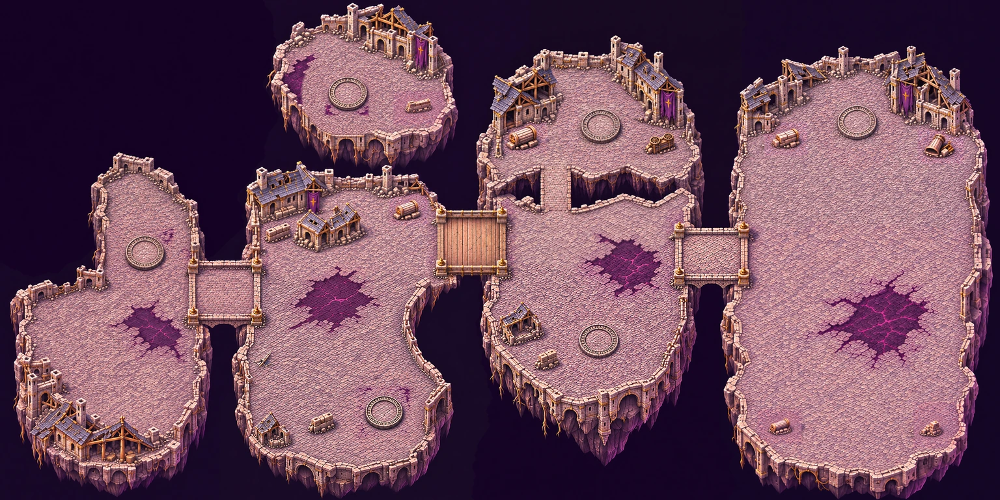
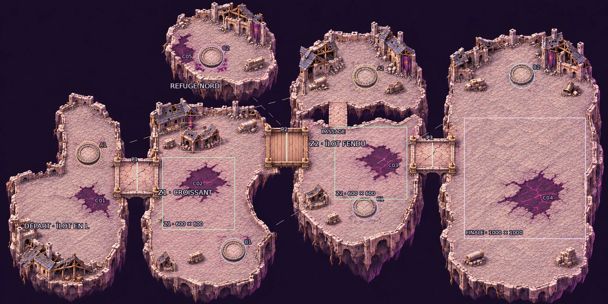

# Carte 23 — Les Quartiers suspendus

**Détail graphique livré le 6 novembre 2026, sur la composition corrigée validée par le propriétaire.**
`suspended_quarters`, chapitre 5, Cité de la Faille. Vagues par zone, **B6 Téléporteurs de faille**.
Format **5016 × 2508 unités**, parcours ouest → est.



## Plan conservé

L’identité des [Faubourgs brisés](FAUBOURGS_BRISES.md) et du
[Sanctuaire des runes](SANCTUAIRE_DES_RUNES.md) est conservée : pierre pâle, ardoise,
dorures ternies, bannières déchirées, lumière haut-gauche et liseré violet bas-droite.
Les fondations arrachées plongent dans un vide violet sombre aux bords nets.

Quatre îlots principaux, trois ponts continus et un refuge au nord :

- **Départ ouest en L**, place dégagée au sud, départ à **10,9649 % ; 73,7640 %**.
- **Z1 en croissant**, pâté de deux maisons effondrées au nord et petite ruine en L au sud-ouest.
  Deux cours et des détours autour des constructions ; dégagement réservé de **600 × 600u**.
- **Z2 fendu**, faille intérieure infranchissable et court passage de pierre nord–sud.
  Maison effondrée à contourner dans la cour basse ; dégagement réservé de **600 × 600u**.
- **Finale à l’est**, place ouverte avec noyau **1000 × 1000u**, centre **86,3238 % ; 58,6124 %**.
  Aucun bâtiment ni abri dans ce noyau, aucun cercle de combat, enceinte ou gardien peint.
- **Refuge au nord**, accessible uniquement par la paire C ; aucun accès à pied.

Les trois ponts suffisent pour tout le parcours principal. Les centres, les berges d’arrivée,
les segments de fermeture et les gabarits validés sont conservés ; dessus praticables d’environ
**232 / 232 / 202u**, hors parapets. Le court passage intérieur de Z2 vise **180u**.
Le détail remplace les grandes dalles de composition par de petits pavés et des planches fines.

La corruption est concentrée en **cinq nappes distinctes** : départ ouest, cour Z1, cour Z2,
finale et refuge. Les dalles violettes restent **plates, praticables et décoratives**, sans effet B9.
Le gouffre intérieur, avec profondeur et maçonnerie rompue, se distingue de ces sols.



Le [`plan.json` figé](../../assets/concepts/incoming/map.suspended_quarters/plan.json) contient les contours
indicatifs des îlots et zones, les cours libres, les trois blocs d’architecture intérieure, la faille et son
passage, les cinq nappes, le départ, les ponts et segments de barrière, les socles/jumeaux et les abris.
Pourcentages depuis le coin haut-gauche de l’image entière. Ces repères graphiques ne remplacent pas
la peinture des collisions ni les essais de circulation en jeu.

## Socles et abris

Les six socles sont bas, vides, praticables, avec centre pavé et gravures sombres.
Leurs centres validés et les trois paires sont conservés ; aucun vortex ni effet lumineux peint.

| Paire | Socle | Îlot | Centre (%) | Jumeau |
| --- | --- | --- | --- | --- |
| A | A1 | Départ ouest | 14,5338 ; 50,5519 | A2 |
| A | A2 | Z2, partie haute | 60,1237 ; 25,2604 | A1 |
| B | B1 | Z1, partie basse | 38,3697 ; 82,4865 | B2 |
| B | B2 | Finale, partie haute | 85,8073 ; 24,9349 | B1 |
| C | C1 | Z2, partie basse | 60,0911 ; 68,2292 | C2 |
| C | C2 | Refuge nord | 34,7127 ; 18,5563 | C1 |

Diamètres graphiques relevés sur le détail : **180 à 199u**, intervalle demandé 160–200u.
Les gros gravats proches sont retirés et les parapets avant C1/C2 abaissés et amincis pour préserver
**120u de dégagement au-delà de la base**, contrôlés visuellement ; le propriétaire confirmera
le détourage sur sa peinture. Aucun socle déplacé et aucun nouveau pont.
[Mesures A/B](../previews/suspended-quarters/pads0_mesures.webp),
[mesures C](../previews/suspended-quarters/pads1_mesures.webp).

**Onze abris : 3 en Z1, 3 en Z2, 4 sur la finale et 1 au refuge.**
Pans de mur bas, colonnes tombées, cloche et charrette renversées, avec ombres portées.
Largeurs graphiques **114 à 156u**, en comptant les semelles, roues et grosses cales.
Relevés manuels à environ 2u près ; ombres et petits éclats plats du dallage exclus.
Les pieds ont été affinés localement, sans modifier les cours, les ponts ou les emplacements des socles.
[Planche 1](../previews/suspended-quarters/covers0_mesures.webp),
[planche 2](../previews/suspended-quarters/covers1_mesures.webp),
[planche 3](../previews/suspended-quarters/covers2_mesures.webp),
[registre des mesures](../../assets/concepts/incoming/map.suspended_quarters/source/detail_measurements.json).

Claude devra respecter la progression des vagues lors de l’activation des téléporteurs entre îlots :
une paire ne doit pas permettre d’éviter une zone encore fermée. Aucun comportement n’est codé par ce lot.

## Détail, échelle et qualité

**Huit régions réellement repeintes**, en grille 4 × 2 : carrés de 1574u, cœur de 1254u et marges de 160u.
La composition reste figée ; les régions remplacent les composants grossiers par du détail neuf.
Assemblage par raccord de faible différence, calibration native, puis retouches peintes des abris et dégagements.
Le seul master détaillé retenu est sans perte, **3762 × 1881 pixels** ; les essais, guides et régions
intermédiaires restent hors dépôt. Prompts, empreintes et recadrages dans
[`regions_provenance.json`](../../assets/concepts/incoming/map.suspended_quarters/source/regions_provenance.json).

Présentation **11286 × 5643 pixels**, en trois tuiles **3762 × 5643**, soit **2,25 px/u**.
Encodage final WebP sans perte pour conserver le grain du dessin ; correction locale de netteté à résidu
atténué (poids 1/12), avec une variation arrondie d’au plus un niveau RVB. Aucun agrandissement de la seule composition n’est livré comme carte finale.
Recette reproductible :

```bash
python3 tools/art/build_suspended_quarters.py --present \
  --work <dossier-hors-depot> --model <realesr_general_x4v3_0.2.onnx> \
  --residual-limit 0.5 --lossless
```

Le [rapport qualité](../previews/suspended-quarters/qualite.json) est **conforme**, avec les seuils du projet inchangés :
**17/20 secteurs**, part lisse **0,104**, détails fins **393,577**, détails moyens **104,864**
par 100 × 100u, fidélité au plan **0,993**.
Les trois secteurs hors bande sont majoritairement du vide aux bords de la carte ; ils restent dans le rapport. Aucun seuil ni contenu du gouffre n’a été modifié pour les exclure.
Le [diagnostic relatif de netteté](../previews/suspended-quarters/nettete_relative.webp) et son registre sont conservés :
214 cases sur 377 restent sous la référence initiale de ce diagnostic. La correction plus forte
atténuait aussi le grain des joints ; elle n’est pas retenue. Le traitement final reste très faible,
et les captures ainsi que la comparaison à la référence permettent de juger le détail effectif.
Ce diagnostic relatif est distinct du rapport de conformité ci-dessus.

La [comparaison avec les Ruines](../previews/suspended-quarters/comparaison_echelle.webp) conserve
**1 pixel = 1 unité**, avec des extraits de 560 × 420u ; disposition verticale pour rester sous 1600px de large.
Repères : Chasseur environ 52u, pavés 15–26u, marches 12–16u, portes ordinaires 75–90u, colonnes 30–45u.

## Captures et vérifications

Le [banc Godot](../../tools/art/preview_suspended_quarters.tscn) charge les trois tuiles finales,
les sprites natifs et la caméra du jeu, avec profil en lecture seule. **Quatorze captures 1280 × 720** :

- [Ensemble](../previews/suspended-quarters/ensemble_720p.webp), [départ](../previews/suspended-quarters/depart_zoom_jeu.webp), [finale](../previews/suspended-quarters/finale_zoom_jeu.webp).
- [Pont ouest](../previews/suspended-quarters/pont_1_zoom_jeu.webp), [passerelle](../previews/suspended-quarters/pont_2_zoom_jeu.webp), [pont est](../previews/suspended-quarters/pont_3_zoom_jeu.webp), [passage intérieur](../previews/suspended-quarters/faille_interieure_zoom_jeu.webp).
- [Socle A1](../previews/suspended-quarters/socle_a1_zoom_jeu.webp), [A2](../previews/suspended-quarters/socle_a2_zoom_jeu.webp), [refuge C2](../previews/suspended-quarters/socle_c2_zoom_jeu.webp), [cour intérieure](../previews/suspended-quarters/cour_interieure_zoom_jeu.webp).
- Lisibilité sur [dalles](../previews/suspended-quarters/lisibilite_dalles.webp), [corruption](../previews/suspended-quarters/lisibilite_corruption.webp), [près du vide](../previews/suspended-quarters/lisibilite_vide.webp).

Témoins : Chasseur, Écho, Éclat errant, Sentinelle de verre, Golem de quartz,
Éclat du silence, Chevalier de glace et Héraut du silence. Aucun sprite du chapitre 5 créé.
Import Godot headless, captures, contrôle assets et lint :
[`controle_detail.json`](../previews/suspended-quarters/controle_detail.json).
Les captures contrôlent le visuel ; elles ne valident pas les collisions, la navigation ou le combat.

## Collisions et raccordement

[**Image entière légère à peindre**](../previews/suspended-quarters/reference_collisions.jpg) :
**1254 × 627 pixels, 341829 octets**, même cadrage entier que le plan et le détail, **4u/px**.
Retour attendu : **PNG 1254 × 627, sans recadrage ni redimensionnement**.
Peindre en rouge translucide le vide, les falaises, les bâtiments, murs et abris bloquants.
Garder praticables les **trois ponts**, le **court passage intérieur**, les **six socles** et les **dalles violettes**.
Ne pas fermer le passage sous un élément de décor surélevé.

La recette et les empreintes des trois tuiles sources et de la référence figurent dans
[`source/collision_reference.json`](../../assets/concepts/incoming/map.suspended_quarters/source/collision_reference.json).
**Aucun masque de collisions créé.** Claude raccordera ensuite collisions, zones, téléporteurs, gardien et campagne.
Les collisions, l’intégration et les sprites du chapitre 5 restent à livrer par leurs chantiers respectifs.

Aucune modification de `src/`, `data/`, du manifeste ni des cartes 14 à 22 dans le diff vers main.
Poids des fichiers de la livraison carte 23, sources retenues et aperçus compris : **87,14 Mo**.
