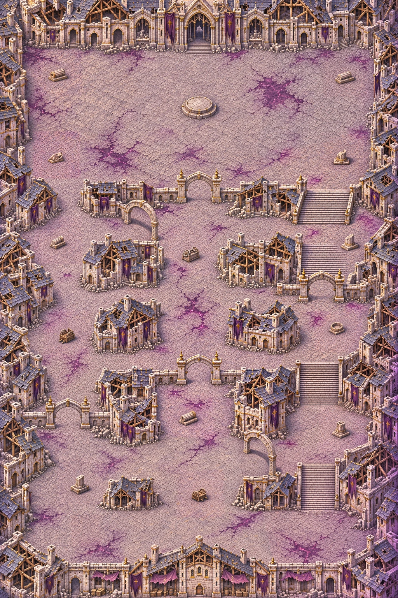
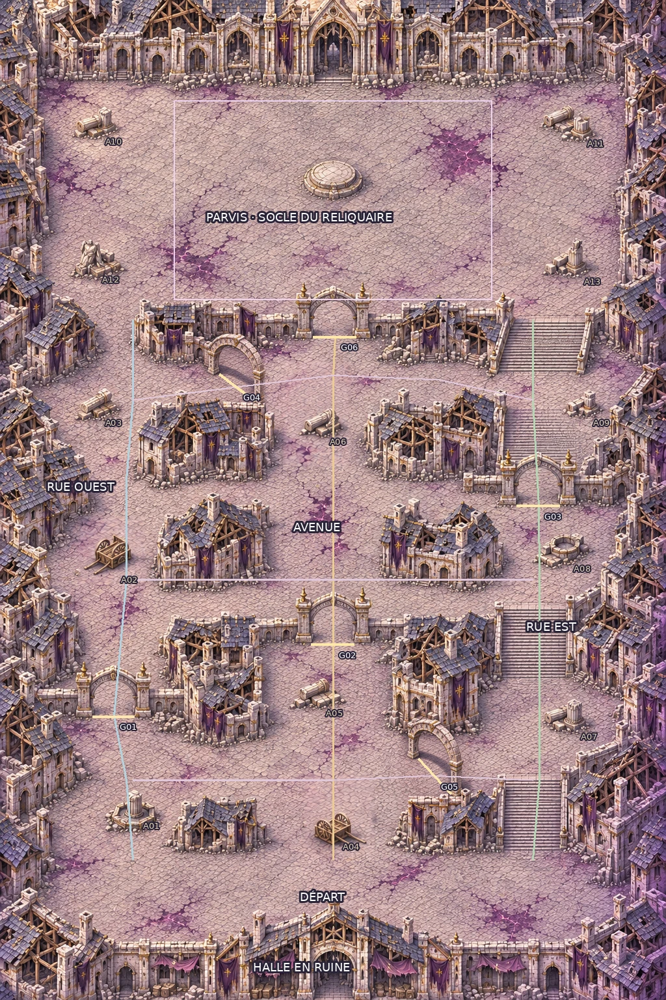

# Carte 22 — Le Sanctuaire des runes

**Détail graphique livré le 6 novembre 2026, après validation de la composition par le propriétaire.**
`rune_sanctum`, chapitre 5, Cité de la Faille. Défense d’autel ; B4 **Portes runiques**.

## Plan conservé

Pierre pâle et ardoise, façades éventrées, dorures ternies, bannières déchirées,
lumière haut-gauche et liseré violet bas-droite : la facture reprend celle des
[Faubourgs brisés](FAUBOURGS_BRISES.md). Le violet sombre et le magenta sont plus présents.
Ces veines restent du **décor praticable**, sans zones B9 ni renforcement. Aucune neige, lave ou végétation de marais.

Monde **3344 × 5016 unités**, portrait **2:3**. Le parcours sud→nord et les emplacements validés
sont conservés dans [`plan.json`](../../assets/concepts/incoming/map.rune_sanctum/plan.json) :

| Repère | Emplacement |
| --- | --- |
| Départ | **50 % ; 88,5 %**, grande place devant la halle en ruine au sud |
| Rue ouest | Rue étroite avec cours élargies ; G01 et trois abris |
| Avenue centrale | Grande voie dallée ; G02, G06 et trois abris |
| Rue est | Trois volées d’escaliers, paliers et trois abris ; G03 sur un palier |
| Traverses | Basse vers 78 %, médiane vers 58 %, haute vers 38–40 % |
| Parvis | Nord, adossé à la façade du sanctuaire, sans enceinte d’arène |
| Socle vide | **50 % ; 18,8 %**, diamètre peint environ 290u, cible 280u ; le jeu pose le reliquaire |
| Espace de combat | **1600 × 1000u**, centre **50 % ; 20 %**, libre hors du seul socle |

Aucun personnage, cristal, effet d’autel ou cercle de combat n’est peint sur le socle.
Les anciennes coordonnées de croquis des volées ont été corrigées dans les métadonnées d’après
les marches de l’image validée : **32–37 %, 60,5–67 %, 78–85 %**, sans déplacer les escaliers.

## Six portes ouvertes

Les arches portent des runes gravées sombres. Le dallage reste continu sous chacune ; aucun battant,
barreau ou rideau d’énergie n’est peint. Le jeu ferme exactement leur segment de passage.
Les quatre arches des rues font face au sud ; les deux arches des traverses sont vues de trois quarts.

| Porte | Rue/traverse | Centre (%) | Segment, deux points (%) | Largeur (u) |
| --- | --- | --- | --- | ---: |
| G01 | ouest | 17,09 ; 71,61 | (13,96 ; 71,61) → (20,21 ; 71,61) | 209,00 |
| G02 | centrale | 49,95 ; 64,45 | (46,78 ; 64,45) → (53,13 ; 64,45) | 212,27 |
| G03 | est | 80,86 ; 50,59 | (77,64 ; 50,59) → (84,08 ; 50,59) | 215,53 |
| G04 | traverse haute | 35,60 ; 38,70 | (32,91 ; 37,37) → (38,28 ; 40,04) | 224,02 |
| G05 | traverse basse | 65,28 ; 77,60 | (62,89 ; 75,85) → (67,68 ; 79,36) | 238,12 |
| G06 | centrale | 50,29 ; 33,66 | (47,07 ; 33,66) → (53,52 ; 33,66) | 215,53 |

[Planche des six seuils superposés au dessin](../previews/rune-sanctum/portes_echelle.webp).
Segments conservés depuis la composition et contrôlés sur le sol dégagé du détail.
Le graphe abstrait reste connecté avec les six portes fermées : monter à l’est jusqu’à la traverse
médiane, rejoindre l’avenue au-dessus de G02, puis la traverse haute et le parvis par les rues latérales.
Ce contrôle porte sur les liaisons du plan ; la navigation réelle dépendra des collisions du propriétaire.

## Échelle et lisibilité

**Treize abris : trois par rue, quatre sur le parvis.** Les silhouettes solides complètes,
socles, roues et brancards compris, mesurent environ **130 à 159u** ; ombres exclues.
Les pieds ont été affinés de moins de 90u dans les mêmes emplacements de combat.
Aucun abri sous une arche, sur une traverse étroite ou dans le cœur de combat du parvis.
Un petit pilier ajouté par la génération dans la place de départ a été retiré.

- [Treize abris au même zoom, avec leurs mesures](../previews/rune-sanctum/abris_echelle.webp)
- [Comparaison détail / composition / Ruines à 1 pixel par unité](../previews/rune-sanctum/comparaison_echelle.webp)
- [Chasseur et Écho sous une arche de rue](../previews/rune-sanctum/arche_rue_zoom_jeu.webp)
- [Chasseur et Écho sous une arche de traverse](../previews/rune-sanctum/arche_traverse_zoom_jeu.webp)
- [Chasseur et Écho sur l’escalier est](../previews/rune-sanctum/escalier_zoom_jeu.webp)
- [Socle et parvis au zoom réel](../previews/rune-sanctum/autel_zoom_jeu.webp)
- [Lisibilité sur dalles](../previews/rune-sanctum/lisibilite_dalles.webp)
- [Lisibilité sur corruption](../previews/rune-sanctum/lisibilite_corruption.webp)

Repères de la bible : Chasseur environ 52u, marches 12–16u, dalles au plus 26u,
colonnes ordinaires 30–45u, portes de maison 75–90u. Les arches sont des portes de ville,
plus hautes ; leurs pierres gardent l’échelle humaine. La porte de la halle a été réduite à environ 85u.
La volée médiane a reçu une retouche peinte pour espacer les marches vers 16u
(précision du master : 1,33u par pixel).

Le [banc de capture](../../tools/art/preview_rune_sanctum.tscn) charge les **deux tuiles finales**, les sprites
natifs et la caméra réelle dans un profil en lecture seule. Témoins : Éclat errant, Sentinelle de verre,
Golem de quartz, Éclat du silence, Chevalier de glace, Héraut du silence, Chasseur et Écho.
Aucun sprite du chapitre 5 créé ; ceux-ci restent à livrer séparément.

## Fabrication et contrôles

**Douze régions réellement redessinées**, carrés de travail de 1574u, sorties de 1254px de côté
(0,797px/u). Recadrage des marges techniques, assemblage sans déplacement du plan et retouches
locales peintes des marches et objets ; aucune génération intermédiaire versionnée.
Master retenu sans perte : **2508 × 3762px**, 0,75px/u.
Présentation à 2,25px/u : **7524 × 11286px**, deux WebP de **3762 × 11286px**, qualité 98.
La correction locale des cases douces intervient sur le détail déjà peint ; elle ne remplace pas les régions.
Son résidu RVB est plafonné à 6/255 pour conserver les joints et les couleurs du dallage.
Le traitement non borné a été écarté après inspection des captures.

[`check_map_quality` conforme](../previews/rune-sanctum/qualite.json), seuils inchangés :
**35/35 secteurs**, fidélité au plan **0,972**, médianes **411,730 détails fins** et **108,919 détails moyens**
par 100×100u, part lisse **0,083**.
[Carte de netteté relative](../previews/rune-sanctum/nettete_relative.webp).
Import Godot headless, sept captures 1280 × 720, contrôle assets, lint du banc et compilation Python :
[`controle_detail.json`](../previews/rune-sanctum/controle_detail.json).
Ces captures vérifient le chargement, l’échelle et la lisibilité ; elles ne simulent pas une partie.

Recette et provenance : `source/regions_provenance.json`, `source/detail_recipe.json`,
`source/cover_measurements.json` et `source/SHA256.json`.
Le [constructeur dédié](../../tools/art/build_rune_sanctum.py) reconstruit les deux tuiles depuis le master retenu.

## Collisions et raccordement

[**Image entière légère à peindre — JPG 836 × 1254**](../previews/rune-sanctum/reference_collisions.jpg).
Quatre unités par pixel, sans recadrage. Recette, poids et empreinte :
[`source/collision_reference.json`](../../assets/concepts/incoming/map.rune_sanctum/source/collision_reference.json).
Retour attendu : **PNG 836 × 1254**, même cadrage, sans redimensionnement.

Peindre en rouge translucide les maisons, murs, pieds des arches, piliers et abris qui bloquent.
**Laisser praticables les six seuils sous les arches**, les traverses, les escaliers et tous les sols violets.
La couronne d’une arche passe au-dessus du joueur : elle ne ferme pas son seuil dans le masque.
Le jeu gère les fermetures temporaires ; Claude raccordera le socle de l’autel selon son emprise.

Aucun masque peint par Codex. Claude intégrera collisions, autel, portes, gardien et campagne.
**Aucune modification de `src/`, `data/`, du manifeste ni des cartes 14 à 21 par ce lot.**

Poids total des fichiers livrés par la PR, sources et aperçus compris : **66,14 Mo**.
