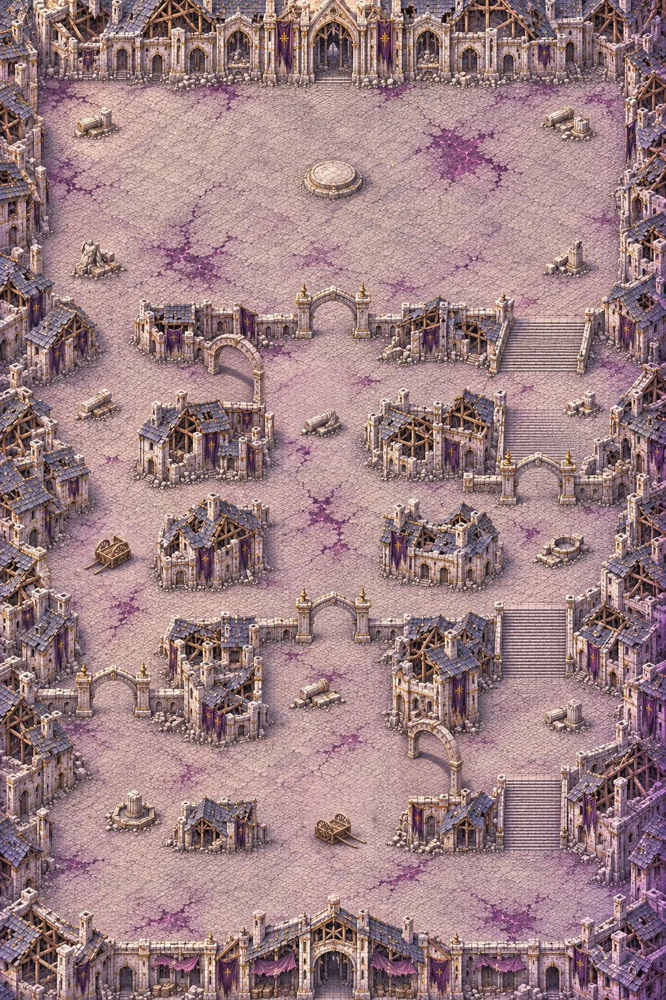

# Carte 22 — Le Sanctuaire des runes

**Composition proposée au propriétaire — 6 novembre 2026. Le détail graphique attend sa validation.**
`rune_sanctum`, chapitre 5, Cité de la Faille. Mode : **défense d’autel** ; B4 **Portes runiques**.
Branche `codex/carte-22-sanctuaire-runes`, créée depuis main actualisé.

## Identité et proposition

La ville reprend l’identité validée des [Faubourgs brisés](https://github.com/ballent-diz/Rift-Hunters/blob/778eefbde634b8de5056d4c0b15d91e45904378a/docs/maps/FAUBOURGS_BRISES.md) :
pierre pâle, ardoise, charpentes et façades éventrées, dorures ternies, bannières déchirées,
lumière haut-gauche et liseré violet bas-droite. Les veines et taches de corruption violet sombre
et magenta sont davantage présentes. Elles restent du **décor praticable** : cette carte ne crée
pas de zones B9 ni d’effet de renforcement. Aucune neige, lave ou végétation de marais.
La carte 21 sert de référence de facture et de palette, sans reprendre son parcours.

Monde **3344 × 5016 unités**, portrait **2:3**, composition entière **1024 × 1536 pixels**.
Parcours du **sud vers le nord**, par trois rues reliées, différent de la diagonale des Faubourgs
et des îles ou plans rayonnants des anciennes défenses d’autel.

Le propriétaire valide ici **rues, traverses, six arches, parvis, socle et départ**.
Les repères proposés figurent dans
[`source/composition_review.json`](../../assets/concepts/incoming/map.rune_sanctum/source/composition_review.json),
en pourcentages depuis le coin haut-gauche. **Aucun `plan.json` n’est verrouillé avant cet accord.**

## Du départ au reliquaire

| Repère | Proposition |
| --- | --- |
| Départ | **50 % ; 88,5 %**, place sud devant les ruines de la halle ; le décor ferme le bord inférieur |
| Rue ouest | Plus étroite, cours latérales élargies pour ses trois abris, G01 dans la rue |
| Avenue centrale | Voie dallée large, trois abris hors des traverses, G02 puis G06 vers le parvis |
| Rue est | Rue en escaliers, trois volées et des paliers élargis ; G03 sur un palier, trois abris latéraux |
| Traverse basse | Vers 78 % de hauteur, relie les trois rues ; G05 entre avenue et rue est |
| Traverse médiane | Vers 58 %, relie les trois rues et reste sans porte |
| Traverse haute | Vers 38–40 %, passe par G04 à l’ouest, puis au nord de l’abri central, rejoint le palier est |
| Parvis | Nord, grande place dégagée adossée à la façade du sanctuaire en bordure |
| Socle du reliquaire | **50 % ; 18,8 %**, cible **280 unités** de diamètre ; socle peint vide pour l’objet du jeu |
| Emprise de combat | Proposition **1600 × 1000 unités**, centre **50 % ; 20 %**, libre hors du seul socle de l’autel |

Les trois rues se rejoignent par la place sud et par le parvis nord. La rue est montre des marches
fines et de vrais paliers, avec les raccords latéraux au sol ; aucune fosse ou glace praticable.
Le socle reste le seul repère central du parvis. Aucun reliquaire, cristal, personnage, cercle de combat
ou effet d’autel n’est peint dessus.

## Six arches ouvertes, runes sombres

Chaque porte est une arche creuse à deux pieds, avec du dallage continu dessous. Les quatre portes
des rues s’ouvrent vers le sud ; les deux portes des traverses sont obliques dans l’autre sens,
pour laisser lire leur ouverture. Les runes sont sombres et discrètes : le jeu les allume.
Les retours de mur raccordent les pieds au décor voisin ; les détours passent par les autres rues.
**Aucun battant, barreau ou rideau d’énergie fermé n’est peint.**

Les segments ci-dessous sont relevés graphiquement entre les pieds, pour la composition ; ils ne
sont pas des collisions ou des placements runtime. Cible du passage : **200–300 unités**, avec
recalage au détail puis contrôle sur la peinture du propriétaire.

| Porte | Rue ou traverse | Centre (%) | Segment de passage, deux points (%) | Largeur relevée (u) |
| --- | --- | --- | --- | ---: |
| G01 | west | 17.09 ; 71.61 | (13.96 ; 71.61) → (20.21 ; 71.61) | 209.00 |
| G02 | central | 49.95 ; 64.45 | (46.78 ; 64.45) → (53.12 ; 64.45) | 212.27 |
| G03 | east | 80.86 ; 50.59 | (77.64 ; 50.59) → (84.08 ; 50.59) | 215.53 |
| G04 | t3 | 35.60 ; 38.70 | (32.91 ; 37.37) → (38.28 ; 40.04) | 224.02 |
| G05 | t1 | 65.28 ; 77.60 | (62.89 ; 75.85) → (67.68 ; 79.36) | 238.12 |
| G06 | central | 50.29 ; 33.66 | (47.07 ; 33.66) → (53.52 ; 33.66) | 215.53 |

Les trois traverses et la répartition des portes permettent de contourner chaque fermeture.
Le **graphe abstrait du plan reste connecté même avec les six portes fermées** : depuis le sud,
prendre la rue est jusqu’à la traverse médiane, rejoindre l’avenue au-dessus de G02, puis prendre
la traverse haute vers la rue est ou remonter à l’ouest pour gagner le parvis. G04 et G05 ferment
leurs traverses respectives, mais la traverse médiane reste ouverte.
Ce contrôle concerne les liaisons du croquis ; **aucune navigation en jeu ou collision n’est simulée**.

## Treize abris et échelle

**Trois abris par rue, quatre sur le parvis** : statues ou fragments renversés, fontaine brisée,
colonnes rompues et charrettes renversées. Les deux abris de l’avenue proches des traverses ont été
replacés sur la composition ; les entrées des arches restent dégagées.
Les emplacements sont proposés dans le fichier de revue. Les grands objets de composition restent
provisoires : **la largeur finale de chaque abri sera 110–160 unités**, à fixer lors des régions.

Même repère que la bible : Chasseur environ **52 unités**, marches **12–16**, dalles **26 au plus**,
colonnes **30–45**, portes de maison **75–90**. Les portes runiques sont des portes de ville plus
hautes ; leurs pierres et leurs marches garderont l’échelle du Chasseur. Le socle sera calibré
à environ 280 unités pendant le détail.

Le banc [preview_rune_sanctum.tscn](../../tools/art/preview_rune_sanctum.tscn) utilise les sprites natifs,
le zoom réel du jeu et un profil en lecture seule, sans partie ni écriture de sauvegarde :

- [Chasseur et Écho sous une arche de rue](../previews/rune-sanctum/arche_rue_zoom_jeu.webp)
- [Chasseur et Écho sous une arche de traverse](../previews/rune-sanctum/arche_traverse_zoom_jeu.webp)
- [Chasseur et Écho sur l’escalier est](../previews/rune-sanctum/escalier_zoom_jeu.webp)
- [Socle du reliquaire et espace du parvis](../previews/rune-sanctum/autel_zoom_jeu.webp)
- [Lisibilité sur dalles](../previews/rune-sanctum/lisibilite_dalles.webp)
- [Lisibilité sur corruption](../previews/rune-sanctum/lisibilite_corruption.webp)

Témoins : Éclat errant, Sentinelle de verre, Golem de quartz (chapitre 3), Éclat du silence,
Chevalier de glace et Héraut du silence (chapitre 4), avec le Chasseur et un Écho.
Aucun nouveau sprite du chapitre 5 livré. Les sept captures font **1280 × 720**.
Le terrain est encore la composition agrandie : **sa finesse est provisoire**.
Import Godot, captures, lint du banc et contrôle des assets : voir
[controle_composition.json](../previews/rune-sanctum/controle_composition.json).
Aucun rapport `check_map_quality` conforme n’est revendiqué à ce stade.

## Après validation du propriétaire

1. Figer `plan.json` : départ, socle, parvis, rues, traverses, six centres et segments de portes, treize abris.
2. Contrôler un secteur témoin à l’échelle, puis redessiner **douze régions** au vrai détail des Ruines,
   assembler et fournir le rapport `check_map_quality` **conforme** et la comparaison d’échelle.
3. Remettre une image entière légère de référence des collisions avec recette et empreinte dans
   `source/collision_reference.json` ; retour du propriétaire en PNG, même cadrage et dimensions.
   Les six passages sous les arches resteront praticables : le jeu les ferme temporairement.

Seule la composition retenue, le croquis de disposition, les repères, les prompts et leurs empreintes
sont versionnés. Essais et retouches intermédiaires restent hors dépôt.
Claude intégrera collisions, autel, portes runiques, gardien et campagne après la peinture du propriétaire.
**Aucun masque de collisions créé. Aucun changement de `src/`, `data/`, du manifeste ni des cartes 14 à 21.**

Poids total de la proposition, source retenue et aperçus compris : **10,33 Mo**.
