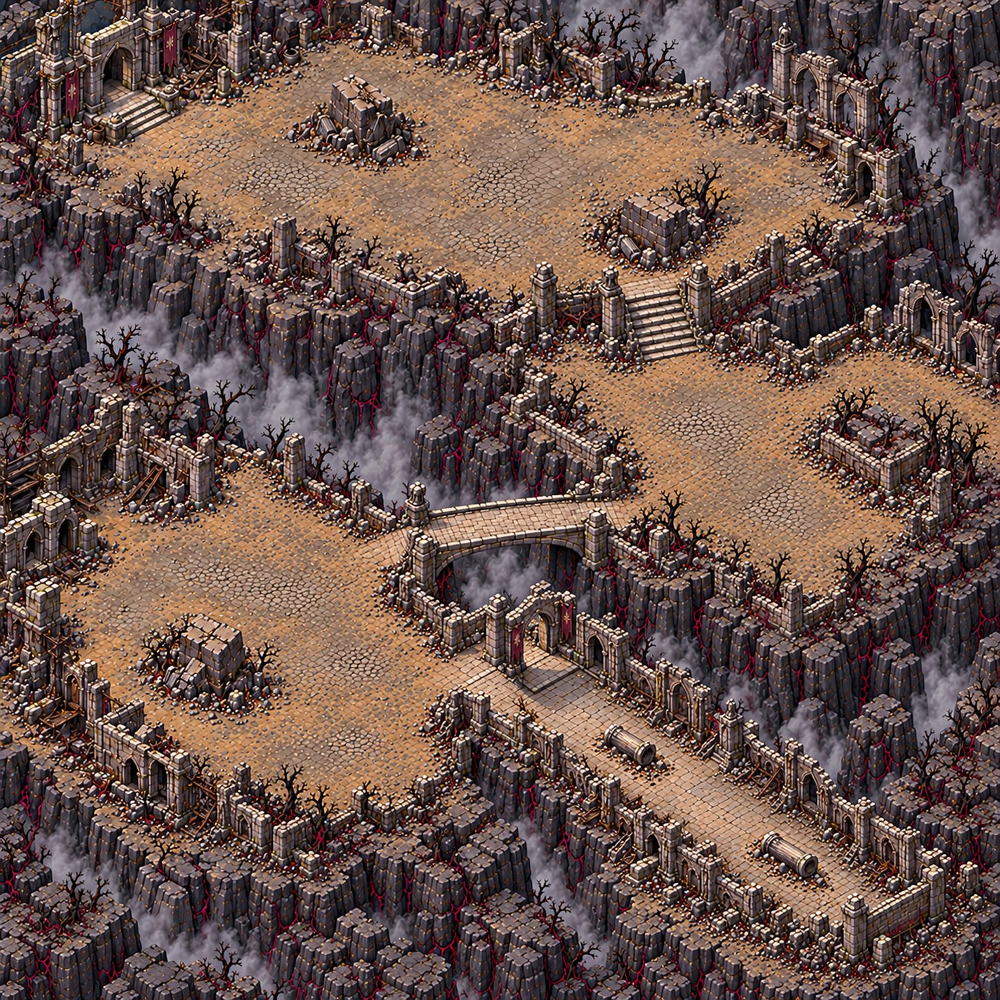

# Tanières de suie — carte 8

Chapitre 2, composition carrée pour un monde de **5016 × 5016 unités**. Composition validée par le propriétaire le **24 octobre 2026** ; plan figé.
La passe de détail par régions et la peinture des collisions restent à réaliser. Aucun niveau, collision ou réglage de combat créé par ce lot.

## Plan et variété

Monastère calciné sur une pente, trois terrasses séparées par des murs de soutènement et des
failles fumantes. Parcours en zigzag : cour haute vers l'est, escalier vers la terrasse médiane,
pont de pierre vers l'ouest, réfectoire effondré en bas à gauche puis nef au sud-est.
Format, sens du parcours, passages et fin de carte diffèrent des Évents de cendre.

Le décor porte les matières du chapitre : pierre noircie, cendre grise, roche brune, toiles aux
ruines périphériques, fissures rouge sombre. Ni lave en surface, ni danger orange, ni nid ou œuf
peint dans le sol. Les trois cartes jointes au générateur servent uniquement de référence de style.

La nef est longue, sans toit et orientée en diagonale, avec **deux tronçons de colonnes couchés**,
décalés. Son extrémité sud-est a été refermée dans une retouche afin que son sol ne sorte pas de
l'image. Elle possède un seul porche d'accès, côté nord-ouest. Les colonnes des murs périphériques
font partie des ruines ; seuls les deux tronçons couchés occupent le sol intérieur.

## Repères proposés sur l'image

Coordonnées en pourcentage, origine en haut à gauche. La composition générée s'écarte de certaines
coordonnées du brief : les positions observées et les cibles sont toutes conservées dans `plan.json`.
Le propriétaire a validé cette composition le 24 octobre 2026 : conserver désormais les positions
observées et les accès de cette image. Cette validation porte sur la composition seule ; elle ne
vaut pas validation des sprites du nid et de l’œuf, qui restent inchangés.

| Repère | Image proposée X,Y % | Cible initiale X,Y % |
|---|---|---|
| Départ sur le parvis, au pied des marches | 19,15 | 15,10 |
| Zone 1, cour haute | environ 35,20 | 35,20 |
| P1, escalier | environ 66,31 | 66,28 |
| Zone 2, terrasse médiane | environ 75,47 | 72,48 |
| P2, pont de pierre | environ 50,52 | 46,62 |
| Zone 3, réfectoire | environ 28,72 | 28,74 |
| Porche de la nef | environ 53,66 | 56,82 |
| Nef en diagonale | environ 75,80 | 76,84 |

## Abris et circulation

| Abri | Zone | Centre X,Y % |
|---|---|---|
| A1, maçonnerie effondrée | 1 | 35,11 |
| A2, grand bloc | 1 | 65,22 |
| A3, maçonnerie | 2 | 87,44 |
| A4, bloc effondré | 3 | 21,65 |

Quatre masses, hors des passages, mesurant visuellement plus de 120 unités. Distance entre centres
la plus faible : **1560,6 unités**, supérieure aux 350 demandées. Deux autres abris dans la nef,
tronçons couchés vers 64,75 et 81,86 %. Le propriétaire peindra leurs collisions ; aucune capacité
à bloquer les tirs n'est inventée par l'image.

## Six propositions de nids

Deux par zone, sur les sols libres. Distance minimale au départ proposé, au départ initial et à
tous les passages observés ou initialement demandés : supérieure à **400 unités**. Distances
euclidiennes, et non distances de navigation ; à confirmer sur la peinture des collisions.

| Nid | Zone | X,Y % |
|---|---|---|
| N01 | 1 | 28,17 |
| N02 | 1 | 48,20 |
| N03 | 2 | 73,43 |
| N04 | 2 | 82,55 |
| N05 | 3 | 15,63 |
| N06 | 3 | 33,72 |

[Plan annoté](../previews/soot-dens/plan_annote.png). Positions en pourcentage, conversions en
unités et distances : `assets/concepts/incoming/map.soot_dens/plan.json`.

## Mesures de composition et limites

| Élément | Relevé |
|---|---|
| Format livré | 1536 × 1536, 1:1, monde 5016 × 5016 |
| Image brute générée | 1254 × 1254, conservée ; simple mise au format de composition |
| Clairières | trois grandes surfaces, largeur visuelle supérieure à 750 unités |
| Escalier et pont | environ 4 à 6 % de largeur libre ; estimation visuelle |
| Nef | axe diagonal d'environ 2100 unités, largeur environ 650–750, proportion proche de 3:1 |
| Sol de la nef | au-dessus des minima 900 × 450 unités ; circulation autour des colonnes à confirmer |
| Surface praticable ≥ 50 % | cible visuellement plausible, non certifiée avant peinture |
| Qualité finale, netteté et échelle | non revendiquées avant les régions |

Le redimensionnement de la composition n'est pas une passe de détail. La future carte finale
doit être redessinée par régions et passer les contrôles officiels, sans modifier les seuils.

## Checklist

- [x] Composition carrée entière, sans interface, personnages ou texte.
- [x] Zigzag descendant, trois terrasses, escalier et pont solidement ancrés.
- [x] Nef allongée en diagonale, bout fermé, deux colonnes couchées asymétriques.
- [x] Quatre abris espacés dans les zones ; six propositions de nids séparés du décor.
- [x] Sources, prompts exacts et SHA256 conservés dans `incoming/map.soot_dens/source/`.
- [ ] Validation de la composition et de ses repères par le propriétaire.
- [ ] Collisions peintes, passages et abris confirmés en navigation.
- [ ] Régions, assemblage, planche d'échelle, rapport CONFORME et netteté.
- [ ] Après intégration par Claude : passe courte du bot joueur moyen sur cette carte, selon DIFFICULTE.md.

La passe du bot nécessite le niveau jouable, ses vagues et ses collisions : elle n'est pas exécutée
sur une simple composition. Les [deux sprites d'objets](../art/NID_ET_OEUF_DE_CENDRE.md) sont indépendants du décor.
