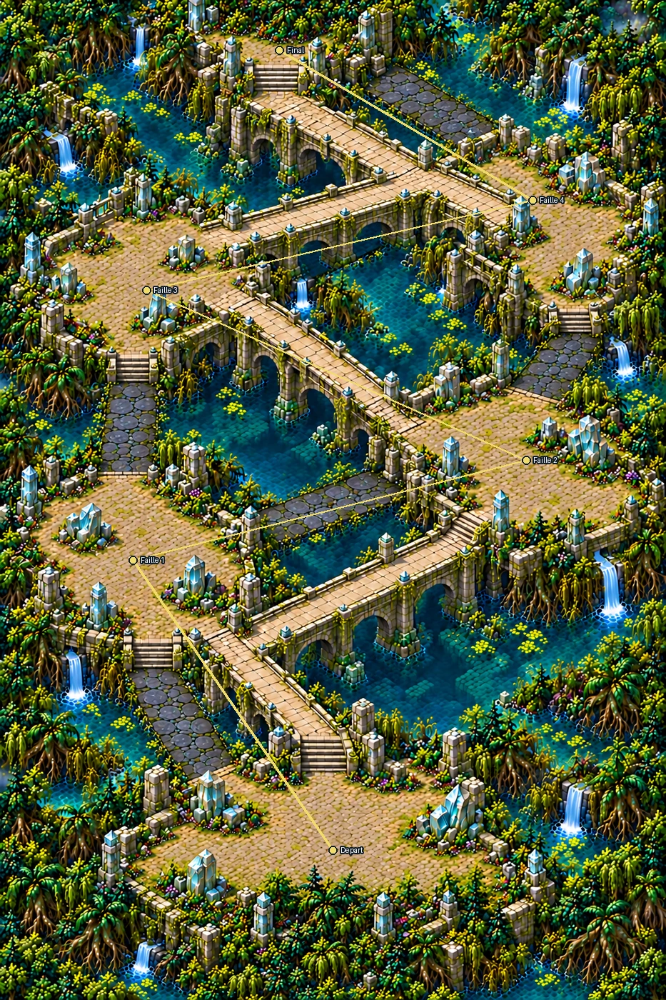
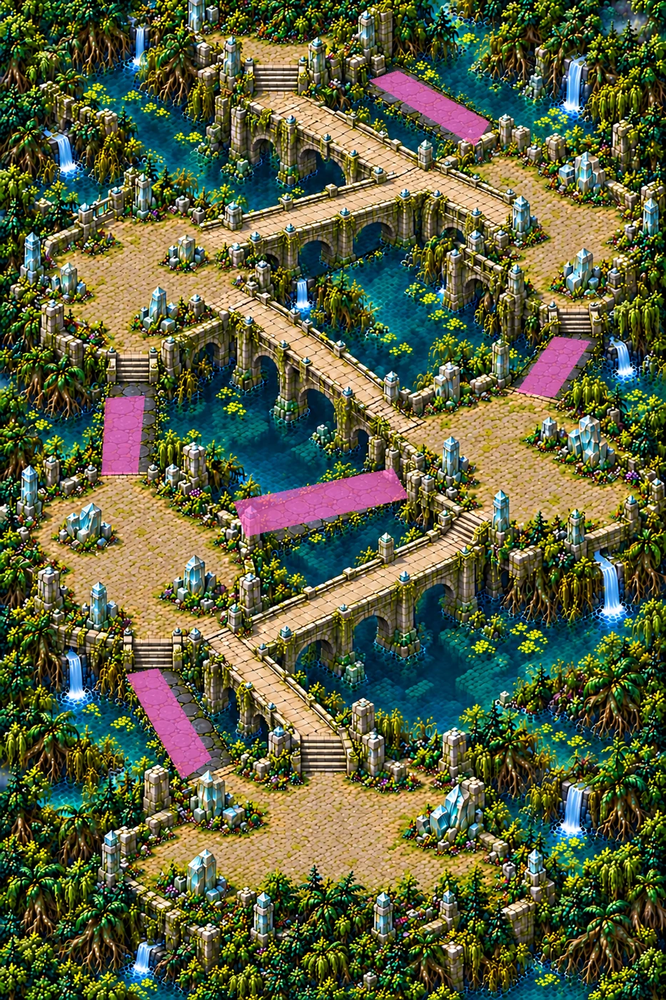

# Temple des marées — carte 12

Chapitre 3, Marais engloutis. Carte **verticale 2:3**, monde **3344 × 5016**, composition **1024 × 1536**. Quatre espaces destinés aux failles, puis parvis final. Aucun objet de faille, gardien ou cercle d’énergie peint : ils seront dessinés par le jeu.

Le propriétaire a autorisé de poursuivre sans questions ni validation intermédiaire. Composition choisie par Codex, pas validation visuelle explicite du propriétaire ; plan ensuite figé pour la passe de régions.

## Parcours haut permanent

Six terrasses échelonnées, reliées par **cinq ponts hauts secs** : départ sud → cour ouest → terrasse est → salle nord-ouest à ciel ouvert → bassin nord-est → parvis nord. Ce tracé reste visuellement continu en supprimant les cinq chaussées basses. Les deux premières compositions demandaient des passages bas obligatoires ; la liaison haute nord a été ajoutée avant de figer le plan.

| Repère réalisé | X,Y % approximatifs |
|---|---|
| Départ, parvis sud | 50,85 |
| Faille 1, cour ouest | 20,56 |
| Faille 2, terrasse est | 79,46 |
| Faille 3, salle effondrée | 22,29 |
| Faille 4, bassin sacré | 80,20 |
| Final, parvis du sanctuaire | 42,5 |

Le tracé jaune du plan est schématique : il indique l’ordre des terrasses, pas une trajectoire de navigation. Coordonnées relevées sur l’image réalisée, distinctes des repères indicatifs du brief ; Claude choisira les points exacts après les collisions. Le carrefour haut vers (64,18) permet de rejoindre le parvis final sans traverser le centre de la terrasse Faille 4 ; le mode doit donc conserver sa condition de fermeture des quatre failles avant le gardien, plutôt que supposer un passage imposé par le décor.

## Chaussées de marée

**Cinq chaussées basses** (dans la plage demandée de 5 à 7), en dalles sombres humides au niveau de l’eau. Chaque chaussée relie deux terrains secs, et possède un détour haut. `tide.png` : **noir = rien, blanc = chaussée noyée à marée haute**. Pas un masque de collisions.

| Chaussée | Rectangle X1,Y1,X2,Y2 % | Longueur technique (u) | Largeur moyenne (u) |
|---|---|---:|---:|
| T01 | 18.848, 66.797, 31.738, 77.93 | 563.0 | 167.3 |
| T02 | 35.059, 46.81, 61.328, 53.646 | 826.7 | 173.5 |
| T03 | 15.234, 39.518, 21.68, 47.526 | 389.6 | 186.4 |
| T04 | 77.539, 33.594, 88.574, 39.714 | 336.9 | 166.9 |
| T05 | 54.199, 6.576, 74.219, 15.56 | 590.3 | 210.0 |

Mesures de l’emprise technique du masque, pas d’une navigation simulée : [détails](../previews/tide-temple/mesures_chaussees.json). Le masque couvre toute la largeur, joints compris, avec de petites marges extérieures dans l’eau déjà infranchissable ; aucune bande latérale volontairement laissée hors masque.

- T01 : départ ↔ cour ouest ; détour par le premier pont haut.
- T02 : cour ouest ↔ terrasse est ; détour par le pont haut inférieur.
- T03 : cour ouest ↔ salle nord-ouest ; détour par terrasse est puis pont central.
- T04 : terrasse est ↔ bassin nord-est ; détour par salle nord-ouest et pont haut nord.
- T05 : bassin nord-est ↔ parvis final ; détour par le pont haut supérieur.

Masque final **7524 × 11286**, noir/blanc 1 bit, cinq composantes ; emprises provisoires adaptées sans interpolation des valeurs. Bords extérieurs fermés par végétation et ruines. Pierre grise moussue, cristal-miroir cyan pâle, eaux turquoise et profondes, aucune lave ni terrain cendreux.

## Mesures et limites

| Critère | Contrôle |
|---|---|
| Format vertical | 3344 × 5016 unités |
| Espaces de combat | Six terrasses, centres dégagés et abris répartis |
| Ponts hauts | Visuellement continus, ancrés aux terrasses et distincts des chaussées basses |
| Chaussées basses | Cinq, largeur moyenne ci-dessus, détours hauts visibles |
| Sol praticable ≥50 % | Objectif visuel non certifié avant peinture des collisions |
| Couvertures ≥120 u, espaces ≥350 u | Rochers/statues de cristal présents ; tailles et espacements à confirmer manuellement |

Les petits débris de surface doivent rester traversables. Aucune certification de navigation ou de marée en jeu : collisions, règle de submersion et annonces sont hors de ce lot.

## Détail et vérification

Douze régions (3 × 4), redessinées avec une référence des Ruines à chaque génération, assemblées avec recouvrements fondus. Une finition des matières remplace les pavés trop lisses par de plus petits composants sans changer le plan ; prompts exacts dans `source/PROMPT_FINITION.txt`, `source/PROMPT_MICROFINITION.txt` et `source/PROMPT_PAVAGE_NORD.txt`. Le premier contrôle comptait 291,610 détails fins, insuffisant : aucune publication de cet essai. La région nord r0_1 utilise un prompt plus court pour remplacer effectivement le motif des grandes dalles. Les nouveaux pavés sont réinsérés uniquement dans quatre emprises de sol, avec fondu intérieur de 4 pixels ; le décor original est conservé pixel pour pixel hors de ces emprises (provenance et polygones dans source/provenance_pavage_seul.json). Deux tuiles **3762 × 11286**, carte totale **7524 × 11286**, **2,25 px/u**. Les régions intermédiaires restent hors Git ; provenance et empreintes dans `source/regions_manifest.json`.

| Contrôle officiel | Résultat |
|---|---:|
| densité (pixels par unité) | 2.25 |
| part lisse (médiane) | 0.2 |
| détails fins / 100×100 u (médiane) | 348.773 |
| détails moyens / 100×100 u (médiane) | 100.808 |
| secteurs conformes (part) | 1.0 |
| fidélité au plan validé (corrélation) | 0.984 |

Verdict **global CONFORME**, seuils inchangés. Le diagnostic de netteté locale et son interprétation avant/après sont détaillés ci-dessous ; la validation artistique et la navigation restent manuelles. [Rapport](../previews/tide-temple/qualite.json) · [Échelle](../previews/tide-temple/echelle.webp) · [Carte entière](../previews/tide-temple/carte_entiere.webp). Les extraits de comparaison restent à 1 pixel = 1 unité, réorganisés sans redimensionnement.

Import et chargement des textures et du masque contrôlés dans un projet Godot 4.3 isolé. Le [repère Chasseur/Mousseroc](../previews/tide-temple/secteur_echelle.webp) est un montage technique à l’échelle, pas une capture en partie.

## Checklist et raccordement

- [x] Carte entière verticale, sans interface, texte ni personnages.
- [x] Six terrasses et chemin haut permanent, cinq raccourcis bas séparés.
- [x] Identité du chapitre 3, bordures fermées, centres de combat ouverts.
- [x] Masque de marée final, mesures et plan annoté.
- [x] Douze régions, assemblage, qualité globale conforme et planche d’échelle.
- [x] Correction des contours, contrôle sur la référence figée avant correction ; diagnostic relatif après correction conservé séparément.
- [x] Contrôle ciblé de chargement Godot.
- [ ] Validation manuelle des tailles, de la circulation et des détours par le propriétaire.
- [ ] Collisions peintes, marée, quatre failles, gardien et niveau jouable intégrés par Claude.

Aucun `src/`, `data/` ou masque existant modifié. Entrée du manifeste runtime différée, sans inventer de `field`. Sources retenues, prompts exacts et SHA256 dans `assets/concepts/incoming/map.tide_temple/`.

## Restauration des contours et contrôle avant/après

La correction sélective brute a été rejetée : finesse **330,234 → 308,218**, non conforme. La recette retenue conserve la matière et transfère uniquement les contours reconstruits par le modèle officiel sur toute la carte : filtre de détail sigma 1,25, poids 0,75, blocs de 512 pixels, recouvrements de 32. Aucun bruit ajouté, aucun changement du plan. Code exact, paramètres et empreintes du modèle dans `source/RESTAURATION_CONTOURS.json` et `.py`.

Après restauration : contrôle global **CONFORME**, détails fins **348,773**, moyens **100,808**, secteurs conformes **100 %**, fidélité **0,984**. Les pixels des WebP sont identiques au candidat contrôlé. [Avant/après au même zoom](../previews/tide-temple/avant_apres_zoom.webp) · [Chiffres](../previews/tide-temple/restauration_contours.json).

Le diagnostic relatif recalculé sur la carte corrigée signale encore **219/620 cases (35,3 %)**, contre 333 avant ; ce rapport **ne passe pas** son seuil de 5 %. Il reste joint, sans seuil modifié. Toutefois, `QUALITE_DES_CARTES.md` précise que la référence se mesure **avant correction**, car les zones corrigées deviennent ensuite la nouvelle référence. Le blocage fondé uniquement sur la référence recalculée après traitement était donc une interprétation trop stricte de ce diagnostic.

L’audit complémentaire conserve la référence initiale réelle **0,002278732368722558**, le même rapport **0,6** et le même seuil de part signalée **5 %** : **0 case sur 620** sous le seuil initial après correction. Ce n’est pas présenté comme un passage du contrôle relatif recalculé ; les deux résultats restent distincts. [Audit avant/après](../previews/tide-temple/audit_final.json) · [Carte de chaleur relative recalculée](../previews/tide-temple/tide_temple_sharpness.png).

## T05 : correction du masque technique

La mesure initiale avait interverti les côtés longs et courts ; l’audit a ensuite montré que le masque ne couvrait que l’intérieur du tablier déjà peint. Le masque de marée créé par Codex couvre maintenant la largeur du tablier existant : longueur moyenne **590,3 unités**, largeur moyenne **210,0 unités**, dans l’objectif de 150–300. Les quatre autres chaussées restent inchangées, cinq composantes binaires conservées. Aucune modification de l’image, aucun élargissement de terrain ni changement de collision.

[Superposition avant/après T05](../previews/tide-temple/t05_correction.webp). Le masque reste une emprise de submersion, pas une certification de navigation ; son adéquation précise avec les collisions sera vérifiée à l’intégration.

## État de livraison

Passe de détail, assemblage, masque et contrôles visuels livrés pour revue. Aucune revendication de niveau jouable : collisions, marée, quatre failles et gardien restent à intégrer par Claude. La validation artistique, les tailles des abris et la circulation en jeu restent au propriétaire. Aucun outil ni seuil de référence modifié.

Poids des nouveaux fichiers uniques : **140.4 Mo**, sous la limite 150 Mo. [Mesure](../previews/tide-temple/poids.json).

## Intégration en jeu (Claude, 29 octobre 2026)

Arène `data/arenas/tide_temple.tres`, fermeture de failles, collisions peintes par le propriétaire.

- **Marée** sur les trois chaussées sombres qui relient des terrasses : T01 (départ ↔ cour ouest), T03 (cour ouest ↔
  salle nord-ouest), T04 (terrasse est ↔ bassin). Leur emprise de `tide.png` est rendue praticable dans `collision.png`
  (marée basse) ; à marée haute, 26 rectangles qui suivent leur forme les ferment (`tide_causeways`).
- **T02 et T05**, les chaussées en brique, sont encadrées de murs et de piliers et ne débouchent sur aucune terrasse :
  elles restent bloquées, comme le propriétaire les a peintes.
- **Raccord du pont haut nord au bassin** élargi à 90 unités entre le pilier du garde-corps et le grand pilier
  (la peinture n'y laissait qu'environ 16 unités) : sans lui, le bassin était isolé à marée haute.
- Le chemin haut relie toujours tout, marée haute comme basse (`test_map_passages::test_tide_temple_high_road_stays_open_at_high_tide`).
- **Failles** sur les quatre terrasses du plan, au point le plus dégagé de chacune : cour ouest (-988, 312), terrasse
  est (1044, -64), salle nord-ouest (-1060, -1112) et bassin sacré (1196, -1368). Le parvis du sanctuaire (environ
  650 × 150 unités, jamais plus de 120 unités de dégagement) est trop étroit pour une faille ou un combat de gardien :
  il reste un décor. La **finale** est un cercle d'énergie dans le bassin sacré, une fois sa faille refermée
  (centre (1196, -1368), rayons 300 × 240).
- **Densité** réduite par rapport à une carte ouverte (terrasses et ponts de 200 à 300 unités) : 45 à 120 Corrompus
  en vie selon la phase, 0,6 par seconde et par faille ouverte.
- **Flèche de route** : elle suit le chemin haut permanent (les chaussées de marée restent fermées pour elle,
  `FlowField.avoid_transient`) au lieu de basculer à chaque marée ; les raccourcis restent au choix du joueur.
- Départ (4, 1760), parvis sud. Corrompus : les Enlisés. **Gardien provisoire** : la Chimère des brumes (carte 4).
