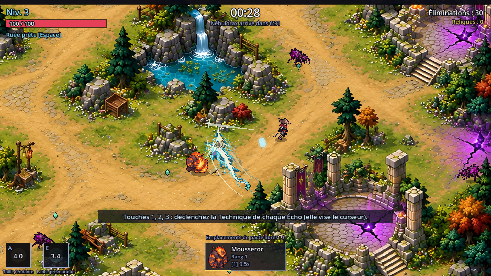
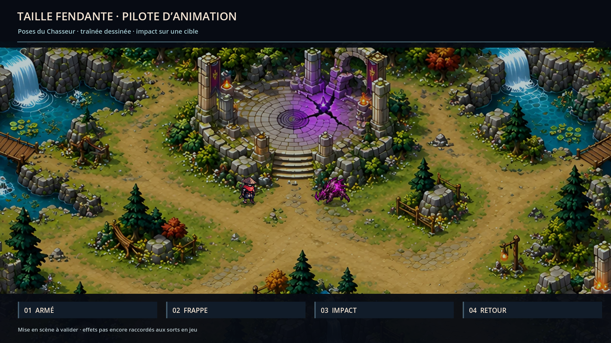
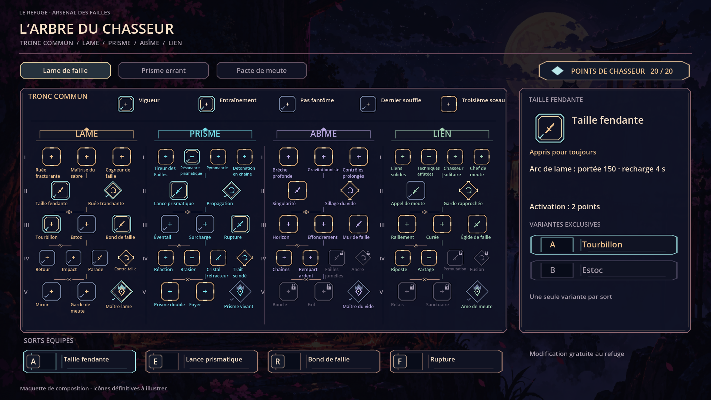
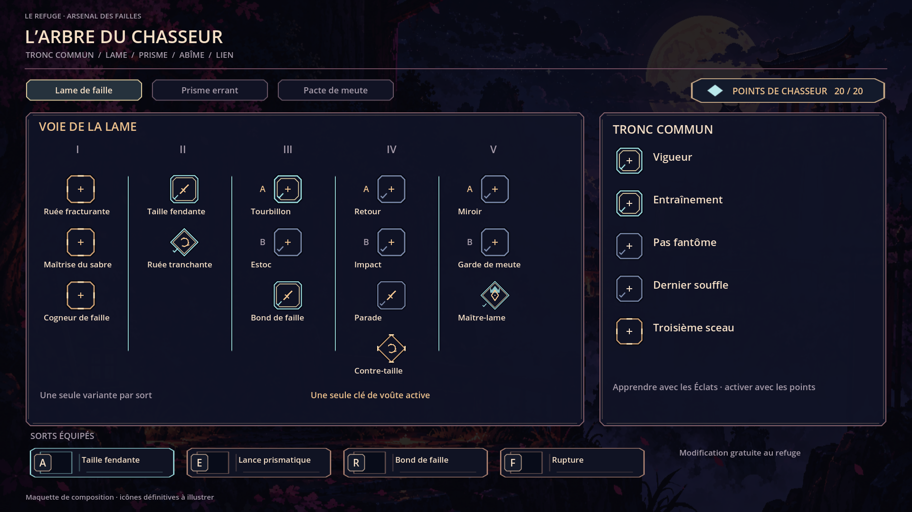
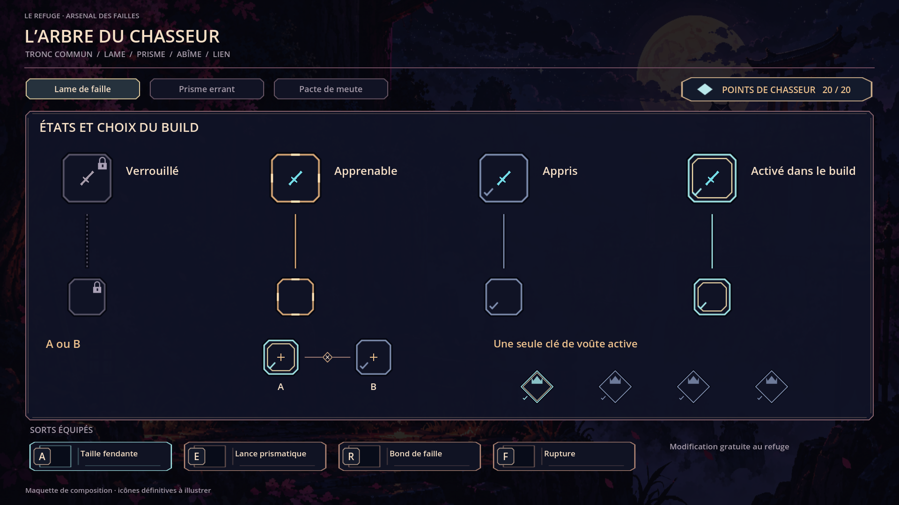
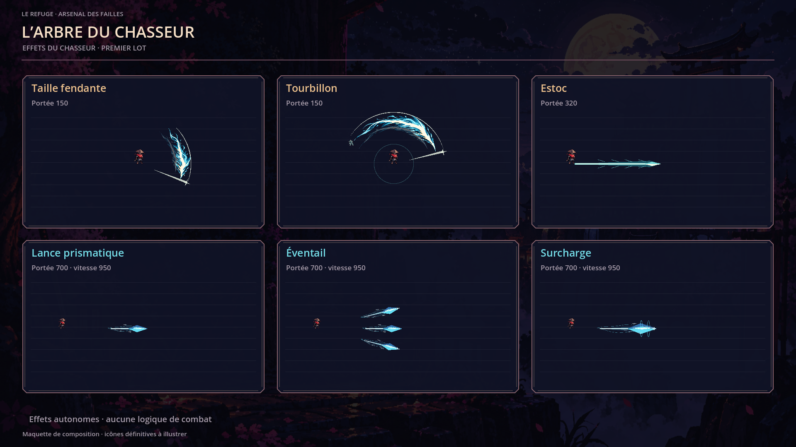
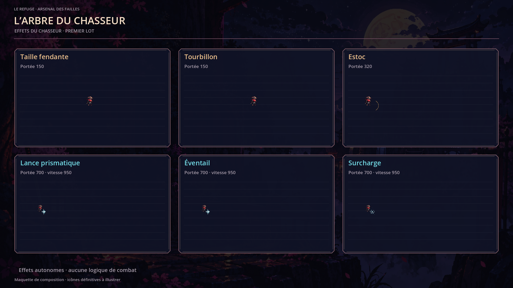

# Maquettes de l’arbre du Chasseur — C5

Captures Godot en 1920 × 1080. L’écran fonctionnel sera raccordé par Claude dans C2.
Les glyphes de placement seront remplacés par les icônes générées par le propriétaire.

## Pilote de Taille fendante — dernière proposition

### Vérification dans une vraie partie

[Vidéo native en partie, 1080p](live/taille-fendante-en-partie.mp4).
Adaptateur visuel de test : les contacts et dégâts proviennent du combat C1.
L’impact est ramené à 72 unités et limité à deux occurrences par frappe pour préserver la lisibilité.

### Étude du geste isolé

[Fiche et chronogramme de raccordement](../../art/TAILLE_FENDANTE_PILOTE.md).

## Vue d’ensemble

## Détail de la Lame

## États et choix exclusifs

## Premiers effets

Durées et contrat de raccordement : [fiche C5](../../art/CHASSEUR_C5.md).
Prompts des 24 icônes : [prompts du propriétaire](../../../assets/concepts/incoming/ui.hunter_tree_icons/PROMPTS.md).
