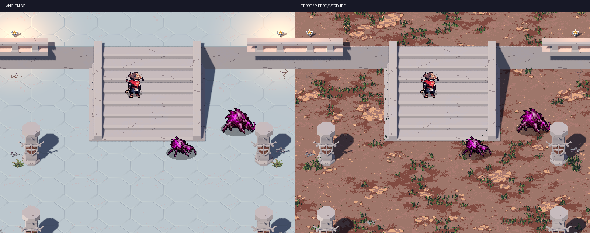
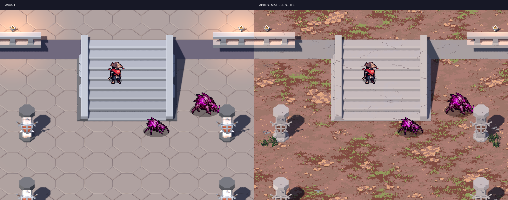

# Cour des Veilleurs — matière seule

Dernière passe sur les volumes : pierre ardoise plus sombre sur murs, escaliers, piliers et fondations,
gris-vert et lichen discret ; suppression des traits artificiels. Les quatre captures de détail sont actualisées.
Comparaison dédiée : [avant/après harmonisation](harmonisation.webp).

Dernière version : sous-bois plus végétal, mousse basse dominante et humus sombre, pierres discrètes.
Les nappes d'herbe restent en 3D. Cette nouvelle demande remplace le choix précédent d'un albedo sans vert.
La retouche ne change que la texture et ses métadonnées, sans changement de relief, collision ou placement.
Import ciblé de la texture dans un projet minimal au même chemin de ressource : conforme ;
captures natives de la Cour sans erreur. Les tests bitmap portent sur palette, raccords, taille et import,
la qualité de la composition végétale est contrôlée sur les captures.

Captures natives Godot 4.3, OpenGL Compatibility, Intel Iris Xe, 1600 × 900.
Caméra orthographique taille 20, décalage `(0, 18, 17)`, lumière de main inchangée.
Chasseur, Skitterling et Husk : sprites réels, mêmes positions et poses dans chaque paire.
Les fichiers WebP sont sans perte, sans agrandissement ni retouche de rendu.

Le propriétaire a demandé le remplacement intégral du sol : les hexagones visibles ont été remplacés par
une surface continue de terre tassée, pierre plate et mousse, sur les 336 emprises de sol, terrasses comprises.
Les escaliers gardent leur géométrie et leur matière de pierre.
Les dernières captures de détail montrent aussi 40 groupes d'herbe en vrais maillages 3D,
avec éclairage et ombres. Après clarification, les anciennes plaques vertes sont également remplacées par des
brins 3D suivant le masque `grass_regions.json` ; la texture de sol ne contient plus de verdure peinte.
Le rapport confirme les mêmes collisions et la même navigation après cet ajout.

[Vue d'ensemble du nouveau sol](ensemble_apres.webp), cadrage d'inspection plus large que le zoom de jeu.

| Cadrage | Original | Matières et détails |
|---|---|---|
| Terrasse | [Avant](terrasse_avant.webp) | [Après](terrasse_apres.webp) |
| Escaliers | [Avant](escaliers_avant.webp) | [Après](escaliers_apres.webp) |
| Abris | [Avant](abris_avant.webp) | [Après](abris_apres.webp) |
| Entrepôts | [Avant](entrepots_avant.webp) | [Après](entrepots_apres.webp) |

[Capture d'une partie à 12 secondes avant ajout de l'herbe 3D](partie_12s.webp),
avec bot immobile/invulnérable, chapitre 1 et graine 241114.
Le lancement produit aussi une capture à 2 secondes, gardée localement pour limiter le poids du lot.

[Rapport de géométrie et collisions](controle_geometrie.json) : conforme, 7 662 triangles, 11 modules hors sol,
551 poses et 532 collisions conservées ; les 885 polygones de navigation restent identiques.
Les 336 emprises et altitudes des surfaces de sol remplacées sont contrôlées ; leurs UV ont une phase commune.
Les 23 entrées du manifeste passent également le validateur Godot.
Contrôle bitmap : 32 couleurs, 16 tuiles périodiques, terrain continu 640 px / 16 m,
23 sprites ancrés, 193 placements reproductibles de 21 variantes. Les fissures superposées sont retirées.
Banc natif, contrôle natif et lint ciblé : conformes. Le lancement de partie à 2/12 secondes précède les nappes 3D.
Le dernier import complet s'achève mais signale des UID de caches locaux obsolètes des autres packs KayKit ;
aucune source de ces packs n'est changée. Le chargement et les captures de la Cour ne signalent pas d'erreur.
Le rapport confirme 3 450 petites touffes suivant les anciennes plaques vertes, en plus des 40 groupes des recoins.

Le rendu pixel de Claude n'est pas inclus dans ces captures ; la lecture combinée reste à vérifier après
rapprochement des branches. La validation artistique et l'essai avec une horde restent au propriétaire.
Le banc indique 492 appels de dessin d'origine et 396 avec les nappes d'herbe 3D, sur les entrepôts ;
ce n'est pas un benchmark de FPS. La fluidité avec une horde reste à essayer.
La version du sol continu avant herbe 3D en indiquait 318.
Le premier essai de matières, avec les hexagones, en indiquait 598. Le terrain continu est désormais un maillage partagé.

Méthode, commandes de reproduction, exceptions UV et propositions d'ambiance :
[MATIERE_DES_CARTES_3D.md](../../art/MATIERE_DES_CARTES_3D.md).
