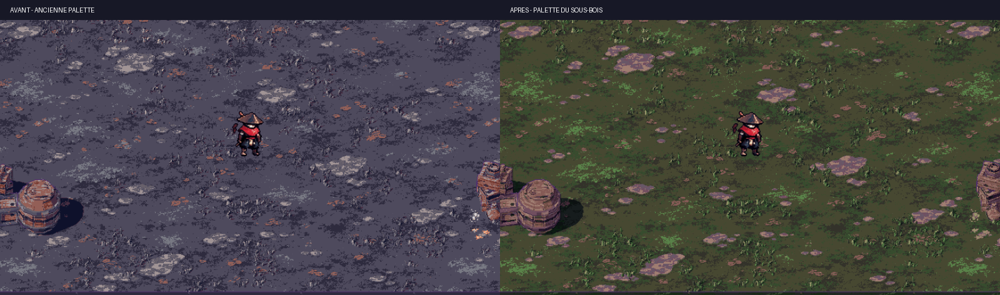

# Palette de la Cour dans le véritable rendu du jeu

Captures natives Godot 4.3 / OpenGL Intel Iris Xe, 1600 × 900, depuis `draft3d/main.tscn`.
Le rendu pixel de la PR #165 est actif sur les deux vues du comparatif. Mêmes graine, caméra et instant.



- [Avant correction](avant.webp) : mousse et terre recolorées en gris-violet.
- [Après correction](apres.webp) : verts du sous-bois conservés, aplats et contours toujours actifs.
- [Escaliers en jeu](escaliers.webp) : caméra fixe, vue réelle avec le rendu pixel actif.

Reproduction (ajuster `--shots` pour chaque version) :

```powershell
godot --path . --resolution 1600x900 res://draft3d/main.tscn -- --chapter=1 --bot --passive --god --seed=241115 --pixel=1 --shots=<dossier> --shot-times=2 --quit-after-shots
```

Pour isoler la cause : ajouter `--pixel-palette=0`, qui conserve le reste du rendu pixel.
Pour comparer au rendu standard : `--pixel=0` ou F4 en partie.
Escaliers : ajouter `--look=0,-9,20` et capturer à quatre secondes pour laisser disparaître le titre.

Validation ciblée : `godot --path . res://tests/run_tests.tscn -- --filter=pixel_render`,
avec un nouveau test empêchant les palettes de la Cour de transformer les verts de mousse en violet/gris.
Les images sont exportées en WebP sans perte, sans retouche du rendu ; le comparatif découpe le même cadre
à la taille réelle des pixels écran. Les shaders, la physique, les objets et les sprites ne changent pas.
